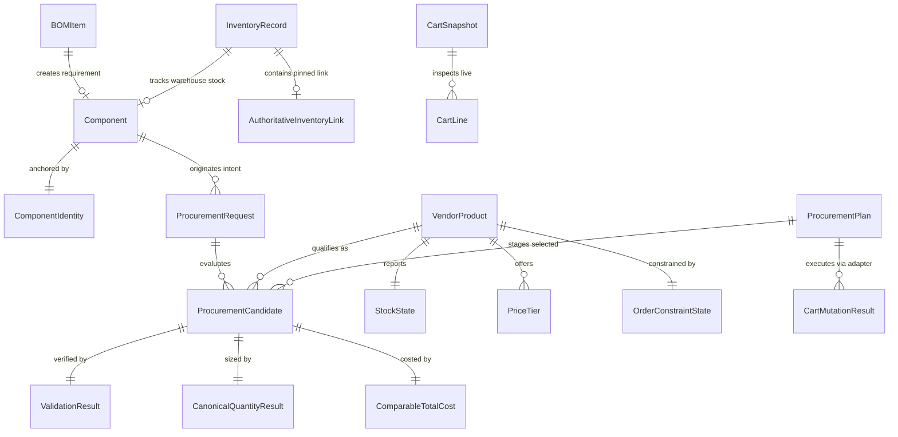

# OMNIX CANONICAL DATA MODEL SPECIFICATION
## Phase D1: Data Model Definition & Preservation Gate

**Document ID**: `SPEC-OMNIX-CDM-001`  
**Revision**: `1.1.0 — DATA MODEL CONSISTENCY CLOSURE`  
**Status**: **PROPOSED — READY FOR USER APPROVAL**  
**Architectural Authority**: `OMNIX_VENDOR_PLUGIN_ARCHITECTURE_SPECIFICATION.md` (Revision 5.4.0 — CONTRACT COMPLETENESS LOCK)  
**Baseline Repository Checkpoint**: `4e3a3ed`  

---

## 0. Objective & Scope

This specification defines the formal, canonical, vendor-agnostic data models for Omnix Core, the Procurement Pipeline, the Inventory Policy Engine, and the Vendor Plugin Contract. It establishes the domain entity boundaries, typing invariants, validation semantics, and state machines required before implementation begins.

### Strategic Directives:
1. **Direct Derivation from Architecture Revision 5.4**: Implements the approved One Core + Standard Contract + Pluggable Vendors architecture.
2. **Strict Tripartite Entity Separation**:
   - **`Component`**: Physical electronic part requirement.
   - **`VendorProduct`**: Commercial listing on a specific vendor's store.
   - **`ProcurementRequest`**: Active purchasing intent under a canonical sourcing strategy.
3. **Behavioral Preservation Gate**: Explicitly catalogs and preserves the ~2000-line working-tree delta from checkpoint `4e3a3ed` as an authoritative behavioral reference.
4. **No Implementation in Phase D1**: Documentation and specification only; zero source code, test, or migration modifications.

---

## 1. Preservation Gate & Forensic Preservation Ledger

### 1.1 Absolute Preservation Invariant
The repository currently contains approximately 2000 lines of working-tree changes across 23 tracked and untracked files relative to checkpoint `4e3a3ed`. These changes represent valuable behavioral evidence developed during prior iterations.

- **`CURRENT WORKING TREE` = `BEHAVIORAL PRESERVATION SOURCE`**
- **`ARCHITECTURE SPECIFICATION` = `STRUCTURAL AUTHORITY`**

Existing working-tree behavior must be understood, preserved, or refactored into the canonical architecture. Destructive operations (`git reset --hard`, `git clean`, `git restore`, file deletions, file moves, renames, and premature mass refactorings) are **strictly prohibited**.

### 1.2 Forensic Preservation Ledger

| File / Component | Diff Stat (Lines) | Classification Category | Description & Target Architectural Disposition |
| :--- | :--- | :--- | :--- |
| `bom_auditor.py` | 40 changed | **B. BEHAVIOR TO REFACTOR** | Brand selection integration and UI event hooks. Refactor to emit canonical `ProcurementRequest` with `ManufacturerRule`. |
| `core/models.py` | 1 changed | **A. BEHAVIOR TO PRESERVE** | `ManufacturerRule` enum integration. Preserve and expand into canonical domain entities. |
| `core/procurement/bridge.py` | 36 changed | **B. BEHAVIOR TO REFACTOR** | Ingestion bridge mapping BOM + Inventory to procurement requests. Refactor to produce canonical `ProcurementRequest`. |
| `core/procurement/orchestrator.py` | 46 changed | **C. BEHAVIOR TO REPLACE** | Sourcing strategy dispatch and staging loops. Replace with vendor-agnostic orchestrator executing 5-tier ranking. |
| `core/procurement/registry.py` | 11 changed | **A. BEHAVIOR TO PRESERVE** | Centralized domain mapping and plugin registry. Preserve and formalize under 11-step lifecycle. |
| `core/procurement/reporting/builder.py` | 262 added | **A. BEHAVIOR TO PRESERVE** | Multi-vendor reporting pipeline and export builder. Preserve all export columns, audit headers, and formatting. |
| `core/procurement/reporting/csv_exporter.py` | 1 changed | **A. BEHAVIOR TO PRESERVE** | Deterministic CSV export formatting. Preserve. |
| `core/procurement/reporting/pdf_exporter.py` | 3 changed | **A. BEHAVIOR TO PRESERVE** | PDF report builder styling and layout. Preserve. |
| `core/procurement/reporting/xlsx_exporter.py` | 1 changed | **A. BEHAVIOR TO PRESERVE** | Multi-tab Excel export styling and column widths. Preserve. |
| `settings.json` | 29 changed | **B. BEHAVIOR TO REFACTOR** | Holds vendor configs and plain credentials. Refactor to separate non-secret settings from secret vault (OD-005). |
| `tests/test_bom_brand_selection.py` | 6 changed | **A. BEHAVIOR TO PRESERVE** | Unit tests for brand rule configuration. Preserve test assertions. |
| `tests/test_dialog_and_edge_cases.py` | 98 added | **A. BEHAVIOR TO PRESERVE** | Edge-case UI modal tests and candidate handling. Preserve. |
| `tests/test_javan_adapter.py` | 20 changed | **A. BEHAVIOR TO PRESERVE** | Javan contract and DOM parsing tests. Preserve. |
| `tests/test_phase9_e2e_procurement.py` | 7 changed | **A. BEHAVIOR TO PRESERVE** | End-to-end procurement pipeline integration tests. Preserve. |
| `tests/test_procurement_bridge.py` | 12 changed | **A. BEHAVIOR TO PRESERVE** | Bridge unit tests. Preserve. |
| `ui/dialogs/__init__.py` | 2 added | **A. BEHAVIOR TO PRESERVE** | Dialog module exports. Preserve. |
| `ui/dialogs/order_preview_dialog.py` | 1148 changed | **B. BEHAVIOR TO REFACTOR** | UI presentation surface, staging tables, progress bars. Refactor to eliminate `if vendor == ...` branching via `adapter.add_to_cart()`. |
| `ui/widgets/bom_audit_widget.py` | 129 changed | **A. BEHAVIOR TO PRESERVE** | Tab 2 audit workflow, brand rule button, and table rendering. Preserve UI layout and callbacks. |
| `ui/dialogs/brand_rule_dialog.py` (Untracked) | New file | **A. BEHAVIOR TO PRESERVE** | Clean UI modal for technician manufacturer rule selection. Preserve as standard UI widget. |
| `vendors/javan/adapter.py` | 473 changed | **B. BEHAVIOR TO REFACTOR** | Javan site scraping and cart staging. Refactor into `adapter.py` facade + `automation.py` engine. |
| `vendors/javan/session.py` | 26 changed | **A. BEHAVIOR TO PRESERVE** | Javan authentication and session cookie recovery. Preserve. |
| `vendors/lion/adapter.py` | 95 changed | **B. BEHAVIOR TO REFACTOR** | Lion site scraping and cart staging. Refactor into `adapter.py` facade + `automation.py` engine. |
| `vendors/lion/session.py` | 26 changed | **A. BEHAVIOR TO PRESERVE** | Lion authentication and session persistence. Preserve. |
| `vendors/roboeq/session.py` | 25 changed | **A. BEHAVIOR TO PRESERVE** | RoboEQ session handling and health check. Preserve. |
| `javan_automator.py` (Untracked) | New file | **D. DUPLICATE / LEGACY** | Standalone untracked Javan automator. Preserve untouched under **DELETE AFTER VERIFICATION** principle. |
| `tests/test_tab2_canonical_procurement.py` (Untracked) | New file | **A. BEHAVIOR TO PRESERVE** | Canonical procurement test suite. Preserve. |

---

## 2. Core Domain Tripartite Entity Separation

Omnix establishes three independent domain entities that must never be conflated:

```
┌────────────────────────────────────────────────────────────────────────┐
│ 1. COMPONENT (Physical Part Requirement)                               │
│    - Identity: ComponentIdentity (MPN, Optional Manufacturer)          │
│    - Validation Attributes: Package, TechnicalParameters               │
│    - ECAD Layout Metadata: Footprint (SOIC-8, DIP8_300, etc.)          │
└───────────────────────────────────┬────────────────────────────────────┘
                                    │ Sourced As
┌───────────────────────────────────▼────────────────────────────────────┐
│ 2. VENDOR PRODUCT (Commercial Listing on Vendor Store)                 │
│    - Commercial Key: Vendor ID ('vendor_lion') + Vendor SKU ('2070')   │
│    - PDP URL: Specific store link                                      │
│    - Vendor Facts: Reported MPN, Reported Brand, Reported Package      │
│    - Commercial State: StockState, OrderConstraints, Native PriceTiers │
└───────────────────────────────────┬────────────────────────────────────┘
                                    │ Evaluated Under
┌───────────────────────────────────▼────────────────────────────────────┐
│ 3. PROCUREMENT REQUEST (Active Purchasing Intent)                      │
│    - Component Reference & Required Quantity (Integer > 0)             │
│    - Sourcing Strategy: EXACT_INVENTORY_LINK vs MULTI_VENDOR_DISCOVERY │
│    - Validation Constraints: ManufacturerRule, PackageValidationPolicy │
│    - Sourcing Context: BOM_REPLENISHMENT, INVENTORY_SHORTAGE, etc.     │
└────────────────────────────────────────────────────────────────────────┘
```

> [!IMPORTANT]
> **Commercial Identifiers Are Never Component Identity**: `vendor_id`, `vendor_sku`, `product_id`, and `PDP URL` are commercial listing artifacts belonging strictly to `VendorProduct`. One physical `Component` may have multiple competing `VendorProduct` listings across different vendors.

---

## 3. Canonical Domain Entities & Type Definitions

### 3.1 ComponentIdentity Model
The foundational matching anchor for electronic parts.

```python
from dataclasses import dataclass
from typing import Optional

@dataclass(frozen=True)
class ComponentIdentity:
    """
    Canonical identification anchor for an electronic component.
    MPN is the primary procurement matching field.
    MPN is NOT assumed to be globally unique across all worldwide manufacturers.
    """
    mpn: str
    manufacturer: Optional[str] = None

    def __post_init__(self):
        if not self.mpn or not self.mpn.strip():
            raise ValueError("ComponentIdentity MPN cannot be empty or whitespace.")
        # Conservative normalization: trim leading/trailing whitespace, collapse internal spaces
        normalized_mpn = " ".join(self.mpn.strip().split())
        object.__setattr__(self, "mpn", normalized_mpn)
        if self.manufacturer is not None:
            normalized_mfr = " ".join(self.manufacturer.strip().split())
            object.__setattr__(self, "manufacturer", normalized_mfr if normalized_mfr else None)
```

#### Conservative Normalization Invariants:
- **Allowed**: Trim whitespace, collapse multiple spaces, case-insensitive comparison policy.
- **Prohibited**: Stripping hyphens (`-`), slashes (`/`), dots (`.`), underscores (`_`), plus signs (`+`), or altering part number suffixes. Any equivalence across distinct strings must be declared via an explicit alias mapping table.

---

### 3.2 Component Model
Represents the physical electronic part requirement.

```python
from dataclasses import dataclass, field
from typing import Dict, Any, Optional

@dataclass(frozen=True)
class Component:
    """
    The physical electronic component requirement.
    Separates ComponentIdentity from Validation Attributes and ECAD Metadata.
    """
    identity: ComponentIdentity
    package: Optional[str] = None                     # Procurement validation attribute
    technical_parameters: Dict[str, Any] = field(default_factory=dict) # Specs (V, uF, %, etc.)
    footprint: Optional[str] = None                   # ECAD layout metadata ONLY
    description: Optional[str] = None
    category: Optional[str] = None
```

#### Field Role Invariants:
1. **`identity.mpn`**: Primary procurement matching field.
2. **`identity.manufacturer`**: Sourcing constraint anchor under `ManufacturerRule`.
3. **`package`**: Physical body envelope (e.g. `'DIP-8'`, `'SOIC-8'`, `'0805'`). Validated during candidate evaluation.
4. **`footprint`**: PCB land pattern (e.g. `'SOIC127P600X175-8N'`, `'DIP8_300'`). Preserved for BOM fidelity and assembly prints; **strictly prohibited from being used as a procurement matching key or substituting for Package**.

---

### 3.3 BOM Item Model
Represents an engineering line item ingested from an Altium Designer BOM.

```python
from dataclasses import dataclass
from typing import Optional
from enum import Enum

class ManufacturerRule(Enum):
    ANY = "ANY"
    EXACT = "EXACT"
    APPROVED_LIST = "APPROVED_LIST"

@dataclass(frozen=True)
class BOMItem:
    """
    Canonical Altium BOM Item.
    Preserves ECAD engineering attributes without distorting source format.
    """
    designator: str                                   # e.g. 'R1, R2, R3' or 'U1'
    quantity: int                                     # Required units per board build
    mpn: str                                          # Manufacturer Part Number
    lib_ref: Optional[str] = None                     # Altium schematic symbol reference
    description: Optional[str] = None                 # Engineering description
    comment: Optional[str] = None                     # Schematic comment field
    footprint: Optional[str] = None                   # ECAD footprint metadata
    package: Optional[str] = None                     # Component physical package
    manufacturer: Optional[str] = None                 # Optional manufacturer string from BOM
    manufacturer_rule: ManufacturerRule = ManufacturerRule.ANY
```

> [!NOTE]
> **Source Format Fidelity**: The source Altium BOM Excel file is not required to have a dedicated `Manufacturer` column. If omitted in the source file, `manufacturer` is `None` and `manufacturer_rule` defaults to `ManufacturerRule.ANY`.

---

### 3.4 Authoritative Inventory Link Model
Represents the pinned sourcing link defined in `Inventory.xlsx`.

```python
from dataclasses import dataclass
from typing import Optional

@dataclass(frozen=True)
class AuthoritativeInventoryLink:
    """
    Sourcing-location metadata pinned in Inventory.xlsx.
    NOT component identity. Requires preflight inspection before Mode A staging.
    """
    url: str
    vendor_id: Optional[str] = None                   # Resolved vendor identifier
    expected_mpn: str = ""                            # Expected MPN at link location
    expected_package: Optional[str] = None            # Expected Package at link location
    expected_manufacturer: Optional[str] = None       # Expected Manufacturer at link location
```

---

### 3.5 Inventory Record Model
Represents operational stock status in the Omnix warehouse/lab and holds policy configuration inputs.

```python
from dataclasses import dataclass
from typing import Optional

@dataclass(frozen=True)
class InventoryRecord:
    """
    Operational inventory state for a component.
    
    Source of Truth & Semantic Boundaries:
    1. component: Authoritative domain owner of MPN, Manufacturer, Package, Footprint, Specs.
       InventoryRecord references Component and does NOT duplicate Package as a competing truth.
    2. current_stock: Operational Fact (actual physical stock). Required field; NO default value.
       Missing current_stock during ingestion is NOT equivalent to zero; ingestion must resolve
       the value or flag the record as incomplete/invalid.
    3. minimum_stock: User-configurable policy threshold. May initialize to 0 as valid default.
       (Note: 0 is an active initialized policy value, NOT UNKNOWN).
    4. target_stock: User-configurable policy threshold. May initialize to 0 as valid default.
       (Note: 0 is an active initialized policy value, NOT UNKNOWN).
    5. authoritative_link: Sourcing-location metadata for Mode A execution.
    """
    record_id: str
    component: Component                              # Authoritative component reference (MPN, Package, etc.)
    current_stock: int                                # Operational fact: Required non-negative integer (NO DEFAULT)
    minimum_stock: int = 0                            # Policy input: Initialized to 0 (valid default, not UNKNOWN)
    target_stock: int = 0                             # Policy input: Initialized to 0 (valid default, not UNKNOWN)
    authoritative_link: Optional[AuthoritativeInventoryLink] = None
    description: Optional[str] = None
    location: Optional[str] = None

    def __post_init__(self):
        if not (isinstance(self.current_stock, int) and not isinstance(self.current_stock, bool) and self.current_stock >= 0):
            raise ValueError(f"current_stock must be a required non-negative integer (no default), got {self.current_stock}")
        if not (isinstance(self.minimum_stock, int) and not isinstance(self.minimum_stock, bool) and self.minimum_stock >= 0):
            raise ValueError(f"minimum_stock must be a non-negative integer, got {self.minimum_stock}")
        if not (isinstance(self.target_stock, int) and not isinstance(self.target_stock, bool) and self.target_stock >= self.minimum_stock):
            raise ValueError(f"target_stock must be integer >= minimum_stock ({self.minimum_stock}), got {self.target_stock}")
```

#### Canonical Invariants & Ingestion Semantics:
- **Operational Fact vs Policy Threshold**: `current_stock` is an observed warehouse fact. If an Excel row lacks a current stock quantity, the ingestion layer must **never** silently assign `current_stock = 0`.
- **Policy Initialization**: Because legacy Excel files do not contain policy columns, the import layer may initialize `minimum_stock = 0` and `target_stock = 0`. These zeros represent valid initialized thresholds, **never** `UNKNOWN`.
- **Threshold Invariant**: Always $\text{target\_stock} \ge \text{minimum\_stock} \ge 0$.
- **Replenishment Demand Formula**:
$$\text{replenishment\_qty} = \begin{cases} 0, & \text{if } \text{current\_stock} \ge \text{minimum\_stock} \implies \text{status} = \mathbf{SATISFIED} \\ \text{target\_stock} - \text{current\_stock}, & \text{if } \text{current\_stock} < \text{minimum\_stock} \implies \text{status} = \mathbf{SHORTAGE} \end{cases}$$

---

### 3.6 Sourcing Strategy & Procurement Request Models

```python
from enum import Enum
from typing import Set, Optional
from dataclasses import dataclass, field

class SourcingStrategy(Enum):
    EXACT_INVENTORY_LINK = "EXACT_INVENTORY_LINK"     # Mode A: Authoritative pinned link only
    MULTI_VENDOR_DISCOVERY = "MULTI_VENDOR_DISCOVERY" # GAP-02: Multi-vendor catalog discovery

class PackageValidationPolicy(Enum):
    REQUIRED = "REQUIRED"                             # Vendor package MUST match; unknown is rejected
    OPTIONAL = "OPTIONAL"                             # Unknown vendor package accepted with warning

@dataclass(frozen=True)
class ProcurementRequest:
    """
    Active purchasing intent created by Core.
    Exactly one sourcing_strategy field governs dispatch.
    """
    request_id: str
    component: Component
    required_quantity: int                            # Strictly positive integer (> 0)
    sourcing_strategy: SourcingStrategy
    manufacturer_rule: ManufacturerRule = ManufacturerRule.ANY
    approved_manufacturers: Set[str] = field(default_factory=set)
    package_policy: PackageValidationPolicy = PackageValidationPolicy.REQUIRED
    authoritative_link: Optional[AuthoritativeInventoryLink] = None
    context: str = "BOM_REPLENISHMENT"                # BOM_REPLENISHMENT, INVENTORY_SHORTAGE, QUICK_ORDER
    origin_reference: Optional[str] = None            # Traceability ID (BOM designator or Inventory ID)

    def __post_init__(self):
        if not (isinstance(self.required_quantity, int) and not isinstance(self.required_quantity, bool) and self.required_quantity > 0):
            raise ValueError(f"required_quantity must be integer > 0, got {self.required_quantity}")
        if self.sourcing_strategy == SourcingStrategy.EXACT_INVENTORY_LINK and self.authoritative_link is None:
            raise ValueError("EXACT_INVENTORY_LINK strategy requires a non-null authoritative_link.")
```

---

### 3.7 Stock, Order Constraint & Pricing Models

```python
from enum import Enum
from typing import Generic, TypeVar, Optional, List
from dataclasses import dataclass
from decimal import Decimal

T = TypeVar("T")

class StockState(Enum):
    IN_STOCK = "IN_STOCK"                             # stock_qty > 0 confirmed
    OUT_OF_STOCK = "OUT_OF_STOCK"                     # stock_qty == 0 or explicitly unavailable
    STOCK_UNKNOWN = "STOCK_UNKNOWN"                   # Live stock count unexposed

class QuantityEligibility(Enum):
    FULL_QTY_AVAILABLE = "FULL_QTY_AVAILABLE"         # stock_qty >= effective_order_qty
    INSUFFICIENT_STOCK = "INSUFFICIENT_STOCK"         # 0 < stock_qty < effective_order_qty
    STOCK_UNAVAILABLE = "STOCK_UNAVAILABLE"           # OUT_OF_STOCK or STOCK_UNKNOWN

@dataclass(frozen=True)
class OrderConstraintState(Generic[T]):
    """
    Explicit known vs unknown order constraint.
    Unknown values NEVER default to 1.
    """
    is_known: bool
    value: Optional[T] = None

    @classmethod
    def known(cls, val: T) -> "OrderConstraintState[T]":
        return cls(is_known=True, value=val)

    @classmethod
    def unknown(cls) -> "OrderConstraintState[T]":
        return cls(is_known=False, value=None)

# Extensible Currency Representation
# Type alias for ISO 4217 standard currency codes (e.g., "IRR", "USD", "EUR", "CNY", "GBP", "JPY", "AED").
# Core remains currency-neutral and extensible without requiring enum code modifications when new vendor markets are introduced.
CurrencyCode = str

@dataclass(frozen=True)
class Price:
    unit_price: Decimal
    currency: CurrencyCode                            # ISO 4217 code (e.g., 'IRR', 'USD', 'EUR', 'CNY')

    def __post_init__(self):
        if not self.currency or not self.currency.strip():
            raise ValueError("CurrencyCode cannot be empty.")
        if self.unit_price < Decimal("0"):
            raise ValueError(f"Price cannot be negative, got {self.unit_price}")
        object.__setattr__(self, "currency", self.currency.strip().upper())

@dataclass(frozen=True)
class PriceTier:
    min_quantity: int                                 # Volume break minimum quantity
    unit_price: Decimal                               # Price per unit in native currency
    currency: CurrencyCode                            # ISO 4217 code (e.g., 'IRR', 'USD', 'EUR', 'CNY')
    max_quantity: Optional[int] = None                # Optional upper bound for tier

    def __post_init__(self):
        if not (isinstance(self.min_quantity, int) and not isinstance(self.min_quantity, bool) and self.min_quantity >= 1):
            raise ValueError(f"min_quantity must be integer >= 1, got {self.min_quantity}")
        if self.unit_price < Decimal("0"):
            raise ValueError(f"unit_price cannot be negative, got {self.unit_price}")
        if not self.currency or not self.currency.strip():
            raise ValueError("CurrencyCode cannot be empty.")
        object.__setattr__(self, "currency", self.currency.strip().upper())
```

---

### 3.8 Canonical Quantity Result Model

```python
@dataclass(frozen=True)
class CanonicalQuantityResult:
    """
    Result of Core quantity calculation.
    Formula:
      if req < MOQ: effective_qty = MOQ
      if req >= MOQ: effective_qty = ceil(req / step) * step
    """
    required_quantity: int
    moq_state: OrderConstraintState[int]
    step_state: OrderConstraintState[int]
    effective_order_qty: Optional[int]
    status: str                                       # VALID, ORDER_CONSTRAINT_UNKNOWN, INVALID_ORDER_CONSTRAINT
    blocking_reason: Optional[str] = None
```

---

### 3.9 Validation Result Model
Canonical tri-state validation record reusable across all domain attributes:

```python
class ValidationState(Enum):
    MATCH = "MATCH"                                   # Compatible with requirement
    MISMATCH = "MISMATCH"                             # Incompatible -> Reject candidate where constrained
    UNKNOWN = "UNKNOWN"                               # Insufficient data -> NOT A MATCH
    NOT_APPLICABLE = "NOT_APPLICABLE"                 # Attribute unconstrained

@dataclass(frozen=True)
class ValidationResult:
    state: ValidationState
    attribute_name: str                               # 'MPN', 'Package', 'Manufacturer', 'TechnicalSpecs'
    expected_value: Optional[str] = None
    observed_value: Optional[str] = None
    reason: str = ""
    evidence: Optional[Dict[str, Any]] = None
```

---

### 3.10 VendorProduct Model
Represents a vendor's commercial sellable product on their website.

```python
@dataclass(frozen=True)
class VendorProduct:
    """
    Commercial store listing.
    Represents what a vendor sells, NOT what the Component fundamentally is.
    """
    vendor_id: str
    vendor_sku: str
    pdp_url: str
    reported_mpn: Optional[str] = None
    reported_manufacturer: Optional[str] = None
    reported_package: Optional[str] = None
    technical_parameters: Dict[str, Any] = field(default_factory=dict)
    stock_state: StockState = StockState.STOCK_UNKNOWN
    stock_quantity: Optional[int] = None
    price_data: Optional[Price] = None
    price_tiers: List[PriceTier] = field(default_factory=list)
    moq_state: OrderConstraintState[int] = field(default_factory=OrderConstraintState.unknown)
    step_state: OrderConstraintState[int] = field(default_factory=OrderConstraintState.unknown)
    can_order: bool = False
    is_inquiry_only: bool = False
    metadata: Dict[str, Any] = field(default_factory=dict)
```

---

### 3.11 Cost Normalization & ComparableTotalCost Models

```python
@dataclass(frozen=True)
class CostNormalizationContext:
    """
    Exchange rate context for multi-currency comparison.
    Core domain remains strictly currency-neutral and extensible across any ISO 4217 CurrencyCode.
    """
    source_currency: CurrencyCode
    target_currency: CurrencyCode
    exchange_rate: Decimal
    timestamp: str
    source_provider: Optional[str] = None

@dataclass(frozen=True)
class ComparableTotalCost:
    """
    Core-comparable total cost for a candidate at effective_order_qty.
    Formula: candidate_total_native = effective_order_qty * applicable_unit_price
    """
    native_total: Price
    normalized_amount: Decimal
    comparison_currency: CurrencyCode
    normalization_context: Optional[CostNormalizationContext] = None
```

---

### 3.12 Procurement Candidate & Procurement Plan Models

```python
class CandidateEligibility(Enum):
    QUALIFIED = "QUALIFIED"
    DISQUALIFIED = "DISQUALIFIED"
    BLOCKED = "BLOCKED"
    PRICE_UNKNOWN = "PRICE_UNKNOWN"

@dataclass(frozen=True)
class ProcurementCandidate:
    """
    Core-evaluated qualification of a VendorProduct for a ProcurementRequest.
    """
    candidate_id: str
    request_id: str
    vendor_product: VendorProduct
    mpn_validation: ValidationResult
    package_validation: ValidationResult
    manufacturer_validation: ValidationResult
    technical_validation: ValidationResult
    stock_state: StockState
    quantity_eligibility: QuantityEligibility
    quantity_result: CanonicalQuantityResult
    applicable_unit_price: Optional[Price] = None
    native_total_cost: Optional[Price] = None
    comparable_total_cost: Optional[ComparableTotalCost] = None
    eligibility_status: CandidateEligibility = CandidateEligibility.DISQUALIFIED
    disqualification_reasons: List[str] = field(default_factory=list)
    warnings: List[str] = field(default_factory=list)

@dataclass(frozen=True)
class ProcurementPlan:
    """
    Deterministic procurement plan generated by Core Orchestrator.
    """
    plan_id: str
    timestamp: str
    sourcing_strategy: SourcingStrategy
    requests: List[ProcurementRequest]
    selected_allocations: Dict[str, ProcurementCandidate] # request_id -> selected candidate
    vendor_allocations: Dict[str, List[ProcurementCandidate]] # vendor_id -> candidate list
    total_comparable_cost: Decimal
    comparison_currency: CurrencyCode
    validation_summary: Dict[str, Any]
    unfulfillable_requests: List[Tuple[str, str]] # request_id, reason
    audit_hash: str
```

---

### 3.13 Cart Models & Delta Synchronization

```python
@dataclass(frozen=True)
class CartLine:
    vendor_sku: str
    product_name: str
    current_quantity: int
    unit_price_native: Optional[Decimal] = None
    total_price_native: Optional[Decimal] = None
    pdp_url: Optional[str] = None
    observed_mpn: Optional[str] = None

@dataclass(frozen=True)
class CartSnapshot:
    vendor_id: str
    cart_url: str
    total_unique_items: int
    total_units: int
    currency: CurrencyCode
    lines: List[CartLine] = field(default_factory=list)
    total_amount_native: Optional[Decimal] = None
    captured_at: str = ""

@dataclass(frozen=True)
class CartMutationResult:
    vendor_id: str
    vendor_sku: str
    initial_cart_qty: int
    target_qty: int
    delta_qty: int                                    # Core formula: target_qty - initial_cart_qty
    actual_staged_qty: int
    success: bool
    error_code: Optional[str] = None
    raw_vendor_message: str = ""
    verification_state: str = "UNVERIFIED"            # VERIFIED, UNVERIFIED, FAILED
```

---

### 3.14 Plugin Manifest Model (`manifest.json`)

```python
@dataclass(frozen=True)
class PluginManifest:
    """
    Plugin metadata and capability contract.
    Contains ZERO procurement business rules or ranking logic.
    """
    plugin_id: str
    vendor_id: str
    display_name: str
    version: str
    omnix_api_version: str
    entry_point: str
    capabilities: List[str]                           # SEARCH, DIRECT_LINK, LIVE_STOCK, TIERED_PRICING, CART_STAGING
    dependencies: List[str]
    domains: List[str]
```

---

### 3.15 Common Error & Safety Taxonomy Model
Supports the 24 standardized safety semantics from Architecture Revision 5.4:

```python
class SafetySeverity(Enum):
    FATAL = "FATAL"                                   # Staging halted immediately
    DISQUALIFY = "DISQUALIFY"                         # Candidate disqualified
    RETRYABLE = "RETRYABLE"                           # Session recovered or retried
    WARNING = "WARNING"                               # Logged diagnostic warning

@dataclass(frozen=True)
class VendorError:
    """
    Standardized Omnix Safety & Error Record.
    """
    semantic_code: str                                # e.g. 'ERR_DEAD_URL_404', 'ERR_INSUFFICIENT_STOCK'
    severity: SafetySeverity
    vendor_id: str
    operation: str                                    # 'inspect_product', 'add_to_cart', 'search_part'
    message: str
    diagnostic_context: Dict[str, Any] = field(default_factory=dict)
    is_recoverable: bool = False
```

---

## 4. Canonical Data Model Relationship Map



---

## 5. Single Source of Truth Table

| Domain Value / Rule | Authoritative Owner | Forbidden Delegations |
| :--- | :--- | :--- |
| **Component Identity Matching** | `ComponentIdentity` & Core Validator | Plugins or UI must never alter MPN strings or declare equivalence without alias map. |
| **Package Definition** | `Component.package` (Single Source of Truth) | `InventoryRecord` or plugins must never define competing package sources of truth. |
| **Inventory Policy State** | `InventoryRecord` & `InventoryPolicyEngine` | Page 1 UI or Excel loader must never compute shortage quantities. |
| **Effective Order Quantity** | Core Quantity Engine | Plugins or UI steppers must never override canonical $\text{MOQ}/\text{Step}$ formula. |
| **Candidate Ranking** | Core Ranking Engine (5-Tier) | UI sort order, network speed, or vendor index must never determine winner. |
| **Price Tier Selection** | Core Pricing Evaluator | Vendor plugin must never choose tier; plugin reports raw tiers, Core matches against effective quantity. |
| **Currency Representation** | `CurrencyCode` (ISO 4217 standard string) | Fixed enum restrictions or plugin-specific hardcoded currency lists are prohibited. |
| **Cart Delta Calculation** | Core Domain ($\Delta = \text{target} - \text{initial}$) | Plugins must never guess delta; plugin executes exact target mutation requested. |
| **Vendor Site Mechanics** | `VendorPlugin` (`automation.py`) | Core or UI must never execute Selenium/DOM selectors directly. |
| **BOM Ingestion** | Ingestion Bridge | Core must not know about Altium Excel sheet formatting or column coordinates. |

---

## 6. Golden Sample Generation Contract

Future golden test fixture files (`OMNIX_SAMPLE_BOM.xlsx` and `OMNIX_SAMPLE_INVENTORY.xlsx`) must strictly derive from the canonical data models defined in this document.

### Golden Sample Rules:
1. **Deterministic & Realistic**: Contains genuine electronic components with verified MPNs, packages, and technical parameters.
2. **Zero Duplicate Inventory Identity Records**: No duplicate records for the same canonical `MPN + Package` (subject to explicit manufacturer constraints).
3. **Fidelity**: BOM sample retains standard Altium columns (`Designator`, `Quantity`, `Part Number`, `Footprint`, `Comment`, `Description`, `Package`) without forcing synthetic non-standard columns.

---

## 7. Data Model Acceptance Gate Checklist (36 Verification Points)

- [x] **DM-01**: `Component`, `VendorProduct`, and `ProcurementRequest` are formally modeled as three distinct entities.
- [x] **DM-02**: `vendor_sku`, `product_id`, and `PDP URL` are commercial listing artifacts and never component identity.
- [x] **DM-03**: `MPN` is the primary procurement matching field and is explicitly not assumed to be globally unique.
- [x] **DM-04**: `ManufacturerRule` semantics (`ANY`, `EXACT`, `APPROVED_LIST`) are formally defined.
- [x] **DM-05**: `Package` is modeled as a procurement validation attribute.
- [x] **DM-06**: `Footprint` is modeled as ECAD layout metadata ONLY and is prohibited from procurement matching.
- [x] **DM-07**: `UNKNOWN != MATCH` is enforced across all validation models.
- [x] **DM-08**: `StockState` (`IN_STOCK`, `OUT_OF_STOCK`, `STOCK_UNKNOWN`) is distinct from `QuantityEligibility`.
- [x] **DM-09**: `MOQ_UNKNOWN` and `STEP_UNKNOWN` are explicitly modeled and never default to `1`.
- [x] **DM-10**: Canonical quantity calculation has exactly one Core owner.
- [x] **DM-11**: Price tier selection is quantity-aware and evaluated against `effective_order_qty`.
- [x] **DM-12**: Pricing model supports multiple currencies via extensible `CurrencyCode` (`IRR`, `USD`, `EUR`, `CNY`, etc.).
- [x] **DM-13**: `ComparableTotalCost` is currency-neutral with an explicit exchange context.
- [x] **DM-14**: Inventory quantities are strictly canonical non-negative integers ($\ge 0$).
- [x] **DM-15**: Inventory replenishment policy has zero silent coercion, float truncation, or fallbacks.
- [x] **DM-16**: Exactly two canonical sourcing strategies exist (`EXACT_INVENTORY_LINK` and `MULTI_VENDOR_DISCOVERY`).
- [x] **DM-17**: Mode A strictly uses authoritative inventory links with zero fallback or substitution.
- [x] **DM-18**: Multi-vendor discovery strictly searches across enabled plugins.
- [x] **DM-19**: GAP-02 maps 100% to `MULTI_VENDOR_DISCOVERY`.
- [x] **DM-20**: GAP-03 remains an open architectural decision (`OD-002`, `OD-003`) and is not silently promoted to Mode A.
- [x] **DM-21**: Core domain owns all procurement business values and decisions.
- [x] **DM-22**: Vendor plugins own vendor facts and site execution mechanics.
- [x] **DM-23**: UI layer owns presentation only and calculates zero canonical business values.
- [x] **DM-24**: Cart idempotency and delta synchronization ($\Delta = \text{target} - \text{initial}$) are modeled explicitly.
- [x] **DM-25**: Plugin manifest data model is strictly separated from procurement business rules.
- [x] **DM-26**: Plugin safety and error evidence maps to a common standardized taxonomy.
- [x] **DM-27**: Raw Excel import/export representations are separated from the canonical domain model.
- [x] **DM-28**: Golden sample generation contract is defined and reproducible.
- [x] **DM-29**: The ~2000-line working-tree delta from checkpoint `4e3a3ed` is preserved in the Preservation Ledger.
- [x] **DM-30**: Legacy automator behavior is preserved under the "DELETE AFTER VERIFICATION" principle.
- [x] **DM-31**: `current_stock` has no default value and cannot silently become zero.
- [x] **DM-32**: `minimum_stock` may initialize to zero as an explicit policy default.
- [x] **DM-33**: `target_stock` may initialize to zero as an explicit policy default.
- [x] **DM-34**: Zero policy default is not the same semantic state as `UNKNOWN`.
- [x] **DM-35**: `Component.package` is the authoritative package value.
- [x] **DM-36**: Currency representation is extensible and not limited to a fixed enum list (`CurrencyCode`).

---

## 8. Global Contradiction Scan & Invariant Verification

A rigorous scan confirms:
1. Zero statements claim `MPN` is globally unique.
2. Zero statements treat `vendor_sku` or `PDP URL` as component identity.
3. Zero statements allow `Footprint` to substitute for `Package` or act as a procurement matching key.
4. Zero statements treat `UNKNOWN` as `MATCH`.
5. Zero statements allow `STOCK_UNKNOWN` to qualify an automatic Mode A staging operation.
6. Zero statements default unknown MOQ or Step to 1.
7. Zero statements default missing price to 0 or 1 (`PRICE_UNKNOWN` is preserved).
8. Zero statements structurally hardcode the Core model to IRR.
9. Zero statements permit UI or plugins to calculate canonical order quantities or candidate rankings.
10. The ~2000-line working-tree delta is 100% preserved.

---

## 9. Stop Condition & Next Steps

**THIS CANONICAL DATA MODEL SPECIFICATION IS PROPOSED AND READY FOR USER APPROVAL.**

### Mandatory Next Step:
**IMPLEMENTATION MUST NOT START UNTIL THE USER REVIEWS AND APPROVES THIS CANONICAL DATA MODEL SPECIFICATION.**
