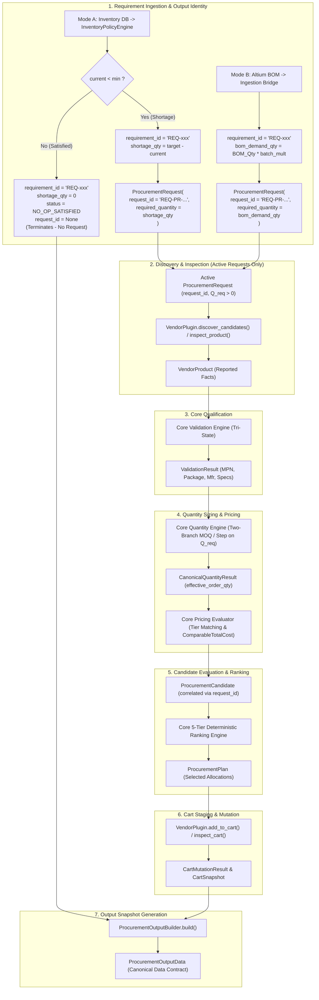
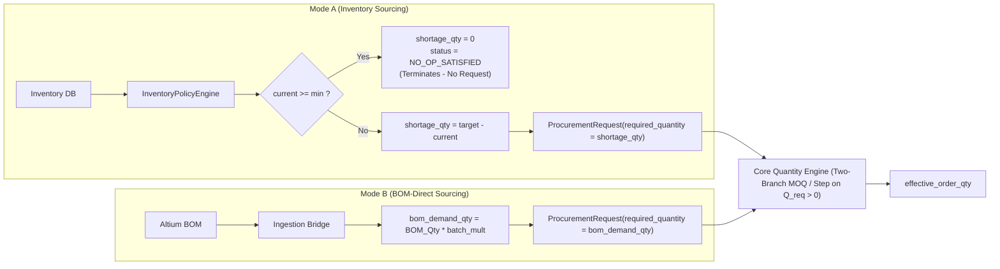

# OMNIX PROCUREMENT OUTPUT SPECIFICATION
## Phase D2: Canonical Fulfillment & Procurement Output Data Contract

**Document ID**: `SPEC-OMNIX-OUT-001`  
**Revision**: `1.11.0 — FINAL REQUIREMENT_ID COLLISION & CHECKSUM CLAIM CLOSURE`  
**Status**: **PROPOSED — READY FOR USER APPROVAL**  
**Governing Specifications**:
- `OMNIX_VENDOR_PLUGIN_ARCHITECTURE_SPECIFICATION.md` (Revision 5.4.0 — CONTRACT COMPLETENESS LOCK)
- `OMNIX_CANONICAL_DATA_MODEL_SPECIFICATION.md` (Revision 1.1.0 — DATA MODEL CONSISTENCY CLOSURE)
**Baseline Checkpoint**: `4e3a3ed` (with ~2000-line working-tree delta preserved as behavioral reference)

---

## 0. Executive Summary & Architectural Invariants

This specification defines the canonical, vendor-agnostic **Final Procurement & Fulfillment Output Contract** (designated in workflows as the "FC / Procurement Output") for the Omnix platform.

### Core Architectural Directives:
1. **Data Contract, Not an Excel Layout**: The procurement output is an authoritative, immutable, format-agnostic **Data Contract** generated by Omnix Core. Excel workbooks (`.xlsx`), CSV files (`.csv`), PDF documents (`.pdf`), and UI views (`OrderPreviewDialog`) are presentation and serialization formats that strictly consume this data contract without containing procurement business logic.
2. **Phase D2 vs Phase D3 Boundary**: Canonical data semantics, typing contracts, validation states, quantity formulas, and audit rules are locked in this document (Phase D2). The **exact visual layout, styling, and column arrangement of the Golden Sample Excel files will be determined in Phase D3** after forensic review of real user Excel samples.
3. **Single Canonical Source of $Q_{\text{req}}$**: The single quantity input to the Core Quantity Engine is strictly $Q_{\text{req}} = \text{ProcurementRequest.required\_quantity}$ (which is strictly an integer $> 0$). Sourcing context determines how this request quantity is populated:
   - In **Mode A (Inventory Replenishment)**: If $\text{current\_stock} < \text{minimum\_stock} \implies \text{ProcurementRequest.required\_quantity} = \text{shortage\_qty}$.
   - In **Mode B (BOM-Direct Turnkey)**: $\text{ProcurementRequest.required\_quantity} = \text{bom\_demand\_qty}$.
4. **NO-OP Pre-Request Termination Invariant (Mode A)**:
   - When $\text{current\_stock} \ge \text{minimum\_stock}$:
     $$\text{shortage\_qty} = 0 \implies \text{status} = \mathbf{NO\_OP\_SATISFIED} \implies \text{is\_no\_op} = \mathbf{True}$$
   - **Terminal Execution**: **No `ProcurementRequest` is created**, no vendor discovery occurs, the Quantity Engine is not invoked ($Q_{\text{req}} = \mathbf{N/A}$, $\text{effective\_order\_qty} = \mathbf{N/A}$), and $\text{selected\_allocation} = \mathbf{None}$. Zero is **never** represented as a synthetic zero-valued `ProcurementRequest.required_quantity`.
5. **Canonical Piecewise Inventory Policy Formula (Mode A)**:
   $$\text{shortage\_qty} = \begin{cases} 0, & \text{if } \text{current\_stock} \ge \text{minimum\_stock} \implies \mathbf{NO\_OP\_SATISFIED} \text{ (Terminates)} \\ \text{target\_stock} - \text{current\_stock}, & \text{if } \text{current\_stock} < \text{minimum\_stock} \implies \text{Creates ProcurementRequest}(Q_{\text{req}} = \text{shortage}) \end{cases}$$
   - **Invariant**: $\text{target\_stock} \ge \text{minimum\_stock} \ge 0$.
   - **Critical Rule**: Target stock alone does **NOT** trigger replenishment. Replenishment is triggered **ONLY** when $\text{current\_stock} < \text{minimum\_stock}$.
6. **Strict Shortage Semantics**: `shortage_qty` is **strictly an inventory-derived concept** calculated by `InventoryPolicyEngine`. It is applicable **only** to inventory-based sourcing (Mode A). In Mode B (BOM-direct), `shortage_qty` is **NOT APPLICABLE** (`None`) and must **never** be populated with `bom_demand_qty`.
7. **Mode A SOURCED Eligibility Gate**: In Mode A, an active requirement becomes `SOURCED` and `selected_allocation` is non-null **ONLY IF** the pinned product passes the full eligibility gate: valid validation, orderability (`can_order`), `stock_state == IN_STOCK`, and strictly `quantity_eligibility == FULL_QTY_AVAILABLE` ($\text{stock\_quantity} \ge \text{effective\_order\_qty}$). If $\text{stock\_quantity} < \text{effective\_order\_qty}$, the line is `BLOCKED` with `ERR_INSUFFICIENT_STOCK` (zero alternate discovery).
8. **Strict Granularity Separation**: Output data explicitly separates batch summary, requirement line item, candidate evaluation offer, selected allocation, and cart execution result.
9. **Requirement Identity vs Procurement Request Correlation**:
   - `requirement_id: str`: Always present on every `RequirementOutputLine`. Generated deterministically from canonical source facts ($\text{SHA-256}$ hash of normalized source context, stable semantic source record identity, normalized MPN, manufacturer constraint encoding, normalized package, and sorted designators). In Mode B, `source_record_identity` is derived from stable semantic BOM facts (item ID / designators), never from volatile file paths or row numbers. `requirement_id` is an output/reporting identity guaranteed unique within an accepted canonical Procurement Output via strict fail-closed collision detection (without random suffixes or UUIDs), without claiming universal global uniqueness across historical projects. It does NOT imply the existence of a `ProcurementRequest`.
   - `request_id: Optional[str] = None`: Optional correlation identifier for an actual `ProcurementRequest`. It exists ONLY when an active `ProcurementRequest` is instantiated ($Q_{\text{req}} > 0$). It is strictly `None` for `NO_OP_SATISFIED` lines (never fabricated).
10. **Behavioral Preservation Gate**: All existing working-tree reporting code (`core/procurement/reporting/`, `ui/dialogs/order_preview_dialog.py`, etc.) is forensically inspected and reconciled into this specification without modifying source files in Phase D2.

---

## 1. Purpose, Scope & Output Separation

### 1.1 What the Final Procurement Output Represents
The Final Procurement Output represents the complete, factual, audit-traceable record of an Omnix procurement operation. It records:
- **What was needed**: Engineering component requirements originating from an Altium BOM or an Inventory shortage.
- **What was discovered**: Every commercial offer discovered across enabled vendor plugins.
- **How offers were evaluated**: Tri-state validation results (MPN, package, manufacturer, technical specifications), stock verification, and two-branch MOQ/step quantization.
- **What was selected**: The winning candidate determined by Core's deterministic 5-tier ranking engine.
- **What was staged**: The exact cart mutation actions executed by vendor automators and the resulting verified cart state.
- **Financial & Operational KPIs**: Native costs, currency conversions, unfulfillable shortages, and actionable engineering warnings.

### 1.2 What the Final Procurement Output Does NOT Represent
- It does **not** represent raw Altium Excel sheet formatting, arbitrary cell coordinates, or ad-hoc column aliases.
- It does **not** perform candidate ranking, price tier selection, currency normalization, or cart delta arithmetic. All calculations belong exclusively to Omnix Core.
- It does **not** hide rejected offers or candidate disqualification reasons; all evidence is preserved for engineering inspection.
- It does **not** hard-lock visual styling, font choices, or column widths into the domain model.

### 1.3 Canonical Data Contract vs Presentation Formats

```
┌─────────────────────────────────────────────────────────────────────────────────┐
│                           OMNIX CORE PIPELINE                                   │
│  - Tri-State Validation  - Quantity Engine  - Pricing Evaluator  - 5-Tier Rank  │
└────────────────────────────────────────┬────────────────────────────────────────┘
                                         │ Produces
                                         ▼
┌─────────────────────────────────────────────────────────────────────────────────┐
│            CANONICAL PROCUREMENT OUTPUT CONTRACT (ProcurementOutputData)        │
│  - BatchRunSummary  - RequirementLines  - CandidateAuditRecords                 │
│  - SelectedAllocations  - CartExecutionRecords  - VendorSummaries               │
└───────┬───────────────────┬───────────────────┬───────────────────┬─────────────┘
        │ Consumed By       │ Consumed By       │ Consumed By       │ Consumed By
        ▼                   ▼                   ▼                   ▼
┌───────────────┐   ┌───────────────┐   ┌───────────────┐   ┌───────────────┐
│   PyQt6 UI    │   │ Excel (XLSX)  │   │   CSV File    │   │   PDF Doc     │
│ OrderPreview  │   │ Reference /   │   │   RFC 4180    │   │  Landscape    │
│    Dialog     │   │ Phase D3      │   │   utf-8-sig   │   │  Persian/RTL  │
└───────────────┘   └───────────────┘   └───────────────┘   └───────────────┘
```

---

## 2. Output Derivation & Pipeline Flow

The final output is deterministically derived from canonical objects through the 7-stage Omnix Procurement Pipeline:



---

## 3. Output Granularity Levels

The canonical output contract strictly distinguishes 5 independent levels of data granularity. They must never be collapsed into a single ambiguous flat table:

```
┌────────────────────────────────────────────────────────────────────────┐
│ LEVEL 1: BATCH / RUN SUMMARY (ProcurementRunSummary)                   │
│ Run ID, Strategy, Currency Context, Status Counters, Aggregated KPIs   │
└───────────────────────────────────┬────────────────────────────────────┘
                                    │ 1 to N
┌───────────────────────────────────▼────────────────────────────────────┐
│ LEVEL 2: REQUIREMENT LINE ITEM (RequirementOutputLine)                 │
│ requirement_id (always present), request_id (optional, active only),   │
│ Component Identity, MPN, Package, BOM Demand, Shortage, Q_req          │
└───────────────────┬───────────────────────────────┬────────────────────┘
                    │ 1 to N (Active Only)          │ 1 to 1 (Active Only)
┌───────────────────▼──────────────┐ ┌──────────────▼────────────────────┐
│ LEVEL 3: CANDIDATE AUDIT RECORD  │ │ LEVEL 4: SELECTED ALLOCATION      │
│ (CandidateAuditRecord)           │ │ (SelectedAllocationRecord)        │
│ request_id, Candidate ID,        │ │ request_id, Winning Vendor,       │
│ Reported Facts, Validation State,│ │ Effective Order Qty, Unit Price,  │
│ Price Tiers, Qualification State │ │ Comparable Cost, Allocation State │
└──────────────────────────────────┘ └──────────────┬────────────────────┘
                                                    │ 1 to 1 (Post-Staging)
┌───────────────────────────────────────────────────▼────────────────────┐
│ LEVEL 5: CART EXECUTION RECORD (CartExecutionRecord)                   │
│ Initial Cart Qty, Target Qty, Delta Qty, Actual Staged Qty,           │
│ Verification State, Raw Vendor Response, Error Taxonomy Record         │
└────────────────────────────────────────────────────────────────────────┘
```

---

## 4. Mandatory Canonical Output Data Contract

### 4.1 Common Type Definitions

```python
from dataclasses import dataclass, field
from decimal import Decimal
from enum import Enum
from typing import Any, Dict, List, Optional, Set, Tuple

# Extensible ISO 4217 Currency Code (e.g. "IRR", "USD", "EUR", "CNY", "GBP", "JPY", "AED")
CurrencyCode = str

class ReportClassification(Enum):
    PRE_ORDER_CONFIRMATION = "PRE_ORDER_CONFIRMATION" # Pre-staging: Planned allocations & estimates
    POST_STAGING_FINAL = "POST_STAGING_FINAL"         # Post-staging: Verified cart actuals & results

class RequirementStatus(Enum):
    SOURCED = "SOURCED"                               # Qualified winner selected & ready
    UNRESOLVED = "UNRESOLVED"                         # No candidate found in vendor discovery
    BLOCKED = "BLOCKED"                               # Blocked by validation, safety, or stock constraint
    NO_OP_SATISFIED = "NO_OP_SATISFIED"               # Warehouse stock satisfies demand; no purchase required

class CandidateQualificationState(Enum):
    QUALIFIED = "QUALIFIED"                           # Meets all constraints; eligible for selection
    DISQUALIFIED = "DISQUALIFIED"                     # Incompatible MPN, package, brand, or specs
    BLOCKED = "BLOCKED"                               # Out of stock, unorderable, or dead link
    PRICE_UNKNOWN = "PRICE_UNKNOWN"                   # Valid part but price unexposed/inquiry-only

class CandidateSelectionState(Enum):
    DISCOVERED = "DISCOVERED"                         # Discovered in vendor catalog
    ELIGIBLE = "ELIGIBLE"                             # Qualified but not lowest cost
    REJECTED = "REJECTED"                             # Disqualified by validation
    SELECTED = "SELECTED"                             # Winner chosen by Core 5-tier ranking
    STAGED = "STAGED"                                 # Successfully added to vendor cart

class CartStagingState(Enum):
    NOT_STAGED = "NOT_STAGED"                         # Staging not executed (Pre-Order report)
    STAGED_VERIFIED = "STAGED_VERIFIED"               # Cart mutation confirmed via live cart inspect
    STAGED_UNVERIFIED = "STAGED_UNVERIFIED"           # Add-to-cart returned success; cart uninspected
    STAGING_FAILED = "STAGING_FAILED"                 # Network, DOM, session, or stock error
    NO_OP = "NO_OP"                                   # Cart already held exact target quantity
```

---

### 4.2 Level 1: Batch / Run Summary Model

```python
@dataclass(frozen=True)
class ProcurementRunSummary:
    """
    Top-level execution metadata and aggregated KPIs for the entire procurement batch.
    All status counters map 1-to-1 to RequirementStatus values.
    """
    run_id: str                                       # Unique run ID (e.g. 'RUN-20260923-034500')
    report_title: str                                 # Human-readable title
    classification: ReportClassification             # PRE_ORDER_CONFIRMATION vs POST_STAGING_FINAL
    created_at_iso: str                               # ISO-8601 creation timestamp
    sourcing_strategy: str                            # EXACT_INVENTORY_LINK vs MULTI_VENDOR_DISCOVERY
    source_file: str                                  # Source BOM or Inventory filename
    batch_multiplier: int                             # Production batch multiplier (>= 1)
    comparison_currency: CurrencyCode                 # ISO code for normalized totals (e.g. 'IRR')
    enabled_vendors: List[str]                        # List of enabled vendor IDs
    
    # Orthogonal 1-to-1 Status Counters (Invariant: total = sourced + unresolved + blocked + no_op)
    total_requirements: int                           # Total requirement lines
    sourced_requirements: int                         # Count of items with status == SOURCED
    unresolved_requirements: int                      # Count of items with status == UNRESOLVED
    blocked_requirements: int                         # Count of items with status == BLOCKED
    no_op_requirements: int                           # Count of items with status == NO_OP_SATISFIED
    
    # Financial & Quality Totals
    total_estimated_comparable_cost: Decimal          # Sum of comparable costs for planned items
    total_actual_comparable_cost: Optional[Decimal]   # Sum of actual staged costs (Post-staging)
    total_warnings_count: int                         # Count of warnings across all lines
    total_errors_count: int                           # Count of blocking errors across all lines
    audit_checksum: str                               # Deterministic SHA-256 hash of output data

    def __post_init__(self):
        expected_total = (
            self.sourced_requirements
            + self.unresolved_requirements
            + self.blocked_requirements
            + self.no_op_requirements
        )
        if self.total_requirements != expected_total:
            raise ValueError(
                f"total_requirements ({self.total_requirements}) must equal sum of status counters "
                f"({expected_total} = {self.sourced_requirements} sourced + {self.unresolved_requirements} unresolved "
                f"+ {self.blocked_requirements} blocked + {self.no_op_requirements} no_op)"
            )
```

---

### 4.3 Level 2: Requirement Line Item Model

```python
@dataclass(frozen=True)
class RequirementOutputLine:
    """
    Canonical representation of an engineering component requirement and its procurement outcome.
    
    Identity and Correlation Semantics:
    1. requirement_id: str (ALWAYS PRESENT)
       - The stable, unique identity of this canonical output requirement line.
       - Generated deterministically via Section 4.11 SHA-256 algorithm over canonical source facts.
       - Exists unconditionally across ALL requirement statuses (SOURCED, UNRESOLVED, BLOCKED, NO_OP_SATISFIED).
       - Identifies the reporting/fulfillment requirement represented by the line item.
       - Does NOT imply that a ProcurementRequest exists.
    2. request_id: Optional[str] = None (ACTIVE REQUESTS ONLY)
       - Optional correlation identifier mapping 1-to-1 to an actual ProcurementRequest.request_id.
       - Present ONLY when an active ProcurementRequest has actually been created (Q_req > 0).
       - Strictly None for NO_OP_SATISFIED requirements (because no ProcurementRequest exists).
       - NEVER fabricated or synthesized for satisfied requirements.
    
    Four Distinct Quantity Fields:
    1. bom_demand_qty: Optional[int]
       - Engineering demand originating from Altium BOM (= BOM Quantity * batch_multiplier).
       - None if pure inventory replenishment without BOM.
    2. shortage_qty: Optional[int]
       - Inventory-derived shortage computed by InventoryPolicyEngine piecewise formula:
         * If current_stock >= minimum_stock -> shortage_qty = 0 (NO_OP_SATISFIED)
         * If current_stock < minimum_stock -> shortage_qty = target_stock - current_stock
       - Applicable ONLY to inventory-based sourcing (Mode A).
       - None (NOT_APPLICABLE) in Mode B (BOM-direct procurement).
       - NO SYNTHETIC DEFAULT (never fabricates 1 or fallback).
    3. required_quantity: Optional[int]
       - Canonical ProcurementRequest.required_quantity (Q_req > 0) entering Core procurement.
       - In Mode A (Active Shortage): required_quantity = shortage_qty.
       - In Mode B (Turnkey Direct): required_quantity = bom_demand_qty.
       - In NO_OP_SATISFIED: None (No ProcurementRequest is created).
    4. effective_order_qty: Optional[int] (in SelectedAllocationRecord)
       - Vendor-constrained commercial order quantity calculated by Core Quantity Engine.
       - None for NO_OP_SATISFIED or unallocated lines.
    """
    line_number: int                                  # 1-based canonical display sequence
    requirement_id: str                               # Output requirement ID (always present across all statuses; deterministic)
    request_id: Optional[str] = None                  # Correlated ProcurementRequest.request_id (None for NO_OP_SATISFIED)
    context: str                                      # 'BOM_REPLENISHMENT', 'INVENTORY_SHORTAGE', 'QUICK_ORDER'
    designators: List[str]                            # ECAD reference designators (e.g. ['R1', 'R2', 'R3'])
    designator_summary: str                           # Compact summary (e.g. 'R1, R2, R3' or 'C1-C10')
    mpn: str                                          # Requested MPN (primary matching field)
    manufacturer: Optional[str]                       # Requested manufacturer (or None if ANY)
    manufacturer_rule: str                            # 'ANY', 'EXACT', 'APPROVED_LIST'
    package: str                                      # Component package (Single Source of Truth)
    footprint: Optional[str]                          # ECAD layout footprint (Reporting metadata only)
    description: str                                  # Component engineering description
    
    # Four Orthogonal Quantity Fields
    required_quantity: Optional[int] = None           # Canonical Q_req > 0 (None if NO_OP_SATISFIED)
    bom_demand_qty: Optional[int] = None              # Raw demand from BOM * multiplier (None if pure replenishment)
    shortage_qty: Optional[int] = None                # Inventory shortage (Mode A only; 0 if satisfied; None in Mode B)
    current_stock_qty: Optional[int] = None           # Operational warehouse stock (Mode A only)
    minimum_stock_qty: Optional[int] = None           # Policy threshold (Mode A only)
    target_stock_qty: Optional[int] = None            # Policy threshold (Mode A only)
    
    # Status & Selection
    status: RequirementStatus = RequirementStatus.UNRESOLVED # SOURCED, UNRESOLVED, BLOCKED, NO_OP_SATISFIED
    is_no_op: bool = False                            # True when status == NO_OP_SATISFIED (shortage_qty == 0)
    candidate_count: int = 0                          # Total offers evaluated (0 if NO_OP_SATISFIED)
    selected_allocation: Optional["SelectedAllocationRecord"] = None # None if NO_OP_SATISFIED or unallocated
    all_candidates: List["CandidateAuditRecord"] = field(default_factory=list)
    warnings: List[str] = field(default_factory=list)
    blocking_reasons: List[str] = field(default_factory=list)
```

---

### 4.4 Level 3: Candidate Audit Record Model

```python
@dataclass(frozen=True)
class CandidateAuditRecord:
    """
    Factual, immutable record of an individual vendor candidate offer and its qualification evidence.
    Correlated to an active ProcurementRequest via request_id.
    (Candidate discovery occurs ONLY for active requests; NO candidate record exists for NO_OP_SATISFIED).
    """
    candidate_id: str                                 # Unique candidate evaluation ID
    request_id: str                                   # Correlated ProcurementRequest.request_id (Active requests only)
    vendor_id: str                                    # Canonical vendor identifier (e.g. 'vendor_lion')
    vendor_display_name: str                          # Formatted display name (e.g. 'Lion Electronic')
    vendor_sku: str                                   # Vendor store SKU / part ID
    pdp_url: str                                      # Direct product page URL
    
    # Vendor-Reported Facts (What the vendor sells)
    reported_mpn: Optional[str]                       # Vendor catalog MPN
    reported_manufacturer: Optional[str]              # Vendor catalog brand/manufacturer
    reported_package: Optional[str]                   # Vendor catalog package
    technical_specs: Dict[str, Any]                   # Raw parsed technical parameters
    
    # Stock & Availability Facts
    stock_state: str                                  # 'IN_STOCK', 'OUT_OF_STOCK', 'STOCK_UNKNOWN'
    reported_stock_qty: Optional[int]                 # Exact stock count (None if STOCK_UNKNOWN)
    can_order: bool                                   # Vendor orderability flag
    is_inquiry_only: bool                             # Call-for-price / RFQ flag
    
    # Order Constraints
    moq_is_known: bool                                # True if MOQ is verified; False if unknown
    moq_value: Optional[int]                          # Minimum order quantity (never defaults to 1)
    step_is_known: bool                               # True if Step is verified; False if unknown
    step_value: Optional[int]                         # Packaging multiple (never defaults to 1)
    
    # Pricing & Currency
    is_price_known: bool                              # False if price unexposed (PRICE_UNKNOWN)
    unit_price_native: Optional[Decimal]              # Unit price in vendor currency at effective qty
    native_currency: CurrencyCode                     # Vendor currency (e.g. 'IRR', 'USD', 'CNY')
    native_total_cost: Optional[Decimal]              # effective_order_qty * unit_price_native
    price_tiers_summary: str                          # Formatted tiers (e.g. '≥1: 10,000 | ≥10: 8,500')
    
    # Cost Normalization
    comparable_total_cost: Optional[Decimal]          # Total cost converted to comparison currency
    comparison_currency: CurrencyCode                 # Target comparison currency (e.g. 'IRR')
    exchange_rate_applied: Optional[Decimal]          # Multiplier applied (1.0 if same currency)
    
    # Validation Results (Tri-State: MATCH, MISMATCH, UNKNOWN, NOT_APPLICABLE)
    mpn_validation_state: str                         # Validation state for MPN
    package_validation_state: str                     # Validation state for Package
    manufacturer_validation_state: str                # Validation state for Manufacturer
    technical_validation_state: str                   # Validation state for Technical Specs
    
    # Decision & Qualification
    qualification_state: CandidateQualificationState  # QUALIFIED, DISQUALIFIED, BLOCKED, PRICE_UNKNOWN
    selection_state: CandidateSelectionState          # DISCOVERED, ELIGIBLE, REJECTED, SELECTED, STAGED
    ranking_tier: Optional[int]                       # 1 to 5 if qualified; None if disqualified
    is_winner: bool                                   # True if chosen as the single best candidate
    disqualification_reasons: List[str]               # Specific rejection reasons
    validation_evidence: Dict[str, Any]               # Detailed matching evidence
```

---

### 4.5 Level 4: Selected Allocation Record Model

```python
@dataclass(frozen=True)
class SelectedAllocationRecord:
    """
    Details of the single chosen winning vendor candidate for an active requirement.
    Correlated to an active ProcurementRequest via request_id.
    Never created for NO_OP_SATISFIED requirements.
    """
    request_id: str                                   # Correlated ProcurementRequest.request_id
    candidate_id: str
    vendor_id: str
    vendor_display_name: str
    vendor_sku: str
    pdp_url: str
    observed_mpn: str
    observed_manufacturer: Optional[str]
    observed_package: Optional[str]
    
    # Canonical Procurement Quantity (Q_req from ProcurementRequest.required_quantity > 0)
    required_quantity: int                            # Canonical requirement Q_req (shortage in Mode A, BOM demand in Mode B)
    effective_order_qty: int                          # Quantized commercial order quantity (Two-Branch MOQ/step compliant)
    moq_applied: int                                  # MOQ constraint applied
    step_applied: int                                 # Step constraint applied
    
    # Pricing
    unit_price_native: Decimal
    native_currency: CurrencyCode
    native_total_cost: Decimal
    comparable_total_cost: Decimal
    comparison_currency: CurrencyCode
    
    # Post-Staging Execution (None if Pre-Order report)
    cart_execution: Optional["CartExecutionRecord"] = None
```

---

### 4.6 Level 5: Cart Execution Record Model

```python
@dataclass(frozen=True)
class CartExecutionRecord:
    """
    Factual execution outcome of adding the selected candidate to the vendor's cart.
    """
    vendor_id: str
    vendor_sku: str
    pdp_url: str
    initial_cart_qty: int                             # Observed cart quantity prior to mutation
    target_order_qty: int                             # Canonical effective order quantity
    delta_qty: int                                    # Core formula: target_order_qty - initial_cart_qty
    actual_staged_qty: int                            # Final quantity observed in vendor cart
    staging_state: CartStagingState                   # STAGED_VERIFIED, STAGING_FAILED, NO_OP, etc.
    is_success: bool                                  # True if actual_staged_qty == target_order_qty
    verification_method: str                          # 'LIVE_CART_INSPECTION', 'API_CONFIRMATION', 'UNVERIFIED'
    error_taxonomy: Optional["VendorErrorOutputRecord"] = None
    raw_vendor_message: str = ""                      # Raw toast / modal / DOM response from site
    staged_at_iso: str = ""                           # Timestamp of staging action
```

---

### 4.7 Multi-Vendor Summary & Financial Aggregation Model

To guarantee **Currency Safety**, financial aggregations must never mix distinct currencies into a single number. `VendorSummaryRecord` records native totals per currency explicitly while providing the unified comparable total in `comparison_currency`:

```python
@dataclass(frozen=True)
class VendorSummaryRecord:
    """
    Aggregated commercial and staging metrics per participating vendor.
    
    Currency Safety Invariants:
    1. subtotals_by_native_currency maps each distinct currency to its exact subtotal.
       (Zero mixed-currency addition).
    2. subtotal_comparable_cost aggregates all allocations normalized into comparison_currency.
    """
    vendor_id: str                                    # Canonical vendor identifier
    vendor_display_name: str                          # Formatted display name
    allocated_line_items: int                         # Count of unique requirements allocated to vendor
    total_order_pieces: int                           # Sum of effective_order_qty for allocated items
    
    # Currency-Safe Native Breakdown
    subtotals_by_native_currency: Dict[CurrencyCode, Decimal] # e.g. {'USD': Decimal('150.00'), 'EUR': Decimal('50.00')}
    
    # Normalized Single-Currency Aggregate
    subtotal_comparable_cost: Decimal                 # Sum converted to comparison_currency
    comparison_currency: CurrencyCode                 # Comparison currency (e.g. 'IRR')
    
    # Post-Staging Actuals
    actual_staged_pieces: int = 0                     # Sum of actual_staged_qty (Post-staging)
    actual_staged_comparable_cost: Decimal = Decimal("0") # Sum in comparison_currency
    staging_status: str = "PENDING"                   # 'PENDING', 'SUCCESS', 'PARTIAL', 'FAILED'
    unresolved_errors: List[str] = field(default_factory=list)
```

---

### 4.8 Standardized Error & Safety Output Model

```python
@dataclass(frozen=True)
class VendorErrorOutputRecord:
    """
    Structured representation of a vendor or automation error conforming to the 24 safety codes.
    """
    semantic_code: str                                # e.g. 'ERR_DEAD_URL_404', 'ERR_INSUFFICIENT_STOCK'
    severity: str                                     # 'FATAL', 'DISQUALIFY', 'RETRYABLE', 'WARNING'
    vendor_id: str                                    # Vendor where error occurred
    operation: str                                    # 'inspect_product', 'add_to_cart', 'search_part'
    message: str                                      # Clean diagnostic message
    is_recoverable: bool                              # True if session recovery was attempted
    diagnostic_context: Dict[str, Any] = field(default_factory=dict)
```

---

### 4.9 Complete Canonical Output Snapshot (`ProcurementOutputData`)

```python
@dataclass(frozen=True)
class ProcurementOutputData:
    """
    Complete, immutable, vendor-agnostic procurement output data contract.
    The single source of data consumed by UI, Excel, CSV, PDF, and API exporters.
    """
    summary: ProcurementRunSummary
    requirement_lines: List[RequirementOutputLine]
    vendor_summaries: List[VendorSummaryRecord]
    unfulfillable_requirements: List[Tuple[str, str]] # (requirement_id, blocking_reason)
    global_warnings: List[str] = field(default_factory=list)
```

---

### 4.10 Canonical Traceability & Correlation Model

The Omnix procurement output guarantees complete, end-to-end audit traceability across all entities while maintaining a strict semantic distinction between the output requirement identity (`requirement_id`) and the domain procurement request identity (`request_id`):

```
Input / Requirement Source (Altium BOM or Inventory Record)
        │
        ▼
requirement_id  (Stable Output-Level Requirement Line Identity — ALWAYS PRESENT)
        │
        ▼
Inventory Policy Engine (Mode A) OR Ingestion Bridge (Mode B)
        │
        ├────────────────────────────────────────────────────────┐
        ▼ (current_stock >= minimum_stock)                       ▼ (current_stock < minimum_stock OR Mode B)
[NO_OP_SATISFIED]                                      [ProcurementRequest Created]
- requirement_id = present                             - requirement_id = present
- request_id = None                                    - request_id = ProcurementRequest.request_id
- shortage_qty = 0                                     - required_quantity = Q_req > 0
- required_quantity = None                                      │
- Q_req = N/A                                                   ▼
- effective_order_qty = None / N/A                     Vendor Candidate Discovery
- candidate_count = 0                                  (CandidateAuditRecord.request_id)
- all_candidates = []                                          │
- selected_allocation = None                                    ▼
- is_no_op = True                                      Selected Allocation
(TERMINATES PRE-REQUEST)                               (SelectedAllocationRecord.request_id)
                                                                │
                                                                ▼
                                                       Cart Execution Record
                                                       (CartExecutionRecord)
```

#### Traceability Invariants:
1. **`requirement_id`**: Always present across all statuses (`SOURCED`, `UNRESOLVED`, `BLOCKED`, `NO_OP_SATISFIED`). It provides a stable identity for every output requirement row, enabling reliable UI selection, Excel row referencing, and deterministic tie-breaking.
2. **`request_id`**: An optional correlation key to a domain `ProcurementRequest`. It is present if and only if an actual `ProcurementRequest` with $Q_{\text{req}} > 0$ was instantiated. For `NO_OP_SATISFIED`, it is strictly `None` and is never fabricated.
3. **Downstream Correlation**: `CandidateAuditRecord.request_id` and `SelectedAllocationRecord.request_id` map directly to `ProcurementRequest.request_id`, guaranteeing that every candidate offer and chosen allocation is traceable to an active purchasing requirement.
4. **No Synthetic Domain Objects**: `requirement_id` is an output/reporting identity, not a new procurement domain entity, preserving the locked Canonical Data Model (Revision 1.1.0).

---

### 4.11 Deterministic Requirement ID Generation Specification (`requirement_id`)

#### 4.11.1 Purpose, Architectural Role & Uniqueness Scope
`requirement_id` provides a stable, reproducible, output-level identifier for each `RequirementOutputLine`. It guarantees deterministic behavior in UI row tracking, spreadsheet export referencing, ordering tie-breakers, and audit checksum calculation without depending on run-time non-determinism (such as random seeds, network latency, vendor execution order, memory addresses, or volatile file naming and row positioning).

`requirement_id` is an output/reporting identity, **not** a new domain entity. It is completely independent from `ProcurementRequest.request_id` (which exists only when an active domain request is instantiated).

#### Uniqueness Scope & Boundary Distinctions:
The specification explicitly defines the three tiers of identity scope:
1. **Tier A — Within-Output Uniqueness**: `requirement_id` is strictly unique across all requirement lines within a given canonical Procurement Output / relevant source context.
2. **Tier B — Cross-Output Semantic Stability**: Re-evaluating the exact same component requirement under identical canonical source semantics deterministically yields the exact same `requirement_id`.
3. **Tier C — Cross-Project / Historical Identity Scope**:
   - `requirement_id` is an output-level and source-context identity, **not** a universal global database primary key across all historical projects.
   - For example, `BOM-LINE:U1` is stable within its specific BOM/source context; evaluating the designator `"U1"` across two completely independent BOMs for distinct projects will generate the same `requirement_id` if all other component attributes match (which is expected for identical component lines across runs).
   - If a stable project/document identity (e.g. `project_id`, `bom_document_guid`) is available in the canonical source model, it MAY participate in the input tuple. If no project identity is available in the source model, the specification does **not** invent or synthesize one and does **not** falsely claim universal historical uniqueness beyond the available source semantics.
   - Volatile filesystem paths and file basenames **MUST NOT** be used as mandatory hash inputs.

#### 4.11.2 Canonical Source Facts & Input Tuple
The input to the deterministic generator is composed strictly from immutable source facts:

```python
canonical_identity_tuple = (
    source_context,              # "MODE_A_INVENTORY" | "MODE_B_BOM" | "QUICK_ORDER"
    source_record_identity,      # Stable semantic identifier (e.g. "INV-REC-0042", "BOM-LINE:U1", "CLIENT-ORDER-REF:101")
    normalized_mpn,              # ComponentIdentity-normalized MPN: re.sub(r'[\s\-_]+', '', mpn).upper()
    manufacturer_constraint_str, # "ANY" | "EXACT:<MFR>" | "APPROVED_LIST:<MFR1,MFR2,...>"
    normalized_package,          # Normalized string from Component.package, or "" if None/empty
    sorted_designators_str,      # Lexicographically sorted designators joined by "," (or "" for inventory)
)
```

#### 4.11.3 Normalization & Mode B Semantic Identity Hierarchy
1. **`source_context`**: Standardized uppercase string (`"MODE_A_INVENTORY"`, `"MODE_B_BOM"`, `"QUICK_ORDER"`).
2. **`source_record_identity`**: Stable semantic identifier derived strictly according to the approved hierarchy:
   - **Mode A (Inventory)**: Canonical Inventory record ID or stable warehouse SKU (`"INV-REC-0042"`, `"INV-REC-0088"`, `"INV-REC-0105"`). Independent of spreadsheet filename or table row position.
   - **Mode B (BOM-Direct Semantic Hierarchy)**:
     * **1. Stable BOM Item ID / Component UID**: If an explicit engineering item identifier / LibRef / Component UID exists, formatted as `f"BOM-ITEM:{normalized_item_id}"`.
     * **2. Designator-Based Semantic Identity**: If reference designators exist, formatted as `f"BOM-LINE:{sorted_designators_str}"` (e.g., `"BOM-LINE:U1"`, `"BOM-LINE:R1,R2"`).
     * **3. Deterministic Row Fallback**: Only if an unlabeled BOM row completely lacks both designators and an item ID does it fall back to `f"ROW-{source_row_index}"`.
     * **Prohibition on Volatile Paths**: Spreadsheet file paths and raw row numbers are **strictly prohibited** from acting as primary semantic identity in `requirement_id`. External presentation / UI provenance metadata (such as source file basenames or raw spreadsheet row indices used for jump-to-row UI actions) are maintained outside the canonical `RequirementOutputLine` dataclass and never participate in the canonical identity tuple, ensuring arbitrary file renaming (e.g. `MainBoard_RevA.xlsx` $\to$ `MainBoard_RevB.xlsx`) or row insertions/reordering never mutate `requirement_id`.
   - **Quick Order**: Unique client order reference (`f"CLIENT-ORDER-REF:{order_ref}"`).
3. **`normalized_mpn`**: Normalized strictly according to the approved `ComponentIdentity` normalization policy:
   $$\text{normalized\_mpn} = \text{re.sub}(r'[\s\-_]+', '', \text{mpn}).\text{upper}()$$
   *(Preserves dots in values like `"0.1uF 50V 0603"` $\to$ `"0.1UF50V0603"`)*.
4. **`manufacturer_constraint_str`**: Formatted according to the active `ManufacturerRule`:
   - If `ManufacturerRule.ANY` or rule is unspecified / `None`: `"ANY"`
   - If `ManufacturerRule.EXACT`: `f"EXACT:{re.sub(r'[\s\-_]+', '', manufacturer).upper()}"`
   - If `ManufacturerRule.APPROVED_LIST`: `f"APPROVED_LIST:{','.join(sorted([re.sub(r'[\s\-_]+', '', m).upper() for m in approved_list if m]))}"`
5. **`normalized_package`**: Uppercase, trimmed package string originating from `Component.package` (the single authoritative source of truth for packaging). If `Component.package` is `None` or empty/whitespace, it normalizes strictly to empty string `""`.
6. **`sorted_designators_str`**: All designators normalized to uppercase, trimmed of whitespace, sorted in ascending lexicographical order, and joined by `","`:
   $$\text{sorted\_designators\_str} = \text{",".join}(\text{sorted}([\text{d.strip().upper()} \text{ for d in designators}]))$$
   *(For Mode A inventory requirements where designators do not exist, this is strictly `""`)*.
7. **Separator & Encoding**: Fields are joined by a pipe delimiter (`|`) into a single canonical UTF-8 string:
   $$\text{canonical\_str} = \text{f"{source\_context}|{source\_record\_identity}|{normalized\_mpn}|{manufacturer\_constraint\_str}|{normalized\_package}|{sorted\_designators\_str}"}$$
   $$\text{canonical\_bytes} = \text{canonical\_str.encode('utf-8')}$$

#### 4.11.4 Hashing Algorithm, Collision Handling & Operational Uniqueness
1. **Cryptographic Hash**: Compute SHA-256 over `canonical_bytes`.
2. **Truncation & Formatting**: Take the first 16 uppercase hexadecimal characters of the SHA-256 digest, prefixed with `"REQ-"`:
   $$\text{digest\_hex} = \text{hashlib.sha256}(\text{canonical\_bytes}).\text{hexdigest}().\text{upper}()$$
   $$\text{requirement\_id} = \text{f"REQ-\{digest\_hex[:16]\}"}$$
   *Example*: `"REQ-AA7FB1D80317C3B0"`

3. **Entropy & Non-Zero Theoretical Collision Probability**:
   - 16 hexadecimal characters provide $16^{16} = 2^{64} \approx 1.84 \times 10^{19}$ discrete states (64 bits of cryptographic entropy).
   - For a massive manufacturing project containing $n = 10^6$ distinct requirement lines, the collision probability $P$ under the Birthday Paradox bound is:
     $$P \approx \frac{n^2}{2 \times 2^{64}} = \frac{10^{12}}{3.68 \times 10^{19}} \approx 2.71 \times 10^{-8}$$
   - While vanishingly small, this non-zero probability requires an explicit operational collision handling policy rather than assuming collisions are mathematically impossible.

4. **Fail-Closed Collision Detection Algorithm**:
   - During the creation of `ProcurementOutputData`, Omnix Core tracks all generated `requirement_id` values in an internal identity registry.
   - If a newly generated `requirement_id` matches an existing entry with distinct canonical source facts (or distinct requirement line semantics), Core **MUST fail closed immediately**.
   - Output generation is halted, and Core raises a blocking deterministic validation error (`ERR_REQUIREMENT_ID_COLLISION`) containing complete diagnostic context:
     * Conflicting line numbers
     * Source contexts (`source_context`)
     * Source record identities (`source_record_identity`)
     * Normalized MPNs (`normalized_mpn`)
     * Manufacturer constraint strings (`manufacturer_constraint_str`)
     * Normalized packages (`normalized_package`)
     * Designators (`sorted_designators_str`)
   - **Strict Prohibitions**: Core is strictly prohibited from:
     * Silently merging the colliding requirement lines.
     * Appending random or sequential suffixes (e.g. `_1`, `_2`, `-DUP`).
     * Falling back to non-deterministic UUID4 generation.
     * Overwriting prior lines or proceeding with ambiguous identities.

5. **Operational Uniqueness Guarantee**:
   - `requirement_id` is guaranteed unique across all requirement lines within an accepted canonical `ProcurementOutputData` contract because collisions are actively detected and rejected fail-closed during output construction.
   - Zero randomness is introduced; the entire pipeline remains pure, idempotent, and deterministic.

#### 4.11.5 Deterministic ID Examples (Mathematically Verified)
- **Example 1: Mode B BOM Line with Exact Manufacturer (`EXACT:STMICROELECTRONICS`)**
  - Source Context: `"MODE_B_BOM"`
  - Source Record: `"BOM-LINE:U1"` (semantic designator identity)
  - MPN: `"STM32F407VGT6"` $\to$ `"STM32F407VGT6"`
  - Manufacturer Constraint: `EXACT` rule with `"STMicroelectronics"` $\to$ `"EXACT:STMICROELECTRONICS"`
  - Package: `"LQFP-100"` $\to$ `"LQFP-100"`
  - Designators: `['u1']` $\to$ `"U1"`
  - Canonical String: `"MODE_B_BOM|BOM-LINE:U1|STM32F407VGT6|EXACT:STMICROELECTRONICS|LQFP-100|U1"`
  - Output `requirement_id`: `"REQ-AA7FB1D80317C3B0"`
  - Domain `request_id`: `"REQ-PR-20260923-0001"` (from `ProcurementRequest`)

- **Example 2: Mode A Inventory Satisfied (`NO_OP_SATISFIED`)**
  - Source Context: `"MODE_A_INVENTORY"`
  - Source Record: `"INV-REC-0042"`
  - MPN: `"0.1uF 50V 0603"` $\to$ `"0.1UF50V0603"`
  - Manufacturer Constraint: `ANY` rule $\to$ `"ANY"`
  - Package: `"0603"` $\to$ `"0603"`
  - Designators: `[]` $\to$ `""`
  - Canonical String: `"MODE_A_INVENTORY|INV-REC-0042|0.1UF50V0603|ANY|0603|"`
  - Output `requirement_id`: `"REQ-6A7BB7C4E4E5EFAF"`
  - Domain `request_id`: `None` (Strictly `None`; no `ProcurementRequest` created; no fake ID fabricated)

- **Example 3: Mode A Inventory Shortage (Active Procurement Request)**
  - Source Context: `"MODE_A_INVENTORY"`
  - Source Record: `"INV-REC-0088"`
  - MPN: `"STM32F407VGT6"` $\to$ `"STM32F407VGT6"`
  - Manufacturer Constraint: `EXACT` rule with `"STMicroelectronics"` $\to$ `"EXACT:STMICROELECTRONICS"`
  - Package: `"LQFP-100"` $\to$ `"LQFP-100"`
  - Designators: `[]` $\to$ `""`
  - Canonical String: `"MODE_A_INVENTORY|INV-REC-0088|STM32F407VGT6|EXACT:STMICROELECTRONICS|LQFP-100|"`
  - Output `requirement_id`: `"REQ-3C995A1BB0AECB53"`
  - Domain `request_id`: `"REQ-PR-20260923-0002"`

- **Example 4: Mode B BOM Line with Approved Manufacturer List (`APPROVED_LIST`)**
  - Source Context: `"MODE_B_BOM"`
  - Source Record: `"BOM-LINE:R1,R2"` (semantic designator cluster identity)
  - MPN: `"RC0603FR-0710KL"` $\to$ `"RC0603FR0710KL"`
  - Manufacturer Constraint: `APPROVED_LIST` with `['Yageo', 'Vishay', 'Panasonic']` $\to$ `"APPROVED_LIST:PANASONIC,VISHAY,YAGEO"`
  - Package: `"0603"` $\to$ `"0603"`
  - Designators: `['r2', 'r1']` $\to$ `"R1,R2"`
  - Canonical String: `"MODE_B_BOM|BOM-LINE:R1,R2|RC0603FR0710KL|APPROVED_LIST:PANASONIC,VISHAY,YAGEO|0603|R1,R2"`
  - Output `requirement_id`: `"REQ-7CFA4AE50FAC077D"`
  - Domain `request_id`: `"REQ-PR-20260923-0005"`

- **Example 5: Mode B BOM Line with Package None / Unspecified**
  - Source Context: `"MODE_B_BOM"`
  - Source Record: `"BOM-LINE:MOD1"`
  - MPN: `"Generic-Module"` $\to$ `"GENERICMODULE"`
  - Manufacturer Constraint: `ANY` rule $\to$ `"ANY"`
  - Package: `None` $\to$ `""`
  - Designators: `['MOD1']` $\to$ `"MOD1"`
  - Canonical String: `"MODE_B_BOM|BOM-LINE:MOD1|GENERICMODULE|ANY||MOD1"`
  - Output `requirement_id`: `"REQ-27935F2C5E5EAE0D"`
  - Domain `request_id`: `"REQ-PR-20260923-0006"`

- **Example 6: Identical Input Verification (Determinism Test)**
  - Re-evaluating the exact same input produces the exact same `requirement_id`:
    $$\text{generate\_requirement\_id}(\dots) \equiv \text{"REQ-AA7FB1D80317C3B0"}$$

---

## 5. Mode A Output Contract (`SourcingStrategy = EXACT_INVENTORY_LINK`)

When executing under **Mode A (Authoritative Inventory Link / Pinned Sourcing)**, the output contract enforces strict visibility, pre-request termination for satisfied stock, and comprehensive eligibility gating:

```
┌─────────────────────────────────────────────────────────────────────────────────┐
│                              MODE A OUTPUT CONTRACT                             │
├─────────────────────────────────────────────────────────────────────────────────┤
│ 1. VISIBLE PINNED LINK:                                                         │
│    - authoritative_link.url MUST be explicitly visible in the output.          │
│    - vendor_id resolved from link domain MUST be displayed.                    │
├─────────────────────────────────────────────────────────────────────────────────┤
│ 2. PRE-REQUEST NO-OP TERMINATION:                                               │
│    - If current_stock >= minimum_stock: shortage_qty = 0, NO_OP_SATISFIED.      │
│    - No ProcurementRequest is created, no discovery, selected_allocation = None.│
├─────────────────────────────────────────────────────────────────────────────────┤
│ 3. PREFLIGHT INSPECTION VISIBILITY (When shortage_qty > 0):                     │
│    - Observed HTTP status (200 OK vs 404/500).                                 │
│    - Vendor SKU and observed MPN extracted from PDP.                           │
│    - Tri-state validation of observed MPN/Package against Component.            │
├─────────────────────────────────────────────────────────────────────────────────┤
│ 4. COMPLETE PROCUREMENT ELIGIBILITY GATE:                                       │
│    - Identity/package/manufacturer validation matches requirement.              │
│    - Orderability passes (can_order == True, is_inquiry_only == False).         │
│    - Stock state is IN_STOCK (STOCK_UNKNOWN or OUT_OF_STOCK halts/blocks).     │
│    - Quantity eligibility is strictly FULL_QTY_AVAILABLE (stock >= effective_qty│
│      REQUIRED for SOURCED status).                                              │
│    - Canonical quantity calculation is valid.                                   │
├─────────────────────────────────────────────────────────────────────────────────┤
│ 5. STRICT ZERO-SUBSTITUTION INVARIANT:                                          │
│    - If pinned link is dead (404), out of stock, inquiry-only, mismatched, or    │
│      has INSUFFICIENT_STOCK:                                                    │
│      -> Line status = BLOCKED                                                   │
│      -> Error code recorded (e.g. ERR_DEAD_URL_404, ERR_INSUFFICIENT_STOCK)     │
│      -> candidate_count = 1 (the pinned offer)                                 │
│      -> ZERO alternate vendor discovery or fallback candidate search.         │
└─────────────────────────────────────────────────────────────────────────────────┘
```

### Mode A Output Field Guarantees:
- `sourcing_strategy`: Strictly `"EXACT_INVENTORY_LINK"`.
- `shortage_qty`: Applicable computed value from `InventoryPolicyEngine` piecewise formula.
- `required_quantity`: Strictly equal to `shortage_qty` when active ($Q_{\text{req}} > 0$); `None` when `status == NO_OP_SATISFIED`.
- `all_candidates`: Contains exactly $1$ candidate record (the inspected pinned link) when active, or $0$ (if `NO_OP_SATISFIED` or link unresolvable).
- `candidate_count`: $1$ or $0$.
- `selected_allocation`: Non-null **ONLY IF** an active requirement ($Q_{\text{req}} > 0$) passes the entire eligibility gate:
  1. Component validation passes (`MATCH`).
  2. Orderability passes (`can_order == True`, `is_inquiry_only == False`).
  3. Price is known and valid (`is_price_known == True`).
  4. `stock_state == StockState.IN_STOCK`.
  5. `quantity_eligibility == QuantityEligibility.FULL_QTY_AVAILABLE` ($\text{stock\_quantity} \ge \text{effective\_order\_qty}$).
  6. Canonical quantity calculation is valid.
- `status`:
  - `SOURCED` if $Q_{\text{req}} > 0$ and the complete eligibility gate passes.
  - `BLOCKED` with explicit reason (`ERR_DEAD_URL_404`, `ERR_INSUFFICIENT_STOCK`, `ERR_PACKAGE_MISMATCH`, etc.) if preflight or quantity eligibility fails.
  - `NO_OP_SATISFIED` if `shortage_qty == 0` ($\text{current\_stock} \ge \text{minimum\_stock}$).

---

## 6. Mode B Output Contract (`SourcingStrategy = MULTI_VENDOR_DISCOVERY`)

When executing under **Mode B (Multi-Vendor Discovery / Turnkey Sourcing)**, the output contract provides comprehensive multi-vendor visibility:

```
┌─────────────────────────────────────────────────────────────────────────────────┐
│                              MODE B OUTPUT CONTRACT                             │
├─────────────────────────────────────────────────────────────────────────────────┤
│ 1. MULTI-VENDOR DISCOVERY AUDIT:                                                │
│    - enabled_vendors lists all participating vendor plugins.                   │
│    - all_candidates contains EVERY discovered offer across all vendors.        │
│    - candidate_count represents total offers discovered for the MPN.           │
├─────────────────────────────────────────────────────────────────────────────────┤
│ 2. SOURCING QUANTITY POPULATION:                                                │
│    - bom_demand_qty contains the engineering BOM requirement * multiplier.     │
│    - shortage_qty is NOT APPLICABLE (None) and never fabricated.               │
│    - required_quantity (Q_req) is strictly equal to bom_demand_qty.             │
├─────────────────────────────────────────────────────────────────────────────────┤
│ 3. DETERMINISTIC 5-TIER RANKING VISIBILITY:                                     │
│    - Winning candidate has is_winner = True and ranking_tier = 1.              │
│    - Non-selected candidates display their exact qualification state:          │
│      * ELIGIBLE (qualified, but higher comparable cost or lower stock)         │
│      * DISQUALIFIED (MPN, package, manufacturer, or spec mismatch)             │
│      * BLOCKED (out of stock, unorderable)                                     │
│      * PRICE_UNKNOWN (inquiry-only / unpriced)                                 │
├─────────────────────────────────────────────────────────────────────────────────┤
│ 4. MULTI-VENDOR ALLOCATION SUMMARY:                                             │
│    - vendor_summaries aggregates line items, pieces, and spend per vendor.     │
│    - Split orders across multiple vendors are clearly partitioned.             │
└─────────────────────────────────────────────────────────────────────────────────┘
```

### Deterministic Candidate Tie-Breaking Order in Output:
All evaluated candidates in `RequirementOutputLine.all_candidates` are deterministically sorted:
1. **Selected Winner**: Always first (`is_winner == True`).
2. **Other Qualified Candidates**: Sorted by Core 5-tier ranking:
   $$\text{Comparable Total Cost (Ascending)} \longrightarrow \text{Stock Qty (Descending)} \longrightarrow \text{MOQ (Ascending)} \longrightarrow \text{vendor\_id (Ascending)} \longrightarrow \text{vendor\_sku (Ascending)}$$
3. **Disqualified / Blocked / Unpriced Candidates**: Sorted alphabetically by $\text{vendor\_id} \to \text{vendor\_sku} \to \text{reported\_mpn}$.

---

## 7. Quantity Transparency Contract & Canonical Quantity Engine

The output contract strictly isolates the origin of required quantities and enforces the canonical two-branch sizing rule. Combining, conflating, or replacing these values with a single ambiguous "Quantity" field is strictly prohibited:

```
┌─────────────────────────────────────────────────────────────────────────────────┐
│                         FOUR CANONICAL QUANTITY CONCEPTS                        │
├─────────────────────────────────────────────────────────────────────────────────┤
│ 1. BOM DEMAND QUANTITY (bom_demand_qty):                                        │
│    - Origin: Altium BOM raw quantity * production batch multiplier.             │
│    - Meaning: The total engineering requirement for assembling the batch.       │
│    - Applicability: Populated in BOM-based workflows; None in pure replenishment│
├─────────────────────────────────────────────────────────────────────────────────┤
│ 2. NET SHORTAGE QUANTITY (shortage_qty):                                        │
│    - Origin: Core Inventory Policy Engine calculation.                          │
│    - Piecewise Rule:                                                            │
│      * if current_stock >= minimum_stock -> shortage_qty = 0 (NO_OP_SATISFIED)  │
│      * if current_stock < minimum_stock  -> shortage_qty = target - current     │
│    - Invariant: target_stock >= minimum_stock >= 0.                             │
│    - Meaning: The net pieces missing from warehouse stock.                      │
│    - Applicability: Strictly Mode A (Inventory-based). In Mode B, it is        │
│      NOT APPLICABLE (None) and must NEVER be populated with bom_demand_qty.     │
│    - Strict Rule: shortage_qty has NO DEFAULT (never fabricates 1 or fallback). │
├─────────────────────────────────────────────────────────────────────────────────┤
│ 3. CANONICAL REQUEST QUANTITY (required_quantity / Q_req):                      │
│    - Origin: ProcurementRequest.required_quantity (strictly integer > 0).       │
│    - Meaning: The exact purchasing demand entering the Core Quantity Engine.    │
│    - Derivation:                                                                │
│      * Mode A (Active Shortage): required_quantity = shortage_qty               │
│      * Mode B (Turnkey Direct): required_quantity = bom_demand_qty              │
│      * NO_OP_SATISFIED: None (No ProcurementRequest is created).                │
├─────────────────────────────────────────────────────────────────────────────────┤
│ 4. EFFECTIVE ORDER QUANTITY (effective_order_qty):                              │
│    - Origin: Core Canonical Quantity Engine.                                    │
│    - Entry Gate: Invoked ONLY when an active ProcurementRequest exists (Q_req>0)│
│    - Meaning: The commercial pieces that must actually be staged in cart.       │
└─────────────────────────────────────────────────────────────────────────────────┘
```

---

### 7.1 Canonical Pipeline Flow for Quantity Ingestion



---

### 7.2 Canonical Two-Branch Effective Order Quantity Formula

The Core Canonical Quantity Engine calculates `effective_order_qty` from the active sourcing requirement $Q_{\text{req}} = \text{ProcurementRequest.required\_quantity} > 0$ under vendor constraints ($\text{MOQ}$, $\text{Step}$) using the exact two-branch rule:

$$\text{effective\_order\_qty} = \begin{cases} \text{MOQ}, & \text{if } Q_{\text{req}} < \text{MOQ} \\ \left\lceil \dfrac{Q_{\text{req}}}{\text{Step}} \right\rceil \times \text{Step}, & \text{if } Q_{\text{req}} \ge \text{MOQ} \end{cases}$$

In Python:
```python
import math

# Invoked ONLY when ProcurementRequest exists with required_qty > 0
if required_qty < moq:
    effective_order_qty = moq
else:
    effective_order_qty = math.ceil(required_qty / step) * step
```

> [!IMPORTANT]
> **CRITICAL INVARIANTS**:
> 1. **NO_OP Pre-Request Termination**: When $\text{current\_stock} \ge \text{minimum\_stock} \implies \text{shortage\_qty} = 0 \implies \mathbf{NO\_OP\_SATISFIED}$. No `ProcurementRequest` is created, and the Quantity Engine is **not** invoked ($Q_{\text{req}} = \mathbf{N/A}$, $\text{effective\_order\_qty} = \mathbf{N/A}$).
> 2. **Replenishment Trigger Invariant**: Target stock alone does **NOT** trigger replenishment. Replenishment occurs if and only if $\text{current\_stock} < \text{minimum\_stock}$.
> 3. **Quantity Sizing Invariant**: When an active request exists and $Q_{\text{req}} < \text{MOQ}$, **NO additional Step / Order-Multiple rounding is applied**.

---

### 7.3 Canonical Quantity Examples

#### Example A — Inventory Satisfied (Mode A):
- $\text{current\_stock} = 15$
- $\text{minimum\_stock} = 10$
- $\text{target\_stock} = 20$
- **Policy Evaluation**: Since $\text{current\_stock} (15) \ge \text{minimum\_stock} (10)$:
  $$\text{shortage\_qty} = 0 \implies \text{status} = \mathbf{NO\_OP\_SATISFIED} \implies \text{is\_no\_op} = \mathbf{True}$$
- **Canonical Output Record State**:
  - `requirement_id = "REQ-6A7BB7C4E4E5EFAF"` (deterministic hash of Mode A record `INV-REC-0042`)
  - `request_id = None` (strictly `None`; never fabricated)
  - `shortage_qty = 0`
  - `required_quantity = None`
  - $Q_{\text{req}} = \mathbf{N/A}$
  - `effective_order_qty = None / N/A`
  - `candidate_count = 0`
  - `all_candidates = []`
  - `selected_allocation = None`
  - `is_no_op = True`
- **Execution Outcome**: No `ProcurementRequest` is created, and no vendor procurement occurs.

#### Example B — Inventory Shortage (Mode A):
- $\text{current\_stock} = 3$
- $\text{minimum\_stock} = 10$
- $\text{target\_stock} = 20$
- **Policy Evaluation**: Since $\text{current\_stock} (3) < \text{minimum\_stock} (10)$:
  $$\text{shortage\_qty} = \text{target\_stock} - \text{current\_stock} = 20 - 3 = 17$$
- **Request Creation**: Active `ProcurementRequest` created with `request_id = "REQ-PR-20260923-0002"` and $Q_{\text{req}} = 17$.
- **Canonical Output Record State**:
  - `requirement_id = "REQ-3C995A1BB0AECB53"` (deterministic hash of Mode A record `INV-REC-0088`)
  - `request_id = "REQ-PR-20260923-0002"` (maps 1-to-1 to domain request)
  - `shortage_qty = 17`
  - `required_quantity = 17` ($Q_{\text{req}} = 17$)
- Vendor constraints: $\text{MOQ} = 50, \text{Step} = 50$.
- Quantity sizing: Since $Q_{\text{req}} (17) < \text{MOQ} (50) \implies \text{effective\_order\_qty} = \mathbf{50}$.
- `selected_allocation` populated with `request_id = "REQ-PR-20260923-0002"`.

#### Example C — IN_STOCK but Insufficient Stock (Mode A):
- Active request: `request_id = "REQ-PR-20260923-0003"`, $Q_{\text{req}} = 100 \implies \text{effective\_order\_qty} = 100$.
- Vendor product facts: $\text{stock\_state} = \mathbf{IN\_STOCK}, \text{stock\_quantity} = 20$.
- **Eligibility Evaluation**:
  - $\text{stock\_quantity} (20) < \text{effective\_order\_qty} (100) \implies \text{quantity\_eligibility} = \mathbf{INSUFFICIENT\_STOCK}$.
  - Requirement status = $\mathbf{BLOCKED}$.
  - `requirement_id = "REQ-590CD64A5E02248A"` (deterministic hash of Mode A record `INV-REC-0105`), `request_id = "REQ-PR-20260923-0003"`.
  - Error recorded: $\mathbf{ERR\_INSUFFICIENT\_STOCK}$.
  - Zero alternate vendor discovery or candidate substitution in Mode A.

#### Example D — Sensor IC Step Invariant (Mode B):
- $\text{BOM Demand} = 3 \implies \text{ProcurementRequest created with } \text{request\_id} = \text{"REQ-PR-20260923-0004"}, Q_{\text{req}} = 3$ ($\text{shortage\_qty} = \mathbf{N/A}$).
- `requirement_id = "REQ-AA7FB1D80317C3B0"` (deterministic hash of Mode B semantic record `BOM-LINE:U1`), `request_id = "REQ-PR-20260923-0004"`.
- Vendor constraints: $\text{MOQ} = 7, \text{Step} = 5$.
- Quantity sizing: Since $Q_{\text{req}} (3) < \text{MOQ} (7) \implies \text{effective\_order\_qty} = \mathbf{7}$ (strictly $\mathbf{7}$, **NOT $10$**).

---

### 7.4 Quantity Comparison Summary Table

| Scenario | Sourcing Context | BOM Demand | Current Stock | Minimum Stock | Target Stock | Shortage Qty | Canonical $Q_{\text{req}}$ | Vendor MOQ | Vendor Step | Effective Order Qty | Notes |
| :--- | :--- | :---: | :---: | :---: | :---: | :---: | :---: | :---: | :---: | :---: | :--- |
| **Ex. A: Inventory Satisfied** | Mode A | — | 15 | 10 | 20 | **0** | **N/A** | 50 | 50 | **N/A** | $\text{curr} \ge \text{min} \implies \text{shortage}=0 \implies \mathbf{NO\_OP}$; no request |
| **Ex. B: Inventory Shortage** | Mode A | — | 3 | 10 | 20 | **17** | **17** | 50 | 50 | **50** | $\text{curr} < \text{min} \implies 20-3=17 < \text{MOQ}$ |
| **Ex. C: Insufficient Stock** | Mode A | — | 0 | 50 | 100 | **100** | **100** | 1 | 1 | **100** | Vendor stock = 20 $\implies \mathbf{BLOCKED}$ |
| **Ex. D: Step Invariant** | Mode B | 3 | — | — | — | **N/A** | **3** | 7 | 5 | **7** | $Q < \text{MOQ} \implies \text{MOQ}=7$ (**NOT 10**) |
| **High-Volume BOM Item** | Mode B | 120 | — | — | — | **N/A** | **120** | 100 | 50 | **150** | $Q \ge \text{MOQ} \implies \text{ceil}(120/50)*50 = 150$ |

---

## 8. Price & Cost Normalization Transparency Contract

### 8.1 Price Fields & Transparency Rules
- **`unit_price_native`**: The per-piece price quoted by the vendor at the volume tier corresponding to `effective_order_qty`.
- **`native_currency`**: The ISO 4217 currency code of the vendor store (e.g. `'IRR'`, `'USD'`, `'CNY'`).
- **`native_total_cost`**: Exactly $\text{effective\_order\_qty} \times \text{unit\_price\_native}$.
- **`comparable_total_cost`**: Total cost converted to the comparison currency using Core's `CostNormalizationContext`.
- **`comparison_currency`**: The standardized comparison currency for the batch (e.g. `'IRR'`).

### 8.2 Strict `PRICE_UNKNOWN` Invariant
- If a vendor does not expose a numeric price (e.g. "Call for Price", "Inquiry Only", or unpriced listing):
  - `is_price_known = False`
  - `unit_price_native = None`
  - `native_total_cost = None`
  - `comparable_total_cost = None`
  - `qualification_state = CandidateQualificationState.PRICE_UNKNOWN`
- **PROHIBITION**: Missing price must **NEVER** be displayed as `0`, `0.00`, `None` coerced to integer, or any synthetic number. In presentation tables, it must render explicitly as `"PRICE UNKNOWN"` or `"INQUIRY ONLY"`.

---

## 9. Reconciled Status & Lifecycle Model

The output contract reconciles legacy status fields into four canonical, orthogonal status dimensions:

```
┌─────────────────────────────────────────────────────────────────────────────────┐
│                           ORTHOGONAL STATUS DIMENSIONS                          │
├─────────────────────────────────────────────────────────────────────────────────┤
│ Dimension 1: Requirement Sourcing Status (RequirementStatus)                    │
│ Values: SOURCED, UNRESOLVED, BLOCKED, NO_OP_SATISFIED                          │
│ Scope: Requirement Line Item level                                             │
├─────────────────────────────────────────────────────────────────────────────────┤
│ Dimension 2: Candidate Qualification State (CandidateQualificationState)        │
│ Values: QUALIFIED, DISQUALIFIED, BLOCKED, PRICE_UNKNOWN                         │
│ Scope: Individual Candidate Offer level                                         │
├─────────────────────────────────────────────────────────────────────────────────┤
│ Dimension 3: Candidate Selection Lifecycle (CandidateSelectionState)           │
│ Values: DISCOVERED, ELIGIBLE, REJECTED, SELECTED, STAGED                        │
│ Scope: Audit Trail / Offer Decision Tracking                                    │
├─────────────────────────────────────────────────────────────────────────────────┤
│ Dimension 4: Cart Staging State (CartStagingState)                              │
│ Values: NOT_STAGED, STAGED_VERIFIED, STAGED_UNVERIFIED, STAGING_FAILED, NO_OP   │
│ Scope: Automation Execution level                                               │
└─────────────────────────────────────────────────────────────────────────────────┘
```

---

## 10. Deterministic Output Ordering Rules

To guarantee 100% reproducible exports, stable checksum calculations, and deterministic regression testing across different operating systems, runtimes, and execution instances, every collection in the procurement output is governed by strict deterministic ordering rules:

### 10.1 Enabled Vendors Ordering (`enabled_vendors`)
The list of participating vendor plugin IDs is strictly sorted in ascending alphabetical order:
$$\text{enabled\_vendors} = \text{sorted}([\text{v.strip().lower()} \text{ for v in enabled\_vendors}])$$
*Example*: `['vendor_javan', 'vendor_lion', 'vendor_roboeq']`

### 10.2 Canonical Requirement Line Item Ordering (`requirement_lines`)
Requirement line items (`requirement_lines`) are ordered strictly according to the canonical 4-tier sort:
1. **`line_number` (Ascending)**: 1-based canonical display sequence preserving original Altium BOM line sequence or inventory record sequence.
2. **`normalized_mpn` (Ascending)**: Lexicographical ascending tie-breaker for identical line numbers.
3. **First Normalized Designator (Ascending)**: First reference designator in alphabetical order (e.g. `'C1'` before `'R1'`), or `""` if no designators.
4. **`requirement_id` (Ascending)**: Final deterministic cryptographic tie-breaker.

$$\text{line\_number (Asc)} \longrightarrow \text{normalized\_mpn (Asc)} \longrightarrow \text{First Designator (Asc)} \longrightarrow \text{requirement\_id (Asc)}$$

> [!IMPORTANT]
> **Canonical Traceability vs Presentation Alternate Views**:
> - Canonical requirement line ordering preserves direct engineering traceability back to the source BOM / Inventory database and is the **sole ordering consumed by the canonical SHA-256 `audit_checksum`**.
> - Sourcing status grouping (`SOURCED` $\to$ `BLOCKED` $\to$ `UNRESOLVED` $\to$ `NO_OP_SATISFIED`) or cost sorting (`comparable_total_cost` ascending) are strictly **presentation-level alternate views** (e.g. in UI dialogs or filtered summary reports) and **MUST NEVER** alter the canonical data contract or checksum serialization sequence.

### 10.3 Candidate Offer Ordering per Line Item (`all_candidates`)
Candidates evaluated within `RequirementOutputLine.all_candidates` are ordered by:
1. **Selected Winner**: Winning candidate always placed first at index 0 (`is_winner == True`).
2. **Qualified Candidates** (`qualification_state == QUALIFIED`): Sorted by Core 5-tier ranking:
   $$\text{comparable\_total\_cost (Asc)} \longrightarrow \text{stock\_quantity (Desc)} \longrightarrow \text{moq (Asc)} \longrightarrow \text{vendor\_id (Asc)} \longrightarrow \text{vendor\_sku (Asc)}$$
3. **Disqualified / Blocked / Unpriced Candidates** (`qualification_state != QUALIFIED`): Sorted by:
   $$\text{qualification\_state (Asc)} \longrightarrow \text{vendor\_id (Asc)} \longrightarrow \text{vendor\_sku (Asc)} \longrightarrow \text{observed\_mpn (Asc)}$$

### 10.4 Vendor Summary Ordering (`vendor_summaries`)
Vendor summary records in `vendor_summaries` are ordered strictly by:
$$\text{vendor\_id (Alphabetical Ascending)}$$

### 10.5 Internal Nested Collections Ordering
- **`subtotals_by_native_currency`**: Dictionary keys sorted lexicographically ascending (`'CNY'`, `'EUR'`, `'IRR'`, `'USD'`).
- **`approved_manufacturers`**: List of strings sorted lexicographically ascending.
- **`designators`**: List of uppercase designators sorted lexicographically ascending (`['C1', 'C2', 'R1', 'U1']`).
- **`disqualification_reasons`**: List of strings sorted lexicographically ascending.
- **`unfulfillable_requirements`**: List of `(requirement_id, blocking_reason)` pairs sorted by `requirement_id` ascending.
- **`global_warnings`**: List of warning strings sorted lexicographically ascending.

---

## 11. Deterministic Canonical SHA-256 Audit Checksum

To guarantee tamper-evident data integrity and reproducible regression validation across environments, `summary.audit_checksum` is computed using a strict **canonical JSON serialization algorithm**:

### 11.1 Checksum Scope & Exhaustive Field Categorization (Approach A)
To guarantee that two independent execution runs over identical procurement and staging facts produce 100% identical checksums, the checksum scope strictly partitions deterministic semantic and execution facts from runtime-variable execution artifacts (such as session UUIDs and timestamps).

#### A. Included Deterministic Semantic & Execution Fields:
1. **Summary Metrics (`ProcurementRunSummary`)**:
   - `sourcing_strategy: str` (`"EXACT_INVENTORY_LINK"` | `"MULTI_VENDOR_DISCOVERY"`)
   - `batch_multiplier: int`
   - `comparison_currency: str` (e.g. `'IRR'`)
   - `total_requirements: int`
   - `sourced_requirements: int`
   - `unresolved_requirements: int`
   - `blocked_requirements: int`
   - `no_op_requirements: int`
   - `total_estimated_comparable_cost: str` (exact Decimal string representation)
   - `total_actual_comparable_cost: Optional[str]` (exact Decimal string representation or `null`)
   - `classification: str` (`"PRE_ORDER_CONFIRMATION"` | `"POST_STAGING_FINAL"`)
   - `enabled_vendors: List[str]` (strictly sorted ascending)
   - `total_warnings_count: int`
   - `total_errors_count: int`
2. **Requirement Lines (`RequirementOutputLine`)**:
   - `requirement_id: str` (deterministic output identity)
   - `line_number: int` (canonical 1-based sequential line index)
   - `context: str` (`"BOM_REPLENISHMENT"`, `"INVENTORY_SHORTAGE"`, `"QUICK_ORDER"`)
   - `mpn: str` (requested MPN)
   - `package: str` (canonical component package)
   - `manufacturer: Optional[str]`
   - `manufacturer_rule: str` (`"ANY"`, `"EXACT"`, `"APPROVED_LIST"`)
   - `description: str`
   - `designators: List[str]` (sorted ascending)
   - `required_quantity: Optional[int]` ($Q_{\text{req}}$ or `null`)
   - `bom_demand_qty: Optional[int]`
   - `shortage_qty: Optional[int]`
   - `current_stock_qty: Optional[int]`
   - `minimum_stock_qty: Optional[int]`
   - `target_stock_qty: Optional[int]`
   - `status: str` (`"SOURCED"`, `"BLOCKED"`, `"UNRESOLVED"`, `"NO_OP_SATISFIED"`)
   - `is_no_op: bool`
   - `candidate_count: int`
   - `warnings: List[str]` (sorted ascending)
   - `blocking_reasons: List[str]` (sorted ascending)
   - `all_candidates: List[Dict]` (ordered by Section 10.3)
   - `selected_allocation: Optional[Dict]`
3. **Candidate Audit Records (`CandidateAuditRecord`)**:
   - `vendor_id: str`
   - `vendor_display_name: str`
   - `vendor_sku: str`
   - `pdp_url: str`
   - `reported_mpn: Optional[str]`
   - `reported_manufacturer: Optional[str]`
   - `reported_package: Optional[str]`
   - `technical_specs: Dict[str, Any]` (sorted keys)
   - `stock_state: str` (`"IN_STOCK"`, `"OUT_OF_STOCK"`, `"STOCK_UNKNOWN"`)
   - `reported_stock_qty: Optional[int]`
   - `can_order: bool`
   - `is_inquiry_only: bool`
   - `moq_is_known: bool`
   - `moq_value: Optional[int]`
   - `step_is_known: bool`
   - `step_value: Optional[int]`
   - `is_price_known: bool`
   - `unit_price_native: Optional[str]` (Decimal string or `null`)
   - `native_currency: str`
   - `native_total_cost: Optional[str]` (Decimal string or `null`)
   - `price_tiers_summary: str`
   - `comparable_total_cost: Optional[str]` (Decimal string or `null`)
   - `comparison_currency: str`
   - `exchange_rate_applied: Optional[str]` (Decimal string or `null`)
   - `mpn_validation_state: str` (`"MATCH"`, `"MISMATCH"`, `"UNKNOWN"`, `"NOT_APPLICABLE"`)
   - `package_validation_state: str`
   - `manufacturer_validation_state: str`
   - `technical_validation_state: str`
   - `qualification_state: str` (`"QUALIFIED"`, `"DISQUALIFIED"`, `"BLOCKED"`, `"PRICE_UNKNOWN"`)
   - `selection_state: str` (`"DISCOVERED"`, `"ELIGIBLE"`, `"REJECTED"`, `"SELECTED"`, `"STAGED"`)
   - `ranking_tier: Optional[int]` (1 to 5 or `null`)
   - `is_winner: bool`
   - `disqualification_reasons: List[str]` (sorted ascending)
   - `validation_evidence: Dict[str, Any]` (sorted keys)
4. **Selected Allocation Records (`SelectedAllocationRecord`)**:
   - `vendor_id: str`
   - `vendor_display_name: str`
   - `vendor_sku: str`
   - `pdp_url: str`
   - `observed_mpn: str`
   - `observed_manufacturer: Optional[str]`
   - `observed_package: Optional[str]`
   - `required_quantity: int`
   - `effective_order_qty: int`
   - `moq_applied: int`
   - `step_applied: int`
   - `unit_price_native: str` (Decimal string)
   - `native_currency: str`
   - `native_total_cost: str` (Decimal string)
   - `comparable_total_cost: str` (Decimal string)
   - `comparison_currency: str`
   - `cart_execution: Optional[Dict]`
5. **Cart Execution Records (`CartExecutionRecord`)**:
   - `vendor_id: str`
   - `vendor_sku: str`
   - `pdp_url: str`
   - `initial_cart_qty: int`
   - `target_order_qty: int`
   - `delta_qty: int`
   - `actual_staged_qty: int`
   - `staging_state: str` (`"STAGED_VERIFIED"`, `"STAGING_FAILED"`, `"NO_OP"`, etc.)
   - `is_success: bool`
   - `verification_method: str`
   - `error_taxonomy: Optional[Dict]` (`semantic_code`, `severity`, `vendor_id`, `operation`, `message`, `is_recoverable`)
6. **Vendor Summaries (`VendorSummaryRecord`)**:
   - `vendor_id: str`
   - `vendor_display_name: str`
   - `allocated_line_items: int` *(derived aggregation: count of unique requirements allocated to vendor)*
   - `total_order_pieces: int` *(derived aggregation: sum of `effective_order_qty` for allocated items)*
   - `subtotals_by_native_currency: Dict[str, str]` (sorted keys, Decimal string values)
   - `subtotal_comparable_cost: str` *(derived aggregation: sum of comparable costs converted to `comparison_currency`, formatted as Decimal string)*
   - `comparison_currency: str`
   - `actual_staged_pieces: int` *(derived post-staging aggregation: sum of `actual_staged_qty`)*
   - `actual_staged_comparable_cost: str` *(derived post-staging aggregation: sum of staged comparable costs, formatted as Decimal string)*
   - `staging_status: str` (`"PENDING"`, `"SUCCESS"`, `"PARTIAL"`, `"FAILED"`)
   - `unresolved_errors: List[str]` (sorted ascending)
7. **Structured Errors & Batch Metadata**:
   - `unfulfillable_requirements: List[Tuple[str, str]]` (sorted by `requirement_id`)
   - `global_warnings: List[str]` (sorted lexicographically)

#### B. Excluded Runtime, Session & Presentation Fields:
1. **Circular Property**: The `summary.audit_checksum` field itself.
2. **Runtime / Session Identifiers**:
   - `summary.run_id` (UUID generated per execution run).
   - `ProcurementRequest.request_id` (runtime request instance token).
   - `CandidateAuditRecord.candidate_id` (runtime candidate offer token).
   - `SelectedAllocationRecord.request_id` and `candidate_id` (runtime correlation tokens).
3. **Mutable Timestamps**:
   - `summary.created_at_iso`
   - `CartExecutionRecord.staged_at_iso`
   - Dynamic error/logging timestamps.
4. **Filesystem & Environment Path Provenance**:
   - `source_file` / `source_file_path` (filesystem path of input file).
   - Filesystem modification timestamps (`mtime`).
   *(Exclusion Guarantee: Executing the pipeline on `C:\projects\MainBoard.xlsx` vs `/tmp/MainBoard.xlsx` or on renamed copies produces 100% identical checksums when canonical component facts, vendor facts, and execution staging facts are identical)*.
5. **Presentation, Styling & UI Artifacts**:
   - Excel formatting: cell colors, font sizes, font weights, borders, gridlines, column widths, and sheet tab styling.
   - External presentation provenance metadata (e.g. source file basenames or raw spreadsheet row indices used for jump-to-row UI actions).
   - Raw UI/DOM messages: `CartExecutionRecord.raw_vendor_message`.
   - UI layout metadata: dialog dimensions, window coordinates, scroll offsets, active tab index, and raw DOM toast messages.

### 11.2 Canonical Serialization Rules
1. **Sorted Keys**: All JSON dictionary keys must be sorted lexicographically (`sort_keys=True`).
2. **Strict Separators**: No extraneous whitespace (`separators=(',', ':')`).
3. **Deterministic Value Formatting**:
   - `Decimal`: Serialized as exact decimal string representations without scientific notation (e.g. `"1250000.00"` or `"12.50"`).
   - `int` / `bool`: Serialized as native JSON integer / boolean literals (`100`, `true`, `false`).
   - `Enum`: Serialized strictly by their string `.value` (e.g. `"SOURCED"`, `"QUALIFIED"`).
   - `None`: Serialized strictly as `null`.
   - Collections: Lists and dictionaries are ordered strictly according to the deterministic sorting rules defined in Section 10.
4. **UTF-8 Encoding**: Serialized to raw UTF-8 bytes.
5. **Algorithm**: Compute SHA-256 hash over the canonical UTF-8 byte stream and format as a 64-character lowercase hex string:
   $$\text{audit\_checksum} = \text{hashlib.sha256}(\text{Canonical\_JSON\_UTF8\_Bytes}).\text{hexdigest}().\text{lower}()$$

### 11.3 Exact Audit Checksum Reproducibility Conditions & Execution Outcome Sensitivity

#### Exact 3-Part Reproducibility Condition:
Checksum reproducibility across independent executions is guaranteed when all three of the following conditions are simultaneously met:
1. **Condition A — Identical Semantic Procurement Facts**:
   - The input component requirements (quantities, MPNs, packages, manufacturer rules, designators) are identical.
   - The discovered vendor candidate offers (prices, currency, stock levels, packaging MOQs/steps, validation states, ranking tiers, and selected allocations) are identical.
2. **Condition B — Identical Execution & Staging Facts**:
   - The post-staging cart execution facts (`actual_staged_qty`, `staging_state`, `verification_method`, `is_success`, `error_taxonomy`) are identical.
   - The vendor summary staging actuals (`actual_staged_pieces`, `actual_staged_comparable_cost`, `staging_status`, `unresolved_errors`) are identical.
3. **Condition C — Identical Canonical Serialization & Ordering**:
   - All collections (`enabled_vendors`, `requirement_lines`, `all_candidates`, `vendor_summaries`, `unfulfillable_requirements`, `global_warnings`) follow the strict deterministic ordering rules defined in Section 10.
   - The canonical JSON serialization rules (sorted keys, strict decimal string formatting, raw UTF-8 encoding) defined in Section 11.2 are applied without deviation.

#### Cryptographic Precision, Execution Sensitivity & Tamper-Evident Integrity:
- **Deterministic Forward Guarantee**: Identical canonical serialized byte payloads **MUST always produce identical `audit_checksum` digests** across all platforms and execution environments.
- **Cryptographic Collision Resistance**: Distinct canonical serialized payloads are expected to produce distinct SHA-256 digests, subject to the standard cryptographic collision-resistance assumption ($2^{-256}$ collision probability).
- **Execution-Sensitive**: Because `audit_checksum` encompasses post-staging execution records (`CartExecutionRecord`) and vendor staging actuals, two runs that evaluate identical component requirements but encounter different vendor automation or cart mutation outcomes (for example, Run 1 succeeds with `STAGED_VERIFIED` while Run 2 fails due to a network session error `ERR_LOGIN_REQUIRED` or cart mutation mismatch `ERR_CART_MUTATION_FAILED`) **will produce distinct checksum digests** (barring an extraordinarily unlikely SHA-256 collision).
- **Quantity & State Sensitivity**: Different `actual_staged_qty` values, `staging_state` transitions, `verification_method` mechanisms, or included execution error taxonomies legitimately produce distinct checksums.
- **Excluded Volatile Artifacts**: Runtime-only identifiers (`run_id`, runtime request/candidate tokens), timestamps (`created_at_iso`, `staged_at_iso`), filesystem path strings, and UI presentation layout settings remain strictly excluded from the serialization byte stream.
- **Tamper-Evident Integrity**: The checksum remains end-to-end tamper-evident, certifying not only what was planned or discovered, but the exact factual state of what was executed and staged into vendor shopping carts.

---

## 12. Error, Safety & Blocking Representation

The output contract integrates the 24 standardized error codes from Architecture Revision 5.4.0. Critical errors are structured as first-class typed records rather than unstructured log text:

| Error Category | Standard Semantic Code | Severity | Output Representation | Pipeline Action |
| :--- | :--- | :--- | :--- | :--- |
| **Link / Inspection** | `ERR_DEAD_URL_404` | `FATAL` (Mode A) / `DISQUALIFY` | Line status = `BLOCKED`, error recorded | Halts Mode A; disqualifies candidate in Mode B |
| **Validation** | `ERR_MPN_MISMATCH` | `DISQUALIFY` | Rejection reason = `"MPN Mismatch"`, `MISMATCH` | Candidate disqualified; logged in audit sheet |
| **Validation** | `ERR_PACKAGE_MISMATCH` | `DISQUALIFY` | Rejection reason = `"Package Mismatch"`, `MISMATCH` | Candidate disqualified; logged in audit sheet |
| **Validation** | `ERR_BRAND_MISMATCH` | `DISQUALIFY` | Rejection reason = `"Manufacturer Mismatch"` | Candidate disqualified; logged in audit sheet |
| **Stock** | `ERR_INSUFFICIENT_STOCK` | `DISQUALIFY` / `FATAL` (Mode A) | Rejection reason = `"Insufficient Stock"`, `INSUFFICIENT_STOCK` | Sizing check fails; blocks Mode A line |
| **Stock** | `ERR_STOCK_UNKNOWN` | `DISQUALIFY` / `WARNING` | Status = `STOCK_UNKNOWN` | Staging blocked; manual confirmation required |
| **Pricing** | `ERR_PRICE_UNAVAILABLE` | `WARNING` | Qualification = `PRICE_UNKNOWN` | Excluded from auto-rank; visible in UI |
| **Session** | `ERR_LOGIN_REQUIRED` | `FATAL` | Staging status = `STAGING_FAILED` | Halts staging; prompts user login |
| **DOM / Mutation** | `ERR_DOM_CHANGED` | `FATAL` | Staging status = `STAGING_FAILED` | Halts staging; logs selector failure |
| **Cart** | `ERR_CART_MUTATION_FAILED`| `FATAL` | Staging status = `STAGING_FAILED` | Records mutation delta mismatch |

---

## 13. Reference / Current Legacy Presentation Behavior

> [!IMPORTANT]
> **Phase Boundary Directives**:
> The sections below describe existing legacy presentation implementations in the codebase as behavioral reference only. They are **NOT** locked as immutable canonical constraints.
> The exact layout, headers, column widths, and styling for the official Golden Sample Excel workbooks will be defined in **Phase D3** based on forensic inspection of the user's real Excel files.

### 13.1 Reference UI Presentation (`OrderPreviewDialog`)
- **View 1 (Sourced Requirements Table)**: Summary grid rendering canonical line item rows (`Line`, `MPN`, `Description`, `Package`, `Required Qty`, `Effective Order Qty`, `Selected Vendor`, `Unit Price`, `Total Price`, `Status`).
- **View 2 (Candidate Comparison Drawer)**: Interactive alternative selection allowing the technician to manually override the winner via radio button.
- **View 3 (Multi-Vendor Staging Execution)**: Progress bars and execution triggers dispatching automation loops.

### 13.2 Reference Excel Workbook Export (`xlsx_exporter.py`)
- **Tab 1 ('Procurement Summary')**: Top KPI cards, Multi-Vendor allocation breakdown table, and Sourced Items table.
- **Tab 2 ('Candidate Audit Trail')**: Comprehensive table of every discovered vendor offer and qualification state.
- **Tab 3 ('Warnings & Incompatibilities')**: Filtered engineering sheet showing items requiring technical review.

### 13.3 Reference CSV Export (`csv_exporter.py`)
- Conforms to RFC 4180 with UTF-8 Byte Order Mark (`utf-8-sig`) for native Microsoft Excel compatibility on Windows.
- Generates a comment metadata header block followed by canonical line item data rows.

### 13.4 Reference PDF Export (`pdf_exporter.py`)
- Landscape A4 vector PDF format with RTL (Right-to-Left) font rendering for Persian vendor descriptions.

---

## 14. Single Source of Truth & Field Ownership Derivation

### 14.1 Field Ownership Table

| Output Field / Concept | Authoritative Owner | Forbidden Delegations |
| :--- | :--- | :--- |
| **MPN & Component Identity** | `ComponentIdentity` & Core Validator | Exporters or UI must never alter MPN strings. |
| **Package Definition** | `Component.package` (Single Source of Truth) | Plugins or exporters must never invent competing packages. |
| **Footprint Reporting** | `Component.footprint` (ECAD Metadata) | Prohibited from acting as package validation substitute. |
| **BOM Demand & Shortage** | Ingestion Bridge & `InventoryPolicyEngine` | UI or exporters must never compute shortage quantities. |
| **Canonical $Q_{\text{req}}$** | `ProcurementRequest.required_quantity` | Exporters or plugins must never invent independent request quantities. |
| **Effective Order Quantity** | Core Canonical Quantity Engine | Plugins or UI steppers must never override canonical two-branch $\text{MOQ}/\text{Step}$ formula. |
| **Validation States** | Core Validation Engine | Vendor plugins must never decide validation outcomes. |
| **Candidate Ranking & Winner**| Core 5-Tier Deterministic Ranking | UI sort order or network timing must never determine winner. |
| **Vendor Facts & PDP URL** | `VendorPlugin` (`adapter.py`) | Core or UI must never guess vendor SKUs or URLs. |
| **Cart Staging Result** | `VendorPlugin` (`automation.py`) | Exporters must never invent cart staging success. |
| **Report Rendering & Styling**| Exporters (`XLSX`, `CSV`, `PDF`, `UI`) | Exporters must contain ZERO business or ranking logic. |

### 14.2 Derivation of Output-Only Representations
To ensure no unvetted business concepts are introduced, every output-only field is explicitly mapped to its canonical derivation:

1. **`batch_multiplier`**: Run parameter passed to Ingestion Bridge to scale raw Altium BOM counts; not a persistent component property.
2. **`RequirementStatus`**: Derived reporting categorization:
   - If $\text{shortage\_qty} = 0 \implies \mathbf{NO\_OP\_SATISFIED}$ (Pre-request termination)
   - Else if qualified winner selected $\implies \mathbf{SOURCED}$
   - Else if pinned link or candidate blocked $\implies \mathbf{BLOCKED}$
   - Else $\implies \mathbf{UNRESOLVED}$
3. **`CandidateSelectionState`**: Derived reporting audit classification reflecting candidate decision lifecycle (`DISCOVERED`, `ELIGIBLE`, `REJECTED`, `SELECTED`, `STAGED`).
4. **`CartStagingState`**: Derived directly from `CartMutationResult.verification_state` and success flag.
5. **`ReportClassification`**: Sourcing execution stage flag (`PRE_ORDER_CONFIRMATION` vs `POST_STAGING_FINAL`).
6. **`VendorSummaryRecord`**: Pure functional aggregation over `SelectedAllocationRecord` and `CartExecutionRecord` collections.
7. **`context`**: Sourcing origin metadata copied directly from `ProcurementRequest.context`.
8. **`requirement_id`**: Output-level stable requirement identifier generated deterministically during output creation for every requirement line item. It is strictly an output/reporting identity and not a new procurement domain object.

---

## 15. Legacy Output Reconciliation & Forensic Audit

A forensic audit of the existing reporting codebase (`core/procurement/reporting/` and `ui/dialogs/order_preview_dialog.py`) reconciles legacy implementations with this canonical contract:

### 15.1 Behaviors Preserved & Formalized
1. **Multi-Tab Excel Export Structure**: The 3-tab workbook layout (`Procurement Summary`, `Candidate Audit Trail`, `Warnings & Incompatibilities`) in [`xlsx_exporter.py`](file:///d:/management-elec/autom/atom/core/procurement/reporting/xlsx_exporter.py) is preserved as reference behavior.
2. **RFC 4180 CSV with UTF-8 BOM**: The `utf-8-sig` encoding and canonical header sequence in [`csv_exporter.py`](file:///d:/management-elec/autom/atom/core/procurement/reporting/csv_exporter.py) are preserved.
3. **Persian / RTL PDF Generation**: The landscape A4 formatting and RTL support in [`pdf_exporter.py`](file:///d:/management-elec/autom/atom/core/procurement/reporting/pdf_exporter.py) are preserved.
4. **Candidate Lifecycle Tracking**: Candidate states in [`models.py`](file:///d:/management-elec/autom/atom/core/procurement/reporting/models.py) are formalized into `CandidateSelectionState`.

### 15.2 Legacy Contradictions Reconciled
1. **Hardcoded IRR Currency Assumption**: Reconciled to use `CurrencyCode` (`str`) and `Decimal` amounts with currency-safe multi-currency aggregations.
2. **Footprint vs Package Ambiguity**: Reconciled to enforce `Component.package` as the sole package authority, treating `footprint` as ECAD metadata only.
3. **Cart Delta Guessing**: Reconciled to enforce Core's exact delta formula: $\Delta = \text{target\_order\_qty} - \text{initial\_cart\_qty}$.
4. **Conflation of Shortage with BOM Demand**: Reconciled to strictly isolate `shortage_qty` as an inventory-only concept (Mode A), making it `None` (`NOT_APPLICABLE`) in Mode B.
5. **Universal Subtraction Bug**: Corrected generic $\text{target} - \text{current}$ formulas to the approved piecewise inventory policy where replenishment is triggered **only** when $\text{current\_stock} < \text{minimum\_stock}$.
6. **Zero-Valued Request Elimination**: Fixed legacy assumptions where satisfied stock generated zero-valued requests; `NO_OP_SATISFIED` now terminates prior to `ProcurementRequest` creation.

---

## 16. Golden Sample Generation Contract (Phase D3 Readiness)

This specification provides the exact semantic data contract required to generate the Golden Sample files in Phase D3:
1. **`OMNIX_SAMPLE_BOM.xlsx`**: Standard Altium BOM input file with realistic parts, MPNs, packages, footprints, descriptions, and quantities.
2. **`OMNIX_SAMPLE_INVENTORY.xlsx`**: Production inventory database file with real part records, `current_stock`, `minimum_stock`, `target_stock`, and authoritative Mode A links.
3. **`OMNIX_SAMPLE_PROCUREMENT_OUTPUT.xlsx`**: The reference golden output workbook implementing the data contract specified in this document.

---

## 17. Data Model Acceptance Gate Checklist (51 Verification Points)

- [x] **D2-01**: Output purpose is unambiguous (a vendor-agnostic Data Contract, not an Excel layout).
- [x] **D2-02**: Canonical output data contract is strictly separated from presentation/export formats.
- [x] **D2-03**: Output derives only from approved canonical domain concepts from Architecture 5.4 and Data Model 1.1.
- [x] **D2-04**: Batch summary, requirement line, candidate offer, selected allocation, and cart execution granularities are defined.
- [x] **D2-05**: Mode A output contract is fully defined with visible pinned links and strict no-substitution invariant.
- [x] **D2-06**: Mode B output contract is fully defined with full multi-vendor candidate discovery and deterministic ranking.
- [x] **D2-07**: BOM demand, net shortage, and effective order quantity are strictly separated and defined.
- [x] **D2-08**: Vendor MOQ and packaging Step constraints are explicitly visible.
- [x] **D2-09**: Stock state (`IN_STOCK`, `OUT_OF_STOCK`, `STOCK_UNKNOWN`) and quantity eligibility are separated.
- [x] **D2-10**: Price and currency semantics use `CurrencyCode` and `Decimal` without hardcoded assumptions.
- [x] **D2-11**: `PRICE_UNKNOWN` is explicit and never represented as zero or fake numeric amounts.
- [x] **D2-12**: `ComparableTotalCost` follows the approved architecture with exchange rate context.
- [x] **D2-13**: Validation states use canonical tri-state model (`MATCH`, `MISMATCH`, `UNKNOWN`, `NOT_APPLICABLE`).
- [x] **D2-14**: Manufacturer rules (`ANY`, `EXACT`, `APPROVED_LIST`) remain Core-owned.
- [x] **D2-15**: Package remains `Component`-owned and the single authoritative source of truth.
- [x] **D2-16**: Footprint is modeled as ECAD metadata only and prohibited from package fallback.
- [x] **D2-17**: Candidate selection and 5-tier ranking remain Core-owned.
- [x] **D2-18**: Vendor site DOM mechanics remain plugin-owned (`automation.py`).
- [x] **D2-19**: Cart execution state is represented separately (`CartExecutionRecord`).
- [x] **D2-20**: Error and blocking information is traceable using the 24 standardized safety codes.
- [x] **D2-21**: Output ordering across requirements, candidates, and vendor summaries is 100% deterministic.
- [x] **D2-22**: End-to-end audit trail and SHA-256 checksum are preserved.
- [x] **D2-23**: Exporters contain zero procurement business logic or ranking calculations.
- [x] **D2-24**: No vendor-specific `if vendor == ...` branching is introduced in Core output logic.
- [x] **D2-25**: Legacy reporting behavior in `core/procurement/reporting/` has been forensically inspected and reconciled.
- [x] **D2-26**: Zero contradictions with Architecture Specification Revision 5.4.0.
- [x] **D2-27**: Zero contradictions with Canonical Data Model Specification Revision 1.1.0.
- [x] **D2-28**: Specification is complete and sufficient to design Golden Sample Excel files in Phase D3.
- [x] **D2-29**: No source code, tests, or files outside this specification were modified.
- [x] **D2-30**: Existing ~2000-line working-tree delta remains 100% untouched.
- [x] **D2-31**: Requirement status counters (`sourced`, `unresolved`, `blocked`, `no_op`) map 1-to-1 to `RequirementStatus` and sum to `total_requirements`.
- [x] **D2-32**: Vendor summary native financial totals are currency-safe (subtotals per currency) without mixed-currency addition.
- [x] **D2-33**: Canonical SHA-256 audit checksum is computed from a format-agnostic, deterministic JSON serialization with strict key and collection sorting.
- [x] **D2-34**: Presentation formats (XLSX, CSV, PDF, UI) are marked as reference behaviors, with exact Golden Sample layout deferred to Phase D3.
- [x] **D2-35**: Effective Order Quantity follows the two-branch canonical MOQ/Step rule ($\text{if } Q_{\text{req}} < \text{MOQ} \implies \text{MOQ}; \text{else } \text{ceil}(Q_{\text{req}} / \text{Step}) \times \text{Step}$) and never applies Step rounding to MOQ when $Q_{\text{req}} < \text{MOQ}$ (e.g. $Q_{\text{req}}=3, \text{MOQ}=7, \text{Step}=5 \implies 7$, not 10).
- [x] **D2-36**: `shortage_qty` is strictly an inventory-derived concept, Mode B does not populate `shortage_qty` (marked `NOT_APPLICABLE`), and `ProcurementRequest.required_quantity` is the single canonical $Q_{\text{req}}$ source for the quantity engine.
- [x] **D2-37**: Mode-A shortage follows the InventoryPolicyEngine minimum-stock trigger exactly:
  $\text{current\_stock} \ge \text{minimum\_stock} \implies \text{shortage\_qty} = 0$;
  $\text{current\_stock} < \text{minimum\_stock} \implies \text{shortage\_qty} = \text{target\_stock} - \text{current\_stock}$.
- [x] **D2-38**: Mode-A SOURCED status requires `FULL_QTY_AVAILABLE`, not merely `IN_STOCK`; insufficient stock produces `BLOCKED` / `ERR_INSUFFICIENT_STOCK`.
- [x] **D2-39**: `NO_OP_SATISFIED` terminates before `ProcurementRequest` creation and Quantity Engine execution; zero shortage is never represented as a zero-valued `ProcurementRequest.required_quantity` or `effective_order_qty`.
- [x] **D2-40**: `RequirementOutputLine` has an always-present output-level `requirement_id`, while `request_id` is optional and exists only when a real `ProcurementRequest` is created; `NO_OP_SATISFIED` lines never fabricate `request_id`.
- [x] **D2-41**: `requirement_id` generation is deterministic, collision-safe by the specified construction, independent of vendor/network/UI execution order, valid for NO_OP and active requirements, and free of random UUID generation.
- [x] **D2-42**: `requirement_id` canonical input encodes manufacturer constraint semantics (`ANY`, `EXACT:<mfr>`, `APPROVED_LIST:<sorted_mfrs>`) deterministically.
- [x] **D2-43**: `requirement_id` generation handles optional package normalization (`""` when `Component.package` is `None`) and MPN normalization cleanly.
- [x] **D2-44**: All `requirement_id` examples across Sections 4.11 and 7.3 are mathematically verified SHA-256 digests matching the exact canonical formula.
- [x] **D2-45**: `audit_checksum` excludes runtime-variable identifiers, timestamps, filesystem paths, and presentation artifacts; checksum reproducibility is guaranteed only when all included semantic procurement facts, included execution/staging facts, canonical collection ordering, and canonical JSON serialization are identical.
- [x] **D2-46**: Mode B source identity is semantically stable (derived from designators or BOM item ID) and not unnecessarily dependent on volatile filenames or row positions.
- [x] **D2-47**: Checksum field scope, collection ordering (`enabled_vendors`, `requirement_lines`, `all_candidates`, `vendor_summaries`, nested lists), and exclusions (`run_id`, timestamps, machine file paths) are fully explicit and mathematically consistent with the identical-input reproducibility claim.
- [x] **D2-48**: Requirement_id uniqueness scope is explicitly defined (within-output uniqueness and semantic stability) and the specification does not falsely imply global uniqueness across historical projects beyond the available source identity semantics.
- [x] **D2-49**: Canonical requirement ordering is deterministic, preserves source-line traceability via line_number, and is strictly the ordering consumed by checksum serialization.
- [x] **D2-50**: Requirement_id truncated-hash collisions are explicitly handled fail-closed, with no silent merge, random suffix, or UUID-based regeneration, while the existing deterministic ID format remains unchanged.
- [x] **D2-51**: Audit checksum reproducibility wording exactly matches the checksum scope, including execution/staging facts, and does not incorrectly claim that identical requirements alone guarantee identical checksums.

---

## 18. Stop Condition & Next Steps

**THIS PROCUREMENT OUTPUT SPECIFICATION (REVISION 1.11.0) IS PROPOSED AND READY FOR USER APPROVAL.**

### Mandatory Next Steps:
1. **User Review & Approval**: Obtain explicit user approval for this revised Procurement Output Specification (`SPEC-OMNIX-OUT-001` Rev 1.11.0).
2. **Phase D3**: Proceed to generate the Golden Sample Excel files (`OMNIX_SAMPLE_BOM.xlsx`, `OMNIX_SAMPLE_INVENTORY.xlsx`, and `OMNIX_SAMPLE_PROCUREMENT_OUTPUT.xlsx`).
3. **DO NOT START IMPLEMENTATION** until all specifications and golden samples are approved.

