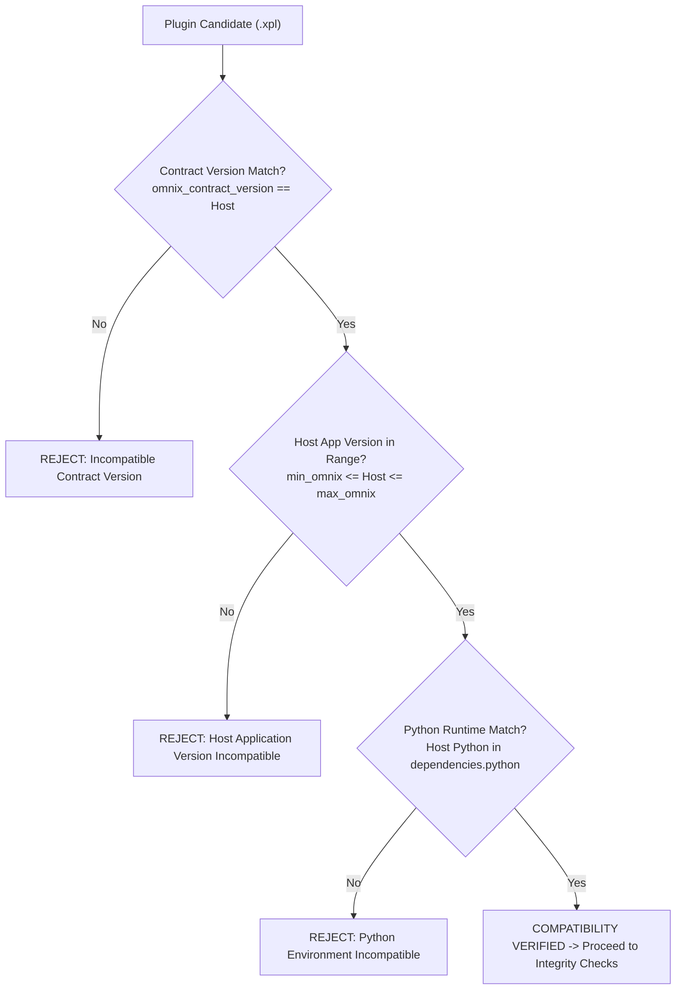
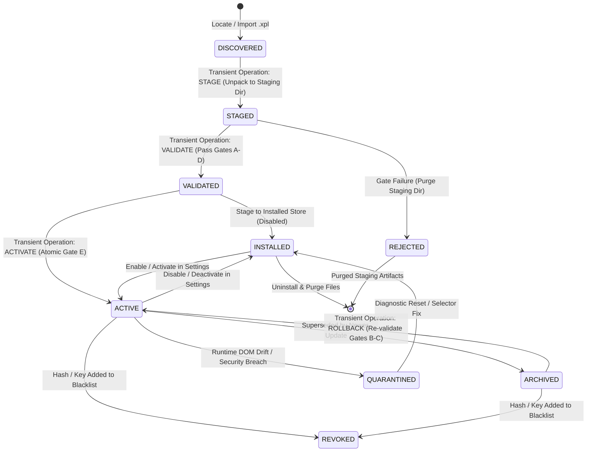
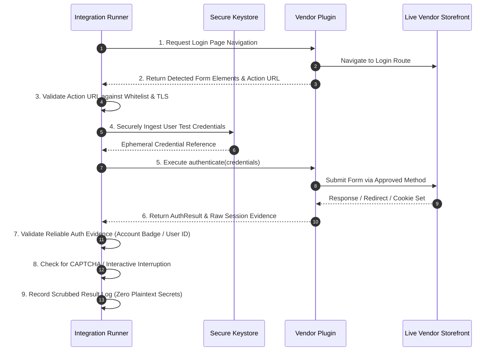
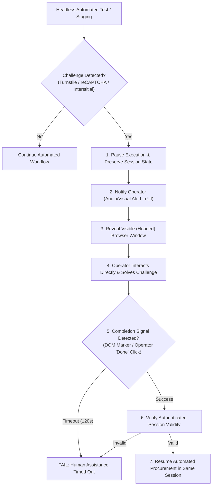
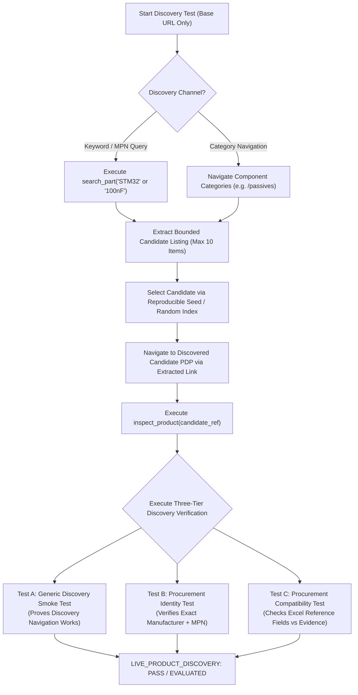

# OMNIX VENDOR PLUGIN & PROCUREMENT ARCHITECTURE SPECIFICATION

**Document Reference:** DOC-OMNIX-VPA-001
**Revision:** 7.0.0 — RELEASE 1 MVP ARCHITECTURE RECONCILIATION: SECURITY, PACKAGE IDENTITY, CREDENTIAL PROTECTION, AND RELEASE SCOPE
**Status:** **AUTHORITATIVE ARCHITECTURAL SPECIFICATION**
**Governing Principle:** Omnix Core + Installable Versioned Vendor Plugins + Shared Procurement Pipeline
**Baseline Repository Commit:** 647d82dce0ae3f9678c2635ac5e8865b53dc3322
**Target System:** Omnix Enterprise Core, Sourcing Engine, and Extensible Vendor Plugin Ecosystem

---

## 1. Purpose, Scope, and Non-Goals

### 1.1 Purpose
This document establishes the official, authoritative architectural specification for Omnix's installable vendor plugin system and its integration with the Omnix Core procurement engine. It reconciles verified repository implementations with the target architecture to serve as the binding reference for all subsequent development, plugin packaging, validation, installation, live integration testing, and procurement orchestration.

### 1.2 Scope
This specification governs:
1. **Architectural Triad**: The strict separation of responsibilities among **Omnix Core**, **Vendor Plugins**, and the **Shared Procurement Pipeline**.
2. **Three-Layer Validation Model**:
   - **Layer A (Static Manifest Validation)**: Deterministic, offline, zero network requests, zero code execution, validating strict JSON schema, syntax, capabilities, routes, and metadata.
   - **Layer B (Controlled Mock/Simulator Testing)**: Mandatory offline verification of contracts, declared capabilities, security properties, and Mode A Add-to-Cart staging inside a headless mock simulator with zero live network calls.
   - **Layer C (Live Vendor Integration Testing)**: Explicitly initiated, controlled online testing of vendor connectivity, live site structure, authentication workflows (`LOGIN_TEST`), CAPTCHA detection and human-assisted resolution, catalog product discovery without direct URLs (`LIVE_PRODUCT_DISCOVERY_TEST`), general MOQ and order-multiple quantity validation (`LIVE_PROCUREMENT_QUANTITY_TEST`), and optional explicitly authorized live cart staging (`LIVE_ADD_TO_CART_TEST`).
3. **Installable Package Format (`.xpl`)**: The logical structure, manifest schema, signature encapsulation, and file layout of installable plugin archives.
4. **Vendor Adapter Contract (`IVendorAdapter`)**: The unified Python interface, method contracts, type definitions, and fail-closed behaviors.
5. **Plugin Lifecycle & State Machine**: Discovery, validation, manual installation, staged transactional update, verified rollback, and dynamic activation/deactivation.
6. **Publisher Trust & Verification**: Cryptographic signing, package-hash integrity binding, publisher identity classification (Official vs. Third-Party Verified vs. Unsigned), and revocation enforcement.
7. **Capability & Procurement Mode Model**: Fine-grained capability declaration (`PRODUCT_URL_RECOGNITION`, `PRODUCT_INSPECTION`, `CART_URL_RESOLUTION`, `MPN_SEARCH`, `MODE_A_STAGING`, `LIVE_CONNECTIVITY_TEST`, `LIVE_STRUCTURE_TEST`, `LOGIN_TEST`, `CAPTCHA_DETECTION`, `CAPTCHA_HUMAN_ASSIST`, `LIVE_PRODUCT_DISCOVERY`, `LIVE_QUANTITY_VALIDATION`, `LIVE_ADD_TO_CART`) and procurement mode rules (sole canonical mode: `MODE_A`).
8. **Preservation of Canonical Domain Rules**: Canonical inventory policy math, conservative MPN/package normalization, tri-state evidence matching (`MATCH`, `MISMATCH`, `UNKNOWN`) with separate applicability scope (`NOT_APPLICABLE`), and GAP-13 cart delta synchronization ($\Delta Q = \max(0, \text{target} - \text{existing})$).
9. **Canonical Component Identity & Excel Data Model**: The strict dual-key component identity (`Manufacturer + MPN`) and its reconciliation against the authoritative two-sheet inventory schema (`Stock Policy` and `Inventory`), preserving real workbook fields without invented datasheet columns, and strictly separating canonical identity from the 5-dimension Stock Policy grouping key.
10. **Release 1 MVP Delivery Scope Reconciliation**: Reconciles the architecture specification with Release 1 MVP delivery constraints:
    - Empty-by-default fresh installations (zero vendor plugins preinstalled or active).
    - Separate single-vendor `.xpl` packages for Lion Electronic (`lion.xpl`) and Javan Electronic (`javan.xpl`), each with a 1-to-1 canonical identity.
    - Strict publisher trust policy accepting only packages signed by explicitly trusted publisher keys, rejecting unsigned or unknown packages without user bypass.
    - Uniform trust policy across distribution channels: manual "Install from File" is a source selector and undergoes identical signature and integrity checks as catalogue installation.
    - Explicit recognition that AST scanning is defense-in-depth, not an execution sandbox.
    - Bounded in-process execution strictly for verified trusted packages (OD-010).
    - Windows DPAPI credential protection at rest with verified fallback migration (OD-002), separating credentials from package archives.
    - Declarative `config_schema` in plugin manifests for dynamic UI generation.
    - Sole Canonical Procurement Architecture (Mode A) with Phase 3 atomic snapshot URL dispatch.

### 1.3 Non-Goals
The following areas are explicitly outside the scope of this specification and must not be altered:
- **No Implementation in Documentation Phase**: This phase is strictly limited to architectural definition, reconciliation, and specification alignment; no live runner code, UI widgets, package loaders, schema changes, or test alterations are implemented in this turn.
- **No Revision of Procurement Business Math**: Mode A exact link pinning and canonical inventory threshold evaluations remain untouched.
- **No Mandatory Empty-Cart Preflight in this Phase**: Pre-order cart clearing or empty-cart blocking is intentionally deferred.
- **No BOM Deduplication / Consolidation Alterations**: Repeated BOM line item handling and multi-BOM order consolidation remain as previously defined.
- **No Live Purchasing, Payments, or Automated Checkout**: Testing and Add-to-Cart validation are strictly bounded. Even under explicitly authorized Layer C live cart staging, live checkout, monetary payments, and final order submissions are strictly prohibited.

---

## 2. Current State vs. Target Architecture

Treating the repository as the empirical source of truth, the following audit establishes what is currently confirmed in code versus what is proposed, open, or not implemented.

### 2.1 Audit Matrix of Architectural Capabilities

| Capability / Area | Repository Evidence / Implementation File | Current Status | Architectural Target |
| :--- | :--- | :--- | :--- |
| **Common Adapter Interface** | `core/vendor_interface.py` (`IVendorAdapter`) | **Confirmed** | Base contract with 13 operations + explicit `get_cart_url()` & `is_pdp_url()`. |
| **Authoritative Cart URL** | `IVendorAdapter.get_cart_url()` returns `None` by default. Lion, Javan, RoboEq implement explicit URLs. | **Confirmed** | Adapters must declare authoritative URLs; no generic `/cart` guessing. |
| **Fail-Closed PDP Validation** | `QuickOrderDialog.validate_vendor_pdp_url()` delegates to `adapter.is_pdp_url()` with fail-closed gates. | **Confirmed** | Validation fails closed if adapter is missing, lacks capability, or raises an error. |
| **Decoupled UI Navigation** | `OrderPreviewDialog` and `QuickOrderDialog` contain zero imports of `*Selectors` and zero Lion cart fallbacks. | **Confirmed** | UI interacts purely through `VendorRegistry` and `IVendorAdapter`. |
| **In-Memory Vendor Registry** | `core/procurement/registry.py` (`VendorRegistry`) | **Confirmed** | Thread-safe registry mapping `vendor_id` and storefront domains to adapter classes with empty-by-default runtime initialization (Phase 2.5). |
| **Version-Aware Registry** | `core/procurement/registry.py` (`VendorRegistry`) | **Confirmed** | Registry tracking multiple registered versions per vendor, active-version management, atomic route dispatch (`resolve_adapter_for_url`), passing 596 tests (Phase 3). |
| **Shared Procurement Pipeline** | `UniversalProcurementOrchestrator` (`stage_candidate`) & `ProcurementBridge` | **Confirmed** | Central pipeline executing GAP-13 delta synchronization and candidate evaluation with atomic URL resolution. |
| **Cart Delta Synchronization** | `stage_candidate` executes $\Delta Q = \max(0, \text{target} - \text{existing})$ | **Confirmed** | Core-owned cart inspection and idempotent delta mutation. |
| **Manifest Schema & Validator** | `core/plugins/manifest_validator.py` and `core/plugins/manifest.schema.json` | **Confirmed (Baseline)** | Formal JSON schema and validator passing 79 comprehensive test cases (Phase 1); Phase 4 adds `config_schema` validation. |
| **Plugin Package Format (`.xpl`)**| None in repository; plugins currently exist as in-tree subpackages under `vendors/`. | **In Design (Phase 4)** | Single-vendor `.xpl` ZIP container with `manifest.json`, `META-INF/` signatures, and declarative `config_schema`. |
| **Digital Signatures & Trust** | None in repository. | **In Design (Phase 5)** | Ed25519 signatures, public key trust store, strict rejection of unsigned/unknown packages in Release 1. |
| **Package Installer & Importer** | None in repository; adapters registered via programmatic API or test fixtures. | **In Design (Phase 7)** | Transactional package installer unpacking to `plugins/installed/<vendor_id>/<version>/`, `installed_plugins.json` persistent state, enable/disable/uninstall lifecycle. |
| **Protected Credential Storage** | Proposed for Release 1 (`settings_manager.py` migration). | **Proposed / In Design (OD-002)** | Windows DPAPI encryption at rest with verified fallback migration; separate from `.xpl` archives. |
| **Dynamic Vendor Configuration UI** | None in repository (`settings_dialog.py` hardcodes inputs). | **Proposed / In Design (Phase 17)** | Dynamic UI generated from manifest `config_schema`, routing sensitive fields to protected storage. |
| **Staged Updates & Safe Rollback**| None in repository. | **In Design (Phase 16)** | Candidate staging, pre-activation validation, atomic pointer switch, rollback with single active version per vendor. |
| **Layered Plugin Mock Test Harness**| In-tree pytest files (`test_*_adapter.py`, `test_desktop_workflows.py`). | **Proposed** | Formal 8-tier verification suite executing in a mock simulator environment (Gate D). |
| **Live Integration Test Runner**| None in repository. | **Proposed** | `VendorIntegrationTestRunner` executing online connectivity, DOM drift, and discovery checks. |
| **Network Egress Boundary Guard**| None in repository. | **Proposed** | Strict origin whitelisting, SSRF prevention, and redirect revalidation. |
| **Live Auth & CAPTCHA Handoff**| None in repository. | **Proposed** | `LOGIN_TEST`, CAPTCHA classification, and headed/headless human-assisted handoff. |
| **Live Product Discovery & Quantity**| None in repository. | **Proposed** | Random catalog discovery and live MOQ / multiple rounding validation. |
| **Explicit Live Cart Staging**| None in repository. | **Proposed** | Separate opt-in live cart mutation without checkout/payment. |
| **Online Plugin Library** | None in repository. | **Proposed** | Searchable catalog, version repository, download integrity verification. |

### 2.2 Paradigm Comparison

```
CURRENT REPOSITORY PARADIGM (Phase 3 Confirmed Baseline):
┌────────────────────────────────────────────────────────────────────────┐
│ UI Layer (OrderPreviewDialog, QuickOrderDialog, SettingsDialog)        │
└───────────────────────────────────┬────────────────────────────────────┘
                                    │ Polymorphic calls / Atomic URL Dispatch
┌───────────────────────────────────▼────────────────────────────────────┐
│ Version-Aware VendorRegistry (Phase 2.5 Empty-by-Default + Phase 3)    │
│ - Multi-version registration metadata & active version pointers        │
│ - resolve_adapter_for_url() atomic snapshot resolution                 │
└───────────────────────────────────┬────────────────────────────────────┘
                                    │ Programmatic Registration (Tests / In-Tree)
┌───────────────────────────────────▼────────────────────────────────────┐
│ In-Tree Python Packages (vendors/lion/, vendors/javan/, vendors/roboeq/)│
└────────────────────────────────────────────────────────────────────────┘
  + core/plugins/manifest_validator.py (Offline Manifest Validator, Phase 1)

TARGET ARCHITECTURE (Omnix Core + Installable Plugins + Shared Pipeline):
┌────────────────────────────────────────────────────────────────────────┐
│ LAYER 0: UX & PRESENTATION (Inventory View, BOM Auditor, Plugin Mgr UI)│
└───────────────────────────────────┬────────────────────────────────────┘
                                    │ Pure Canonical DTOs / Dynamic Config UI
┌───────────────────────────────────▼────────────────────────────────────┐
│ LAYER 1: OMNIX CORE DOMAIN & SHARED PROCUREMENT PIPELINE               │
│ - InventoryPolicyEngine, Canonical Quantity Engine, Tri-State Matcher  │
│ - UniversalProcurementOrchestrator (GAP-13 Delta Sync Pipeline)        │
│ - Plugin Lifecycle, Trust & Verification Manager (Gates A - E)         │
│ - Version-Aware VendorRegistry (Active Pointer, Domain Routing)        │
│ - Protected Credential Storage at Rest (Windows DPAPI, OD-002)         │
└───────────────────────────────────┬────────────────────────────────────┘
                                    │ IVendorAdapter Interface Contract
┌───────────────────────────────────▼────────────────────────────────────┐
│ LAYER 2: EXTENSIBLE VENDOR PLUGINS (Independent Single-Vendor .xpl)    │
│ ┌──────────────────────┐  ┌──────────────────────┐  ┌────────────────┐ │
│ │ Official Lion Plugin │  │ Official Javan Plugin│  │ Trusted Partner│ │
│ │ lion.xpl (Ed25519)   │  │ javan.xpl (Ed25519)  │  │ .xpl (Signed)  │ │
│ └──────────────────────┘  └──────────────────────┘  └────────────────┘ │
└────────────────────────────────────────────────────────────────────────┘
```

---

## 3. Architecture and Component Boundaries

The architecture strictly establishes three separate operational spheres:

### 3.1 Omnix Core Responsibilities
Omnix Core is 100% vendor-agnostic and owns all business rules, mathematical calculations, and lifecycle governance:
- **Canonical Domain Models**: Component identity (`ComponentIdentity`), procurement intent (`ProcurementRequest`), and candidate representations (`VendorProcurementCandidate`, `CandidateEvaluation`).
- **Inventory Replenishment Math**: Pure non-negative integer math ($\text{replenishment} = \text{target} - \text{current}$ when $\text{current} < \text{min}$).
- **Canonical Quantity Calculation**: Constraint-aware quantity engine determining $Q_{\text{vendor\_min}}$ from requested quantity $Q$, vendor MOQ $M$, and verified multiple $S$ under `ABSOLUTE_MULTIPLE`, `MOQ_BASED_INCREMENT`, or MOQ-only rules without duplicate rounding.
- **Component Matching**: Tri-state evidence matching (`MATCH`, `MISMATCH`, `UNKNOWN`) with separate applicability scope (`NOT_APPLICABLE` for unconstrained parameters), where $UNKNOWN \neq MISMATCH$ (missing data is not an explicit contradiction) but $UNKNOWN \neq MATCH$ (missing essential data cannot satisfy an active procurement constraint).
- **Sourcing Strategy Dispatch**: Routing `EXACT_INVENTORY_LINK` (Mode A).
- **Candidate Ranking**: Deterministic 5-tier hierarchy (Cost $\rightarrow$ Stock $\rightarrow$ MOQ $\rightarrow$ `vendor_id` $\rightarrow$ `vendor_sku`).
- **Plugin Lifecycle & Security Governance**: Validation of manifests (Layer A), signature checking, mock test orchestration (Layer B), activation, transactional update, and rollback.
- **Registry Management**: Dynamic mapping of vendor IDs and storefront domains to validated, active plugin instances.

### 3.2 Vendor Plugin Responsibilities
A vendor plugin contains all supplier-specific integration logic and runs isolated within its package boundary:
- **Storefront Recognition**: Identifying product pages, cart URLs, search endpoints, and domain routes.
- **Product Inspection**: Scraping and extracting raw vendor facts (MPN, package, manufacturer, live stock, MOQ, order multiple, price tiers) from DOM/APIs.
- **Data Normalization to Contract**: Packaging raw site facts into typed Core models (`ProductDetails`, `StockStatus`, `OrderConstraints`).
- **Cart Mutation**: Adding components to the vendor shopping cart via browser automation or session endpoints.
- **Cart Inspection**: Inspecting active cart items and reporting accurate quantities and SKUs to Core for delta reconciliation.
- **Error Translation**: Mapping vendor-specific HTTP codes, Cloudflare blocks, and Persian toast messages into the Omnix 13-category error taxonomy.
- **Self-Contained Configuration**: Providing vendor selectors, regex patterns, and session parameters without leaking them to Core.

### 3.3 Shared Procurement Pipeline Responsibilities
The Shared Procurement Pipeline bridges Core intent with Plugin execution:
- **Unified Bridge (`ProcurementBridge`)**: Translating BOM shortages and inventory needs into canonical `ProcurementRequest` batches.
- **Orchestration (`UniversalProcurementOrchestrator`)**: Gathering candidates across enabled plugins and evaluating eligibility against user-configured constraints.
- **Authoritative Quantity Engine**: Calculating effective order quantities ($Q_{\text{vendor\_min}}$) from plugin-reported constraints without duplicate rounding logic.
- **GAP-13 Delta Synchronization**: Enforcing idempotency by inspecting current cart contents before staging:
  $$\Delta Q = \max(0, \text{target\_order\_qty} - \text{existing\_cart\_qty})$$
- **Reporting Pipeline**: Building deterministic CSV, XLSX, and vector PDF manifests from actual staging outcomes.

### 3.4 Authoritative Omnix Excel Data Model
The authoritative Omnix inventory database (`Inventory.xlsm` / `Inventory.xlsx`, implemented in `core/inventory/loader.py` and `core/inventory/models.py`) establishes the exact schema for procurement and stock monitoring:
1. **Sheet 1: `Stock Policy` (Authoritative Group & Policy Source)**:
   - `Category`: Component family classification (e.g. "Capacitors", "Resistors", "Semiconductors").
   - `Type/Technology`: Dielectric or sub-technology (e.g. "Ceramic X7R", "Thick Film", "MOSFET").
   - `Value`: Electrical or functional value (e.g. "100nF", "10k", "NE555P").
   - `Package`: Physical packaging standard (normalized via `normalize_package`, e.g. "0805", "DIP-8").
   - `Footprint`: PCB mounting footprint (e.g. "C0805", "DIP8_W300").
   - `Total Quantity in Stock`: Aggregated cached stock count across inventory bins.
   - `Min Stock`: Minimum replenishment threshold ($Q_{\text{min}}$).
   - `Target Stock`: Target replenishment ceiling ($Q_{\text{target}}$).
   - `Description`: Functional description and engineering notes.
2. **Sheet 2: `Inventory` (Individual Physical Product Records)**:
   - `Manufacturer`: Component brand/producer (e.g. "Murata", "Yageo", "Texas Instruments").
   - `MPN`: Exact Manufacturer Part Number (e.g. "GRM188R71H104KA93D").
   - `Category`: Component family classification.
   - `Type/Technology`: Sub-technology or material specification.
   - `Package`: Packaging standard.
   - `Footprint`: Mounting footprint.
   - `Value`: Nominal value.
   - `Description`: Component description.
   - `Quantity in Stock`: Physical count present in the specific drawer/bin.
   - `Purchase Link`: Authoritative primary supplier product URL.
3. **Canonical 5-Dimension Grouping Key**:
   Reconciliation between individual physical parts and replenishment policies uses the exact 5 dimensions:
   $$\text{Group Key} = \text{Category} \mid \text{Type/Technology} \mid \text{Value} \mid \text{Normalized Package} \mid \text{Footprint}$$
   > [!IMPORTANT]
   > The five-dimensional grouping key is for inventory stock-policy aggregation, not an alternative component identity and not a replacement for `Manufacturer + MPN`.
4. **Preservation of Actual Excel Schema (No Invented Columns)**:
   Parameters such as `Capacitance`, `Voltage`, `Dielectric`, and `Tolerance` are **not** separate columns in the Excel inventory schema. They may be discussed as supplier-provided or authoritative-reference data tied to the MPN, but must not be misrepresented as part of the Excel workbook schema.

### 3.5 Canonical Component Identity — Manufacturer + MPN
Omnix establishes a strict, dual-key canonical unique component identity:

$$\mathbf{Identity} = \mathbf{Manufacturer} + \mathbf{MPN}$$

Both fields jointly identify the exact manufacturer-specific component:
- **No Substitutes for Identity**: Neither product title, description, vendor SKU, product URL, package/footprint alone, the five-dimensional Stock Policy grouping key, similar electrical specifications, nor generic component category can substitute for this canonical identity.
- **Identity Conflict Example**:
  `Manufacturer = Murata`, `MPN = GRM188R71H104KA93D`.
  A supplier search result that explicitly associates this MPN with a conflicting manufacturer represents an explicit identity conflict, not an equivalent product.
- **Double-Check Function of Excel Fields**:
  The Excel reference fields (`Package`, `Footprint`, `Value`, `Description`) serve as a secondary compatibility double-check to ensure Omnix purchases the intended part. They do not create alternative identities for the same exact `Manufacturer + MPN`.
- **Identity Governance Rules**:
  1. If candidate manufacturer or MPN contradicts the requested canonical identity, reject the candidate or report an explicit identity conflict.
  2. If a supplier explicitly reports a value that contradicts a relevant reference field in the Excel record, reject the candidate as incompatible (`MISMATCH`).
  3. Live supplier product pages are not required to display every technical attribute directly.
  4. Where the vendor page omits a field, an authoritative reference tied to the exact `Manufacturer + MPN` may be used when available.
  5. If an essential field cannot be verified, it must be reported as `UNKNOWN` or `INCONCLUSIVE`. Never invent values or treat uncertainty as a match.
  6. A different MPN is never accepted as an automatic substitute merely because the component appears technically similar.

### 3.6 Single Vendor Plugin per Package Invariant & Active Version Limits
Omnix establishes a strict 1-to-1 canonical relationship between an `.xpl` package and a vendor integration:
1. **One Vendor Plugin per Package**: An `.xpl` package represents exactly ONE vendor integration. An `.xpl` package must contain exactly one `manifest.json` declaring exactly one canonical `plugin_id` and one corresponding `vendor_id`. Multi-vendor omnibus packages or packages attempting to install, register, or activate multiple distinct vendor integrations are strictly prohibited. Packages may contain multiple internal implementation files, modules, and classes, provided that the package represents exactly one vendor integration, exposes the single declared primary adapter entry point required by `manifest.json`, and does not register or activate any second vendor integration.
2. **Canonical Single-Vendor Packages**: Lion Electronic (`com.omnix.vendor.lion`, `vendor_lion`) and Javan Electronic (`com.omnix.vendor.javan`, `vendor_javan`) must be packaged and distributed as completely separate, independent `.xpl` archives (`lion.xpl` and `javan.xpl`).
3. **Single Active Version per Vendor**: A vendor integration has exactly one user-facing entry in Omnix and at most one active version registered in `VendorRegistry` at any time. When multiple versions are installed or archived on disk for rollback, exactly one version is active; older versions remain inactive and do not appear as separate active integrations or duplicate routing entries.

### 3.7 Sole Canonical Procurement Architecture (Mode A)
1. **Mode A (Explicit Product URL Procurement)**: Sole operational procurement architecture in Omnix. Omnix Core routes candidate URLs to active vendor adapters via Phase 3 version-aware atomic route dispatch (`resolve_adapter_for_url`). Staging executes idempotent cart delta synchronization ($\Delta Q = \max(0, \text{target} - \text{existing})$).
2. **Sole Canonical Architecture**: Mode A is the sole supported procurement architecture in Omnix. Any non-Mode A procurement request is immediately rejected fail-closed.

## 4. Plugin Package Format (`.xpl`)

### 4.1 File Format & Extension
Installable Omnix vendor plugins are packaged as compressed ZIP archives using the file extension **`.xpl`** (Omnix Plugin Package).

#### Archive Evaluation & Justification:
- **Zip-Standard Compatibility**: The standard ZIP archive format (`deflate` compression) is natively supported by Python's `zipfile` module without external C-extensions, ensuring 100% cross-platform compatibility on Windows, Linux, and macOS.
- **No Format Collision**: The `.xpl` extension distinguishes Omnix plugins from standard Python wheels (`.whl`), generic ZIP files (`.zip`), or system executables (`.exe`), preventing accidental execution or ingestion by generic archive utilities.
- **Atomic Inspection**: ZIP files allow random-access reading of `manifest.json` and cryptographic signatures without decompressing the entire code payload into memory or disk.
- **Single-Vendor Package Invariant**: Each `.xpl` archive encapsulates exactly one vendor integration (1-to-1 canonical identity). Multi-vendor omnibus packages or packages attempting to install or activate multiple distinct vendor integrations are strictly invalid. Packages may contain multiple internal implementation files and helper classes, provided that the package represents exactly one vendor integration, exposes the single declared primary adapter entry point required by `manifest.json`, and does not register or activate any second vendor integration. Lion Electronic (`lion.xpl`) and Javan Electronic (`javan.xpl`) must be packaged as separate archives.

### 4.2 Logical Directory Layout
```
<package_name>-<version>.xpl (ZIP Archive)
├── manifest.json              # Canonical plugin manifest (JSON format)
├── plugin/                    # Python package payload containing vendor implementation
│   ├── __init__.py            # Module root exporting the IVendorAdapter class
│   ├── adapter.py             # Core-facing adapter implementation
│   ├── automation.py          # Browser/DOM automation mechanics
│   ├── session.py             # Authentication and session persistence
│   ├── selectors.py           # DOM selectors and regex patterns
│   └── errors.py              # Vendor error taxonomy translation
├── assets/                    # Optional static assets
│   ├── icon.png               # Vendor brand icon (64x64 or 128x128 PNG)
│   └── documentation.md       # Plugin-specific usage notes and change log
├── tests/                     # Developer-supplied unit and mock DOM tests
│   ├── __init__.py
│   └── test_self.py           # Self-contained plugin unit tests
└── META-INF/                  # Cryptographic integrity and signature metadata
    ├── MANIFEST.MF            # SHA-256 digests of all package files (excluding META-INF/)
    ├── SIGNATURE.SIG          # Ed25519 digital signature of canonical MANIFEST.MF
    └── CERTIFICATE.CRT        # Optional X.509 / PEM certificate chain
```

### 4.3 Package Archive Security & Extraction Hardening Rules

To prevent archive-processing attacks and host filesystem compromise, all `.xpl` archives undergo rigorous pre-extraction validation:

1. **Path Traversal & ZIP Slip Prevention**:
   - Every archive member path is strictly normalized using `posixpath.normpath`.
   - Any entry with a leading `/` or `\`, containing `..` path segments, Windows drive specifiers (e.g. `C:`), or embedded null bytes (`\0`) causes immediate rejection (`PLUGIN_CORRUPT`).
   - Prior to writing any file, the destination path is resolved and verified:
     $$\text{os.path.commonpath}([\text{staging\_dir}, \text{dest\_file}]) == \text{staging\_dir}$$
     If any path resolves outside the designated staging root, extraction is aborted and the staging directory is completely purged.

2. **Duplicate & Conflicting Member Rejection**:
   - The archive is scanned for duplicate entry paths. Any archive containing identical normalized paths is rejected.
   - On case-insensitive file systems (Windows NTFS, macOS APFS), case collisions (e.g. `plugin/Adapter.py` vs `plugin/adapter.py`) could overwrite files maliciously. The unpacker enforces case-folded uniqueness across all member names.

3. **Symlink, Hardlink, and Device File Rejection**:
   - The unpacker inspects ZIP external file attributes (`ZipInfo.external_attr`).
   - Entries representing symbolic links (`S_IFLNK`), hardlinks, FIFOs/named pipes (`S_IFIFO`), character devices, or block devices are strictly rejected. Only regular files (`S_IFREG`) and standard directories (`S_IFDIR`) are permitted.

4. **Resource Exhaustion & Decompression Bomb Mitigations**:
   - **Maximum Archive File Size (Compressed)**: 10 MB.
   - **Maximum Total Uncompressed Size**: 50 MB cumulative across all members.
   - **Maximum Single File Uncompressed Size**: 20 MB.
   - **Maximum Compression Ratio**: 10:1 (enforced for any member whose uncompressed size exceeds 1 MB).
   - **Maximum Archive Member Count**: 500 total entries (files + directories).
   - Validation occurs by reading member headers from the central directory *before* streaming uncompressed bytes, terminating extraction immediately if any limit is exceeded.

5. **Strict File Extension Whitelist**:
   - To prevent smuggling of binary payloads or system executables, only declared safe extensions are permitted:
     `{".py", ".json", ".png", ".jpg", ".jpeg", ".svg", ".md", ".txt", ".MF", ".SIG", ".CRT"}`.
   - Archives containing compiled binaries (`.exe`, `.dll`, `.so`, `.dylib`), native Python C-extensions (`.pyd`), shell scripts (`.sh`, `.bat`, `.cmd`, `.ps1`), or executable scripts are rejected unconditionally.

6. **Namespace & Staging Containment**:
   - Extraction is restricted exclusively to an isolated, ephemeral staging directory:
     `~/.omnix/plugins/staging/<vendor_id>-<candidate_version>-<nonce>/`
   - Plugins are structurally barred from extracting into Omnix Core directories, system folders, or paths belonging to other plugins. Cross-plugin file overwrites are structurally impossible.

---

## 5. Manifest Schema and Validation

### 5.1 Format Justification: JSON vs. YAML
The plugin manifest is strictly named **`manifest.json`** and serialized in JSON.
- **Deterministic Parsing**: Python's standard `json` parser is fast, strictly deterministic, and built into the Python runtime.
- **Security**: Unlike YAML parsers (e.g., PyYAML), JSON parsing cannot be exploited via arbitrary Python object instantiation (`!!python/object/apply`) or complex anchor reference bombs.
- **Strict Typing**: JSON enforces unambiguous representations of booleans, numbers, strings, arrays, and nested dictionaries.

### 5.2 Canonical Manifest JSON Schema
```json
{
  "$schema": "https://omnix.dot.org/schemas/v1/plugin-manifest.json",
  "manifest_version": "1.0.0",
  "plugin_id": "com.omnix.vendor.lion",
  "vendor_id": "vendor_lion",
  "display_name": "Lion Electronic",
  "version": "1.2.0",
  "min_omnix_version": "2.0.0",
  "max_omnix_version": "2.99.99",
  "omnix_contract_version": "1.0.0",
  "entry_point": "plugin.adapter:LionVendorAdapter",
  "publisher": {
    "name": "Omnix Official Engineering",
    "type": "OFFICIAL",
    "key_id": "ed25519-official-placeholder-key1",
    "contact": "plugins@omnix.org"
  },
  "capabilities": [
    "PRODUCT_URL_RECOGNITION",
    "PRODUCT_INSPECTION",
    "CART_URL_RESOLUTION",
    "MPN_SEARCH",
    "MODE_A_STAGING"
  ],
  "supported_modes": [
    "MODE_A"
  ],
  "routes": {
    "base_url": "https://lionelectronic.ir",
    "cart_url": "https://lionelectronic.ir/orders/cart",
    "domains": [
      "lionelectronic.ir",
      "www.lionelectronic.ir"
    ],
    "pdp_patterns": [
      "^https?://(?:www\\.)?lionelectronic\\.ir/products/(?P<product_id>\\d+)-(?P<slug>[a-zA-Z0-9_.\\-\\+\\/]+)$",
      "^/products/(?P<product_id>\\d+)-(?P<slug>[a-zA-Z0-9_.\\-\\+\\/]+)$"
    ]
  },
  "config_schema": {
    "fields": [
      {
        "key": "username",
        "label": "Storefront Username or Mobile",
        "type": "string",
        "required": true,
        "description": "User account identifier for login"
      },
      {
        "key": "password",
        "label": "Account Password",
        "type": "password",
        "required": true,
        "is_secret": true,
        "description": "Storefront authentication password"
      },
      {
        "key": "headless",
        "label": "Run Browser in Headless Mode",
        "type": "boolean",
        "required": false,
        "default": true
      }
    ]
  },
  "dependencies": {
    "python": ">=3.11",
    "external_libraries": [
      "beautifulsoup4>=4.12.0",
      "selenium>=4.20.0"
    ]
  }
}
```

### 5.3 Manifest Field Specifications & Validation Rules

| Field Name | Type | Allowed Values / Constraints | Failure Action |
| :--- | :--- | :--- | :--- |
| `manifest_version` | `string` | Must match supported schema version (currently `"1.0.0"`). | Reject package: Schema version unsupported. |
| `plugin_id` | `string` | Reverse-DNS format (`^[a-z0-9_]+(\\.[a-z0-9_]+)+$`, max 64 chars). Strictly 1-to-1 canonical identity. | Reject package: Malformed plugin identifier. |
| `vendor_id` | `string` | Lowercase snake_case (`^vendor_[a-z0-9_]+$`, max 32 chars). Exactly one vendor integration per package. | Reject package: Malformed vendor identifier. |
| `display_name` | `string` | Non-empty string (3–64 chars). | Reject package: Invalid display name. |
| `version` | `string` | Valid SemVer 2.0.0 (`MAJOR.MINOR.PATCH`). | Reject package: Version is not valid SemVer. |
| `min_omnix_version` | `string` | Valid SemVer 2.0.0. Current host must be $\ge$ min. | Reject package: Omnix version incompatible. |
| `max_omnix_version` | `string` | Valid SemVer 2.0.0 or `null`. Current host must be $\le$ max. | Reject package: Omnix version incompatible. |
| `omnix_contract_version`| `string`| Must match Core contract major version (`"1.0.0"`). | Reject package: Contract version mismatch. |
| `entry_point` | `string` | Format `module.path:ClassName`. | Reject package: Entry point malformed. |
| `publisher.type` | `string` | `"OFFICIAL"`, `"THIRD_PARTY_VERIFIED"`, `"COMMUNITY"`. | Reject package: Unrecognized publisher type. |
| `publisher.key_id` | `string` | Matches an approved public key identifier in the Core trust store. (Note: Manifest examples use illustrative placeholder `'ed25519-official-placeholder-key1'`; authoritative keys must be provisioned via an administrative release process). | Reject package: Unknown or unapproved publisher key. |
| `capabilities` | `list[string]`| Valid canonical capability IDs (Section 7). | Reject package: Invalid capability declared. |
| `supported_modes` | `list[string]`| Must be `["MODE_A"]`. Non-empty. | Reject package: Invalid or unsupported modes declared. |
| `routes.base_url` | `string` | Valid absolute URL (`http://` or `https://`). | Reject package: Invalid base URL. |
| `routes.cart_url` | `string` | Valid absolute URL (`http://` or `https://`). | Reject package: Invalid cart URL. |
| `routes.domains` | `list[string]`| Non-empty list of valid hostnames without ports/paths. | Reject package: Empty or invalid domain routes.|
| `config_schema` | `object` | Optional dictionary declaring vendor settings schema. When present, must contain a `fields` list where each field declares `key` (snake_case string), `label` (string), `type` (one of `"string"`, `"password"`, `"integer"`, `"boolean"`, `"select"`), optional `required` (boolean), optional `default`, optional `options` (for select), and optional `is_secret` (boolean). | Reject package: Malformed configuration schema. |

### 5.4 Declarative Plugin Configuration Schema (`config_schema`)
To eliminate hardcoded assumptions (such as assuming every supplier uses a `username` and `password`) without executing arbitrary plugin code, the plugin manifest supports an optional declarative `config_schema`:
1. **Dynamic UI Generation**: Omnix Core's Settings dialog dynamically renders input controls (line edits, password masks, checkboxes, combo boxes) strictly from the declared schema fields.
2. **Zero Executable Code**: The schema is strictly declarative JSON. No custom Python widgets, hooks, or validation scripts are executed from the package during schema rendering or setting persistence.
3. **Protected Credential Routing**: Any field with `is_secret: true` or `type: "password"` is automatically designated as a sensitive credential. In Release 1 on Windows, these fields are routed to protected credential storage via Windows DPAPI rather than being saved in plaintext (see Section 16 & OD-002).
4. **Backward Compatibility**: If `config_schema` is omitted from `manifest.json`, the manifest remains valid. Omnix Core falls back to standard default fields or treats the plugin as requiring no custom configuration.
5. **Implementation Boundary Note**: The `config_schema` specification represents an authoritative architecture requirement for Release 1 to be implemented in Phase 4 (updating `core/plugins/manifest.schema.json` and `manifest_validator.py`). It is not yet implemented in the current working tree.

### 5.5 Layer A Deterministic Offline Verification Invariant
> [!IMPORTANT]
> **Static Manifest validation (Layer A) is 100% offline, deterministic, and free of side effects:**
> - Parsing and validating a `manifest.json` does **not** perform DNS lookups, open HTTP connections, launch browser instances, execute Python code, or unpack archives.
> - Verifying that `routes.cart_url` or `routes.base_url` has a valid URL syntax proves only that the string is syntactically well-formed; it **does not** prove that the URL is live, reachable, or currently serving valid pages.
> - A statically valid Manifest proves contract compliance of declared metadata, but **never proves that the plugin actually works against the live supplier website**.

---

## 6. Vendor Adapter Contract (`IVendorAdapter`)

All vendor plugins implement the unified `IVendorAdapter` abstract base class defined in [`core/vendor_interface.py`](file:///d:/management-elec/autom/atom/core/vendor_interface.py).

```python
from abc import ABC, abstractmethod
from typing import Optional, Dict, Any, List
from core.models import (
    AdapterStatus,
    AuthResult,
    ProductReference,
    SearchResultSet,
    ProductDetails,
    CanonicalComponentDraft,
    StockStatus,
    OrderConstraints,
    CartMutationResult,
    CartDetails,
    RecoveryResult,
)

class IVendorAdapter(ABC):
    """
    Unified Vendor Adapter Contract Interface.
    Governs all communication between Omnix Core and vendor plugins.
    """

    @property
    @abstractmethod
    def vendor_id(self) -> str:
        """Unique vendor identifier (e.g., 'vendor_lion')."""
        pass

    @property
    @abstractmethod
    def base_url(self) -> str:
        """Authoritative base storefront URL."""
        pass

    @abstractmethod
    def initialize(self, config: Optional[Dict[str, Any]] = None) -> AdapterStatus:
        """Initialize adapter dependencies, session state, and configurations."""
        pass

    @abstractmethod
    def authenticate(self, credentials: Optional[Dict[str, Any]] = None) -> AuthResult:
        """Authenticate user against vendor storefront; persist cookies/tokens."""
        pass

    @abstractmethod
    def validate_session(self) -> bool:
        """Verify whether the active session credentials/cookies remain authenticated."""
        pass

    @abstractmethod
    def search_part(self, query: str) -> SearchResultSet:
        """Execute catalog search by part number or query string."""
        pass

    @abstractmethod
    def resolve_product(self, url_or_sku: str) -> ProductReference:
        """Resolve a direct product URL or vendor SKU into a ProductReference."""
        pass

    @abstractmethod
    def inspect_product(self, product_ref: ProductReference) -> ProductDetails:
        """Scrape or query full canonical details (MPN, package, manufacturer, specs, pricing)."""
        pass

    @abstractmethod
    def extract_product_data(self, dom_context: Any) -> CanonicalComponentDraft:
        """Extract technical specifications and package information from DOM context."""
        pass

    @abstractmethod
    def inspect_stock(self, product_ref: ProductReference) -> StockStatus:
        """Probe real-time inventory level for the product reference."""
        pass

    @abstractmethod
    def determine_order_constraints(self, product_ref: ProductReference) -> OrderConstraints:
        """Extract vendor-enforced Minimum Order Quantity (MOQ) and packaging multiples."""
        pass

    @abstractmethod
    def add_to_cart(self, product_ref: ProductReference, quantity: int) -> CartMutationResult:
        """Add requested quantity of product into vendor shopping cart."""
        pass

    @abstractmethod
    def inspect_cart(self) -> CartDetails:
        """Inspect active cart contents for quantity reconciliation and delta sync."""
        pass

    @abstractmethod
    def recover_from_error(self, error: Exception) -> RecoveryResult:
        """Execute vendor-specific recovery flow (e.g. dismissing modals, reconnecting session)."""
        pass

    @abstractmethod
    def close(self) -> None:
        """Cleanly terminate browser sessions and release system resources."""
        pass

    def get_cart_url(self) -> Optional[str]:
        """
        Return the storefront cart URL for browser navigation and user review.
        Base contract returns None; every production adapter must explicitly define its cart URL.
        """
        return None

    def is_pdp_url(self, url: str) -> bool:
        """
        Check whether the given storefront URL matches a canonical Product Detail Page (PDP).
        Base contract returns False (strict fail-closed rejection).
        """
        return False
```

### Contract Guarantees & Invariants
1. **Explicit Cart URLs**: An adapter must return a valid, verified URL from `get_cart_url()`. If an adapter returns `None`, an empty string, or an invalid scheme, Core treats the cart URL as unavailable and suppresses browser navigation.
2. **Fail-Closed PDP Validation**: `is_pdp_url(url)` evaluates strictly against verified URL/path regexes. Non-PDP URLs (home, search, cart, category) evaluate to `False`.
3. **Freshness Rule**: If `inspect_product()` already extracted fresh, authoritative stock counts during initial inspection, Core does not force a redundant browser call to `inspect_stock()`.

---

## 7. Capability and Mode Model

### 7.1 Canonical Capability Identifiers
Capabilities represent fine-grained functional features exposed by a plugin:

| Capability Identifier | Layer | Semantic Meaning & Operational Scope |
| :--- | :--- | :--- |
| `PRODUCT_URL_RECOGNITION` | Layer A/B | Plugin can validate and recognize canonical Product Detail Page (PDP) URLs via `is_pdp_url()`. |
| `PRODUCT_INSPECTION` | Layer B | Plugin can extract specifications, package, brand, stock, and pricing via `inspect_product()`. |
| `CART_URL_RESOLUTION` | Layer A/B | Plugin provides an authoritative storefront cart URL via `get_cart_url()`. |
| `MPN_SEARCH` | Layer B | Plugin can search the supplier catalog using MPN or partial queries via `search_part()`. |
| `LIVE_STOCK_PROBE` | Layer B | Plugin provides an optimized real-time stock availability check via `inspect_stock()`. |
| `TIERED_PRICING` | Layer B | Plugin extracts and reports structured quantity price tiers (`min_qty`, `unit_price`). |
| `MODE_A_STAGING` | Layer B | Plugin supports Mode A exact inventory link staging via `add_to_cart()`. |
| `LIVE_CONNECTIVITY_TEST` | Layer C | Plugin declares support for online endpoint probe (DNS, TLS, HTTP reachability). |
| `LIVE_STRUCTURE_TEST` | Layer C | Plugin declares selectors that match the live supplier storefront DOM structure. |
| `LOGIN_TEST` | Layer C | Plugin supports live authentication testing using user-authorized credentials. |
| `CAPTCHA_DETECTION` | Layer C | Plugin can identify and classify vendor anti-bot challenges and CAPTCHA screens. |
| `CAPTCHA_HUMAN_ASSIST` | Layer C | Plugin supports browser session handoff for human-assisted challenge completion. |
| `LIVE_PRODUCT_DISCOVERY` | Layer C | Plugin supports catalog/search navigation without being supplied a direct product URL. |
| `LIVE_QUANTITY_VALIDATION`| Layer C | Plugin exposes live MOQ and order multiple constraints for pipeline validation. |
| `LIVE_ADD_TO_CART` | Layer C | Plugin supports explicitly authorized live cart staging without checkout/payment. |

### 7.2 Capability Verification Status Model
For any core procurement capability, Omnix tracks an explicit five-status model:
- **`PASSED`**: The capability was executed and satisfied all contract and assertion requirements under independent verification.
- **`FAILED`**: The capability was executed, but failed its assertions, returned invalid data, or raised an unhandled runtime exception.
- **`NOT_RUN`**: The capability is declared and supported by the plugin, but its verification suite has not yet been executed in the current session.
- **`NOT_SUPPORTED`**: The capability is not declared by the plugin manifest; the feature is intentionally omitted and unavailable.
- **`BLOCKED`**: The capability cannot execute or be verified because an explicit prerequisite, security gate, authorization requirement, or revocation prevents execution (e.g. missing/unconfigured credentials, unverified domain whitelist, failed prerequisite test gate, developer-mode restriction, or cryptographic revocation).

#### Structured Blocking Reasons
To maintain the five mutually exclusive top-level statuses without proliferating ad-hoc status values, any capability reported as `BLOCKED` records a structured `blocking_reason` enum:
- `MISSING_CREDENTIALS`: Capability requires authentication credentials that have not been configured or provided by the operator.
- `UNVERIFIED_DOMAIN`: Target endpoint is not in the declared `routes.domains` whitelist.
- `PREREQUISITE_GATE_FAILED`: An earlier verification gate (e.g. Manifest Layer A, Mock Layer B, or Connectivity) failed or was not satisfied.
- `REVOCATION_BLACKLISTED`: Publisher key, certificate, or package hash is listed on the revocation blacklist.
- `SECURITY_POLICY_RESTRICTION`: Capability is blocked by host security policy (e.g. Community plugin attempting automated production execution without developer mode enabled).
- `VENDOR_ACCESS_BLOCKED`: Live vendor security, IP block, or unresolved anti-bot challenge prevents automated interaction.
- `OPERATOR_OPT_IN_REQUIRED`: Live mutation (such as cart staging) is blocked pending explicit human confirmation.

### 7.3 CAPTCHA Challenge & Interactive Status States
For live interactive challenge evaluation, Omnix tracks fine-grained operational states:
- **`NOT_DETECTED_IN_THIS_SESSION`**: No challenge appeared during this execution session. (Does not prove supplier never uses CAPTCHA).
- **`DETECTED`**: Challenge identified on page, awaiting resolution.
- **`USER_ACTION_REQUIRED`**: Automation paused; human must interact with page.
- **`RESOLVED_BY_USER`**: User completed challenge, verified by system.
- **`UNSUPPORTED`**: Challenge format cannot be resolved by available mechanisms.
- **`UNKNOWN`**: Ambiguous challenge or interstitial page.
- **`INCONCLUSIVE`**: Session state indeterminate after challenge attempt.
- **`BLOCKED`**: Anti-bot challenge, IP block, or account suspension explicitly prevents automated interaction (maps to capability status `BLOCKED` with reason `VENDOR_ACCESS_BLOCKED`).
- **`FAIL`**: Resolution attempt failed or timeout expired.

> [!IMPORTANT]
> `PASSED`, `FAILED`, `NOT_RUN`, `NOT_SUPPORTED`, and `BLOCKED` are distinct, mutually exclusive operational states and must never be conflated. Furthermore, a successful challenge detection must never be equated to successful login or authentication.

### 7.4 Procurement Mode Support Rules
1. **Canonical Mode Enforcement**: All vendor plugins must declare `["MODE_A"]` as their supported procurement mode in `manifest.json`.
2. **Mandatory Add-to-Cart Validation**: A plugin must pass mandatory Mode A Add-to-Cart validation during Layer B verification.
3. **Core Mode Guarding**: Omnix Core strictly requires Mode A (`DATABASE_AWARE`) procurement. Any request with an unsupported or missing mode is rejected fail-closed.
4. **Mode A Operational Status**: Mode A (explicit product URL procurement) is the sole operational procurement workflow in Omnix. Storefront URLs are resolved atomically via Phase 3 `resolve_adapter_for_url()` without TOCTOU race conditions.
5. **Sole Procurement Workflow**: All capabilities, enums, UI controls, and code strictly enforce Mode A as the sole procurement workflow.

---

## 8. Versioning and Compatibility

### 8.1 Semantic Versioning (SemVer 2.0.0)
All plugin versions must adhere strictly to `MAJOR.MINOR.PATCH`:
- **`MAJOR`**: Breaking changes to the plugin's internal selectors, supported models, or dropped capabilities.
- **`MINOR`**: Backwards-compatible feature additions (e.g. adding `TIERED_PRICING` support).
- **`PATCH`**: Backwards-compatible bug fixes, DOM drift adjustments, or selector maintenance.

### 8.2 Three-Way Compatibility Matrix
A plugin candidate must satisfy a three-way compatibility check before installation or activation:
1. **`omnix_contract_version` vs Host Contract Version**: Major version must match exactly (e.g. `"1.0.0"` matches Core Contract `"1.x.x"`).
2. **`min_omnix_version` / `max_omnix_version` vs Host Omnix Version**:
   $$\text{min\_omnix\_version} \le \text{Host Version} \le \text{max\_omnix\_version}$$
3. **Python Runtime Compatibility**: Host Python interpreter must satisfy the declared `dependencies.python` range (e.g. `Python >= 3.11`).



---

## 9. Publisher Identity, Signatures, and Trust

### 9.1 Decoupled Dimensions of Trust and Execution Authorization

To prevent dangerous conflation between cryptographic identity, functional capability, and security posture, Omnix strictly decouples six distinct architectural dimensions:

```
┌───────────────────────────────────────────────────────────────────────────────────────────────────────┐
│                           SIX DECOUPLED ARCHITECTURAL DIMENSIONS                                      │
├──────────────────────────┬─────────────────────────────────────┬──────────────────────────────────────┤
│ Dimension                │ Evaluated By                        │ Possible States / Values             │
├──────────────────────────┼─────────────────────────────────────┼──────────────────────────────────────┤
│ 1. Publisher Identity    │ Public key ID & Certificate Subject │ Key ID, Publisher Name, Contact      │
├──────────────────────────┼─────────────────────────────────────┼──────────────────────────────────────┤
│ 2. Publisher Class/Tier  │ Keyring matching against Core Trust │ OFFICIAL, THIRD_PARTY_VERIFIED,      │
│                          │ Store                               │ COMMUNITY, BLOCKED                   │
├──────────────────────────┼─────────────────────────────────────┼──────────────────────────────────────┤
│ 3. Package Integrity &   │ Per-file SHA-256 + Ed25519 Signature│ SIGNED_TRUSTED, UNTRUSTED_KEY,       │
│    Signature State       │                                     │ UNSIGNED, TAMPERED, CORRUPT          │
├──────────────────────────┼─────────────────────────────────────┼──────────────────────────────────────┤
│ 4. System Compatibility  │ SemVer check vs Contract & Runtime  │ COMPATIBLE, INCOMPATIBLE             │
├──────────────────────────┼─────────────────────────────────────┼──────────────────────────────────────┤
│ 5. Functional Test Status│ Layer B Mock/Simulator Test Harness │ PASSED, FAILED, NOT_SUPPORTED,       │
│                          │                                     │ NOT_RUN, BLOCKED                     │
├──────────────────────────┼─────────────────────────────────────┼──────────────────────────────────────┤
│ 6. Execution Authority   │ User / Enterprise Security Policy   │ AUTHORIZED_PRODUCTION,               │
│                          │                                     │ AUTHORIZED_DEV_ONLY, DENIED          │
└──────────────────────────┴─────────────────────────────────────┴──────────────────────────────────────┘
```

> [!WARNING]
> **Core Architectural Principles**:
> 1. A verified signature establishes **integrity and publisher identity only**; it does **not** prove that the underlying Python code is safe or non-malicious.
> 2. A valid third-party signature must **never** cause a plugin to be displayed or treated as an official Omnix plugin.
> 3. Passing functional tests proves **API compliance only**; it does **not** constitute a security audit or guarantee absence of malicious logic.
> 4. Live Vendor Integration Test results (Layer C) represent **local/session operational health diagnostics**; a live test pass must **never** override failed cryptographic signatures, tampered package hashes, or security policy denials.
> 5. **Release 1 MVP Trust Requirement**: For the Release 1 MVP, Omnix accepts ONLY packages signed by an explicitly trusted publisher key (such as the Omnix Official key). Unknown or unsigned packages are strictly rejected. There is no user click-through, warning dialog, or "install anyway" override in Release 1.
> 6. **Uniform Trust Policy (Catalogue vs. Manual Import)**: Manual "Install from File" is a source selection method, NOT a trust bypass. Packages imported from a local file must undergo and pass the exact same signature, manifest, and integrity checks as packages installed through an online catalogue.
> 7. **AST Scanning Limitation (Defense in Depth, Not a Sandbox)**: Scanning Python code for forbidden imports or AST patterns helps detect obvious policy violations early, but cannot guarantee that untrusted code is safe to execute in-process. AST scanning does not make untrusted or unsigned community plugins safe to run.

### 9.2 Non-Circular Cryptographic Model & Signing Specification

Omnix enforces a strict, four-tier cryptographic model that completely eliminates circular signature and hashing dependencies:

```
[ Individual Payload Files: plugin/*.py, manifest.json, assets/*, tests/* ]
                              │
                              ▼  (Step 1: Compute Per-File SHA-256)
┌──────────────────────────────────────────────────────────────────────┐
│ 1. META-INF/MANIFEST.MF                                              │
│    Canonical, sorted list of relative paths and their SHA-256 digests │
│    (Strictly excludes META-INF/ files to prevent circular loops)      │
└─────────────────────────────────┬────────────────────────────────────┘
                                  │
                                  ▼  (Step 2: Sign Canonical Manifest Bytes)
┌──────────────────────────────────────────────────────────────────────┐
│ 2. META-INF/SIGNATURE.SIG                                            │
│    Raw Ed25519 signature computed strictly over META-INF/MANIFEST.MF  │
└─────────────────────────────────┬────────────────────────────────────┘
                                  │
                                  ▼  (Step 3: Pack into Final .xpl ZIP Archive)
┌──────────────────────────────────────────────────────────────────────┐
│ 3. Final Package Hash: package_hash = SHA-256(Raw .xpl Bytes)        │
│    Cryptographic fingerprint of the complete binary distribution      │
└─────────────────────────────────┬────────────────────────────────────┘
                                  │
                                  ▼  (Step 4: Execute Gates A-D in Simulator)
┌──────────────────────────────────────────────────────────────────────┐
│ 4. External Test Attestation: <package_hash>.attestation.json        │
│    Stored EXTERNALLY in cache or catalog; references package_hash    │
│    (Never embedded into .xpl to avoid mutating the package hash)     │
└──────────────────────────────────────────────────────────────────────┘
```

#### Detailed Cryptographic Entities:

1. **Per-File SHA-256 Manifest (`META-INF/MANIFEST.MF`)**:
   - Contains the cryptographic digest of every file included in the package payload.
   - **Exclusion Rule**: Files inside `META-INF/` (specifically `META-INF/MANIFEST.MF`, `META-INF/SIGNATURE.SIG`, and `META-INF/CERTIFICATE.CRT`) are strictly excluded from entries in `MANIFEST.MF`.
   - **Canonicalization Rules**:
     * File paths must be relative POSIX paths (`/`), normalized via `posixpath.normpath`. No leading slash, no `./`, no `../`.
     * Entries must be sorted lexicographically by UTF-8 byte order (Unicode code point order / C-locale).
     * Text encoding must be strictly UTF-8 with standard Unix newline (`\n`) terminators.
     * Entry format:
       ```
       File: manifest.json
       SHA-256-Digest: 4f53cda18c2baa0c0354bb5f9a3ecbe5ed12ab4d8e11ba873c2f11161202b945

       File: plugin/adapter.py
       SHA-256-Digest: e3b0c44298fc1c149afbf4c8996fb92427ae41e4649b934ca495991b7852b855
       ```

2. **Ed25519 Digital Signature (`META-INF/SIGNATURE.SIG`)**:
   - Algorithm: **Ed25519** (RFC 8032) pure digital signature system over Curve25519.
   - Signed Data: The signature is computed directly and exclusively over the exact UTF-8 byte sequence of `META-INF/MANIFEST.MF`.
   - Because `MANIFEST.MF` binds the SHA-256 digests of all package files, signing `MANIFEST.MF` transitively guarantees the integrity of the entire plugin payload without self-referential signature loops.
   - **Key Distribution & Core Trust Store**:
     * Omnix Core distributes approved public verification keys and trusted key fingerprints within a built-in Core trust store.
     * Private signing keys are held strictly by authorized release infrastructure and must NEVER be packaged in client code, client installations, repository checkouts, or `.xpl` archives.
   - **Key Approval & Provisioning**:
     * Authoritative public keys or key fingerprints must be explicitly approved and provisioned through an established release or administrative governance process.
     * A package is not verifiable or trusted simply because its manifest references a plausible key identifier string (such as `ed25519-official-placeholder-key1`).
     * Any key identifier not present in the Core trust store is rejected fail-closed as unapproved.
   - **Status of Official Packages in Repository**:
     * Official Lion and Javan `.xpl` packages (`lion.xpl`, `javan.xpl`) are architectural targets for Release 1 MVP; they are not claimed to be already signed or verifiable today in the repository, as the official public key infrastructure has not yet been provisioned in code. All references to key identifiers in examples (such as `ed25519-official-placeholder-key1`) are illustrative placeholders and proposals only.

3. **Final Binary Package Hash (`package_hash`)**:
   - The final `.xpl` ZIP archive is created containing all payload files and the `META-INF/` directory.
   - `package_hash = sha256(raw_bytes_of_xpl_file)`.
   - This 64-character lowercase hexadecimal string acts as the immutable physical identifier of the distributed package across registries, download mirrors, and audit logs.

4. **External Non-Circular Test Attestation**:
   - To guarantee that test certification records cannot invalidate the signed package, test attestations are **strictly stored externally** from the `.xpl` archive.
   - Local storage: `~/.omnix/plugins/attestations/<package_hash>.attestation.json`.
   - Remote catalog: Embedded in `catalog.json` alongside the package download entry.
   - **Attestation Schema**:
     ```json
     {
       "attestation_version": "1.0.0",
       "package_hash": "a1b2c3d4e5f6...",
       "plugin_id": "com.omnix.vendor.lion",
       "version": "1.2.0",
       "omnix_contract_version": "1.0.0",
       "test_policy_revision": "2026.1",
       "attested_at": "2026-10-14T19:30:00Z",
       "test_results": {
         "self_tests": "PASS",
         "capability_tests": "PASS",
         "contract_tests": "PASS",
         "integration_tests": "PASS",
         "workflow_tests": "PASS",
         "security_tests": "PASS",
         "mode_a_add_to_cart": "PASS"
       },
       "attester": "Omnix Automated Certification Pipeline"
     }
     ```
   - Injecting test results or attestation files into the `.xpl` archive after testing is strictly prohibited because it would mutate the archive bytes and invalidate `package_hash`.

### 9.3 Publisher Trust Tiers, Signature States & Authorization Policies

To ensure cryptographic verification and publisher governance do not become conflated, Omnix strictly distinguishes three distinct concepts:
1. **Publisher Classification**: Who authored and published the plugin (`OFFICIAL`, `THIRD_PARTY_VERIFIED`, `COMMUNITY`, or `BLOCKED/REVOKED`).
2. **Cryptographic Signature State**: How the package archive is signed and whether its key is verified (`SIGNED_TRUSTED`, `UNTRUSTED_KEY`, `UNSIGNED`, or `TAMPERED_OR_CORRUPT`).
3. **Execution Authorization Policy**: Whether the current Omnix environment permits the package to be installed, loaded, or executed.

```
┌─────────────────────────────────────────────────────────────────────────────────────────────────────────────────────────────────┐
│                                       PUBLISHER TIERS, SIGNATURE STATES & EXECUTION POLICIES                                     │
├────────────────────────┬─────────────────────────┬──────────────────────────────────────┬───────────────────────────────────────┤
│ Publisher Tier         │ Signature State         │ Release 1 MVP Execution Policy       │ Target Downstream Execution Policy    │
├────────────────────────┼─────────────────────────┼──────────────────────────────────────┼───────────────────────────────────────┤
│ Tier 1: OFFICIAL       │ SIGNED_TRUSTED          │ AUTHORIZED_PRODUCTION (Default)      │ AUTHORIZED_PRODUCTION (Default)       │
│                        │ (Approved Core Key)     │ Loaded and executed in-process.      │ Loaded and executed in-process.       │
├────────────────────────┼─────────────────────────┼──────────────────────────────────────┼───────────────────────────────────────┤
│ Tier 2: 3RD_PARTY_     │ SIGNED_TRUSTED          │ DENIED (Strict Rejection)            │ AUTHORIZED_PRODUCTION (Prompt)        │
│         VERIFIED       │ (Approved Partner Key)  │ Partner key infrastructure deferred. │ Explicit user confirmation prompt.    │
├────────────────────────┼─────────────────────────┼──────────────────────────────────────┼───────────────────────────────────────┤
│ Tier 3: COMMUNITY      │ SIGNED_TRUSTED (Future) │ DENIED (Strict Rejection)            │ Evaluation under process isolation    │
│                        │ UNTRUSTED_KEY / UNSIGNED│ No community key store in R1.        │ (OD-003 / OD-010).                    │
├────────────────────────┼─────────────────────────┼──────────────────────────────────────┼───────────────────────────────────────┤
│ Any Tier               │ UNTRUSTED_KEY           │ DENIED (Strict Rejection)            │ DENIED (Strict Rejection)             │
│                        │ (Unknown / Self-Signed) │ Fail-closed; no user override.       │ Blocked unless explicit Dev sandbox.  │
├────────────────────────┼─────────────────────────┼──────────────────────────────────────┼───────────────────────────────────────┤
│ Any Tier               │ UNSIGNED                │ DENIED (Strict Rejection)            │ DENIED (Strict Rejection)             │
│                        │ (No signature)          │ Fail-closed; no user override.       │ Blocked unless explicit Dev sandbox.  │
├────────────────────────┼─────────────────────────┼──────────────────────────────────────┼───────────────────────────────────────┤
│ Tier 4: BLOCKED /      │ Any Signature State     │ DENIED (Strict Rejection)            │ DENIED (Strict Rejection)             │
│         REVOKED        │ (Listed on Blacklist)   │ Permanent fail-closed block.         │ Permanent fail-closed block.          │
└────────────────────────┴─────────────────────────┴──────────────────────────────────────┴───────────────────────────────────────┘
```

#### Policy Invariants:
1. **Third-Party Elevation Barrier**: A valid signature on a `THIRD_PARTY_VERIFIED` plugin verifies partner identity and package integrity, but can **never** elevate the plugin to `OFFICIAL`. The UI must explicitly display partner identity badges and prompt user confirmation prior to initial activation in downstream phases.
2. **Release 1 Approved-Publisher & Signed-Trusted Requirement (Fail-Closed Policy)**: For the Release 1 MVP, Omnix permits installation and execution **ONLY** for packages that have an officially approved publisher identity and a valid `SIGNED_TRUSTED` signature matching an explicitly provisioned key in the Core trust store. Unsigned packages, packages signed with unapproved/untrusted keys, and packages declaring unapproved publisher classifications (including `COMMUNITY` tier packages in Release 1) are strictly rejected fail-closed (`DENIED`). There is no user click-through, warning dialog, or "install anyway" override in Release 1. Developer Mode execution of unverified packages is explicitly deferred until process isolation (OD-003 / OD-010) is fully implemented.
3. **Disentanglement of Community Classification and Signature Trust**: The `COMMUNITY` publisher tier designates independent third-party community contributors. An archive from this tier could technically be unsigned, signed with an unapproved or self-signed key, or (in downstream phases if a community registry is established) signed by an attested community key. In Release 1 MVP, however, no community key registry exists, and running unisolated third-party code in-process is prohibited; therefore, community-tier packages are rejected regardless of claimed packaging.
4. **Revocation & Rollback Immunity**: If a publisher key, certificate, or package hash is listed on the revocation blacklist, it is permanently denied. **Rollback cannot bypass revocation**: the rollback engine re-evaluates Gate B, and any package matching a revoked hash or key is blocked from reactivation.
5. **AST Scanning Limitation (Defense in Depth, Not a Sandbox)**: Scanning Python code for forbidden imports or AST patterns helps detect obvious policy violations early, but cannot guarantee that untrusted code is safe to execute in-process. The specification does not claim that AST scanning makes unsigned or untrusted community plugins safe to run.

### 9.4 Execution Isolation Boundaries and Residual Security Risk

The specification strictly differentiates **Storefront/Procurement Mock Simulation** from **Process/Operating System Isolation**:

```
┌───────────────────────────────────────────────────────────────────────────────────────────────────────┐
│                             ISOLATION DOMAINS & RESPONSIBILITIES                                      │
├─────────────────────────────────────────────────┬─────────────────────────────────────────────────────┤
│ Storefront & Procurement Mock Simulator         │ Host Operating System & Process Isolation           │
├─────────────────────────────────────────────────┼─────────────────────────────────────────────────────┤
│ - Protects external vendor websites from traffic│ - Protects user host files, OS, and environment     │
│ - Prevents real cart mutations on live sites    │ - Enforces timeouts, memory caps, and CPU limits    │
│ - Prevents financial checkout & credit charges  │ - Controls local filesystem read/write permissions  │
│ - Injects simulated stock, MOQ, and DOM faults  │ - Restricts network sockets and credential access   │
└─────────────────────────────────────────────────┴─────────────────────────────────────────────────────┘
```

> [!CAUTION]
> **Mocking a vendor website does NOT isolate the host operating system.**
> An adapter executing inside a mock simulator can still attempt to read private user files, open outbound network sockets, or access system credentials unless host execution boundaries are enforced.

#### Implementable Three-Phase Execution Model:

1. **Static Inspection Phase (Gates A, B, C)**:
   - **Zero Code Execution**: Manifest parsing (`json.loads`), archive integrity validation, file digest calculations (`hashlib.sha256`), and Ed25519 signature checks (`cryptography`) are performed purely via static analysis.
   - No Python modules from the plugin are imported, executed, or instantiated during Gates A, B, or C.

2. **Test Execution Phase (Gate D)**:
   - When plugin code must be executed to verify `IVendorAdapter` compliance and capabilities, it executes under controlled test boundaries:
     * **Execution Timeout**: Enforced hard timeout of 30 seconds for the entire test suite and 5 seconds per test method.
     * **Network Socket Interception**: Standard library socket connections are intercepted; all outbound network traffic to non-mock destinations is blocked (fail-closed).
     * **Mock Credentials Only**: The test harness supplies synthetic dummy credentials (`test_user`, `dummy_password`) during `authenticate()`; real user credentials are never provided to tests.
     * **Functional vs. Safety Distinction**: Passing all 8 test tiers proves that the plugin satisfies functional procurement requirements, but **does not prove the code is harmless**.

3. **Runtime Execution Phase (Gate E & Active Procurement)**:
   - **Release 1 MVP In-Process Execution Policy (OD-010 Scoped Resolution)**: For Release 1 MVP, in-process CPython execution is restricted strictly to verified trusted-publisher packages (signed by trusted keys like Omnix Official). Untrusted, unknown, or unsigned packages are never executed in-process. Credentials are provided in-memory exclusively via method parameters to `authenticate()`; direct filesystem access is restricted to the plugin data folder (`~/.omnix/plugins/data/<vendor_id>/`).
   - **Broader Isolation Decision (OD-010 / OD-003)**: The broader problem of executing arbitrary untrusted third-party code in an isolated operating system sandbox or out-of-process worker remains an open architectural decision (OD-010 / OD-003) and is not implemented in Release 1. Process isolation is not claimed to be complete.

---

## 10. Installation and Activation Lifecycle

### 10.1 Persistent Plugin States vs. Transient Lifecycle Operations

To eliminate ambiguous states and guarantee deterministic failure handling, Omnix strictly separates **Persistent Plugin States** (the stored status of a package version on disk and in registry) from **Transient Lifecycle Operations** (atomic engine actions):



#### Definitions of Persistent States:
- **`DISCOVERED`**: An `.xpl` file has been identified locally or downloaded from the library, but has not yet been unpacked or evaluated.
- **`STAGED`**: The archive has been unpacked into an isolated, ephemeral scratch directory (`staging/<vendor_id>-<candidate_version>-<nonce>/`) and is undergoing inspection and testing.
- **`VALIDATED`**: The package has successfully passed Gates A, B, C, and D; an external test attestation has been generated and cached; the plugin is certified ready for activation.
- **`INSTALLED` (or `DISABLED`)**: The plugin resides in the local installed repository (`plugins/installed/<vendor_id>/<version>/`), is verified and intact, but is currently deactivated (not loaded into `VendorRegistry` or procurement routes).
- **`ACTIVE`**: The plugin is registered in `VendorRegistry` under the thread-safe active pointer (`plugins/active/<vendor_id>`), actively servicing product inspection and cart staging.
- **`ARCHIVED`**: A previously active healthy version displaced by a newer version, retained in `plugins/archive/<vendor_id>/<version>/` for rollback.
- **`QUARANTINED`**: An active plugin that encountered critical runtime security violations or severe storefront DOM drift, temporarily suspended from procurement routing pending repair.
- **`REVOKED`**: A package hash or publisher key listed on the revocation blacklist. Revoked plugins cannot be installed, activated, or rolled back to under any circumstances.
- **`REJECTED`**: A candidate package that failed any gate during validation. Staging files are purged, and a diagnostic failure log is recorded.

### 10.1.1 The Nine Distinct Lifecycle Operations
To ensure clear operational boundaries, the system explicitly separates nine sequential lifecycle operations:
1. **Selecting a Package File**: The operator selects an `.xpl` package through the user-facing Plugin Manager dialog via catalogue browsing or manual "Install from File".
2. **Inspecting Structure (Gate A)**: Static inspection of the `.xpl` ZIP archive without extracting or executing code. Enforces path traversal guards, file extension whitelist, and archive size/bomb limits.
3. **Verifying Declared File Integrity (Gate B)**: Computing SHA-256 digests of all payload files and comparing them against `META-INF/MANIFEST.MF`.
4. **Verifying Publisher Signature and Trust Policy (Gate B)**: Cryptographically verifying `META-INF/SIGNATURE.SIG` against the canonical manifest bytes using trusted publisher keys from the Core trust store. In Release 1, unsigned or unknown keys are strictly rejected.
5. **Presenting Validated Identity & Details**: Rendering the validated package identity (`display_name`, `version`, `vendor_id`, publisher trust tier, declared capabilities, and routes) to the user for review.
6. **Staging / Installing the Package**: Extracting verified files to the persistent installation repository (`plugins/installed/<vendor_id>/<version>/`).
7. **Persisting Installation State**: Writing the installation metadata to persistent storage (`installed_plugins.json`), recording `plugin_id`, `vendor_id`, `version`, `installed_path`, and `enabled: true/false`.
8. **Registering and Activating the Eligible Plugin (Gate E)**: Under thread-safe lock (`_lock`), updating the active version pointer in `VendorRegistry`, registering storefront domain routes, and deactivating any previously active version for that vendor.
9. **Recording Success or Recoverable Failure**: Logging the lifecycle event to the structured audit trail and displaying confirmation or diagnostic failure details to the user.

> [!IMPORTANT]
> A package must **never** become active merely because the user selected it or because its archive passed structural inspection. Every gate must be satisfied sequentially before activation.

### 10.1.2 Release 1 Product Lifecycle Invariants
1. **Empty-by-Default Fresh Installations**: A clean installation of Omnix contains zero pre-installed or pre-active vendor plugins (`VendorRegistry.get_default_registry().list_vendors() == []`).
2. **Explicit User Installation**: Plugins are installed exclusively through deliberate user action (catalogue installation or manual "Install from File").
3. **Uniform Trust Enforcement Across Sources**: Selecting "Install from File" is a source selection method, NOT a trust bypass. Local `.xpl` files undergo the exact same signature, manifest, and integrity checks as catalogue packages. Unsigned packages are strictly rejected.
4. **Persistent State Across Restarts**: Installed plugins and their enabled/disabled state are saved in persistent storage (`installed_plugins.json`). On application startup, Omnix restores previously enabled plugins into `VendorRegistry`. Disabled plugins remain installed on disk but dormant.
5. **Full User Lifecycle Control**:
   - **Install**: Stages, verifies, installs, persists, and activates a plugin package.
   - **Enable**: Restores an installed inactive plugin into `VendorRegistry` under lock.
   - **Disable**: Unregisters and removes an active plugin from `VendorRegistry` while preserving its files on disk.
   - **Re-enable**: Re-activates a disabled plugin into `VendorRegistry`.
   - **Uninstall**: Unregisters active adapter, removes files from `plugins/installed/`, and purges record from `installed_plugins.json`.
6. **Single Active Version per Vendor**: A vendor has exactly one user-facing plugin entry and at most one active version in `VendorRegistry` at any time. When multiple versions are retained on disk for rollback, older versions remain inactive.

---

### 10.2 Five Strict Verification Gates

Every candidate package must traverse five fail-closed verification gates in strict sequence before activation:

```
[ .xpl Candidate Package ]
           │
           ▼
┌──────────────────────┐     Fail
│ GATE A: Archive      ├─────────────► REJECT: Directory Traversal / Bomb / Malformed Archive
│ Hardening & Checks   │               (Purge Staging Folder)
└──────────┬───────────┘
           │ Pass
           ▼
┌──────────────────────┐     Fail
│ GATE B: Cryptographic├─────────────► REJECT: Tampered Digest / Invalid Signature / Revoked Key
│ Integrity & Trust    │               (Purge Staging Folder)
└──────────┬───────────┘
           │ Pass
           ▼
┌──────────────────────┐     Fail
│ GATE C: Manifest &   ├─────────────► REJECT: Schema Invalid / Contract or Host Incompatible
│ System Compatibility │               (Purge Staging Folder)
└──────────┬───────────┘
           │ Pass
           ▼
┌──────────────────────┐     Fail
│ GATE D: Isolated     ├─────────────► REJECT: Contract Breach / Undeclared Mode / Test Failure
│ Test Harness (Sim)   │               (Purge Staging Folder)
└──────────┬───────────┘
           │ Pass (Attestation Generated)
           ▼
┌──────────────────────┐
│ GATE E: Atomic       ├─────────────► ACTIVATED: Registered in VendorRegistry & Route Mappings
│ Registry Activation  │
└──────────────────────┘
```

1. **Gate A: Archive Hardening & Decompression Guard**:
   - Enforce archive limits (max 10 MB compressed, max 50 MB uncompressed, max 10:1 ratio, max 500 entries).
   - Reject any member path with `..`, leading slashes, drive letters, or null bytes; enforce destination containment via `os.path.commonpath`.
   - Reject symlinks, hardlinks, FIFOs, device nodes, and duplicate/case-colliding paths.
   - Enforce file extension whitelist (strictly reject native binaries, DLLs, and shell scripts).
   - *Static inspection only; zero Python code executed.*

2. **Gate B: Cryptographic Integrity & Revocation Gate**:
   - Verify every file's SHA-256 digest against `META-INF/MANIFEST.MF`.
   - Verify Ed25519 signature in `META-INF/SIGNATURE.SIG` over canonical `MANIFEST.MF` bytes using publisher public key.
   - Check publisher key and `package_hash` against local and online revocation blacklists.
   - Match publisher key in Core trust store to assign trust tier (`OFFICIAL`, `THIRD_PARTY_VERIFIED`, `COMMUNITY`).
   - *Release 1 MVP Enforcement*: Only packages signed by explicitly trusted publisher keys in the Core trust store (such as Omnix Official) pass Gate B. Unsigned or unknown publisher keys are strictly rejected fail-closed without exception.
   - *Static inspection only; zero Python code executed.*

3. **Gate C: Manifest & Compatibility Gate**:
   - Validate `manifest.json` against canonical JSON schema (`ManifestValidator`), including optional `config_schema`.
   - Verify three-way compatibility: `omnix_contract_version` exact major match, host application version in `[min_omnix_version, max_omnix_version]`, host Python runtime in `dependencies.python`.
   - Verify non-empty `supported_modes` (must be `["MODE_A"]`).
   - *Static inspection only; zero Python code executed.*

4. **Gate D: Automated Test Harness & Sandbox Execution Gate (Layer B)**:
   - Execute all applicable test tiers (Section 12) inside the headless Mock/Simulator environment.
   - Enforce hard execution timeouts (30s suite, 5s per test) and network socket interception (blocking all non-mock outbound internet traffic).
   - Verify every declared capability passes. Mode A plugins (`["MODE_A"]`) pass tests for their declared capabilities and Mode A workflows.
   - On full success: generate external test attestation `<package_hash>.attestation.json` and persist it to `~/.omnix/plugins/attestations/`.

5. **Gate E: Atomic Registry Activation Gate**:
   - Move validated package into installed repository `plugins/installed/<vendor_id>/<version>/`.
   - Under thread-safe registry lock (`_lock`), atomically update active pointer `plugins/active/<vendor_id>`, register active version in `VendorRegistry`, deactivate any previously active version for this vendor, instantiate adapter, and register storefront domain routes.
   - Record installation state in `installed_plugins.json` (`enabled: true`).
   - Log activation event to structured audit trail.

---

## 11. Update and Rollback

### 11.1 Staged Transactional Update & Failure Recovery

Updates are fully transactional and guarantee zero downtime and zero partial activation:

```
STAGING ISOLATION WORKFLOW:
1. Active Version v1.0.0 is servicing procurement requests from ~/.omnix/plugins/active/vendor_lion/
2. Candidate v1.1.0 is unpacked into ~/.omnix/plugins/staging/vendor_lion-1.1.0-<nonce>/
3. Gates A through D execute against the candidate in staging. Active v1.0.0 is 100% unaffected.
4. If Gate A, B, C, or D fails:
   - Staging directory is completely wiped.
   - Active v1.0.0 continues running without interruption.
   - Diagnostic error log is recorded.
5. If Gates A through D pass:
   - Core acquires VendorRegistry._lock.
   - Moves active v1.0.0 folder to ~/.omnix/plugins/archive/vendor_lion/1.0.0/
   - Moves staging candidate to ~/.omnix/plugins/installed/vendor_lion/1.1.0/
   - Atomically points ~/.omnix/plugins/active/vendor_lion -> installed/vendor_lion/1.1.0/
   - Instantiates new LionVendorAdapter and releases _lock.
```

#### Failure & Interruption Guarantees:
- **Zero Partial State**: An update is never partially activated. Either the new version passes all gates and replaces the active version atomically under lock, or the active version remains unchanged.
- **Crash / Power-Loss Recovery**: On application startup, Omnix inspects `plugins/staging/`. Any leftover candidate directories from an interrupted process are purged immediately before loading active plugins.
- **Health Preservation**: The healthy active version is moved to `archive/` only *after* the candidate has completely passed Gate D and the registry cutover lock has been acquired.

### 11.2 Re-Validated Rollback

Rollback reactivates an archived version safely and must **never** bypass security policies:

1. **Locate Rollback Candidate**: The user or automation selects a target archived version from `~/.omnix/plugins/archive/<vendor_id>/<target_version>/`.
2. **Mandatory Policy Re-Validation**:
   - **Revocation Check (Gate B)**: The candidate's `package_hash` and publisher key are checked against the latest revocation blacklist. If the version was archived due to a security flaw or its key was revoked, **rollback is strictly blocked** (`ROLLBACK_BLOCKED_REVOKED`).
   - **Host Compatibility Check (Gate C)**: The candidate's `min_omnix_version`, `max_omnix_version`, and `omnix_contract_version` are evaluated against the *current* running host. If the host has been upgraded past the archived version's supported range, **rollback is blocked** (`ROLLBACK_BLOCKED_INCOMPATIBLE`).
   - **Integrity Re-Verification**: SHA-256 digests in `META-INF/MANIFEST.MF` and the overall `package_hash` are re-calculated to ensure archived files were not tampered with on disk.
3. **Atomic Cutover**:
   - Core acquires `VendorRegistry._lock`.
   - The current active version is moved to `archive/` and deactivated in `VendorRegistry`.
   - The rollback version is moved to `installed/` and the active pointer is updated.
   - The rolled-back adapter is instantiated and registered as the single active version for this vendor in `VendorRegistry`.
   - Core updates `installed_plugins.json` reflecting the rolled-back active version.
   - Core releases `_lock` and records the `ROLLBACK` event in the audit trail.

---

## 12. Testing Strategy & The Three Validation Layers

Before any plugin can be activated in production or relied upon during automated procurement, its integrity, compatibility, and real-world behavior must be thoroughly verified.

### 12.1 The Architectural Triad of Validation

Omnix establishes three independent, complementary validation layers:

```
┌───────────────────────────────────────────────────────────────────────────────────────────────────────┐
│                                 THE THREE VALIDATION LAYERS                                           │
├───────────────────────┬───────────────────────────────────────────┬───────────────────────────────────┤
│ Validation Layer      │ Operational Boundaries & Scope            │ Primary Purpose                   │
├───────────────────────┼───────────────────────────────────────────┼───────────────────────────────────┤
│ Layer A: Static       │ Deterministic, 100% offline. Zero network │ Fast, fail-closed verification of │
│ Manifest Validation   │ requests, zero DNS, zero code execution.  │ manifest syntax, JSON schema,     │
│                       │ Validates JSON schema, syntax, URLs, regex│ versions, and declared routes.    │
├───────────────────────┼───────────────────────────────────────────┼───────────────────────────────────┤
│ Layer B: Controlled   │ Mandatory Gate D gatekeeper. Runs inside  │ Verifies IVendorAdapter compliance│
│ Mock/Simulator Testing│ headless test harness with mock endpoints.│ Mode A/B staging, and security.   │
│                       │ Zero live network calls; synthetic dummy  │ Pre-activation requirement for all│
│                       │ credentials; deterministic fault fixtures.│ plugin packages.                  │
├───────────────────────┼───────────────────────────────────────────┼───────────────────────────────────┤
│ Layer C: Live Vendor  │ Online, explicitly initiated diagnostics. │ Verifies real-world connectivity, │
│ Integration Testing   │ Runs via VendorIntegrationTestRunner.     │ live site DOM structure, live auth│
│                       │ Contacts configured live vendor website   │ CAPTCHA detection/human handoff,  │
│                       │ within strict origin boundaries.          │ live catalog discovery & quantity.│
└───────────────────────┴───────────────────────────────────────────┴───────────────────────────────────┘
```

> [!IMPORTANT]
> - **Layer A $\neq$ Live Reachability**: A syntactically valid URL in `manifest.json` does not prove the website is online or functioning.
> - **Layer B $\neq$ Real Website Compatibility**: A passing mock test proves contract compliance, but cannot guarantee that the supplier has not altered their live HTML layout.
> - **Layer C $\neq$ Static Validity or Package Trust**: A failure in live connectivity or an expired session does not mean the package is corrupt or untrusted; conversely, passing live tests cannot bypass failed cryptographic signatures or package tampering.

### 12.2 Layered Test Matrix

| Test Identifier | Category | Layer | Executed By | Activation Gate | Live Network? |
| :--- | :--- | :--- | :--- | :--- | :--- |
| **8.1 Self-Tests** | Unit tests supplied by plugin developer. | Layer B | Plugin Runner | Gate D | No (Mock) |
| **8.2 Capability Tests** | Independent verification of declared features. | Layer B | Omnix Core | Gate D | No (Mock DOM) |
| **8.3 Contract Tests** | Compliance with 13 `IVendorAdapter` operations. | Layer B | Omnix Core | Gate D | No (Mock DOM) |
| **8.4 Integration Tests** | Registry discovery, initialization, domain routing. | Layer B | Omnix Core | Gate D | No (Mock Session)|
| **8.5 Workflow Tests** | End-to-end Mode A mock procurement. | Layer B | Omnix Core | Gate D | No (Simulator) |
| **8.6 Security Tests** | Zip-slip checks, AST import scanning, signatures. | Layer A/B | Omnix Core | Gates A, B, C | No (Static) |
| **8.7 Add-to-Cart (Mode A)**| Exact component selection and mock cart staging. | Layer B | Omnix Core | Gate D | No (Simulator) |
| **8.8 Live Connectivity** | DNS, TLS, reachability, status code probe. | Layer C | Integration Runner | Diagnostic | **Yes (Live)** |
| **8.10 Live Site Structure**| Live DOM selector matching & drift detection. | Layer C | Integration Runner | Diagnostic | **Yes (Live)** |
| **8.11 Live Login Test** | Safe authentication flow with user credentials. | Layer C | Integration Runner | Diagnostic | **Yes (Live)** |
| **8.12 CAPTCHA Detection** | Challenge recognition & human-assisted handoff. | Layer C | Integration Runner | Diagnostic | **Yes (Live)** |
| **8.13 Live Discovery** | Catalog search without predetermined product URL. | Layer C | Integration Runner | Diagnostic | **Yes (Live)** |
| **8.14 Live Quantity Math** | Live MOQ and order-multiple constraint audit. | Layer C | Integration Runner | Diagnostic | **Yes (Live)** |
| **8.15 Live Cart Staging** | Optional explicitly authorized real cart mutation. | Layer C | Integration Runner | Explicit Opt-In | **Yes (Live)** |

### 12.3 Test Outcome Classification
Every test execution produces one of the standard mutually exclusive states:
- **`PASS`**: Execution succeeded and all assertions were verified against evidence.
- **`FAIL`**: Execution failed, returned unexpected data, or raised an unhandled exception.
- **`NOT_SUPPORTED`**: The test was skipped because the plugin does not claim the relevant capability or mode.
- **`NOT_RUN`**: The test has not been executed yet for this package version or session.
- **`BLOCKED`**: The test could not execute because an explicit prerequisite, security gate, authorization requirement, or revocation prevented execution (annotated with structured `blocking_reason`).
- **`INCONCLUSIVE`**: Execution completed but evidence was ambiguous or indeterminate.
- **`USER_ACTION_REQUIRED`**: Execution paused awaiting human interaction (e.g. CAPTCHA completion).
- **`RESOLVED_BY_USER`**: Human user resolved interactive challenge; workflow resumed.

---

## 13. Layer B — Controlled Mock/Simulator Requirements

### 13.1 Strict Isolation from Live Vendor Websites
> [!CAUTION]
> **Real purchases, credit card payments, or live vendor cart mutations are strictly prohibited during Layer B plugin testing and activation validation.**

All mandatory activation verification (Gate D) executes inside a controlled Mock / Simulator Environment:
1. **Mock HTTP Transport**: Intercepts outbound HTTP requests using deterministic fixtures, returning pre-recorded HTML pages and API responses.
2. **Headless DOM Simulator**: Simulates browser execution (BeautifulSoup / headless Chromium with mocked endpoints) to verify DOM selection, button clicks, and modal interactions without live network calls.
3. **Mock Cart State Machine**: Simulates vendor shopping cart state, allowing validation of item addition, quantity updates, duplicate SKU handling, and cart clearing.
4. **Deterministic Error Injection**: Validates adapter error translation by injecting simulated 404s, out-of-stock notices, MOQ violations, Cloudflare challenge pages, and session timeouts.

### 13.2 Host Environment & Process Isolation vs. Storefront Simulation

To prevent architectural ambiguity, Omnix explicitly defines the boundary between storefront simulation and operating system security:

```
┌───────────────────────────────────────────────────────────────────────────────────────────────────────┐
│                       STOREFRONT SIMULATION VS. HOST PROCESS ISOLATION                                │
├──────────────────────────────────────────────────┬────────────────────────────────────────────────────┤
│ 1. Storefront Simulation (Gate D Procurement)    │ 2. Host Process & OS Isolation (System Security)   │
├──────────────────────────────────────────────────┼────────────────────────────────────────────────────┤
│ • Prevents HTTP traffic to live vendor endpoints │ • Prevents untrusted code from reading host files  │
│ • Simulates cart state and item quantities       │ • Blocks arbitrary socket creation & egress calls  │
│ • Enforces zero financial / checkout operations  │ • Enforces CPU/RAM resource limits & hard timeouts │
│ • Validates MPN matching and quantity math       │ • Isolates credentials and session secrets         │
└──────────────────────────────────────────────────┴────────────────────────────────────────────────────┘
```

#### Test Execution Host Boundaries (Gate D):
1. **Zero Outbound Network Egress**: During Gate D test execution, socket creation is trapped via a transport interceptor. Any attempted network connection to addresses outside local loopback mock fixtures results in immediate test failure and gate rejection (`TEST_NETWORK_VIOLATION`).
2. **Execution Timeouts & Resource Caps**:
   - Hard execution timeout: 30 seconds for the entire test suite, 5 seconds per test method.
   - Memory limit: 512 MB maximum resident set size during test execution.
   - Infinite loops, hung threads, or excessive memory allocations terminate the runner and trigger `TEST_RESOURCE_EXHAUSTED`.
3. **Synthetic Dummy Secrets**: Only mock credentials (`dummy_user`, `dummy_token`) are supplied during test execution. Real user credentials, API keys, or browser cookies are strictly isolated and never passed to the test runner.
4. **Functional Testing $\neq$ Malware Detection**:
   - A passing test suite in Gate D verifies that the adapter correctly parses DOM elements, calculates quantities, and adheres to `IVendorAdapter`.
   - **Crucial Invariant**: A passing functional test does **not** prove that the plugin is free of malicious intent, data harvesting logic, or hidden side effects.
5. **Deferred Full OS Sandboxing & Residual Risk**:
   - Operating system-level process sandboxing (OD-003) is deferred in the initial baseline.
   - Because Python AST static analysis cannot provide 100% OS-level containment against sophisticated dynamic evasion, untrusted `COMMUNITY` plugins carry residual host risk and are **strictly confined to Development Mode**. They cannot be authorized for automated production procurement until isolated out-of-process RPC workers are deployed.

---

## 14. Layer C — Live Vendor Integration Architecture (`VendorIntegrationTestRunner`)

### 14.1 Role, Purpose, and Structural Separation
The **`VendorIntegrationTestRunner`** is an independent subsystem designed to assess how a validated plugin behaves against an explicitly authorized, live supplier website.

```
┌───────────────────────────────────────────────────────────────────────────────────────────────────────┐
│                                ARCHITECTURAL SEPARATION OF CONCERNS                                   │
├──────────────────────────┬────────────────────────────────────────────────────────────────────────────┤
│ Subsystem                │ Strict Functional Boundary                                                 │
├──────────────────────────┼────────────────────────────────────────────────────────────────────────────┤
│ `ManifestValidator`      │ Static syntax, schema, and metadata parsing (Layer A, Offline).            │
├──────────────────────────┼────────────────────────────────────────────────────────────────────────────┤
│ `TrustEngine`            │ Cryptographic signatures, hashes, and publisher tiers (Gates A-C, Offline).│
├──────────────────────────┼────────────────────────────────────────────────────────────────────────────┤
│ `PluginTestHarness`      │ Mandatory mock simulation and contract compliance (Gate D, Offline).       │
├──────────────────────────┼────────────────────────────────────────────────────────────────────────────┤
│ `VendorIntegrationRunner`│ Live online connectivity, DOM drift, live auth, and discovery (Layer C).   │
├──────────────────────────┼────────────────────────────────────────────────────────────────────────────┤
│ `ProcurementPipeline`    │ Core business math, candidate ranking, delta sync, staging execution.      │
└──────────────────────────┴────────────────────────────────────────────────────────────────────────────┘
```

The runner is an operational diagnostic and health-verification tool. It does **not** replace Gate D or redefine static package validity.

### 14.2 Category 1: Live Connectivity Testing
The connectivity suite verifies basic network transport and vendor endpoint availability:
- **DNS Resolution & Connectivity**: Validates that declared hostnames resolve via system DNS.
- **HTTPS & TLS Certificate Verification**: Enforces valid, unexpired, trusted TLS certificates. **Disabling TLS verification or ignoring certificate validation errors to force tests to pass is strictly prohibited.**
- **HTTP Reachability & Status Codes**: Probes the configured base URL (`routes.base_url`) and verifies acceptable responses (HTTP 200, or expected redirect HTTP 301/302).
- **Access Denials & Challenge Interceptions**: Detects HTTP 403 Forbidden, Cloudflare challenge pages (1020, 503 waiting rooms), WAF blocks, or Iranian national intranet restrictions.
- **Transient Failures & Rate Limits**: Identifies HTTP 429 Too Many Requests, HTTP 500/502/503 server faults, and enforces bounded retries with exponential backoff (maximum 3 attempts).
- **Hard Timeouts**: Enforces socket connect timeouts (5 seconds) and read timeouts (15 seconds).

### 14.3 Category 2: Live Site Structure & DOM Drift Detection
A reachable website does not guarantee that the plugin's selectors remain functional:
- **Critical Page Recognition**: Probes whether the plugin's regexes and selectors correctly recognize the homepage, search landing page, product detail pages (PDP), and shopping cart.
- **DOM Selector Verification**: Inspects live HTML structures against declared selectors (`selectors.py`):
  * Search input fields and submission buttons.
  * Product title, MPN, manufacturer, and packaging labels.
  * Live inventory / stock status badges.
  * Price tier tables and currency markers (e.g. Tomans / Rials).
  * Quantity increment/decrement spinners, input boxes, and Add-to-Cart buttons.
- **Drift Classification**: Categorizes structural discrepancies as:
  * `DRIFT_BENIGN`: Non-essential styling or wrapper div changes; data extraction intact.
  * `DRIFT_SELECTIVE`: Single non-critical field broken (e.g. brand missing, but MPN and stock intact).
  * `DRIFT_CRITICAL`: Essential procurement selectors broken (Add-to-Cart button or MPN unlocatable); triggers plugin quarantine recommendation.

### 14.4 Category 3: Diagnostic Test Reporting & Redaction of Secrets
All live integration test results produce structured diagnostic reports recorded in `~/.omnix/logs/live_test_<vendor_id>_<timestamp>.json`:
- **Identity Context**: `plugin_id`, `version`, `package_hash`, `vendor_id`, target storefront URL.
- **Execution Metadata**: UTC ISO-8601 timestamp, runner environment, browser/automation engine version.
- **Observed vs. Expected Evidence**: HTTP status codes, matched selector paths, extracted text snippets.
- **Fail-Closed Secret Redaction**: The reporting engine automatically scrubs and redacts:
  * User passwords, PINs, and OTPs (replaced with `***REDACTED***`).
  * Authentication headers (`Authorization: Bearer ***`, `Cookie: ...`).
  * Sensitive URL query parameters (e.g. `?token=...`, `?auth=...`).
  * CAPTCHA answers and raw response tokens.
- **Conclusiveness Flag**: Explicitly records whether the outcome is definitive (`DEFINITIVE`) or inconclusive (`INCONCLUSIVE`) due to network dropouts or vendor maintenance.

---

## 15. Live Network Egress and Website Access Boundaries

### 15.1 Untrusted Plugin URLs & Origin Whitelist Enforcement
> [!WARNING]
> **URLs declared within a plugin manifest or returned by an adapter are untrusted input.**
> Declaring a URL does not grant permission to contact arbitrary network endpoints.

1. **Origin Confinement**: Outbound network requests during Layer C live testing are strictly restricted to the origins and domains explicitly declared in `routes.base_url` and `routes.domains`.
2. **Domain Whitelist Matching**: Destination hostnames are normalized and matched strictly against declared domains. Subdomains are permitted only if explicitly listed or matched by wildcard rules declared in Core configuration.

### 15.2 Defense-in-Depth Against SSRF
To prevent Server-Side Request Forgery (SSRF) and local network exploration, the network client enforces hard egress barriers:
- **Loopback Rejection**: Strictly blocks requests resolving to `127.0.0.0/8`, `localhost`, `::1`.
- **Private Network Rejection**: Strictly blocks RFC 1918 private IPv4 subnets (`10.0.0.0/8`, `172.16.0.0/12`, `192.168.0.0/16`) and carrier-grade NAT (`100.64.0.0/10`).
- **Link-Local & Cloud Metadata Rejection**: Strictly blocks link-local addresses (`169.254.0.0/16`) and cloud instance metadata services (specifically `169.254.169.254` and `fd00::/8`).
- **Pre-Dial IP Resolution**: The transport resolves the target hostname via DNS *before* socket connection and verifies that the resolved physical IP address does not fall into any forbidden IP block (preventing DNS rebinding attacks).

### 15.3 HTTP Redirect Revalidation & Origin Confinement
- On receiving HTTP redirect responses (`301`, `302`, `303`, `307`, `308`), the target URL in the `Location` header is evaluated *prior* to issuing the follow-up request.
- If the redirect target points to a domain outside the plugin's approved `routes.domains`, the redirect is **aborted immediately** (`REDIRECT_OUT_OF_BOUNDS`).
- Cross-origin redirects are never followed silently.
- Authentication credentials and session cookies are strictly stripped if a redirect changes hostnames within the permitted domain set.

### 15.4 Prohibition of General-Purpose URL Proxying
- The `VendorIntegrationTestRunner` is strictly prohibited from functioning as a general-purpose HTTP fetching or proxy utility.
- Requests cannot be initiated with arbitrary arbitrary user-supplied URLs that do not belong to the active vendor plugin.

---

## 16. Live Authentication Testing (`LOGIN_TEST`) & Credential Security

### 16.1 Verification Sequence & Pre-Submission Origin Validation
The `LOGIN_TEST` verifies that an adapter can successfully authenticate against the live vendor storefront using an authorized, user-provided account.

The test enforces a strict 9-step execution sequence:


1. **Recognize Login Page**: Verify that the login form, input selectors (username, mobile number, password, OTP input), and submit buttons are present.
2. **Inspect Form Action URL**: Confirm that the form's target submission URL matches an approved vendor origin over HTTPS.
3. **Safe Credential Ingestion**: Obtain credentials exclusively from the secure operating-system keystore (OD-002). Indiscriminate reading of local configuration files (`settings.json`) is strictly prohibited.
4. **Pre-Submission Destination Validation**: Verify that the active browser URL and target POST endpoint belong strictly to `routes.domains`.
5. **Form Submission Execution**: Delegate to `adapter.authenticate(credentials)` using standard browser or session mechanics.
6. **Reliable Evidence Verification**: Scrutinize the post-login DOM for definitive authentication proof (e.g. user profile name, logout link, customer dashboard indicator). **A 200 OK status or generic redirect alone must never be accepted as proof of successful login.**
7. **Failure Cause Classification**: Accurately distinguish:
   - `AUTH_INVALID_CREDENTIALS`: Wrong username or password.
   - `AUTH_ACCOUNT_LOCKED`: Rate limiting or failed attempts block.
   - `AUTH_EXPIRED`: Stale credentials or expired session token.
   - `AUTH_CAPTCHA_INTERRUPT`: Anti-bot challenge prevented submission.
   - `AUTH_NETWORK_ERROR`: Connection timeout during POST.
8. **Interactive Interruption Detection**: Check whether two-factor authentication (2FA SMS OTP) or CAPTCHA interrupted the flow.
9. **Zero Plaintext Persistence**: Guarantee that passwords, session cookies, and bearer tokens are immediately dropped from memory and never written to logs or audit records.

### 16.2 Credential Protection, Bounded Retries, and Lockout Prevention
1. **Conservative Retry Limits**: The runner enforces a hard limit of **maximum 2 consecutive login attempts** during automated testing. If authentication fails, automated retries are permanently suspended to prevent locking the user's real supplier account.
2. **Explicit Operator Initiation**: `LOGIN_TEST` is an on-demand operation initiated explicitly by the user or an authorized automation workflow. It is **never** executed automatically during package import, manifest validation, or application launch.
3. **No Cross-User Testing**: Tests execute exclusively with credentials provided by the local operator for their own account. Publishers cannot distribute packages pre-baked with test credentials.

### 16.3 Protected Credential Storage at Rest (Windows DPAPI) and Safe Migration
1. **Protected Credential Storage (Windows DPAPI)**:
   - For the Windows Release 1 MVP, all vendor credentials at rest (storefront passwords, authentication tokens, API secrets) must be protected using the Windows Data Protection API (DPAPI via `CryptProtectData` and `CryptUnprotectData`).
   - Credentials must remain strictly separate from `.xpl` plugin archives. Packages must never contain credentials, and extracting or updating a package must never alter user credentials.
   - Storing credentials in plaintext in `settings.json` is strictly prohibited in the target architecture.
   - **Specification Status**: This is an authoritative requirement for the Release 1 MVP (distinguished from implementation status; it is not yet implemented in code).
2. **Safe Legacy Migration Requirements**:
   - Existing installations currently store credentials in plaintext within `settings.json` (e.g. `vendor_lion`, `vendor_javan`). Migration to DPAPI-protected storage must adhere strictly to a transactional, fail-safe protocol:
     1. Read the existing plaintext credentials from `settings.json`.
     2. Encrypt the credentials using Windows DPAPI and persist them to the secure storage file/store.
     3. Verify successful migration: read back and decrypt the newly stored credentials to confirm round-trip integrity *before* altering `settings.json`.
     4. Only after successful verification may the plaintext credentials be removed from `settings.json`.
     5. If encryption, storage, or decryption verification fails at any step, the migration must be aborted immediately, the original plaintext credentials in `settings.json` must be preserved intact without data loss, and a diagnostic error must be logged.
3. **Audit and Log Redaction**:
   - Secrets, plaintext passwords, session tokens, and DPAPI ciphertext must **never** be printed to logs, console output, audit records, or UI error messages.

---

## 17. CAPTCHA and Interactive Challenge Framework

### 17.1 Challenge Classification & Environmental Variance
CAPTCHA, Cloudflare Turnstile, and anti-bot challenges occur dynamically depending on client IP reputation, request velocity, automation signatures, and vendor threat levels.
- **Conditional Occurrence**: Not encountering a challenge during a single test session proves only that no challenge appeared in that specific session (`NOT_DETECTED_IN_THIS_SESSION`); it does **not** prove that the supplier never presents challenges.
- **Classification Categories**:
  * **Text/Image CAPTCHA**: Distorted alphanumeric images requiring text transcription.
  * **Interactive Checkbox**: Single-click verification widgets (e.g. Google reCAPTCHA v2 checkbox).
  * **Managed Cloudflare Turnstile / hCaptcha**: Script-based behavioral verification widgets.
  * **JavaScript Interstitial / Waiting Room**: Cloudflare 5-second challenge screens ("Just a moment...", HTTP 503).
  * **SMS OTP / 2FA Challenge**: Two-factor authentication codes delivered out-of-band.
  * **Unknown Challenge**: Proprietary vendor challenges without standard DOM markers.

### 17.2 Human-Assisted Challenge Resolution & Session Handoff
When an interactive challenge blocks automated execution, Omnix delegates resolution to the human operator:



#### Detailed Workflow Protocol:
1. **State Preservation**: The browser execution context, active DOM, cookies, and local storage are frozen; navigation is halted.
2. **Operator Alert**: A prominent, user-visible notification is raised in the Omnix UI, detailing the supplier identity and the type of challenge encountered.
3. **Session Handover**: The existing browser instance is brought to the foreground in a visible (headed) window.
4. **Direct Interaction**: The human operator completes the challenge (clicks checkbox, selects images, solves puzzle, or enters SMS OTP) directly on the vendor's page.
5. **Completion Detection**: The runner monitors the DOM for disappearance of the challenge iframe or awaits an explicit "I Have Solved It" button click from the operator (with a bounded 120-second timeout).
6. **Session Re-Validation**: The runner probes the active URL and session cookies to ensure the site has unblocked navigation.
7. **Seamless Resumption**: Execution resumes immediately from the paused step without restarting the session or discarding cart contents.

### 17.3 Headed/Headless Transitions & Session Continuity
- Where the automation engine supports dynamic window un-hiding (CDP / Playwright `show`), the existing session is preserved seamlessly.
- If the browser framework requires restarting the process to display a window, cookies and local storage must be serialized securely and re-injected.
- **Verification Gate**: The runner must verify session continuity *before* resuming automated actions. If session continuity is broken, the runner prompts for re-authentication rather than failing silently.
- **Anti-Loop Guard**: If challenges reappear consecutively after human resolution, the runner terminates after 2 attempts (`CHALLENGE_PERSISTENT_LOOP`) and releases control to the operator.

### 17.4 Non-Bypass Security Principle & Operational State Model
> [!CAUTION]
> **Omnix strictly prohibits automated CAPTCHA bypassing, third-party solving APIs (e.g. 2captcha, anti-captcha), and adversarial evasion techniques.**
> - Omnix is an enterprise procurement management tool, not an adversarial scraping tool.
> - Official partner APIs may be integrated where vendors explicitly provide automated access tokens. Otherwise, human interaction is the sole authorized resolution path.
> - The operational state model must reflect reality:
>   * `CAPTCHA_DETECTION` passing means only that detection logic worked.
>   * A login test cannot be marked `PASSED` until human-assisted resolution succeeds and post-login session evidence is verified.

---

## 18. Live Product Discovery & Compatibility Verification (`LIVE_PRODUCT_DISCOVERY_TEST`)

### 18.1 Catalog & Search Navigation Workflow
The `LIVE_PRODUCT_DISCOVERY_TEST` verifies that a plugin can independently explore the vendor's storefront to locate and inspect suitable electronic components **without receiving a pre-determined product detail URL**.



### 18.2 Bounded Candidates, Pagination, and Seeded Selection
To prevent catalog crawling, denial-of-service, or excessive bandwidth usage, the discovery test operates under strict boundaries:
1. **Candidate Pool Cap**: The runner extracts no more than **10 candidate product links** from the first search/listing page.
2. **Zero Deep Crawling**: Pagination beyond page 1 is disabled during automated testing.
3. **Reproducible Seeded Selection**: A candidate is selected from the pool using a pseudo-random seed recorded in the test log (`selection_seed`). This allows deterministic reproduction of diagnostic failures.
4. **Rate Limits & Navigation Timeouts**: Maximum navigation timeout of 20 seconds; inter-request delay of 2.0 seconds between catalog listing and PDP navigation.

### 18.3 Three Distinct Discovery and Compatibility Tests
Omnix strictly distinguishes three tiers of discovery and compatibility verification:

1. **Test A: Generic Discovery Smoke Test**:
   - Demonstrates that the plugin can organically explore categories or search results, follow listing links, and reach a candidate PDP.
   - Proves that the search and navigation mechanism is operational.
   - **Crucial Rule**: Passing Test A proves discovery mechanics only; it does **not** prove that the discovered product is suitable for procurement.

2. **Test B: Procurement Identity Test**:
   - Demonstrates that the candidate has the exact expected canonical identity:
     $$\mathbf{Identity} = \mathbf{Manufacturer} + \mathbf{MPN}$$
   - Both fields must match the requested part.
   - An explicit contradiction in manufacturer (e.g. vendor page identifies MPN with a conflicting brand) is an immediate identity failure.
   - A similar-looking product with a different MPN is never accepted as an automatic substitute.

3. **Test C: Procurement Compatibility Test**:
   - Compares the applicable reference fields present in the actual procurement request and Excel inventory record (`Package`, `Footprint`, `Value`, `Description`) against vendor facts or authoritative references tied to the exact identity using the **Tri-State Evidence Model**:
     * **`MATCH`**: Candidate attribute is verified and conforms to the Excel/CAD requirement.
     * **`MISMATCH`**: Candidate attribute explicitly contradicts the Excel/CAD requirement (e.g. Excel specifies DIP-8, vendor page states QFN-16). Immediate fatal disqualification.
     * **`UNKNOWN`**: Candidate attribute is omitted or unlisted on the vendor page.
   - **Applicability Scope (`NOT_APPLICABLE`)**: When a parameter or constraint is unconstrained by the procurement request (e.g. unconstrained footprint or `manufacturer = ANY`), the constraint is classified as `NOT_APPLICABLE` (outside evaluation scope) and bypassed without penalizing qualification.
   - **Missing Information Rule**: An attribute omitted from the supplier product page (e.g. missing footprint diagram or dielectric code) is **not** an explicit contradiction and does not automatically cause a mismatch ($UNKNOWN \neq MISMATCH$).
   - **Contradiction Rule**: An explicit contradiction between supplier data and Excel reference data is a definitive `MISMATCH`.
   - **Unresolved Evidence Rule**: Where an essential technical attribute cannot be verified from either the vendor page or authoritative reference data, it remains `UNKNOWN` or `INCONCLUSIVE`. Omnix never invents values or treats uncertainty as a match ($UNKNOWN \neq MATCH$).
   - **No Blanket Display Requirement**: Live supplier product pages are **not** required to display every technical attribute directly before discovery can pass.

### 18.4 Procurement Facts Extraction & Evidence Logging
Where vendor pages or authoritative references provide constraint data, the runner extracts:
- Authoritative live stock availability (`StockStatus.IN_STOCK` vs `OUT_OF_STOCK`, with physical count if displayed).
- Authoritative Minimum Order Quantity (`OrderConstraints.min_order_qty`).
- Packaging / order increment multiple (`OrderConstraints.order_multiple`) and multiple type (`ABSOLUTE_MULTIPLE` vs `MOQ_BASED_INCREMENT`).
- Price breaks and quantity tier pricing (`ProductDetails.price_tiers`).
- Source listing URL, selected candidate index, resolved PDP URL, and normalized DTO recorded in structured diagnostic logs.

---

## 19. General MOQ, Absolute Order Multiples, and Quantity Rounding Mathematics

### 19.1 Authority Boundary: Core Quantity Engine vs. Plugin Facts
> [!IMPORTANT]
> **Omnix Core owns all procurement quantity calculations.**
> - Vendor plugins do **not** implement custom quantity rounding algorithms. Plugins are responsible solely for extracting and exposing verified vendor constraints through `OrderConstraints`.
> - The Shared Procurement Pipeline (`UniversalProcurementOrchestrator`) applies canonical domain formulas uniformly across Mode A procurement workflows and live integration tests.
> - The `VendorIntegrationTestRunner` validates that the effective quantity computed by the Core pipeline complies with the live vendor's enforced constraints without introducing a secondary rounding algorithm.

### 19.2 Vendor-Specific Constraints & Standard Terminology
**The applicable quantity rule varies by vendor and product.** Omnix must determine the actual verified constraint and calculate the smallest valid quantity satisfying it.

Do not apply a universal order increment. Verified order increments may include `1`, `2`, `5`, `10`, `25`, `50`, `100`, or another value established by the vendor's actual storefront terms.

The meanings of constraint values must never be inferred from the numbers themselves:
- An MOQ of 50 does not automatically mean that the order must be a multiple of 50.
- An MOQ of 100 does not automatically mean that every order must be a multiple of 100.
- An absolute multiple of 25 must not be inferred merely because the MOQ is 25.
- A price break at quantity 50 or 100 is a pricing rule, not proof of an MOQ or an order multiple.
- A price increase or a different unit price at quantities 1, 2, 3, or 4 must not be interpreted as an MOQ or packaging multiple. Price breaks must be represented independently from order constraints.

#### Standard Quantity Variables:
- $Q \in \mathbb{Z}^+$: Requested procurement quantity (from BOM shortfall or user input).
- $M \in \mathbb{Z}^+$: Verified Minimum Order Quantity (MOQ), if applicable.
- $S \in \mathbb{Z}^+$: Verified order multiple or packaging increment, if applicable.
- $Q_{\text{vendor\_min}} \in \mathbb{Z}^+$: Smallest valid quantity satisfying all verified vendor constraints and the request.

### 19.3 Mathematical Rules & Formulations
*(The binding 16-case numerical verification matrix and supplementary edge-case tests for these formulations are detailed in Section 19.4).*

#### 1. ABSOLUTE_MULTIPLE Rule
Under this rule, the total order quantity must be an exact multiple of $S$ ($Q_{\text{vendor\_min}} \equiv 0 \pmod S$).

If MOQ ($M$) is present:
$$B = \max(Q, M)$$
`B = max(Q, M)`
Otherwise:
$$B = Q$$
`B = Q`

If an absolute multiple $S$ exists:
$$Q_{\text{vendor\_min}} = \left\lceil \frac{B}{S} \right\rceil \times S$$
`Q_vendor_min = ceil(B / S) * S`
If no multiple applies ($S = \text{None}$):
$$Q_{\text{vendor\_min}} = B$$
`Q_vendor_min = B`

*Examples*:
- $Q = 45, S = 2 \implies Q_{\text{vendor\_min}} = 46$
- $Q = 45, S = 5 \implies Q_{\text{vendor\_min}} = 45$
- $Q = 45, S = 10 \implies Q_{\text{vendor\_min}} = 50$
- $Q = 45, S = 25 \implies Q_{\text{vendor\_min}} = 50$
- $Q = 8, M = 25, S = 10 \implies Q_{\text{vendor\_min}} = 30$ (valid only when supplier explicitly establishes an absolute multiple of 10 in addition to MOQ 25).

#### 2. MOQ_BASED_INCREMENT Rule
Under this rule, MOQ ($M$) is the starting minimum quantity. Further quantities are purchased in increments of $S$ measured from $M$, not from zero ($Q_{\text{vendor\_min}} = M + k \times S$).

When both MOQ $M$ and increment $S$ are verified:
$$Q_{\text{vendor\_min}} = M + \left\lceil \frac{\max(0, Q - M)}{S} \right\rceil \times S$$
`Q_vendor_min = M + ceil(max(0, Q - M) / S) * S`

An MOQ-based increment requires an established MOQ $M$.

*Examples*:
- $Q = 8, M = 25, S = 10 \implies Q_{\text{vendor\_min}} = 25$
- $Q = 41, M = 25, S = 10 \implies Q_{\text{vendor\_min}} = 45$

These results differ fundamentally from `ABSOLUTE_MULTIPLE` for the same numerical inputs. The supplier's verified rule determines which formula applies.

#### 3. MOQ Only Rule
If the supplier establishes an MOQ but no additional increment:
$$Q_{\text{vendor\_min}} = \max(Q, M)$$
`Q_vendor_min = max(Q, M)`

*Examples*:
- $Q = 45, M = 50$, no increment $\implies Q_{\text{vendor\_min}} = 50$
- $Q = 45, M = 100$, no increment $\implies Q_{\text{vendor\_min}} = 100$
- $Q = 8, M = 25$, no increment $\implies Q_{\text{vendor\_min}} = 25$

Do not round these results further without an independently verified additional constraint.

#### 4. Unknown or Ambiguous Rules
If the supplier's wording or page evidence does not establish whether a rule is an absolute multiple or an MOQ-based increment, report:
`QUANTITY_CONSTRAINT_AMBIGUOUS`

Do not guess, infer a rule from pricing tiers, or choose whichever interpretation happens to produce a convenient quantity.

If multiple constraints apply simultaneously, combine them only when supplier evidence establishes that they all apply. The outcome must be the smallest quantity satisfying the requested quantity and every verified applicable constraint.

**No Universal Overbuying Policy**: Do not introduce global batch normalization, arbitrary round-to-ten behavior, or any other unnecessary overbuying policy into Core or plugins.

### 19.4 Required Quantity Acceptance Matrix

#### 19.4.1 Primary 16-Case Quantity Acceptance Matrix
The canonical quantity calculation must satisfy the following verified 16-case acceptance matrix:

| Requested Q | MOQ M | S | Constraint type | Expected minimum valid quantity |
|---:|---:|---:|---|---:|
| 45 | — | 1 | ABSOLUTE_MULTIPLE | 45 |
| 45 | — | 2 | ABSOLUTE_MULTIPLE | 46 |
| 45 | — | 5 | ABSOLUTE_MULTIPLE | 45 |
| 45 | — | 10 | ABSOLUTE_MULTIPLE | 50 |
| 45 | — | 25 | ABSOLUTE_MULTIPLE | 50 |
| 45 | — | 50 | ABSOLUTE_MULTIPLE | 50 |
| 45 | — | 100 | ABSOLUTE_MULTIPLE | 100 |
| 8 | 25 | — | MOQ only | 25 |
| 8 | 25 | 10 | ABSOLUTE_MULTIPLE | 30 |
| 8 | 25 | 10 | MOQ_BASED_INCREMENT | 25 |
| 36 | 10 | 10 | ABSOLUTE_MULTIPLE | 40 |
| 41 | — | 10 | ABSOLUTE_MULTIPLE | 50 |
| 41 | 25 | 10 | MOQ_BASED_INCREMENT | 45 |
| 41 | 25 | 10 | ABSOLUTE_MULTIPLE | 50 |
| 45 | 50 | — | MOQ only | 50 |
| 45 | 100 | — | MOQ only | 100 |

*Note*: `—` denotes that the constraint is absent, not that it has an unknown numerical value. These are separate test cases even when different verified constraints happen to produce the same final quantity. The cases involving absolute multiples of 25, 50, and 100 are mathematical acceptance tests; they do not assert that every supplier or every component uses these multiples.

#### 19.4.2 Supplementary Edge-Case, Zero/Negative Quantity & Ambiguity Acceptance Matrix
To ensure comprehensive test coverage without compromising the primary 16-case matrix, boundary conditions and failure modes are explicitly verified:

| Case Description | Requested Q | MOQ M | S | Constraint type | Expected Result / Handling |
|---|---:|---:|---:|---|---|
| Zero Quantity Input | 0 | 10 | 1 | Any | **REJECTED** (Validation error: $Q \ge 1$ required) |
| Negative Quantity Input | -5 | 10 | 1 | Any | **REJECTED** (Validation error: non-negative integer required) |
| Conflicting Stepping Rules | 12 | 10 | 5 | Conflicting / Unknown | **FLAGGED** (`QUANTITY_CONSTRAINT_AMBIGUOUS`) |
| Price Break Threshold | 7 | Tier: 10+ | — | Pricing Tier Only | **7** (Unit discount applies at tier; does not dictate packaging multiple) |
| Single-Piece Baseline | 1 | 1 | 1 | ABSOLUTE_MULTIPLE | **1** (Single-unit purchase baseline) |
| Full Packaging Pack Exact Match | 25 | 1 | 25 | ABSOLUTE_MULTIPLE | **25** (Exact single pack) |
| Packaging Pack Overshoot | 26 | 1 | 25 | ABSOLUTE_MULTIPLE | **50** (Rounds up to 2 packs: $\lceil 26/25 \rceil \times 25 = 50$) |
| Small Step Absolute Multiple ($Q < M$) | 7 | 10 | 3 | ABSOLUTE_MULTIPLE | **12** ($\max(7,10)=10 \implies \lceil 10/3 \rceil \times 3 = 12$) |
| Small Step Absolute Multiple ($Q \ge M$) | 11 | 10 | 3 | ABSOLUTE_MULTIPLE | **12** ($\lceil 11/3 \rceil \times 3 = 12$) |
| Small Step MOQ Increment ($Q < M$) | 7 | 10 | 3 | MOQ_BASED_INCREMENT | **10** (Base minimum $M=10$ satisfies request) |
| Small Step MOQ Increment ($Q \ge M$) | 11 | 10 | 3 | MOQ_BASED_INCREMENT | **13** ($10 + \lceil(11-10)/3\rceil \times 3 = 10 + 3 = 13$) |
| GAP-13 Delta Cart Staging | Target=50, Cart=41 | 10 | 10 | ABSOLUTE_MULTIPLE | $\Delta Q = \mathbf{9}$ (Net delta staged; **never rounded** to 10) |

#### 19.4.3 Mandatory Negative and Ambiguity Tests:
1. A price break alone must not create an MOQ or order multiple.
2. MOQ 25 alone must not imply `ABSOLUTE_MULTIPLE = 25`.
3. MOQ 50 alone must not imply `ABSOLUTE_MULTIPLE = 50`.
4. A supplier page that provides insufficient evidence to distinguish constraint types must produce `QUANTITY_CONSTRAINT_AMBIGUOUS`.
5. A verified increment of 2 must not be normalized to 10.
6. A verified increment of 5 must not be normalized to 10.
7. A verified increment of 25 must not be normalized to 10.
8. No universal round-to-10 policy may exist in Core, plugins, or the documented architecture.

### 19.5 Preservation of GAP-13 Cart Delta Synchronization
The existing GAP-13 cart synchronization rule remains strictly in force:

$$\Delta Q = \max(0, \text{target\_order\_qty} - \text{existing\_cart\_qty})$$

#### Crucial Separation of Concepts:
- **Final Valid Procurement Target ($Q_{\text{vendor\_min}}$)**: Determined by the quantity engine as the smallest vendor-compliant total procurement quantity for the line item.
- **Cart Delta ($\Delta Q$)**: Determined by GAP-13 as the net additional quantity needed after accounting for pre-existing cart contents.
- **NEVER Round the Delta**: **Do NOT accidentally apply vendor order-multiple rounding to $\Delta Q$ as though the delta were a new independent order.**
  For example, if the target order quantity is 50 (a valid multiple of 10), and the cart already contains 41 units, $\Delta Q = 50 - 41 = 9$. Staging 9 additional units brings the cart total to 50, satisfying the vendor's multiple-of-10 rule. Rounding $\Delta Q$ up to 10 would stage 10 units and yield 51 in the cart, violating the vendor's multiple-of-10 constraint! Any interaction between vendor constraints and delta staging must preserve this invariant.

## 20. Live Procurement Quantity Test (`LIVE_PROCUREMENT_QUANTITY_TEST`)

### 20.1 End-to-End Live Validation Workflow
The `LIVE_PROCUREMENT_QUANTITY_TEST` bridges live product discovery with the Core quantity calculation engine:
1. **Discover Component**: Executes the discovery workflow without a supplied URL.
2. **Extract Live Constraints**: Reads raw live vendor MOQ ($M$) and packaging multiple ($S$) from the inspected PDP.
3. **Submit Test Requests**: Executes the Core pipeline formula against canonical test scenarios ($Q=8$, $Q=41$, $Q=36$).
4. **Assert Compliance**:
   - Asserts that $Q_{\text{effective}}$ exactly matches the derived mathematical expectation.
   - Verifies that no quantity is ever rounded down below requested quantity or MOQ ($Q_{\text{effective}} \ge \max(Q, M)$).
   - Verifies that $Q_{\text{effective}}$ is cleanly divisible by $S$ (under absolute multiple semantics).
5. **Fail-Closed Failure Modes**: The test fails immediately if:
   - The plugin fails to extract live ordering constraints when present on the page.
   - The pipeline accepts an unrounded quantity (e.g. staging 8 units when MOQ is 25).
   - An ambiguous constraint is falsely marked as verified.

---

## 21. Explicitly Authorized Live Cart Staging (`LIVE_ADD_TO_CART_TEST`)

### 21.1 High-Risk Classification & Mandatory Explicit Opt-In
> [!CAUTION]
> **Modifying a user's real shopping cart on a live supplier website is a high-risk operational action.**
> - General authorization to perform live integration tests does **not** grant permission to modify the shopping cart.
> - Layer C defaults strictly to read-only testing (connectivity, DOM structure, discovery, quantity audit) and **stops immediately prior to cart mutation**.
> - Live cart staging is executed **only** when the user provides explicit, interactive opt-in immediately prior to mutation.

```
┌───────────────────────────────────────────────────────────────────────────────────────────────────────┐
│                              LIVE CART MUTATION AUTHORIZATION MODAL                                   │
├───────────────────────────────────────────────────────────────────────────────────────────────────────┤
│ Vendor:              Lion Electronic (lionelectronic.ir)                                              │
│ Action:              LIVE_ADD_TO_CART_TEST                                                            │
│ Component:           STM32F103C8T6 (LQFP-48)                                                          │
│ Requested Quantity:  8 units                                                                          │
│ Effective Quantity:  30 units (Adjusted: MOQ 25, Multiple 10)                                          │
│ Target Cart URL:     https://lionelectronic.ir/orders/cart                                            │
│                                                                                                       │
│ WARNING: This operation will add real items to your live vendor shopping cart.                        │
│          It will NOT place an order or process any payment.                                           │
│                                                                                                       │
│ [x] I authorize Omnix to stage this item in my active supplier cart.                                  │
│                                           [ Cancel ]  [ Proceed with Staging ]                        │
└───────────────────────────────────────────────────────────────────────────────────────────────────────┘
```

### 21.2 Cart Preservation, Verification, and Safe Cleanup Rules
When explicit authorization is granted:
1. **Pre-Staging Cart Snapshot**: The runner calls `adapter.inspect_cart()` to record pre-existing line items and quantities.
2. **Cart Preservation Invariant**: **The runner must NEVER clear, empty, or delete pre-existing items in the user's cart.**
3. **Staging Execution**: The runner calls `adapter.add_to_cart(candidate_ref, Q_effective)`.
4. **Post-Staging Verification**: The runner calls `adapter.inspect_cart()` to verify that:
   - The targeted SKU is now present in the cart.
   - The staged quantity matches $Q_{\text{effective}}$ exactly (accounting for pre-existing quantity via GAP-13 delta sync).
   - Unrelated cart items remain untouched.
5. **Safe Cleanup Protocol**:
   - If the supplier cart UI permits removing the specific test line item without affecting other products, the runner removes the test item.
   - If granular removal is not supported or creates risk of deleting user items, the runner leaves the item in the cart and notifies the user:
     `"Test item (30 units of STM32F103C8T6) remains in your vendor cart. Please review prior to checkout."`

### 21.3 Absolute Prohibition of Checkout, Payment, and Orders
> [!CAUTION]
> **Live integration testing is structurally barred from executing checkout or financial transactions:**
> - The runner contains zero code paths for clicking "Checkout", "Finalize Order", or "Pay".
> - Automated submission of credit card numbers, banking portal redirects, or invoice generation is strictly prohibited.
> - The test stops completely once post-staging cart contents are verified.

---

## 22. Multi-Layer Test Result Model & Reporting Taxonomy

### 22.1 Independent Reporting Across 12 Functional Groups
To ensure complete transparency and prevent misleading diagnostic rollups, test results are partitioned across 12 distinct functional groups:

```
┌───────────────────────────────────────────────────────────────────────────────────────────────────────┐
│                               12 INDEPENDENT TEST REPORTING GROUPS                                    │
├─────┬─────────────────────────────────────┬─────────┬─────────────────────────────────────────────────┤
│ ID  │ Functional Test Group               │ Layer   │ Evaluated Property                              │
├─────┼─────────────────────────────────────┼─────────┼─────────────────────────────────────────────────┤
│ G01 │ Static Manifest Schema Validation   │ Layer A │ JSON syntax, schema compliance, SemVer ranges.  │
├─────┼─────────────────────────────────────┼─────────┼─────────────────────────────────────────────────┤
│ G02 │ Package & Cryptographic Integrity   │ Layer A │ Zip-slip, file hashes, Ed25519 signature.       │
├─────┼─────────────────────────────────────┼─────────┼─────────────────────────────────────────────────┤
│ G03 │ Mock Contract & Capability Tests    │ Layer B │ 13 IVendorAdapter methods, Mode A/B staging.   │
├─────┼─────────────────────────────────────┼─────────┼─────────────────────────────────────────────────┤
│ G04 │ Live Network Connectivity           │ Layer C │ DNS, TLS validity, HTTP reachability, latency.  │
├─────┼─────────────────────────────────────┼─────────┼─────────────────────────────────────────────────┤
│ G05 │ Live Site Structure & Selectors     │ Layer C │ DOM drift, search/PDP/cart element detection.   │
├─────┼─────────────────────────────────────┼─────────┼─────────────────────────────────────────────────┤
│ G06 │ Live Authentication Workflow        │ Layer C │ Safe credential handling, login verification.   │
├─────┼─────────────────────────────────────┼─────────┼─────────────────────────────────────────────────┤
│ G07 │ CAPTCHA Challenge Detection         │ Layer C │ Identification of Cloudflare/Turnstile/reCAPTCHA│
├─────┼─────────────────────────────────────┼─────────┼─────────────────────────────────────────────────┤
│ G08 │ CAPTCHA Human-Assisted Resolution   │ Layer C │ Visible session handoff, continuation check.    │
├─────┼─────────────────────────────────────┼─────────┼─────────────────────────────────────────────────┤
│ G09 │ Live Random Product Discovery       │ Layer C │ Catalog search without pre-determined URL.      │
├─────┼─────────────────────────────────────┼─────────┼─────────────────────────────────────────────────┤
│ G10 │ Live Product Identity Verification  │ Layer C │ MPN, manufacturer, footprint evidence.          │
├─────┼─────────────────────────────────────┼─────────┼─────────────────────────────────────────────────┤
│ G11 │ Live MOQ & Order Multiple Audit     │ Layer C │ Calculation compliance with live constraints.   │
├─────┼─────────────────────────────────────┼─────────┼─────────────────────────────────────────────────┤
│ G12 │ Explicit Live Cart Staging          │ Layer C │ Real cart item mutation & delta sync.           │
└─────┴─────────────────────────────────────┴─────────┴─────────────────────────────────────────────────┘
```

### 22.2 Multi-Layer Status Taxonomy & Prohibition of Boolean Conflation
> [!IMPORTANT]
> **Omnix strictly prohibits collapsing validation outcomes into a single boolean `health: true/false` flag.**
> - A plugin with a valid Manifest and passing Mock tests may experience transient live connectivity issues due to vendor downtime. This does **not** make the package invalid or untrusted.
> - Conversely, a plugin that successfully loads a live homepage cannot bypass failed cryptographic signatures or untrusted publisher tiers.
> - Every diagnostic report exposes full group-level results, evidence logs, and specific failure causes.

#### Standardized Operational & Evidence Taxonomies:
1. **Capability Verification Status (5 Mutually Exclusive States)**:
   - `PASSED`: Verified by test harness and satisfied all assertion requirements.
   - `FAILED`: Executed but failed assertions or generated runtime errors.
   - `NOT_RUN`: Supported by plugin but verification suite has not yet executed.
   - `NOT_SUPPORTED`: Undeclared feature, intentionally omitted.
   - `BLOCKED`: Prevented from executing by unmet prerequisite, security gate, authorization, or revocation (annotated with structured `blocking_reason`).
2. **Tri-State Evidence Matching with Applicability Scope**:
   - `MATCH`: Verified attribute conforms to reference specification.
   - `MISMATCH`: Explicit contradiction between candidate and reference (immediate fatal disqualification).
   - `UNKNOWN`: Attribute omitted or unlisted ($UNKNOWN \neq MISMATCH$, but $UNKNOWN \neq MATCH$).
   - `NOT_APPLICABLE`: Parameter unconstrained in procurement request (outside evaluation scope).

---

## 23. Plugin Library Publication vs. Local Operational Diagnostics

### 23.1 Publication Gate Verification (Layers A & B)
The future Omnix Plugin Library (Phase 18) enforces strict publication gating:
- Every published `.xpl` must pass 100% of **Layer A** (Static Manifest) and **Layer B** (Mandatory Mock/Simulator Suite).
- Remote certification pipelines run in fully sandboxed CI environments with zero live vendor dependencies.
- Published packages receive a cryptographically signed test attestation (`<package_hash>.attestation.json`).

### 23.2 Local Operational Diagnostics (Layer C) & Result Staleness
- **Layer C tests are local and session-specific**: Live supplier websites change dynamically, credentials belong to local operators, and CAPTCHA algorithms react to local IP reputation.
- **Staleness Policies**:
  * Live connectivity and DOM drift results remain valid for **24 hours**.
  * Authentication sessions expire per vendor cookie TTL (typically 1–7 days).
  * Any plugin package update (`version` change) immediately invalidates all prior live test results and requires re-running diagnostic verification.

---

## 24. Security Threat Model and Mitigations

The expanded threat model accounts for package integrity, host safety, network egress boundaries, live authentication, and real-world storefront interactions:

| Threat ID | Threat Vector | Risk Level | Architectural Mitigation |
| :--- | :--- | :--- | :--- |
| **TH-01** | **Zip-Slip Directory Traversal**: Malicious archive contains `../../system32/evil.py` paths. | **CRITICAL** | Package unpacker strictly validates that all destination paths resolve inside the isolated staging root; canonicalizes all paths with `os.path.commonpath`. |
| **TH-02** | **Decompression Bomb**: Tiny archive expands to 50 GB, crashing host memory/disk. | **HIGH** | Unpacker enforces maximum compression ratio threshold (10:1), 50 MB total uncompressed cap, and 10 MB compressed archive limit. |
| **TH-03** | **Package Tampering**: Attacker modifies Python code inside a signed package. | **CRITICAL** | Every file's SHA-256 digest is checked against `META-INF/MANIFEST.MF`, and `SIGNATURE.SIG` is verified via Ed25519 before any code is imported. |
| **TH-04** | **Credential Harvesting**: Plugin steals user vendor passwords or system credentials. | **HIGH** | AST static analysis blocks unauthorized file reads; credentials supplied only in-memory to `authenticate()`; plugins cannot access `settings.json` directly. |
| **TH-05** | **Supply Chain Hijacking**: Compromised developer key signs malicious update. | **CRITICAL** | Online/local revocation list checks; third-party plugins cannot claim `OFFICIAL` tier; updates require user approval. |
| **TH-06** | **DOM Drift / Silent Procurement Fault**: Vendor alters storefront HTML, causing incorrect component ordering. | **HIGH** | Pre-staging identity verification; conservative MPN matching; strict quantity formula verification; simulator certification. |
| **TH-07** | **Symlink, Special File & Path Collision Injection**: Archive contains symlinks or case-colliding filenames to escape staging or overwrite files. | **CRITICAL** | Unpacker rejects symbolic links (`S_IFLNK`), hardlinks, FIFOs, and device nodes. Case-folded path uniqueness is strictly validated prior to extraction. |
| **TH-08** | **Malicious Code Execution via Test Gate**: Untrusted plugin executes malicious side effects during mandatory Gate D test execution. | **CRITICAL** | Test runner enforces network socket interception (blocking all non-mock egress), hard timeouts (30s/5s), 512 MB memory caps, and synthetic dummy credentials. Functional test success is strictly decoupled from security authorization. |
| **TH-09** | **Rollback to Revoked or Vulnerable Version**: Attacker or user rolls back to an archived version that was revoked due to a security flaw. | **HIGH** | Rollback engine re-evaluates Gate B against the live revocation blacklist and Gate C against host compatibility; rollback to revoked versions is strictly blocked. |
| **TH-10** | **Unauthorized Production Execution of Community Code**: Unsigned arbitrary code executing silently in automated procurement workflows. | **HIGH** | Community plugins are blocked by default from production execution. Permitted strictly in Developer Mode with explicit user setting and persistent warning banners. |
| **TH-11** | **SSRF & Network Exploration via Live Tests**: Plugin uses live testing to probe localhost services, internal LAN IPs, or cloud metadata endpoints. | **CRITICAL** | Live integration runner strictly confines network egress to declared `routes.domains`; pre-dial DNS resolution blocks loopback, RFC 1918 subnets, and cloud metadata (`169.254.169.254`). |
| **TH-12** | **Credential Exfiltration via Open Redirects**: Login workflow redirects to an attacker-controlled external host, transmitting user credentials. | **CRITICAL** | Live runner inspects HTTP redirects; aborts immediately if target domain diverges from approved vendor origins; strips authorization headers on redirect. |
| **TH-13** | **Anti-Bot Account Suspension via Stealth Automation**: Evasion scripts trigger vendor bans or CAPTCHA loops on user's supplier account. | **HIGH** | Anti-bot evasion and 3rd-party CAPTCHA solving services are strictly banned. Human-assisted handoff allows user interaction directly within official vendor boundaries. |
| **TH-14** | **Accidental Order Placement or Financial Charges**: Automated live testing submits orders or triggers credit card payments. | **CRITICAL** | Live tests structurally exclude checkout/payment automation; cart staging requires explicit interactive user opt-in immediately prior to mutation. |

---

## 25. Errors, Audit Logs, and Failure Handling

### 25.1 Fail-Closed Error Taxonomy
Omnix enforces fail-closed behavior across all validation gates and live integration workflows:

```
┌─────────────────────────────────┬─────────────────────────────────────────────────────────────┐
│ Error Category                  │ Operational Impact & Diagnostic Behavior                    │
├─────────────────────────────────┼─────────────────────────────────────────────────────────────┤
│ `PLUGIN_NOT_FOUND`              │ Plugin package missing; bypass vendor or notify user.       │
│ `PLUGIN_CORRUPT`                │ Archive extraction or hash mismatch; reject package.       │
│ `SIGNATURE_INVALID`             │ Cryptographic signature check failed; reject package.       │
│ `PUBLISHER_REVOKED`             │ Publisher key or version is blacklisted; reject package.    │
│ `COMPATIBILITY_MISMATCH`        │ Host Omnix or contract version incompatible; reject.        │
│ `CONTRACT_VIOLATION`            │ Adapter class missing required methods; reject package.     │
│ `CAPABILITY_TEST_FAILED`        │ Declared feature failed mock verification; reject package.  │
│ `CAPABILITY_UNSUPPORTED`        │ Optional feature not claimed; bypass feature safely.        │
│ `VENDOR_DOM_DRIFT`              │ Selectors mismatch live/mock site; quarantine plugin.      │
│ `VENDOR_AUTH_EXPIRED`           │ Session expired; prompt re-login without crashing Core.     │
│ `NETWORK_EGRESS_BLOCKED`        │ Attempted connection to non-whitelisted IP/domain (SSRF).  │
│ `REDIRECT_OUT_OF_BOUNDS`        │ Redirect target outside declared vendor origins.            │
│ `CAPTCHA_CHALLENGE_BLOCKED`     │ Interactive challenge unresolved or human handoff timed out.│
│ `CART_STAGING_DENIED`           │ User declined explicit live cart mutation opt-in.           │
│ `QUANTITY_CONSTRAINT_AMBIGUOUS` │ Vendor quantity rules cannot be classified; fail-closed.    │
└─────────────────────────────────┴─────────────────────────────────────────────────────────────┘
```

### 25.2 Structured Audit Logging
All plugin lifecycle and live test events are recorded in `~/.omnix/logs/plugin_audit.jsonl` with structured fields:
- `timestamp`: UTC ISO-8601 timestamp.
- `event`: `IMPORT`, `VALIDATE`, `ACTIVATE`, `UPDATE`, `ROLLBACK`, `LIVE_TEST`, `LIVE_CART_STAGE`.
- `plugin_id`: Unique plugin identifier.
- `version`: SemVer string.
- `package_hash`: SHA-256 digest of `.xpl` file.
- `publisher_key`: Identifier of signing key.
- `gate_results`: Detailed status dictionary for Gates A through E and Layer C groups.
- `user_authorization`: Boolean flag confirming explicit user opt-in for cart staging.
- `operator`: User username or `"SYSTEM_AUTOMATION"`.

---

## 26. Backward Compatibility and Migration

### 26.1 In-Tree Adapters as Baseline Built-ins
The existing in-tree adapters ([`vendors/lion/`](file:///d:/management-elec/autom/atom/vendors/lion/), [`vendors/javan/`](file:///d:/management-elec/autom/atom/vendors/javan/), [`vendors/roboeq/`](file:///d:/management-elec/autom/atom/vendors/roboeq/)) provide baseline contract-compliant implementations within the development repository.
- **Decoupled Lifecycle (Phase 2.5)**: Distinguishing in-tree reference source code from active runtime plugins, these adapters no longer register automatically during normal application startup. Omnix starts with an empty registry (`VendorRegistry.get_default_registry().list_vendors() == []`), and in-tree adapters are only registered when explicitly configured or loaded by explicit test fixtures.
- **Migration Path**: In-tree adapters will be packaged into standalone single-vendor `.xpl` archives (`lion.xpl` for Lion Electronic, `javan.xpl` for Javan Electronic) once the downstream package inspection (Phase 4), signature verification (Phase 5), and manual import/activation (Phase 7) pipelines are operational. Packaging and `.xpl` installation do not occur in Phase 3, which was strictly dedicated to version-aware registry metadata. Lion and Javan must be packaged as completely separate `.xpl` archives with independent `plugin_id` and `vendor_id` values, strictly preserving the single-vendor-per-package invariant.
- **Zero Disruption**: The in-memory `VendorRegistry` continues supporting explicit programmatic class registration (`register_plugin_manifest`) until dynamic `.xpl` package loading is established in downstream phases (OD-010).
- **Preserved Decoupling**: The removal of hardcoded vendor fallbacks and UI selectors ensures Core remains 100% vendor-agnostic, maintaining clean separation between in-tree reference implementations and future installable `.xpl` packages.

---

## 27. Staged Implementation Roadmap (18 Testable Phases)

```
┌────────────────────────────────────────────────────────────────────────┐
│                      STAGED IMPLEMENTATION ROADMAP                     │
├────────────────────────────────────────────────────────────────────────┤
│ PHASE 1: Manifest Schema & Validator Engine [CONFIRMED / COMPLETED]    │
│                                  │                                     │
│                                  ▼                                     │
│ PHASE 2: Formal Plugin Contract & Vendor Capability Mapping [COMPLETED]│
│                                  │                                     │
│                                  ▼                                     │
│ PHASE 2.5: Empty-by-Default Plugin Lifecycle [COMPLETED]               │
│                                  │                                     │
│                                  ▼                                     │
│ PHASE 3: Version-Aware Registry Metadata                               │
│                                  │                                     │
│                                  ▼                                     │
│ PHASE 4: Package Integrity & Package Inspection (.xpl & SHA-256)       │
│                                  │                                     │
│                                  ▼                                     │
│ PHASE 5: Publisher Identity, Signature Verification, and Trust        │
│                                  │                                     │
│                                  ▼                                     │
│ PHASE 6: Mandatory Mock/Simulator Test Orchestration (Gate D)          │
│                                  │                                     │
│                                  ▼                                     │
│ PHASE 7: Controlled Manual Import and Activation (Atomic Gate E)       │
│                                  │                                     │
│                                  ▼                                     │
│ PHASE 8: Isolated Execution Policy for Plugin Code                     │
│                                  │                                     │
│                                  ▼                                     │
│ PHASE 9: VendorIntegrationTestRunner Foundations (Layer C Runner)      │
│                                  │                                     │
│                                  ▼                                     │
│ PHASE 10: Live Connectivity & Live Site-Structure Validation           │
│                                  │                                     │
│                                  ▼                                     │
│ PHASE 11: Live Login & Authentication-Result Reporting (LOGIN_TEST)    │
│                                  │                                     │
│                                  ▼                                     │
│ PHASE 12: CAPTCHA/Challenge Detection & Human-Assisted Continuation    │
│                                  │                                     │
│                                  ▼                                     │
│ PHASE 13: Live Random Product Discovery Without Supplied Product URL   │
│                                  │                                     │
│                                  ▼                                     │
│ PHASE 14: Live Product Identity & Procurement Quantity Validation      │
│                                  │                                     │
│                                  ▼                                     │
│ PHASE 15: Optional Explicitly Authorized Live Cart-Staging Tests       │
│                                  │                                     │
│                                  ▼                                     │
│ PHASE 16: Update and Rollback Engine                                   │
│                                  │                                     │
│                                  ▼                                     │
│ PHASE 17: Plugin Management and Diagnostic Reporting UI                │
│                                  │                                     │
│                                  ▼                                     │
│ PHASE 18: Future Online Plugin Library Integration (catalog.json)      │
└────────────────────────────────────────────────────────────────────────┘
```

### Detailed Phase Specifications

#### Phase 1: Manifest Schema & Validator Engine
- **Status**: **CONFIRMED / COMPLETED** in working tree.
- **Scope**: Define `manifest.json` formal JSON schema and implement `ManifestValidator`.
- **Files**: `core/plugins/manifest_validator.py`, `core/plugins/manifest.schema.json`, `tests/test_plugin_manifest_validator.py`.
- **Acceptance**: Passes 79 test cases; validates all static metadata strictly offline.

#### Phase 2: Formal Plugin Contract & Vendor Capability Mapping
- **Status**: **CONFIRMED / COMPLETED** in working tree.
- **Scope**: Formalize `IVendorAdapter` abstract base class and typed DTOs (`OrderConstraints`, `ProductDetails`, `StockStatus`).
- **Dependencies**: Phase 1.
- **Files**: `core/vendor_interface.py`, `core/models.py`.
- **Acceptance**: Strict type safety, explicit `get_cart_url()` returning `None`, fail-closed `is_pdp_url()`.

#### Phase 2.5: Empty-by-Default Plugin Lifecycle
- **Status**: **CONFIRMED / COMPLETED** in working tree (Intermediate Foundation).
- **Scope**: Establish strict empty-by-default runtime registry behavior and remove implicit vendor couplings across Core before versioning:
  1. Default registry initialization starts empty (`len(registry.list_vendors()) == 0`) with zero pre-registered adapters and zero pre-routed domains.
  2. Removal of automatic built-in vendor registration from application startup paths (`main.py`, `ui/main_window.py`).
  3. Explicit, atomic manifest-validated programmatic registration (`VendorRegistry.register_plugin_manifest`) and unregistration (`unregister_adapter`).
  4. Removal of hardcoded storefront domain fallbacks in `excel_loader.py`, `bom_auditor.py`, `core/procurement/bridge.py`, and `builder.py`.
  5. Graceful empty-registry fail-closed behavior across inventory loading, BOM auditing, procurement orchestration, order preview dialog, and Settings UI (empty state message).
  6. Dedicated lifecycle test suite protecting these behaviors (`tests/test_plugin_lifecycle.py`).
- **Dependencies**: Phase 2.
- **Relationship to Roadmap**: Phase 2.5 is an intermediate lifecycle foundation, not a replacement or renumbering of the established 18 phases. It does not implement `.xpl` package archive extraction, cryptographic signature verification, dynamic out-of-tree code loading, or a user-facing plugin installer UI (which remain assigned to downstream Phases 4–8 and 17).
- **Prerequisite for Phase 3**: Clean, empty-by-default registry semantics are an essential prerequisite to developing version-aware registry metadata in Phase 3.

#### Phase 3: Version-Aware Registry Metadata
- **Status**: **CONFIRMED / COMPLETED** in working tree.
- **Scope**: Upgrade `VendorRegistry` to support version indexing, active version pointers, multi-version registration coexistence, and atomic route dispatching (`resolve_adapter_for_url`).
- **Dependencies**: Phase 2, Phase 2.5.
- **Files**: `core/procurement/registry.py`, `core/procurement/orchestrator.py`, `tests/test_versioned_registry.py`.
- **Acceptance**: Passes 596 test cases; multiple plugin versions coexist in registry metadata; thread-safe active version pointer; atomic URL dispatch prevents TOCTOU race conditions.

#### Phase 4: Package Integrity & Package Inspection
- **Scope**: Implement `.xpl` ZIP archive inspection, Zip-slip traversal guards, compression bomb limits, and per-file SHA-256 validation against `META-INF/MANIFEST.MF`.
- **Dependencies**: Phase 3.
- **Files**: `core/plugins/package_inspector.py`, `tests/test_package_inspector.py`.
- **Acceptance**: Rejects traversal attacks, bomb ratios > 10:1, and unlisted archive members.

#### Phase 5: Publisher Identity, Signature Verification, and Trust
- **Scope**: Implement Ed25519 digital signature validation over `META-INF/MANIFEST.MF`, trust store management, and publisher tier classification (`OFFICIAL`, `THIRD_PARTY_VERIFIED`, `COMMUNITY`).
- **Dependencies**: Phase 4.
- **Files**: `core/plugins/trust_engine.py`, `tests/test_trust_engine.py`.
- **Acceptance**: Validates Ed25519 signatures, checks local revocation blacklist, binds test attestations externally.

#### Phase 6: Mandatory Mock/Simulator Test Orchestration
- **Scope**: Implement Gate D offline test harness executing 8 mock tiers (Mode A & B Add-to-Cart simulators) with zero live network calls.
- **Dependencies**: Phase 5.
- **Files**: `core/plugins/mock_runner.py`, `core/plugins/simulator/`, `tests/test_plugin_mock_harness.py`.
- **Acceptance**: Deterministic execution under mock endpoints; enforces 30s suite timeout and 512 MB memory cap.

#### Phase 7: Controlled Manual Import and Activation
- **Scope**: Implement atomic unpacker to `staging/`, five-gate pipeline execution, atomic pointer switch to `active/`, and audit log recording.
- **Dependencies**: Phase 6.
- **Files**: `core/plugins/installer.py`, `tests/test_plugin_installer.py`.
- **Acceptance**: Atomic cutover under lock; zero partial installation on gate failure.

#### Phase 8: Isolated Execution Policy for Plugin Code
- **Scope**: Implement runtime boundaries, AST import gating, memory and execution timeouts, and developer-mode gating for Community plugins.
- **Dependencies**: Phase 7.
- **Files**: `core/plugins/sandbox.py`, `tests/test_plugin_sandbox.py`.
- **Acceptance**: Community plugins blocked from automated production execution; AST scanning blocks illegal OS imports.

#### Phase 9: VendorIntegrationTestRunner Foundations
- **Scope**: Implement Layer C base runner architecture, lifecycle management, and test outcome data models.
- **Dependencies**: Phase 8.
- **Files**: `core/plugins/live/runner.py`, `core/plugins/live/models.py`, `tests/test_live_runner_base.py`.
- **Acceptance**: Structural separation from core procurement; structured diagnostic JSON reporting with secret redaction.

#### Phase 10: Live Connectivity & Live Site-Structure Validation
- **Scope**: Implement DNS, TLS, HTTP reachability probes, and live DOM selector matching / drift classification.
- **Dependencies**: Phase 9.
- **Files**: `core/plugins/live/connectivity.py`, `core/plugins/live/dom_inspector.py`.
- **Acceptance**: Enforces TLS verification; detects Cloudflare challenge pages and HTTP 429 rate limits; classifies DOM drift.

#### Phase 11: Live Login & Authentication-Result Reporting
- **Scope**: Implement `LOGIN_TEST` 9-step sequence, secure keystore integration (OD-002), and conservative attempt bounds (max 2).
- **Dependencies**: Phase 10.
- **Files**: `core/plugins/live/auth_test.py`, `tests/test_live_auth.py`.
- **Acceptance**: Verifies post-login authenticated DOM evidence; redacts all passwords/tokens; never logs plaintext credentials.

#### Phase 12: CAPTCHA/Challenge Detection and Human-Assisted Continuation
- **Scope**: Implement challenge classifier (Turnstile, reCAPTCHA, interstitials), headed browser un-hiding, session handoff, and resume verification.
- **Dependencies**: Phase 11.
- **Files**: `core/plugins/live/captcha.py`, `tests/test_live_captcha.py`.
- **Acceptance**: Accurately classifies challenge types; alerts operator; waits for user completion; verifies session before resuming.

#### Phase 13: Live Random Product Discovery Without a Supplied Product URL
- **Scope**: Implement `LIVE_PRODUCT_DISCOVERY_TEST` catalog search, bounded candidate pooling (max 10), and reproducible seeded candidate selection.
- **Dependencies**: Phase 12.
- **Files**: `core/plugins/live/discovery.py`, `tests/test_live_discovery.py`.
- **Acceptance**: Locates components without pre-determined URLs; logs selection seed; rejects non-electronic or unidentifiable items.

#### Phase 14: Live Product Identity & Procurement Quantity Validation
- **Scope**: Implement `LIVE_PROCUREMENT_QUANTITY_TEST` verifying extracted live MOQ and packaging multiples against Core pipeline formulas.
- **Dependencies**: Phase 13.
- **Files**: `core/plugins/live/quantity_audit.py`, `tests/test_live_quantity.py`.
- **Acceptance**: Verifies exact canonical math ($Q=8, M=25, S=10 \implies 30$); fails closed if constraints are ambiguous.

#### Phase 15: Optional Explicitly Authorized Live Cart-Staging Tests
- **Scope**: Implement `LIVE_ADD_TO_CART_TEST` with interactive user confirmation modal, cart snapshot preservation, and delta verification.
- **Dependencies**: Phase 14.
- **Files**: `core/plugins/live/cart_staging.py`, `tests/test_live_cart_staging.py`.
- **Acceptance**: Requires explicit opt-in; never empties cart; verifies added line; strictly prohibits checkout/payment code.

#### Phase 16: Update and Rollback
- **Scope**: Implement transactional staged update, candidate validation, atomic archive cutover, and policy-checked rollback (re-checking revocation).
- **Dependencies**: Phase 15.
- **Files**: `core/plugins/updater.py`, `tests/test_plugin_rollback.py`.
- **Acceptance**: Rollback to revoked versions is strictly blocked; zero downtime during atomic cutover.

#### Phase 17: Plugin Management and Diagnostic Reporting UI
- **Scope**: PyQt6 dialog displaying installed plugins, capabilities, trust badges, Layer A/B/C diagnostic status, and manual `.xpl` import.
- **Dependencies**: Phase 16.
- **Files**: `ui/dialogs/plugin_manager_dialog.py`, `tests/test_plugin_manager_ui.py`.
- **Acceptance**: User can view granular 12-group test results, trigger manual live diagnostics, and authorize cart staging.

#### Phase 18: Future Online Plugin Library Integration
- **Scope**: GitHub-backed plugin catalog client (`catalog.json`), asset downloading, signature verification, and automated update notifications.
- **Dependencies**: Phase 17.
- **Files**: `core/plugins/library_client.py`, `tests/test_plugin_library.py`.
- **Acceptance**: Downloads `.xpl` archives, verifies SHA-256 hashes and Ed25519 signatures, runs local Gates A-D before activation.

### 27.2 Release 1 MVP Scope and Delivery Alignment
This section establishes the precise boundaries of capabilities delivered in the **Release 1 MVP** without altering the established 18-phase architecture roadmap:
1. **Empty-by-Default Runtime Foundation**:
   - Built on Phase 2.5 and Phase 3: fresh installs start with zero vendor plugins preinstalled, registered, or active (`VendorRegistry.get_default_registry().list_vendors() == []`).
2. **Bounded Phase 4 Scope (Package Integrity & Inspection)**:
   - Archive inspection strictly offline: zip-slip traversal guards, destination containment via `os.path.commonpath`, bomb limits (10 MB zip, 50 MB uncompressed, 20 MB per file, 10:1 ratio, 500 entries), extension whitelist.
   - Offline `manifest.json` schema validation, including the optional declarative `config_schema`.
   - File digest validation (SHA-256 against `META-INF/MANIFEST.MF`) and package hash calculation.
   - Verification of the declared adapter entry-point module without importing or executing it.
   - Package inspection does NOT execute code, import modules, activate plugins, or mutate the production registry.
3. **Bounded Phase 5 Scope (Publisher Identity & Signature Verification)**:
   - Ed25519 digital signature verification over canonical `META-INF/MANIFEST.MF` bytes using public keys from the Core trust store.
   - Strict Release 1 trust policy: accept ONLY packages signed by explicitly trusted publisher keys (such as the Omnix Official key). Unsigned or unknown publisher packages are strictly rejected fail-closed.
   - Uniform trust policy: manual "Install from File" is a source selection mechanism, NOT a trust bypass. Packages imported from file undergo the identical signature and integrity checks as catalogue packages.
4. **Bounded Phase 7 Scope (Controlled Installation & Persistent Lifecycle)**:
   - Atomic staging, verification of Gates A–D, and atomic installation to `plugins/installed/<vendor_id>/<version>/`.
   - Single-vendor-per-package invariant: each `.xpl` archive contains exactly one vendor integration. Lion Electronic (`lion.xpl`) and Javan Electronic (`javan.xpl`) are separate single-vendor packages.
   - Persistent installation state in `installed_plugins.json` (`plugin_id`, `vendor_id`, `version`, `installed_path`, `enabled: true/false`).
   - Startup restoration: on application launch, Omnix reads `installed_plugins.json` and restores previously enabled plugins into `VendorRegistry`. Disabled plugins remain dormant.
   - User lifecycle actions: Install, Enable, Disable, Re-enable, Uninstall.
   - Single active version rule: at most one active version per vendor in `VendorRegistry` at any time.
5. **Bounded Phase 8 Scope (In-Process Execution Policy)**:
   - In-process CPython execution is restricted strictly to verified trusted-publisher packages (OD-010 scoped resolution).
   - AST inspection serves as defense-in-depth, not an execution sandbox.
6. **Protected Credential Storage & Safe Migration (Release 1 Security Architecture / OD-002)**:
   - Windows DPAPI encryption at rest for sensitive credentials declared in manifest `config_schema`.
   - Fail-safe legacy migration: decrypt and verify DPAPI storage before deleting plaintext credentials from `settings.json`.
   - Credential separation: credentials remain strictly separate from `.xpl` packages.
   - Distinct from Phase 11: Phase 11 in the roadmap governs `Live Login & Authentication-Result Reporting` (`LOGIN_TEST`). Protected credential storage at rest via Windows DPAPI is not Phase 11; it is governed under the security architecture, credential storage specifications (Section 16.3), and decision record OD-002.
7. **Bounded Phase 17 Scope (Plugin Management UI)**:
   - User-facing Plugin Manager dialog: browse installed plugins, manual "Install from File", inspect package details, enable/disable/uninstall actions, and dynamic configuration forms generated from `config_schema`.
8. **Preservation of Long-Term Roadmap Responsibilities**:
   - Delivering these Release 1 MVP features does not claim that Phases 4, 5, 7, 8, or 17 are 100% complete across their full architectural scope, nor that Phase 11 live authentication testing is implemented.
   - Long-term capabilities—including live integration test runners (Phase 9), DOM drift monitors (Phase 10), live auth runner (Phase 11), CAPTCHA handoff (Phase 12), live discovery (Phase 13), quantity verification (Phase 14), cart staging (Phase 15), full automated rollback engine (Phase 16), and online GitHub catalogue sync (Phase 18)—remain assigned to their respective roadmap phases.

---

## 28. Required Acceptance Scenarios

The following 12 acceptance scenarios serve as the binding behavioral specifications for implementation verification (directly exercising the Primary 16-Case Quantity Acceptance Matrix and Edge-Case Matrix from Section 19.4):

### Scenario A — Offline Manifest Validation
- **Given**: A syntactically valid `manifest.json` with valid declared URLs and capabilities.
- **When**: `ManifestValidator.validate()` is invoked.
- **Then**: Validation succeeds (`VALIDATED`) without issuing any HTTP requests, DNS queries, browser launches, or Python code execution.
- **Invariant**: Syntactic URL validity must not be confused with live availability.

### Scenario B — Live Connectivity Failure
- **Given**: A statically valid, signed plugin package whose supplier website is temporarily down or returning HTTP 503.
- **When**: `VendorIntegrationTestRunner` executes the connectivity suite.
- **Then**: Static validity (Layer A) and package signature (Gate B) remain 100% valid.
- **Result**: Live connectivity reports `FAIL` (`VENDOR_STOREFRONT_UNREACHABLE`). The package's trust tier and installed status remain untouched.

### Scenario C — Login Success
- **Given**: An authorized operator test account and supported login flow.
- **When**: `LOGIN_TEST` is executed against the live vendor storefront.
- **Then**: The runner navigates to the login page, validates the target origin, securely ingests credentials, submits the form, verifies definitive post-login DOM evidence (e.g. user dashboard badge), and records a scrubbed log with zero plaintext secrets.

### Scenario D — CAPTCHA Detection and User Handoff
- **Given**: A live vendor storefront displaying an interactive Cloudflare Turnstile challenge.
- **When**: The runner attempts automated navigation or login.
- **Then**: The challenge is identified and classified as `DETECTED`; automation is paused; a visible browser window is revealed; the operator is prompted to solve the challenge.
- **Resume**: Upon operator completion, the runner verifies that session cookies are valid and resumes the workflow without entering an infinite retry loop.
- **Invariant**: The test must not claim login success merely because the challenge was dismissed.

### Scenario E — Three-Level Product Discovery and Compatibility Verification
- **Given**: A live vendor storefront, no pre-determined product URL, and declared `LIVE_PRODUCT_DISCOVERY` capability.
- **When**: `LIVE_PRODUCT_DISCOVERY_TEST` is executed.
- **Then**:
  1. **Generic Discovery Smoke Test (Test A)** passes by discovering a candidate from a bounded pool of up to 10 items via recorded random seed.
  2. **Procurement Identity Test (Test B)** verifies that the candidate matches the exact `Manufacturer + MPN` (e.g. `Manufacturer = Murata`, `MPN = GRM188R71H104KA93D`). Conflicting manufacturer associations cause immediate failure.
  3. **Procurement Compatibility Test (Test C)** checks Excel reference fields (`Package`, `Footprint`, `Value`, `Description`) using the Tri-State Evidence Model. Missing non-essential fields on the supplier page do not cause failure ($UNKNOWN \neq MISMATCH$); explicit contradictions produce `MISMATCH`; unresolved essential attributes remain `UNKNOWN` ($UNKNOWN \neq MATCH$); unconstrained parameters are `NOT_APPLICABLE`.

### Scenario F — MOQ Only Adjustment
- **Given**: Requested quantity $Q = 8$. Discovered component live MOQ $M = 25$, with no packaging multiple ($S = \text{None}$).
- **When**: Core quantity calculation executes.
- **Then**: $B = \max(8, 25) = 25$. $Q_{\text{vendor\_min}} = 25$.
- **Result**: Exactly 25 units are calculated; staging 8 units causes immediate test failure. Similarly, for $Q = 45, M = 50$, $Q_{\text{vendor\_min}} = 50$.

### Scenario G — Absolute Order Multiple
- **Given**: Requested quantity $Q = 41$. Discovered component has no MOQ ($M = \text{None}$), but vendor enforces an absolute multiple $S = 10$.
- **When**: Core quantity calculation executes.
- **Then**: $Q_{\text{vendor\_min}} = \lceil 41 / 10 \rceil \times 10 = 5 \times 10 = 50$.
- **Result**: Exactly 50 units are calculated; accepting 41 units causes immediate failure. Similarly, for $Q = 45, S = 2$, $Q_{\text{vendor\_min}} = 46$.

### Scenario H — Combined MOQ and Absolute Multiple
- **Given**: Requested quantity $Q = 8$. Discovered component has verified MOQ $M = 25$ and verified absolute multiple $S = 10$.
- **When**: Core quantity calculation executes.
- **Then**: $B = \max(8, 25) = 25$. $Q_{\text{vendor\_min}} = \lceil 25 / 10 \rceil \times 10 = 30$.
- **Result**: Exactly 30 units are calculated. 25 is strictly rejected because $25 \not\equiv 0 \pmod{10}$.

### Scenario I — MOQ-Based Increment
- **Given**: Requested quantity $Q = 8$, verified MOQ $M = 25$, verified increment $S = 10$ under `MOQ_BASED_INCREMENT`.
- **When**: Core quantity calculation executes.
- **Then**: $Q_{\text{vendor\_min}} = 25 + \lceil \max(0, 8 - 25) / 10 \rceil \times 10 = 25$.
- **Result**: For $Q = 41, M = 25, S = 10$ under `MOQ_BASED_INCREMENT`, $Q_{\text{vendor\_min}} = 25 + \lceil (41 - 25) / 10 \rceil \times 10 = 25 + 20 = 45$.

### Scenario J — Ambiguous Quantity Semantics
- **Given**: A vendor website where it cannot be determined whether a multiple of 10 represents an absolute multiple or an increment from MOQ.
- **When**: `LIVE_PROCUREMENT_QUANTITY_TEST` executes.
- **Then**: The runner records `QUANTITY_CONSTRAINT_AMBIGUOUS` and marks the test `INCONCLUSIVE`.
- **Invariant**: The system must not falsely claim quantity validation passed under ambiguous constraint semantics.

### Scenario K — Default Live Test Does Not Modify the Real Cart
- **Given**: An operator running live product discovery and quantity validation tests.
- **When**: Tests execute to completion under default settings.
- **Then**: The runner navigates, inspects components, and validates math, but **terminates prior to cart mutation**.
- **Result**: The user's live supplier shopping cart contents remain 100% unaltered.

### Scenario L — Explicit Live Cart Staging & Delta Preservation
- **Given**: An operator explicitly authorizes `LIVE_ADD_TO_CART_TEST` for an item with $Q_{\text{vendor\_min}} = 50$, where the live cart already contains 41 units.
- **When**: The runner calculates the cart delta via GAP-13: $\Delta Q = \max(0, 50 - 41) = 9$.
- **Then**: The runner stages exactly 9 units. **It does not round $\Delta Q$ to 10**. The resulting cart total becomes exactly 50 (satisfying the vendor's multiple-of-10 constraint).
- **Invariant**: Pre-existing cart items remain intact; the workflow never executes checkout, payment, or order placement.

## 29. Open Questions and Explicit Decisions

| ID | Topic | Current Classification | Description, Trade-offs & Recommended Default |
| :--- | :--- | :--- | :--- |
| **OD-001** | **Online Library Backend** | **Proposed** | **Options**: (A) Dedicated GitHub repository (`omnix-plugins`) using Release assets; (B) Custom HTTPS API registry service.<br>**Trade-off**: Option A has zero hosting overhead and transparent git auditing; Option B requires operating dedicated infrastructure.<br>**Recommendation**: Adopt Option A (GitHub repository) for Phase 18. |
| **OD-002** | **Encrypted Credential Keystore & Protected Storage** | **Scoped Resolution for Windows Release 1 / Open Decision for Cross-Platform** | **Release 1 Resolution**: For the Windows Release 1 MVP, the Windows Data Protection API (DPAPI via `CryptProtectData` and `CryptUnprotectData`) is the selected mechanism for protecting credentials at rest. Plaintext credentials must not be stored in `settings.json`, and credentials must remain strictly separate from `.xpl` packages. A transactional legacy migration protocol is established: decrypt and verify DPAPI round-trip storage before deleting plaintext credentials from `settings.json`; if migration fails, original plaintext is preserved intact without data loss.<br>**Implementation Status**: Target architectural requirement for Windows Release 1 MVP under the security architecture (Section 16.3); not yet implemented in code. (Note: Phase 11 in the roadmap governs live login automation testing, not DPAPI credential storage at rest).<br>**Broader Architecture Status**: Cross-platform credential keystores (Python `keyring`, Linux Secret Service, macOS Keychain, headless server environments) remain an **OPEN DECISION** for downstream phases. |
| **OD-003** | **Process Isolation for Third-Party Plugins** | **Open Decision** | **Options**: (A) In-process CPython execution with AST import gating; (B) Out-of-process RPC workers communicating via IPC/JSON-RPC.<br>**Trade-off**: Option A is fast and lightweight but lacks hard memory isolation; Option B provides true process sandboxing at the cost of IPC serialization overhead.<br>**Recommendation**: In-process execution for Phase 2/3 built-ins; evaluate out-of-process RPC workers for untrusted Community plugins in future phases. |
| **OD-004** | **Quick Order Final UX Placement** | **Open Decision** | **Options**: (A) Retain as a standalone modal convenience dialog; (B) Integrate Direct MPN into Tab 1 Inventory and Tab 2 BOM.<br>**Trade-off**: Standalone dialog provides rapid bench technician ordering; tab integration reduces UI surface fragmentation.<br>**Recommendation**: Retain `QuickOrderDialog` as a convenience UI wrapper delegating to Core Orchestrator. |
| **OD-005** | **Archive Decompression Limits & Benchmarking** | **Open Decision** | **Options**: (A) Conservative fixed limits (10 MB zip, 50 MB uncompressed, 10:1 ratio, 500 files); (B) Dynamic scaling based on host RAM/disk capacity; (C) Configurable thresholds in `settings.json`.<br>**Trade-off**: Option A ensures immediate deterministic security; Option B accommodates larger assets but complicates testing.<br>**Recommendation**: Implement conservative fixed defaults (Option A) with optional override keys in `settings.json` under `security.plugin_limits`. |
| **OD-006** | **External Test Attestation Storage Model** | **Open Decision** | **Options**: (A) Pure local cache in `~/.omnix/plugins/attestations/<package_hash>.attestation.json`; (B) Centrally signed attestations in Online Catalog (`catalog.json`); (C) Hybrid model.<br>**Trade-off**: Option A functions 100% offline; Option B provides non-repudiation for distributed packages.<br>**Recommendation**: Adopt Hybrid Model (Option C): local cache for manual/developer installations, catalog-embedded signed attestations for the Online Library. |
| **OD-007** | **Browser Automation Engine for Live Testing** | **Open Decision** | **Options**: (A) Playwright Python; (B) Selenium WebDriver; (C) Direct Chrome DevTools Protocol (CDP).<br>**Trade-off**: Playwright provides modern auto-waiting and headless/headed toggle; Selenium is already present in project dependencies; CDP avoids heavyweight wrapper dependencies.<br>**Recommendation**: Reuse existing `selenium` baseline for initial live tests; evaluate Playwright migration for Phase 12 CAPTCHA handoff. |
| **OD-008** | **Headed/Headless Session Handoff Reliability** | **Open Decision** | **Options**: (A) In-place window un-hiding via CDP commands; (B) State serialization (cookies/local storage) and browser restart in visible window.<br>**Trade-off**: Option A maintains active websockets and DOM state; Option B is more portable across browser drivers but risks triggering anti-bot flags.<br>**Recommendation**: Implement Option A (CDP un-hiding) as primary; fallback to Option B with mandatory session re-validation. |
| **OD-009** | **Discovery Candidate Bounds & Seed Reproducibility** | **Open Decision** | **Options**: (A) Fixed 10-candidate pool with deterministic pseudo-random seed logged to JSON; (B) Dynamic search result pagination.<br>**Trade-off**: Option A prevents accidental catalog crawling and enables 100% reproducible diagnostic logs; Option B provides broader coverage.<br>**Recommendation**: Enforce Option A (fixed 10-item cap, seed logged) to prevent excessive supplier server load. |
| **OD-010** | **Vendor Payload Decoupling & Dynamic Loading Boundary** | **Scoped Resolution for Release 1 / Open Decision for Untrusted Third-Party Code** | **Release 1 Resolution**: For the Release 1 MVP, in-process CPython dynamic loading via `importlib` from unpacked active package directories (`plugins/installed/<vendor_id>/<version>/`) into namespaced modules is the selected execution model, strictly restricted to verified packages signed by explicitly trusted publisher keys (such as Omnix Official). Untrusted or unsigned packages are strictly rejected and barred from execution. AST scanning is enforced as defense-in-depth.<br>**Implementation Status**: Target requirement for Release 1 MVP (Phases 7 and 8 bounded delivery); not yet implemented in code.<br>**Broader Architecture Status**: The broader problem of process isolation and sandboxing for executing arbitrary untrusted third-party or community code without host risk remains an **OPEN DECISION** (bound to OD-003) for future phases. |

---

## 30. Stop Condition

**THIS ARCHITECTURAL SPECIFICATION (REVISION 7.0.0) IS AUTHORITATIVE, LOCKED, AND READY FOR SYSTEMATIC PHASE-BY-PHASE IMPLEMENTATION.**

*No source code implementation of the live runner, CAPTCHA handling, browser automation, or package importer should begin until this specification has been formally accepted.*
