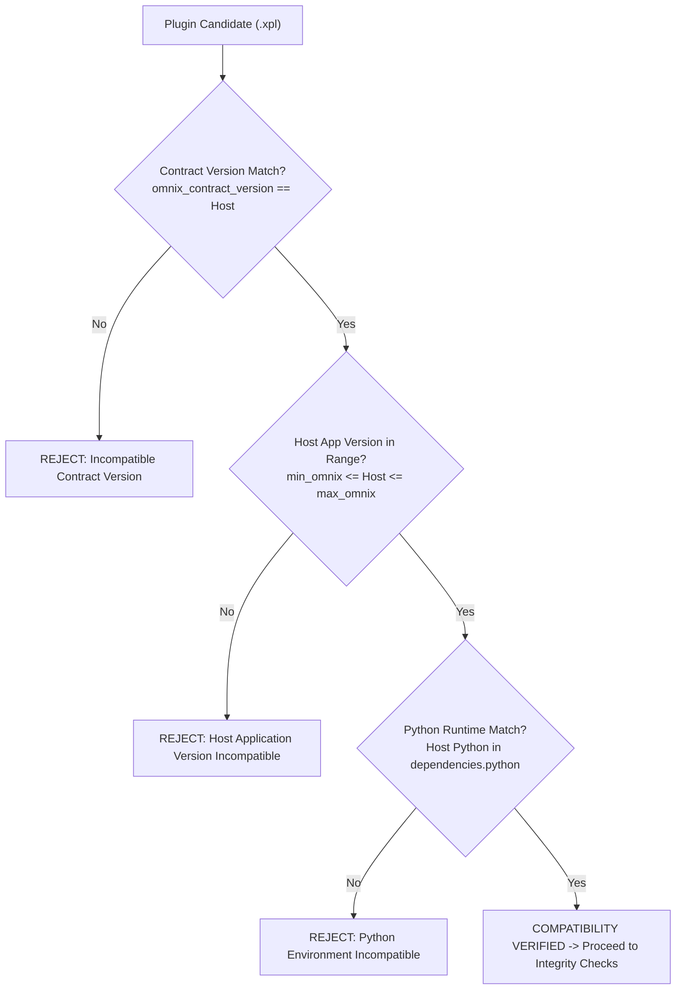
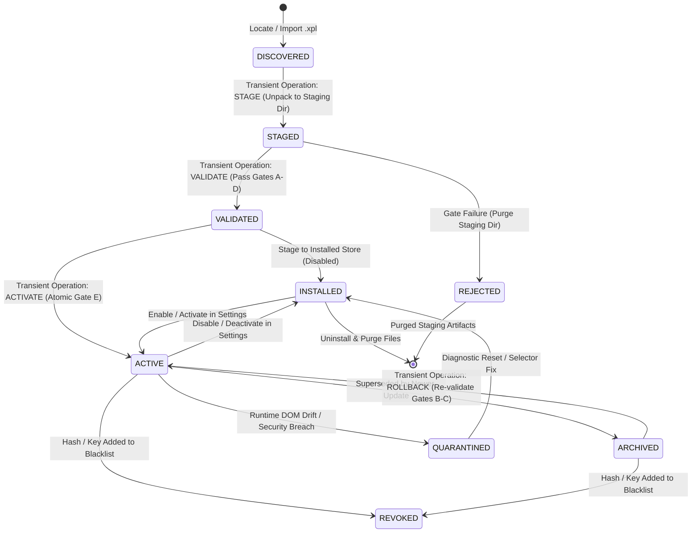
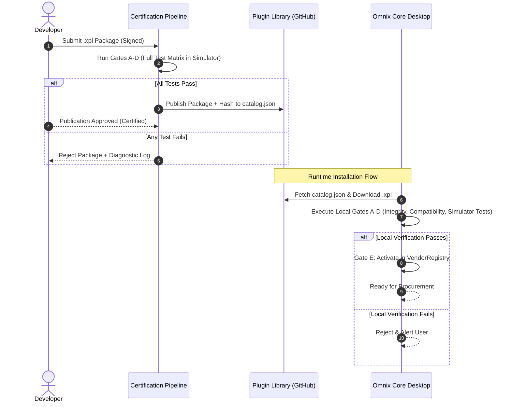

# OMNIX VENDOR PLUGIN & PROCUREMENT ARCHITECTURE SPECIFICATION

**Document Reference:** `DOC-OMNIX-VPA-001`  
**Revision:** `6.1.0 — SECURITY-HARDENED AND ARCHITECTURALLY RECONCILED BASELINE`  
**Status:** **AUTHORITATIVE ARCHITECTURAL SPECIFICATION**  
**Governing Principle:** Omnix Core + Installable Versioned Vendor Plugins + Shared Procurement Pipeline  
**Baseline Repository Commit:** `647d82dce0ae3f9678c2635ac5e8865b53dc3322`  
**Target System:** Omnix Enterprise Core, Sourcing Engine, and Extensible Vendor Plugin Ecosystem  

---

## 1. Purpose, Scope, and Non-Goals

### 1.1 Purpose
This document establishes the official, authoritative architectural specification for Omnix's installable vendor plugin system and its integration with the Omnix Core procurement engine. It reconciles verified repository implementations with the target architecture to serve as the binding reference for all subsequent development, plugin packaging, validation, installation, and procurement orchestration.

### 1.2 Scope
This specification governs:
1. **Architectural Triad**: The strict separation of responsibilities among **Omnix Core**, **Vendor Plugins**, and the **Shared Procurement Pipeline**.
2. **Installable Package Format (`.xpl`)**: The logical structure, manifest schema, signature encapsulation, and file layout of installable plugin archives.
3. **Vendor Adapter Contract (`IVendorAdapter`)**: The unified Python interface, method contracts, type definitions, and fail-closed behaviors.
4. **Plugin Lifecycle & State Machine**: Discovery, validation, manual installation, staged transactional update, verified rollback, and dynamic activation/deactivation.
5. **Publisher Trust & Verification**: Cryptographic signing, package-hash integrity binding, publisher identity classification (Official vs. Third-Party Verified vs. Unsigned), and revocation enforcement.
6. **Capability & Procurement Mode Model**: Fine-grained capability declaration (`PRODUCT_URL_RECOGNITION`, `PRODUCT_INSPECTION`, `CART_URL_RESOLUTION`, `MPN_SEARCH`, `MODE_A_STAGING`, `MODE_B_STAGING`) and procurement mode rules (single-mode support permitted).
7. **Layered Validation Framework**: The eight mandatory testing tiers (Self-Tests, Capability, Contract, Integration, Workflow, Package/Security, Mode A Add-to-Cart Simulator, Mode B Add-to-Cart Simulator) required before activation.
8. **Preservation of Canonical Domain Rules**: Canonical inventory policy math, conservative MPN/package normalization, tri-state matching ($UNKNOWN \neq MATCH$), and GAP-13 cart delta synchronization ($\Delta Q = \max(0, \text{target} - \text{existing})$).

### 1.3 Non-Goals
The following areas are explicitly outside the scope of this specification and must not be altered:
- **No Implementation in Documentation Phase**: This phase is strictly limited to architectural definition and documentation; no loader code, UI widgets, or package importers are implemented in this turn.
- **No Revision of Procurement Business Math**: Mode A exact link pinning, Mode B 5-tier deterministic cost ranking, and canonical inventory threshold evaluations remain untouched.
- **No Mandatory Empty-Cart Preflight in this Phase**: Pre-order cart clearing or empty-cart blocking is intentionally deferred.
- **No BOM Deduplication / Consolidation Alterations**: Repeated BOM line item handling and multi-BOM order consolidation remain as previously defined.
- **No Live Purchasing or Payment Automation**: Testing and Add-to-Cart validation are strictly bounded to controlled Mock/Simulator environments; live checkout and monetary transactions are never automated.

---

## 2. Current State vs. Target Architecture

Treating the repository as the empirical source of truth, the following audit establishes what is currently confirmed in code versus what is proposed, open, or not implemented.

### 2.1 Audit Matrix of Architectural Capabilities

| Capability / Area | Repository Evidence / Implementation File | Current Status | Architectural Target |
| :--- | :--- | :--- | :--- |
| **Common Adapter Interface** | `core/vendor_interface.py` (`IVendorAdapter`) | **Confirmed** | Base contract with 13 operations + explicit `get_cart_url()` & `is_pdp_url()`. |
| **Authoritative Cart URL** | `IVendorAdapter.get_cart_url()` returns `None` by default. Lion, Javan, RoboEq implement explicit URLs. | **Confirmed** | Adapters must declare authoritative URLs; no generic `/cart` guessing. |
| **Fail-Closed PDP Validation** | `QuickOrderDialog.validate_vendor_pdp_url()` delegates to `adapter.is_pdp_url()` with fail-closed gates. | **Confirmed** | Validation fails closed if adapter is missing, lacks capability, or raises an error. |
| **Decoupled UI Navigation** | `OrderPreviewDialog` and `QuickOrderDialog` contain zero imports of `*Selectors` and zero Lion cart fallbacks. | **Confirmed** | UI interacts purely through `VendorRegistry` and `IVendorAdapter`. |
| **In-Memory Vendor Registry** | `core/procurement/registry.py` (`VendorRegistry`) | **Confirmed** | Thread-safe registry mapping `vendor_id` and storefront domains to adapter classes. |
| **Shared Procurement Pipeline** | `UniversalProcurementOrchestrator` (`stage_candidate`) & `ProcurementBridge` | **Confirmed** | Central pipeline executing GAP-13 delta synchronization and candidate evaluation. |
| **Cart Delta Synchronization** | `stage_candidate` executes $\Delta Q = \max(0, \text{target} - \text{existing})$ | **Confirmed** | Core-owned cart inspection and idempotent delta mutation. |
| **Plugin Package Format (`.xpl`)**| None in repository; plugins exist as in-tree subpackages under `vendors/`. | **Not Implemented** | Proposed `.xpl` ZIP container with `manifest.json` and signatures. |
| **Manifest Schema & Validator** | None in repository. | **Not Implemented** | Formal JSON schema and validator (`core/plugins/manifest_validator.py`). |
| **Version-Aware Registry** | `VendorRegistry` tracks adapter classes, but lacks version strings, active versions, or rollback stacks. | **Not Implemented** | Registry tracking `active_version`, installed versions, and compatibility. |
| **Digital Signatures & Trust** | None in repository. | **Not Implemented** | Ed25519 signatures, public key trust store, Official vs Third-Party verification. |
| **Package Installer & Importer** | None in repository; adapters registered via hardcoded `register_default_adapters()`. | **Not Implemented** | Transactional package installer unpacking to `plugins/installed/<vendor_id>/<version>/`. |
| **Staged Updates & Safe Rollback**| None in repository. | **Not Implemented** | Candidate staging, pre-activation validation, atomic symlink/pointer switch, rollback. |
| **Layered Plugin Test Harness** | In-tree pytest files (`test_*_adapter.py`, `test_desktop_workflows.py`). | **Proposed** | Formal 8-tier verification suite executing in a mock simulator environment. |
| **Online Plugin Library** | None in repository. | **Proposed** | Searchable catalog, version repository, download integrity verification. |

### 2.2 Paradigm Comparison

```
CURRENT REPOSITORY PARADIGM (Phase 2 Baseline):
┌────────────────────────────────────────────────────────────────────────┐
│ UI Layer (OrderPreviewDialog, QuickOrderDialog)                        │
└───────────────────────────────────┬────────────────────────────────────┘
                                    │ Polymorphic calls
┌───────────────────────────────────▼────────────────────────────────────┐
│ VendorRegistry (In-Memory Singleton: Lion, Javan, RoboEq)              │
└───────────────────────────────────┬────────────────────────────────────┘
                                    │ Python Class Instantiation
┌───────────────────────────────────▼────────────────────────────────────┐
│ In-Tree Python Packages (vendors/lion/, vendors/javan/, vendors/roboeq/)│
└────────────────────────────────────────────────────────────────────────┘

TARGET ARCHITECTURE (Omnix Core + Installable Plugins + Shared Pipeline):
┌────────────────────────────────────────────────────────────────────────┐
│ LAYER 0: UX & PRESENTATION (Inventory View, BOM Auditor, Quick Order)  │
└───────────────────────────────────┬────────────────────────────────────┘
                                    │ Pure Canonical DTOs
┌───────────────────────────────────▼────────────────────────────────────┐
│ LAYER 1: OMNIX CORE DOMAIN & SHARED PROCUREMENT PIPELINE               │
│ - InventoryPolicyEngine, Canonical Quantity Engine, Tri-State Matcher  │
│ - UniversalProcurementOrchestrator (GAP-13 Delta Sync Pipeline)        │
│ - Plugin Lifecycle, Trust & Verification Manager                       │
│ - Version-Aware VendorRegistry (Active Pointer, Compatibility Gates)   │
└───────────────────────────────────┬────────────────────────────────────┘
                                    │ IVendorAdapter Interface Contract
┌───────────────────────────────────▼────────────────────────────────────┐
│ LAYER 2: EXTENSIBLE VENDOR PLUGINS (Independent .xpl Packages)         │
│ ┌──────────────────────┐  ┌──────────────────────┐  ┌────────────────┐ │
│ │ Official Lion Plugin │  │ Official Javan Plugin│  │ 3rd-Party .xpl │ │
│ │ v1.2.0 (Ed25519)     │  │ v2.0.1 (Ed25519)     │  │ v0.9.0 (Signed)│ │
│ └──────────────────────┘  └──────────────────────┘  └────────────────┘ │
└────────────────────────────────────────────────────────────────────────┘
```

---

## 3. Architecture and Component Boundaries

The architecture strictly establishes three separate operational spheres:

### 3.1 Omnix Core Responsibilities
Omnix Core is 100% vendor-agnostic and owns all business rules, mathematical calculations, and lifecycle governance:
- **Canonical Domain Models**: Component identity (`ComponentIdentity`), procurement intent (`ProcurementRequest`), and candidate representations (`VendorProcurementCandidate`, `CandidateEvaluation`).
- **Inventory Replenishment Math**: Pure non-negative integer math ($\text{replenishment} = \text{target} - \text{current}$ when $\text{current} < \text{min}$).
- **Canonical Quantity Calculation**: Constraint-aware formula ($\text{effective} = \text{MOQ}$ if $\text{req} < \text{MOQ}$ else $\lceil \text{req} / \text{step} \rceil \times \text{step}$).
- **Component Matching**: Tri-state validation ($MATCH$, $MISMATCH$, $UNKNOWN$, $NOT\_APPLICABLE$) where $UNKNOWN \neq MATCH$.
- **Sourcing Strategy Dispatch**: Routing `EXACT_INVENTORY_LINK` (Mode A) versus `MULTI_VENDOR_DISCOVERY` (Mode B).
- **Candidate Ranking**: Deterministic 5-tier hierarchy (Cost $\rightarrow$ Stock $\rightarrow$ MOQ $\rightarrow$ `vendor_id` $\rightarrow$ `vendor_sku`).
- **Plugin Lifecycle & Security Governance**: Validation of manifests, signature checking, test orchestration, activation, transactional update, and rollback.
- **Registry Management**: Dynamic mapping of vendor IDs and storefront domains to validated, active plugin instances.

### 3.2 Vendor Plugin Responsibilities
A vendor plugin contains all supplier-specific integration logic and runs isolated within its package boundary:
- **Storefront Recognition**: Identifying product pages, cart URLs, search endpoints, and domain routes.
- **Product Inspection**: Scraping and extracting raw vendor facts (MPN, package, manufacturer, live stock, MOQ, order multiple, price tiers) from DOM/APIs.
- **Data Normalization to Contract**: Packaging raw site facts into typed Core models (`ProductDetails`, `StockStatus`, `OrderConstraints`).
- **Cart Mutation**: Adding components to the vendor shopping cart via browser automation or session endpoints.
- **Cart Inspection**: Inspecting active cart items and reporting accurate quantities and SKUs to Core for delta reconciliation.
- **Error Translation**: Mapping vendor-specific HTTP codes, Cloudflare blocks, and Persian toast messages into the Omnix 13-category error taxonomy.
- **Self-Contained Configuration**: Providing vendor selectors, regex patterns, and session parameters without leaking them to Core.

### 3.3 Shared Procurement Pipeline Responsibilities
The Shared Procurement Pipeline bridges Core intent with Plugin execution:
- **Unified Bridge (`ProcurementBridge`)**: Translating BOM shortages and inventory needs into canonical `ProcurementRequest` batches.
- **Orchestration (`UniversalProcurementOrchestrator`)**: Gathering candidates across enabled plugins and evaluating eligibility against user-configured constraints.
- **GAP-13 Delta Synchronization**: Enforcing idempotency by inspecting current cart contents before staging:
  $$\Delta Q = \max(0, \text{target\_order\_qty} - \text{existing\_cart\_qty})$$
- **Reporting Pipeline**: Building deterministic CSV, XLSX, and vector PDF manifests from actual staging outcomes.

---

## 4. Plugin Package Format (`.xpl`)

### 4.1 File Format & Extension
Installable Omnix vendor plugins are packaged as compressed ZIP archives using the file extension **`.xpl`** (Omnix Plugin Package).

#### Archive Evaluation & Justification:
- **Zip-Standard Compatibility**: The standard ZIP archive format (`deflate` compression) is natively supported by Python's `zipfile` module without external C-extensions, ensuring 100% cross-platform compatibility on Windows, Linux, and macOS.
- **No Format Collision**: The `.xpl` extension distinguishes Omnix plugins from standard Python wheels (`.whl`), generic ZIP files (`.zip`), or system executables (`.exe`), preventing accidental execution or ingestion by generic archive utilities.
- **Atomic Inspection**: ZIP files allow random-access reading of `manifest.json` and cryptographic signatures without decompressing the entire code payload into memory or disk.

### 4.2 Logical Directory Layout
```
<package_name>-<version>.xpl (ZIP Archive)
├── manifest.json              # Canonical plugin manifest (JSON format)
├── plugin/                    # Python package payload containing vendor implementation
│   ├── __init__.py            # Module root exporting the IVendorAdapter class
│   ├── adapter.py             # Core-facing adapter implementation
│   ├── automation.py          # Browser/DOM automation mechanics
│   ├── session.py             # Authentication and session persistence
│   ├── selectors.py           # DOM selectors and regex patterns
│   └── errors.py              # Vendor error taxonomy translation
├── assets/                    # Optional static assets
│   ├── icon.png               # Vendor brand icon (64x64 or 128x128 PNG)
│   └── documentation.md       # Plugin-specific usage notes and change log
├── tests/                     # Developer-supplied unit and mock DOM tests
│   ├── __init__.py
│   └── test_self.py           # Self-contained plugin unit tests
└── META-INF/                  # Cryptographic integrity and signature metadata
    ├── MANIFEST.MF            # SHA-256 digests of all package files (excluding META-INF/)
    ├── SIGNATURE.SIG          # Ed25519 digital signature of canonical MANIFEST.MF
    └── CERTIFICATE.CRT        # Optional X.509 / PEM certificate chain
```

### 4.3 Package Archive Security & Extraction Hardening Rules

To prevent archive-processing attacks and host filesystem compromise, all `.xpl` archives undergo rigorous pre-extraction validation:

1. **Path Traversal & ZIP Slip Prevention**:
   - Every archive member path is strictly normalized using `posixpath.normpath`.
   - Any entry with a leading `/` or `\`, containing `..` path segments, Windows drive specifiers (e.g. `C:`), or embedded null bytes (`\0`) causes immediate rejection (`PLUGIN_CORRUPT`).
   - Prior to writing any file, the destination path is resolved and verified:
     $$\text{os.path.commonpath}([\text{staging\_dir}, \text{dest\_file}]) == \text{staging\_dir}$$
     If any path resolves outside the designated staging root, extraction is aborted and the staging directory is completely purged.

2. **Duplicate & Conflicting Member Rejection**:
   - The archive is scanned for duplicate entry paths. Any archive containing identical normalized paths is rejected.
   - On case-insensitive file systems (Windows NTFS, macOS APFS), case collisions (e.g. `plugin/Adapter.py` vs `plugin/adapter.py`) could overwrite files maliciously. The unpacker enforces case-folded uniqueness across all member names.

3. **Symlink, Hardlink, and Device File Rejection**:
   - The unpacker inspects ZIP external file attributes (`ZipInfo.external_attr`).
   - Entries representing symbolic links (`S_IFLNK`), hardlinks, FIFOs/named pipes (`S_IFIFO`), character devices, or block devices are strictly rejected. Only regular files (`S_IFREG`) and standard directories (`S_IFDIR`) are permitted.

4. **Resource Exhaustion & Decompression Bomb Mitigations**:
   - **Maximum Archive File Size (Compressed)**: 10 MB.
   - **Maximum Total Uncompressed Size**: 50 MB cumulative across all members.
   - **Maximum Single File Uncompressed Size**: 20 MB.
   - **Maximum Compression Ratio**: 10:1 (enforced for any member whose uncompressed size exceeds 1 MB).
   - **Maximum Archive Member Count**: 500 total entries (files + directories).
   - Validation occurs by reading member headers from the central directory *before* streaming uncompressed bytes, terminating extraction immediately if any limit is exceeded.

5. **Strict File Extension Whitelist**:
   - To prevent smuggling of binary payloads or system executables, only declared safe extensions are permitted:
     `{".py", ".json", ".png", ".jpg", ".jpeg", ".svg", ".md", ".txt", ".MF", ".SIG", ".CRT"}`.
   - Archives containing compiled binaries (`.exe`, `.dll`, `.so`, `.dylib`), native Python C-extensions (`.pyd`), shell scripts (`.sh`, `.bat`, `.cmd`, `.ps1`), or executable scripts are rejected unconditionally.

6. **Namespace & Staging Containment**:
   - Extraction is restricted exclusively to an isolated, ephemeral staging directory:
     `~/.omnix/plugins/staging/<vendor_id>-<candidate_version>-<nonce>/`
   - Plugins are structurally barred from extracting into Omnix Core directories, system folders, or paths belonging to other plugins. Cross-plugin file overwrites are structurally impossible.

---

## 5. Manifest Schema and Validation

### 5.1 Format Justification: JSON vs. YAML
The plugin manifest is strictly named **`manifest.json`** and serialized in JSON.
- **Deterministic Parsing**: Python's standard `json` parser is fast, strictly deterministic, and built into the Python runtime.
- **Security**: Unlike YAML parsers (e.g., PyYAML), JSON parsing cannot be exploited via arbitrary Python object instantiation (`!!python/object/apply`) or complex anchor reference bombs.
- **Strict Typing**: JSON enforces unambiguous representations of booleans, numbers, strings, arrays, and nested dictionaries.

### 5.2 Canonical Manifest JSON Schema
```json
{
  "$schema": "https://omnix.dot.org/schemas/v1/plugin-manifest.json",
  "manifest_version": "1.0.0",
  "plugin_id": "com.omnix.vendor.lion",
  "vendor_id": "vendor_lion",
  "display_name": "Lion Electronic",
  "version": "1.2.0",
  "min_omnix_version": "2.0.0",
  "max_omnix_version": "2.99.99",
  "omnix_contract_version": "1.0.0",
  "entry_point": "plugin.adapter:LionVendorAdapter",
  "publisher": {
    "name": "Omnix Official Engineering",
    "type": "OFFICIAL",
    "key_id": "ed25519-omnix-official-2026-key1",
    "contact": "plugins@omnix.org"
  },
  "capabilities": [
    "PRODUCT_URL_RECOGNITION",
    "PRODUCT_INSPECTION",
    "CART_URL_RESOLUTION",
    "MPN_SEARCH",
    "MODE_A_STAGING",
    "MODE_B_STAGING"
  ],
  "supported_modes": [
    "MODE_A",
    "MODE_B"
  ],
  "routes": {
    "base_url": "https://lionelectronic.ir",
    "cart_url": "https://lionelectronic.ir/orders/cart",
    "domains": [
      "lionelectronic.ir",
      "www.lionelectronic.ir"
    ],
    "pdp_patterns": [
      "^https?://(?:www\\.)?lionelectronic\\.ir/products/(?P<product_id>\\d+)-(?P<slug>[a-zA-Z0-9_.\\-\\+\\/]+)$",
      "^/products/(?P<product_id>\\d+)-(?P<slug>[a-zA-Z0-9_.\\-\\+\\/]+)$"
    ]
  },
  "dependencies": {
    "python": ">=3.11",
    "external_libraries": [
      "beautifulsoup4>=4.12.0",
      "selenium>=4.20.0"
    ]
  }
}
```

### 5.3 Manifest Field Specifications & Validation Rules

| Field Name | Type | Allowed Values / Constraints | Failure Action |
| :--- | :--- | :--- | :--- |
| `manifest_version` | `string` | Must match supported schema version (currently `"1.0.0"`). | Reject package: Schema version unsupported. |
| `plugin_id` | `string` | Reverse-DNS format (`^[a-z0-9_]+(\\.[a-z0-9_]+)+$`, max 64 chars). | Reject package: Malformed plugin identifier. |
| `vendor_id` | `string` | Lowercase snake_case (`^vendor_[a-z0-9_]+$`, max 32 chars). | Reject package: Malformed vendor identifier. |
| `display_name` | `string` | Non-empty string (3–64 chars). | Reject package: Invalid display name. |
| `version` | `string` | Valid SemVer 2.0.0 (`MAJOR.MINOR.PATCH`). | Reject package: Version is not valid SemVer. |
| `min_omnix_version` | `string` | Valid SemVer 2.0.0. Current host must be $\ge$ min. | Reject package: Omnix version incompatible. |
| `max_omnix_version` | `string` | Valid SemVer 2.0.0 or `null`. Current host must be $\le$ max. | Reject package: Omnix version incompatible. |
| `omnix_contract_version`| `string`| Must match Core contract major version (`"1.0.0"`). | Reject package: Contract version mismatch. |
| `entry_point` | `string` | Format `module.path:ClassName`. | Reject package: Entry point malformed. |
| `publisher.type` | `string` | `"OFFICIAL"`, `"THIRD_PARTY_VERIFIED"`, `"COMMUNITY"`. | Reject package: Unrecognized publisher type. |
| `publisher.key_id` | `string` | Matches public key identifier in trust store. | Reject package: Unknown publisher key. |
| `capabilities` | `list[string]`| Valid canonical capability IDs (Section 7). | Reject package: Invalid capability declared. |
| `supported_modes` | `list[string]`| Subset of `["MODE_A", "MODE_B"]`. Non-empty. | Reject package: No supported modes declared. |
| `routes.base_url` | `string` | Valid absolute URL (`http://` or `https://`). | Reject package: Invalid base URL. |
| `routes.cart_url` | `string` | Valid absolute URL (`http://` or `https://`). | Reject package: Invalid cart URL. |
| `routes.domains` | `list[string]`| Non-empty list of valid hostnames without ports/paths. | Reject package: Empty or invalid domain routes.|

---

## 6. Vendor Adapter Contract (`IVendorAdapter`)

All vendor plugins implement the unified `IVendorAdapter` abstract base class defined in [`core/vendor_interface.py`](file:///d:/management-elec/autom/atom/core/vendor_interface.py).

```python
from abc import ABC, abstractmethod
from typing import Optional, Dict, Any, List
from core.models import (
    AdapterStatus,
    AuthResult,
    ProductReference,
    SearchResultSet,
    ProductDetails,
    CanonicalComponentDraft,
    StockStatus,
    OrderConstraints,
    CartMutationResult,
    CartDetails,
    RecoveryResult,
)

class IVendorAdapter(ABC):
    """
    Unified Vendor Adapter Contract Interface.
    Governs all communication between Omnix Core and vendor plugins.
    """

    @property
    @abstractmethod
    def vendor_id(self) -> str:
        """Unique vendor identifier (e.g., 'vendor_lion')."""
        pass

    @property
    @abstractmethod
    def base_url(self) -> str:
        """Authoritative base storefront URL."""
        pass

    @abstractmethod
    def initialize(self, config: Optional[Dict[str, Any]] = None) -> AdapterStatus:
        """Initialize adapter dependencies, session state, and configurations."""
        pass

    @abstractmethod
    def authenticate(self, credentials: Optional[Dict[str, Any]] = None) -> AuthResult:
        """Authenticate user against vendor storefront; persist cookies/tokens."""
        pass

    @abstractmethod
    def validate_session(self) -> bool:
        """Verify whether the active session credentials/cookies remain authenticated."""
        pass

    @abstractmethod
    def search_part(self, query: str) -> SearchResultSet:
        """Execute catalog search by part number or query string."""
        pass

    @abstractmethod
    def resolve_product(self, url_or_sku: str) -> ProductReference:
        """Resolve a direct product URL or vendor SKU into a ProductReference."""
        pass

    @abstractmethod
    def inspect_product(self, product_ref: ProductReference) -> ProductDetails:
        """Scrape or query full canonical details (MPN, package, manufacturer, specs, pricing)."""
        pass

    @abstractmethod
    def extract_product_data(self, dom_context: Any) -> CanonicalComponentDraft:
        """Extract technical specifications and package information from DOM context."""
        pass

    @abstractmethod
    def inspect_stock(self, product_ref: ProductReference) -> StockStatus:
        """Probe real-time inventory level for the product reference."""
        pass

    @abstractmethod
    def determine_order_constraints(self, product_ref: ProductReference) -> OrderConstraints:
        """Extract vendor-enforced Minimum Order Quantity (MOQ) and packaging multiples."""
        pass

    @abstractmethod
    def add_to_cart(self, product_ref: ProductReference, quantity: int) -> CartMutationResult:
        """Add requested quantity of product into vendor shopping cart."""
        pass

    @abstractmethod
    def inspect_cart(self) -> CartDetails:
        """Inspect active cart contents for quantity reconciliation and delta sync."""
        pass

    @abstractmethod
    def recover_from_error(self, error: Exception) -> RecoveryResult:
        """Execute vendor-specific recovery flow (e.g. dismissing modals, reconnecting session)."""
        pass

    @abstractmethod
    def close(self) -> None:
        """Cleanly terminate browser sessions and release system resources."""
        pass

    def get_cart_url(self) -> Optional[str]:
        """
        Return the storefront cart URL for browser navigation and user review.
        Base contract returns None; every production adapter must explicitly define its cart URL.
        """
        return None

    def is_pdp_url(self, url: str) -> bool:
        """
        Check whether the given storefront URL matches a canonical Product Detail Page (PDP).
        Base contract returns False (strict fail-closed rejection).
        """
        return False
```

### Contract Guarantees & Invariants
1. **Explicit Cart URLs**: An adapter must return a valid, verified URL from `get_cart_url()`. If an adapter returns `None`, an empty string, or an invalid scheme, Core treats the cart URL as unavailable and suppresses browser navigation.
2. **Fail-Closed PDP Validation**: `is_pdp_url(url)` evaluates strictly against verified URL/path regexes. Non-PDP URLs (home, search, cart, category) evaluate to `False`.
3. **Freshness Rule**: If `inspect_product()` already extracted fresh, authoritative stock counts during initial inspection, Core does not force a redundant browser call to `inspect_stock()`.

---

## 7. Capability and Mode Model

### 7.1 Canonical Capability Identifiers
Capabilities represent fine-grained functional features exposed by a plugin:

| Capability Identifier | Semantic Meaning & Operational Scope |
| :--- | :--- |
| `PRODUCT_URL_RECOGNITION` | Plugin can validate and recognize canonical Product Detail Page (PDP) URLs via `is_pdp_url()`. |
| `PRODUCT_INSPECTION` | Plugin can extract specifications, package, brand, stock, and pricing via `inspect_product()`. |
| `CART_URL_RESOLUTION` | Plugin provides an authoritative storefront cart URL via `get_cart_url()`. |
| `MPN_SEARCH` | Plugin can search the supplier catalog using MPN or partial queries via `search_part()`. |
| `LIVE_STOCK_PROBE` | Plugin provides an optimized real-time stock availability check via `inspect_stock()`. |
| `TIERED_PRICING` | Plugin extracts and reports structured quantity price tiers (`min_qty`, `unit_price`). |
| `MODE_A_STAGING` | Plugin supports Mode A exact inventory link staging via `add_to_cart()`. |
| `MODE_B_STAGING` | Plugin supports Mode B multi-vendor discovery staging via `add_to_cart()`. |

### 7.2 Capability Status Quad-State
For any capability, Omnix tracks an explicit quad-state:
- **`PASSED`**: Declared by publisher and independently verified by Omnix test harness.
- **`FAILED`**: Declared by publisher, but failed during mandatory capability verification.
- **`NOT_RUN`**: Declared by publisher, but mandatory verification has not yet executed.
- **`NOT_SUPPORTED`**: Not declared by plugin; feature is intentionally unavailable.
- **`BLOCKED`**: Prohibited from operational use due to security policy or revocation.

> [!IMPORTANT]
> `NOT_SUPPORTED`, `NOT_RUN`, `FAILED`, and `PASSED` are distinct operational states and must never be conflated.

### 7.3 Procurement Mode Support Rules
1. **Single-Mode Plugins Permitted**: A plugin that implements only Mode A (e.g. pinned URL staging) is fully valid and accepted, provided it declares `["MODE_A"]` and does not claim Mode B.
2. **No False Advertising**: A plugin must pass mandatory Add-to-Cart validation for every mode it declares. If a plugin claims `["MODE_A", "MODE_B"]`, but fails Mode B validation, the update/installation is rejected.
3. **Core Mode Guarding**: Omnix Core inspects `supported_modes` before dispatching procurement batches. If a BOM requires Mode B discovery, plugins supporting only Mode A are bypassed automatically without error.

---

## 8. Versioning and Compatibility

### 8.1 Semantic Versioning (SemVer 2.0.0)
All plugin versions must adhere strictly to `MAJOR.MINOR.PATCH`:
- **`MAJOR`**: Breaking changes to the plugin's internal selectors, supported models, or dropped capabilities.
- **`MINOR`**: Backwards-compatible feature additions (e.g. adding `TIERED_PRICING` support).
- **`PATCH`**: Backwards-compatible bug fixes, DOM drift adjustments, or selector maintenance.

### 8.2 Three-Way Compatibility Matrix
A plugin candidate must satisfy a three-way compatibility check before installation or activation:
1. **`omnix_contract_version` vs Host Contract Version**: Major version must match exactly (e.g. `"1.0.0"` matches Core Contract `"1.x.x"`).
2. **`min_omnix_version` / `max_omnix_version` vs Host Omnix Version**:
   $$\text{min\_omnix\_version} \le \text{Host Version} \le \text{max\_omnix\_version}$$
3. **Python Runtime Compatibility**: Host Python interpreter must satisfy the declared `dependencies.python` range (e.g. `Python >= 3.11`).



---

## 9. Publisher Identity, Signatures, and Trust

### 9.1 Decoupled Dimensions of Trust and Execution Authorization

To prevent dangerous conflation between cryptographic identity, functional capability, and security posture, Omnix strictly decouples six distinct architectural dimensions:

```
┌───────────────────────────────────────────────────────────────────────────────────────────────────────┐
│                           SIX DECOUPLED ARCHITECTURAL DIMENSIONS                                      │
├──────────────────────────┬─────────────────────────────────────┬──────────────────────────────────────┤
│ Dimension                │ Evaluated By                        │ Possible States / Values             │
├──────────────────────────┼─────────────────────────────────────┼──────────────────────────────────────┤
│ 1. Publisher Identity    │ Public key ID & Certificate Subject │ Key ID, Publisher Name, Contact      │
├──────────────────────────┼─────────────────────────────────────┼──────────────────────────────────────┤
│ 2. Publisher Class/Tier  │ Keyring matching against Core Trust │ OFFICIAL, THIRD_PARTY_VERIFIED,      │
│                          │ Store                               │ COMMUNITY, BLOCKED                   │
├──────────────────────────┼─────────────────────────────────────┼──────────────────────────────────────┤
│ 3. Package Integrity     │ Per-file SHA-256 + Ed25519 Signature│ UNTAMPERED, TAMPERED, CORRUPT        │
├──────────────────────────┼─────────────────────────────────────┼──────────────────────────────────────┤
│ 4. System Compatibility  │ SemVer check vs Contract & Runtime  │ COMPATIBLE, INCOMPATIBLE             │
├──────────────────────────┼─────────────────────────────────────┼──────────────────────────────────────┤
│ 5. Functional Test Status│ 8-Tier Mock/Simulator Test Harness  │ PASSED, FAILED, NOT_SUPPORTED,       │
│                          │                                     │ NOT_RUN, BLOCKED                     │
├──────────────────────────┼─────────────────────────────────────┼──────────────────────────────────────┤
│ 6. Execution Authority   │ User / Enterprise Security Policy   │ AUTHORIZED_PRODUCTION,               │
│                          │                                     │ AUTHORIZED_DEV_ONLY, DENIED          │
└──────────────────────────┴─────────────────────────────────────┴──────────────────────────────────────┘
```

> [!WARNING]
> **Core Architectural Principles**:
> 1. A verified signature establishes **integrity and publisher identity only**; it does **not** prove that the underlying Python code is safe or non-malicious.
> 2. A valid third-party signature must **never** cause a plugin to be displayed or treated as an official Omnix plugin.
> 3. Passing functional tests proves **API compliance only**; it does **not** constitute a security audit or guarantee absence of malicious logic.

### 9.2 Non-Circular Cryptographic Model & Signing Specification

Omnix enforces a strict, four-tier cryptographic model that completely eliminates circular signature and hashing dependencies:

```
[ Individual Payload Files: plugin/*.py, manifest.json, assets/*, tests/* ]
                              │
                              ▼  (Step 1: Compute Per-File SHA-256)
┌──────────────────────────────────────────────────────────────────────┐
│ 1. META-INF/MANIFEST.MF                                              │
│    Canonical, sorted list of relative paths and their SHA-256 digests │
│    (Strictly excludes META-INF/ files to prevent circular loops)      │
└─────────────────────────────────┬────────────────────────────────────┘
                                  │
                                  ▼  (Step 2: Sign Canonical Manifest Bytes)
┌──────────────────────────────────────────────────────────────────────┐
│ 2. META-INF/SIGNATURE.SIG                                            │
│    Raw Ed25519 signature computed strictly over META-INF/MANIFEST.MF  │
└─────────────────────────────────┬────────────────────────────────────┘
                                  │
                                  ▼  (Step 3: Pack into Final .xpl ZIP Archive)
┌──────────────────────────────────────────────────────────────────────┐
│ 3. Final Package Hash: package_hash = SHA-256(Raw .xpl Bytes)        │
│    Cryptographic fingerprint of the complete binary distribution      │
└─────────────────────────────────┬────────────────────────────────────┘
                                  │
                                  ▼  (Step 4: Execute Gates A-D in Simulator)
┌──────────────────────────────────────────────────────────────────────┐
│ 4. External Test Attestation: <package_hash>.attestation.json        │
│    Stored EXTERNALLY in cache or catalog; references package_hash    │
│    (Never embedded into .xpl to avoid mutating the package hash)     │
└──────────────────────────────────────────────────────────────────────┘
```

#### Detailed Cryptographic Entities:

1. **Per-File SHA-256 Manifest (`META-INF/MANIFEST.MF`)**:
   - Contains the cryptographic digest of every file included in the package payload.
   - **Exclusion Rule**: Files inside `META-INF/` (specifically `META-INF/MANIFEST.MF`, `META-INF/SIGNATURE.SIG`, and `META-INF/CERTIFICATE.CRT`) are strictly excluded from entries in `MANIFEST.MF`.
   - **Canonicalization Rules**:
     * File paths must be relative POSIX paths (`/`), normalized via `posixpath.normpath`. No leading slash, no `./`, no `../`.
     * Entries must be sorted lexicographically by UTF-8 byte order (Unicode code point order / C-locale).
     * Text encoding must be strictly UTF-8 with standard Unix newline (`\n`) terminators.
     * Entry format:
       ```
       File: manifest.json
       SHA-256-Digest: 4f53cda18c2baa0c0354bb5f9a3ecbe5ed12ab4d8e11ba873c2f11161202b945

       File: plugin/adapter.py
       SHA-256-Digest: e3b0c44298fc1c149afbf4c8996fb92427ae41e4649b934ca495991b7852b855
       ```

2. **Ed25519 Digital Signature (`META-INF/SIGNATURE.SIG`)**:
   - Algorithm: **Ed25519** (RFC 8032) pure digital signature system over Curve25519.
   - Signed Data: The signature is computed directly and exclusively over the exact UTF-8 byte sequence of `META-INF/MANIFEST.MF`.
   - Because `MANIFEST.MF` binds the SHA-256 digests of all package files, signing `MANIFEST.MF` transitively guarantees the integrity of the entire plugin payload without self-referential signature loops.

3. **Final Binary Package Hash (`package_hash`)**:
   - The final `.xpl` ZIP archive is created containing all payload files and the `META-INF/` directory.
   - `package_hash = sha256(raw_bytes_of_xpl_file)`.
   - This 64-character lowercase hexadecimal string acts as the immutable physical identifier of the distributed package across registries, download mirrors, and audit logs.

4. **External Non-Circular Test Attestation**:
   - To guarantee that test certification records cannot invalidate the signed package, test attestations are **strictly stored externally** from the `.xpl` archive.
   - Local storage: `~/.omnix/plugins/attestations/<package_hash>.attestation.json`.
   - Remote catalog: Embedded in `catalog.json` alongside the package download entry.
   - **Attestation Schema**:
     ```json
     {
       "attestation_version": "1.0.0",
       "package_hash": "a1b2c3d4e5f6...",
       "plugin_id": "com.omnix.vendor.lion",
       "version": "1.2.0",
       "omnix_contract_version": "1.0.0",
       "test_policy_revision": "2026.1",
       "attested_at": "2026-10-14T19:30:00Z",
       "test_results": {
         "self_tests": "PASS",
         "capability_tests": "PASS",
         "contract_tests": "PASS",
         "integration_tests": "PASS",
         "workflow_tests": "PASS",
         "security_tests": "PASS",
         "mode_a_add_to_cart": "PASS",
         "mode_b_add_to_cart": "PASS"
       },
       "attester": "Omnix Automated Certification Pipeline"
     }
     ```
   - Injecting test results or attestation files into the `.xpl` archive after testing is strictly prohibited because it would mutate the archive bytes and invalidate `package_hash`.

### 9.3 Publisher Trust Tiers & Authorization Policies

Omnix classifies publishers and governs execution authorization through four strict tiers:

```
┌───────────────────────────────────────────────────────────────────────────────────────────────────────┐
│                                   PUBLISHER TRUST TIERS & POLICIES                                    │
├────────────────────────┬────────────────────────────────────────────────────────┬─────────────────────┤
│ Trust Tier             │ Verification Requirements                              │ Execution Authority │
├────────────────────────┼────────────────────────────────────────────────────────┼─────────────────────┤
│ Tier 1: OFFICIAL       │ Signed by Omnix Official Private Key. Key present in   │ AUTHORIZED_         │
│                        │ built-in Core trust store. Verified untampered.        │ PRODUCTION (Default)│
├────────────────────────┼────────────────────────────────────────────────────────┼─────────────────────┤
│ Tier 2: 3RD_PARTY_     │ Signed by a registered partner key. Key present in     │ AUTHORIZED_         │
│         VERIFIED       │ trusted partner keyring. User must confirm install.    │ PRODUCTION (Prompt) │
├────────────────────────┼────────────────────────────────────────────────────────┼─────────────────────┤
│ Tier 3: COMMUNITY      │ Unsigned or signed by untrusted/self-signed key.       │ DENIED by default.  │
│                        │ Key absent from trusted keyring.                       │ DEV_ONLY if unlocked│
├────────────────────────┼────────────────────────────────────────────────────────┼─────────────────────┤
│ Tier 4: BLOCKED/       │ Key, certificate, or package_hash listed on local or   │ DENIED              │
│         REVOKED        │ online revocation blacklist.                           │ (Strict Rejection)  │
└────────────────────────┴────────────────────────────────────────────────────────┴─────────────────────┘
```

#### Policy Invariants:
1. **Third-Party Elevation Barrier**: A valid signature on a `THIRD_PARTY_VERIFIED` plugin verifies partner identity and package integrity, but can **never** elevate the plugin to `OFFICIAL`. The UI must explicitly display partner identity badges and prompt user confirmation prior to initial activation.
2. **Community / Unsigned Policy**: Unsigned plugins or plugins signed with unknown keys are **blocked from production procurement execution by default**. They are permitted exclusively in "Developer Mode" when explicitly enabled by a user setting (`developer_mode: true` in `settings.json`) and must display persistent warning banners indicating unverified code execution.
3. **Revocation & Rollback Immunity**: If a publisher key, certificate, or package hash is listed on the revocation blacklist, it is permanently denied. **Rollback cannot bypass revocation**: the rollback engine re-evaluates Gate B, and any package matching a revoked hash or key is blocked from reactivation.

### 9.4 Execution Isolation Boundaries and Residual Security Risk

The specification strictly differentiates **Storefront/Procurement Mock Simulation** from **Process/Operating System Isolation**:

```
┌───────────────────────────────────────────────────────────────────────────────────────────────────────┐
│                             ISOLATION DOMAINS & RESPONSIBILITIES                                      │
├─────────────────────────────────────────────────┬─────────────────────────────────────────────────────┤
│ Storefront & Procurement Mock Simulator         │ Host Operating System & Process Isolation           │
├─────────────────────────────────────────────────┼─────────────────────────────────────────────────────┤
│ - Protects external vendor websites from traffic│ - Protects user host files, OS, and environment     │
│ - Prevents real cart mutations on live sites    │ - Enforces timeouts, memory caps, and CPU limits    │
│ - Prevents financial checkout & credit charges  │ - Controls local filesystem read/write permissions  │
│ - Injects simulated stock, MOQ, and DOM faults  │ - Restricts network sockets and credential access   │
└─────────────────────────────────────────────────┴─────────────────────────────────────────────────────┘
```

> [!CAUTION]
> **Mocking a vendor website does NOT isolate the host operating system.**  
> An adapter executing inside a mock simulator can still attempt to read private user files, open outbound network sockets, or access system credentials unless host execution boundaries are enforced.

#### Implementable Three-Phase Execution Model:

1. **Static Inspection Phase (Gates A, B, C)**:
   - **Zero Code Execution**: Manifest parsing (`json.loads`), archive integrity validation, file digest calculations (`hashlib.sha256`), and Ed25519 signature checks (`cryptography`) are performed purely via static analysis.
   - No Python modules from the plugin are imported, executed, or instantiated during Gates A, B, or C.

2. **Test Execution Phase (Gate D)**:
   - When plugin code must be executed to verify `IVendorAdapter` compliance and capabilities, it executes under controlled test boundaries:
     * **Execution Timeout**: Enforced hard timeout of 30 seconds for the entire test suite and 5 seconds per test method.
     * **Network Socket Interception**: Standard library socket connections are intercepted; all outbound network traffic to non-mock destinations is blocked (fail-closed).
     * **Mock Credentials Only**: The test harness supplies synthetic dummy credentials (`test_user`, `dummy_password`) during `authenticate()`; real user credentials are never provided to tests.
     * **Functional vs. Safety Distinction**: Passing all 8 test tiers proves that the plugin satisfies functional procurement requirements, but **does not prove the code is harmless**.

3. **Runtime Execution Phase (Gate E & Active Procurement)**:
   - **Tier 1 (Official) & Tier 2 (Third-Party Verified)**: Executed in-process. Credentials are provided in-memory exclusively via method parameters to `authenticate()`; direct filesystem access is restricted to the plugin data folder (`~/.omnix/plugins/data/<vendor_id>/`).
   - **Tier 3 (Community) Residual Security Risk**:
     * In-process CPython execution cannot guarantee hard OS-level sandboxing against malicious Python code (e.g. obfuscated dynamic imports or native extensions).
     * **Architecture Decision (OD-003)**: Out-of-process RPC worker sandboxing is documented as the target for untrusted third-party code. Until OD-003 is fully implemented, running untrusted Community code carries residual host risk. Consequently, Community plugins are restricted strictly to Development Mode and barred from production environments.

---

## 10. Installation and Activation Lifecycle

### 10.1 Persistent Plugin States vs. Transient Lifecycle Operations

To eliminate ambiguous states and guarantee deterministic failure handling, Omnix strictly separates **Persistent Plugin States** (the stored status of a package version on disk and in registry) from **Transient Lifecycle Operations** (atomic engine actions):



#### Definitions of Persistent States:
- **`DISCOVERED`**: An `.xpl` file has been identified locally or downloaded from the library, but has not yet been unpacked or evaluated.
- **`STAGED`**: The archive has been unpacked into an isolated, ephemeral scratch directory (`staging/<vendor_id>-<candidate_version>-<nonce>/`) and is undergoing inspection and testing.
- **`VALIDATED`**: The package has successfully passed Gates A, B, C, and D; an external test attestation has been generated and cached; the plugin is certified ready for activation.
- **`INSTALLED` (or `DISABLED`)**: The plugin resides in the local installed repository (`plugins/installed/<vendor_id>/<version>/`), is verified and intact, but is currently deactivated (not loaded into `VendorRegistry` or procurement routes).
- **`ACTIVE`**: The plugin is registered in `VendorRegistry` under the thread-safe active pointer (`plugins/active/<vendor_id>`), actively servicing product inspection and cart staging.
- **`ARCHIVED`**: A previously active healthy version displaced by a newer version, retained in `plugins/archive/<vendor_id>/<version>/` for rollback.
- **`QUARANTINED`**: An active plugin that encountered critical runtime security violations or severe storefront DOM drift, temporarily suspended from procurement routing pending repair.
- **`REVOKED`**: A package hash or publisher key listed on the revocation blacklist. Revoked plugins cannot be installed, activated, or rolled back to under any circumstances.
- **`REJECTED`**: A candidate package that failed any gate during validation. Staging files are purged, and a diagnostic failure log is recorded.

---

### 10.2 Five Strict Verification Gates

Every candidate package must traverse five fail-closed verification gates in strict sequence:

```
[ .xpl Candidate Package ]
           │
           ▼
┌──────────────────────┐     Fail
│ GATE A: Archive      ├─────────────► REJECT: Directory Traversal / Bomb / Malformed Archive
│ Hardening & Checks   │               (Purge Staging Folder)
└──────────┬───────────┘
           │ Pass
           ▼
┌──────────────────────┐     Fail
│ GATE B: Cryptographic├─────────────► REJECT: Tampered Digest / Invalid Signature / Revoked Key
│ Integrity & Trust    │               (Purge Staging Folder)
└──────────┬───────────┘
           │ Pass
           ▼
┌──────────────────────┐     Fail
│ GATE C: Manifest &   ├─────────────► REJECT: Schema Invalid / Contract or Host Incompatible
│ System Compatibility │               (Purge Staging Folder)
└──────────┬───────────┘
           │ Pass
           ▼
┌──────────────────────┐     Fail
│ GATE D: Isolated     ├─────────────► REJECT: Contract Breach / Undeclared Mode / Test Failure
│ Test Harness (Sim)   │               (Purge Staging Folder)
└──────────┬───────────┘
           │ Pass (Attestation Generated)
           ▼
┌──────────────────────┐
│ GATE E: Atomic       ├─────────────► ACTIVATED: Registered in VendorRegistry & Route Mappings
│ Registry Activation  │
└──────────────────────┘
```

1. **Gate A: Archive Hardening & Decompression Guard**:
   - Enforce archive limits (max 10 MB compressed, max 50 MB uncompressed, max 10:1 ratio, max 500 entries).
   - Reject any member path with `..`, leading slashes, drive letters, or null bytes; enforce destination containment via `os.path.commonpath`.
   - Reject symlinks, hardlinks, FIFOs, device nodes, and duplicate/case-colliding paths.
   - Enforce file extension whitelist (strictly reject native binaries, DLLs, and shell scripts).
   - *Static inspection only; zero Python code executed.*

2. **Gate B: Cryptographic Integrity & Revocation Gate**:
   - Verify every file's SHA-256 digest against `META-INF/MANIFEST.MF`.
   - Verify Ed25519 signature in `META-INF/SIGNATURE.SIG` over canonical `MANIFEST.MF` bytes using publisher public key.
   - Check publisher key and `package_hash` against local and online revocation blacklists.
   - Match publisher key in Core trust store to assign trust tier (`OFFICIAL`, `THIRD_PARTY_VERIFIED`, `COMMUNITY`).
   - *Static inspection only; zero Python code executed.*

3. **Gate C: Manifest & Compatibility Gate**:
   - Validate `manifest.json` against canonical JSON schema (`ManifestValidator`).
   - Verify three-way compatibility: `omnix_contract_version` exact major match, host application version in `[min_omnix_version, max_omnix_version]`, host Python runtime in `dependencies.python`.
   - Verify non-empty `supported_modes` (subset of `["MODE_A", "MODE_B"]`).
   - *Static inspection only; zero Python code executed.*

4. **Gate D: Automated Test Harness & Sandbox Execution Gate**:
   - Execute all 8 test tiers (Section 12) inside the headless Mock/Simulator environment.
   - Enforce hard execution timeouts (30s suite, 5s per test) and network socket interception (blocking all non-mock outbound internet traffic).
   - Verify every declared capability passes. Single-mode plugins (`["MODE_A"]` or `["MODE_B"]`) only need to pass tests for their declared mode.
   - On full success: generate external test attestation `<package_hash>.attestation.json` and persist it to `~/.omnix/plugins/attestations/`.

5. **Gate E: Atomic Registry Activation Gate**:
   - Move validated package into installed repository `plugins/installed/<vendor_id>/<version>/`.
   - Under thread-safe registry lock (`_lock`), atomically update active pointer `plugins/active/<vendor_id>`, instantiate adapter, and register storefront domain routes.
   - Log activation event to structured audit trail.

---

## 11. Update and Rollback

### 11.1 Staged Transactional Update & Failure Recovery

Updates are fully transactional and guarantee zero downtime and zero partial activation:

```
STAGING ISOLATION WORKFLOW:
1. Active Version v1.0.0 is servicing procurement requests from ~/.omnix/plugins/active/vendor_lion/
2. Candidate v1.1.0 is unpacked into ~/.omnix/plugins/staging/vendor_lion-1.1.0-<nonce>/
3. Gates A through D execute against the candidate in staging. Active v1.0.0 is 100% unaffected.
4. If Gate A, B, C, or D fails:
   - Staging directory is completely wiped.
   - Active v1.0.0 continues running without interruption.
   - Diagnostic error log is recorded.
5. If Gates A through D pass:
   - Core acquires VendorRegistry._lock.
   - Moves active v1.0.0 folder to ~/.omnix/plugins/archive/vendor_lion/1.0.0/
   - Moves staging candidate to ~/.omnix/plugins/installed/vendor_lion/1.1.0/
   - Atomically points ~/.omnix/plugins/active/vendor_lion -> installed/vendor_lion/1.1.0/
   - Instantiates new LionVendorAdapter and releases _lock.
```

#### Failure & Interruption Guarantees:
- **Zero Partial State**: An update is never partially activated. Either the new version passes all gates and replaces the active version atomically under lock, or the active version remains unchanged.
- **Crash / Power-Loss Recovery**: On application startup, Omnix inspects `plugins/staging/`. Any leftover candidate directories from an interrupted process are purged immediately before loading active plugins.
- **Health Preservation**: The healthy active version is moved to `archive/` only *after* the candidate has completely passed Gate D and the registry cutover lock has been acquired.

### 11.2 Re-Validated Rollback

Rollback reactivates an archived version safely and must **never** bypass security policies:

1. **Locate Rollback Candidate**: The user or automation selects a target archived version from `~/.omnix/plugins/archive/<vendor_id>/<target_version>/`.
2. **Mandatory Policy Re-Validation**:
   - **Revocation Check (Gate B)**: The candidate's `package_hash` and publisher key are checked against the latest revocation blacklist. If the version was archived due to a security flaw or its key was revoked, **rollback is strictly blocked** (`ROLLBACK_BLOCKED_REVOKED`).
   - **Host Compatibility Check (Gate C)**: The candidate's `min_omnix_version`, `max_omnix_version`, and `omnix_contract_version` are evaluated against the *current* running host. If the host has been upgraded past the archived version's supported range, **rollback is blocked** (`ROLLBACK_BLOCKED_INCOMPATIBLE`).
   - **Integrity Re-Verification**: SHA-256 digests in `META-INF/MANIFEST.MF` and the overall `package_hash` are re-calculated to ensure archived files were not tampered with on disk.
3. **Atomic Cutover**:
   - Core acquires `VendorRegistry._lock`.
   - The current active version is moved to `archive/`.
   - The rollback version is moved to `installed/` and the active pointer is updated.
   - The rolled-back adapter is instantiated and registered.
   - Core releases `_lock` and records the `ROLLBACK` event in the audit trail.

---

## 12. Testing Strategy and Mandatory Test Matrix

Before any plugin can be activated in production, it must pass a comprehensive, layered test matrix.

### 12.1 Layered Test Framework Matrix

| Test Category | Scope & Objective | Executed By | Activation Gate | Simulator Required? |
| :--- | :--- | :--- | :--- | :--- |
| **8.1 Self-Tests** | Unit tests supplied by plugin developer validating internal parsing and regexes. | Plugin Runner | Gate D | No (Unit Mock) |
| **8.2 Capability Tests** | Independent verification that declared capabilities behave per contract (e.g. testing valid/invalid PDP URLs). | Omnix Core | Gate D | Yes (Mock DOM) |
| **8.3 Contract Tests** | Compliance with all 13 `IVendorAdapter` operations, typed models, and error translations. | Omnix Core | Gate D | Yes (Mock DOM) |
| **8.4 Integration Tests** | Registry discovery, initialization, domain routing, and session lifecycle. | Omnix Core | Gate D | Yes (Mock Session) |
| **8.5 Workflow Tests** | End-to-end Mode A and Mode B procurement execution through the orchestrator. | Omnix Core | Gate D | Yes (Simulator) |
| **8.6 Security Tests** | Package integrity, signature verification, zip-slip checks, AST import scanning. | Omnix Core | Gate B & C | No (Static Analysis) |
| **8.7 Add-to-Cart (Mode A)** | Verification of exact component selection and cart staging under Mode A pinned links. | Omnix Core | Gate D | Yes (Cart Simulator) |
| **8.8 Add-to-Cart (Mode B)** | Verification of candidate selection and cart staging under Mode B multi-vendor discovery. | Omnix Core | Gate D | Yes (Cart Simulator) |

### 12.2 Test Outcome Classification
Every test execution produces one of five mutually exclusive states:
- **`PASS`**: Execution succeeded and all assertions were verified.
- **`FAIL`**: Execution failed, returned unexpected data, or raised an unhandled exception.
- **`NOT_SUPPORTED`**: The test was skipped because the plugin does not claim the relevant capability or mode.
- **`NOT_RUN`**: The test has not been executed yet for this package version.
- **`BLOCKED`**: The test could not run because a prerequisite gate (e.g. signature verification) failed.

---

## 13. Mock/Simulator Requirements

### 13.1 Strict Isolation from Live Vendor Websites
> [!CAUTION]
> **Real purchases, credit card payments, or live vendor cart mutations are strictly prohibited during plugin testing and validation.**

All plugin validation executes inside a controlled Mock / Simulator Environment:
1. **Mock HTTP Transport**: Intercepts outbound HTTP requests using deterministic fixtures, returning pre-recorded HTML pages and API responses.
2. **Headless DOM Simulator**: Simulates browser execution (BeautifulSoup / headless Chromium with mocked endpoints) to verify DOM selection, button clicks, and modal interactions without live network calls.
3. **Mock Cart State Machine**: Simulates vendor shopping cart state, allowing validation of item addition, quantity updates, duplicate SKU handling, and cart clearing.
4. **Deterministic Error Injection**: Validates adapter error translation by injecting simulated 404s, out-of-stock notices, MOQ violations, Cloudflare challenge pages, and session timeouts.

### 13.2 Host Environment & Process Isolation vs. Storefront Simulation

To prevent architectural ambiguity, Omnix explicitly defines the boundary between storefront simulation and operating system security:

```
┌───────────────────────────────────────────────────────────────────────────────────────────────────────┐
│                       STOREFRONT SIMULATION VS. HOST PROCESS ISOLATION                                │
├──────────────────────────────────────────────────┬────────────────────────────────────────────────────┤
│ 1. Storefront Simulation (Gate D Procurement)    │ 2. Host Process & OS Isolation (System Security)   │
├──────────────────────────────────────────────────┼────────────────────────────────────────────────────┤
│ • Prevents HTTP traffic to live vendor endpoints │ • Prevents untrusted code from reading host files  │
│ • Simulates cart state and item quantities       │ • Blocks arbitrary socket creation & egress calls  │
│ • Enforces zero financial / checkout operations  │ • Enforces CPU/RAM resource limits & hard timeouts │
│ • Validates MPN matching and quantity math       │ • Isolates credentials and session secrets         │
└──────────────────────────────────────────────────┴────────────────────────────────────────────────────┘
```

#### Test Execution Host Boundaries (Gate D):
1. **Zero Outbound Network Egress**: During Gate D test execution, socket creation is trapped via a transport interceptor. Any attempted network connection to addresses outside local loopback mock fixtures results in immediate test failure and gate rejection (`TEST_NETWORK_VIOLATION`).
2. **Execution Timeouts & Resource Caps**:
   - Hard execution timeout: 30 seconds for the entire test suite, 5 seconds per test method.
   - Memory limit: 512 MB maximum resident set size during test execution.
   - Infinite loops, hung threads, or excessive memory allocations terminate the runner and trigger `TEST_RESOURCE_EXHAUSTED`.
3. **Synthetic Dummy Secrets**: Only mock credentials (`dummy_user`, `dummy_token`) are supplied during test execution. Real user credentials, API keys, or browser cookies are strictly isolated and never passed to the test runner.
4. **Functional Testing $\neq$ Malware Detection**:
   - A passing test suite in Gate D verifies that the adapter correctly parses DOM elements, calculates quantities, and adheres to `IVendorAdapter`.
   - **Crucial Invariant**: A passing functional test does **not** prove that the plugin is free of malicious intent, data harvesting logic, or hidden side effects.
5. **Deferred Full OS Sandboxing & Residual Risk**:
   - Operating system-level process sandboxing (OD-003) is deferred in the initial Phase 2/3 baseline.
   - Because Python AST static analysis cannot provide 100% OS-level containment against sophisticated dynamic evasion, untrusted `COMMUNITY` plugins carry residual host risk and are **strictly confined to Development Mode**. They cannot be authorized for automated production procurement until isolated out-of-process RPC workers are deployed.

---

## 14. Plugin Library and Publishing Flow

### 14.1 Initial Manual Installation vs. Future Online Library
- **Phase 2 Baseline**: Manual installation from local `.xpl` files. The user selects an `.xpl` file via the GUI or CLI; Omnix unpacks, verifies, tests, and registers the plugin.
- **Phase 3 Target (Proposed)**: Online Plugin Library. A centralized repository hosting certified plugin packages and metadata.

### 14.2 Evaluated Library Hosting Architecture
- **Option A (GitHub-Backed Repository)**: Host certified plugin metadata (`catalog.json`) and `.xpl` release assets in a dedicated GitHub repository (`omnix-plugins`).
  - *Advantages*: Zero infrastructure hosting costs, built-in Git audit trail, cryptographic commit signing, automated GitHub Actions certification pipeline.
  - *Disadvantages*: Dependent on GitHub API rate limits.
  - *Architectural Recommendation*: **Adopt Option A** as the default online library architecture.
- **Shared Activation Lifecycle**: Downloading a package from the online library does **not** bypass validation. Library packages undergo the exact same Gates A through E as manually imported files.



---

## 15. Security Threat Model and Mitigations

| Threat ID | Threat Vector | Risk Level | Architectural Mitigation |
| :--- | :--- | :--- | :--- |
| **TH-01** | **Zip-Slip Directory Traversal**: Malicious archive contains `../../system32/evil.py` paths. | **CRITICAL** | Package unpacker strictly validates that all destination paths resolve inside the isolated staging root; canonicalizes all paths with `os.path.commonpath`. |
| **TH-02** | **Decompression Bomb**: Tiny archive expands to 50 GB, crashing host memory/disk. | **HIGH** | Unpacker enforces maximum compression ratio threshold (10:1), 50 MB total uncompressed cap, and 10 MB compressed archive limit. |
| **TH-03** | **Package Tampering**: Attacker modifies Python code inside a signed package. | **CRITICAL** | Every file's SHA-256 digest is checked against `META-INF/MANIFEST.MF`, and `SIGNATURE.SIG` is verified via Ed25519 before any code is imported. |
| **TH-04** | **Credential Harvesting**: Plugin steals user vendor passwords or system credentials. | **HIGH** | AST static analysis blocks unauthorized file reads; credentials supplied only in-memory to `authenticate()`; plugins cannot access `settings.json` directly. |
| **TH-05** | **Supply Chain Hijacking**: Compromised developer key signs malicious update. | **CRITICAL** | Online/local revocation list checks; third-party plugins cannot claim `OFFICIAL` tier; updates require user approval. |
| **TH-06** | **DOM Drift / Silent Procurement Fault**: Vendor alters storefront HTML, causing incorrect component ordering. | **HIGH** | Pre-staging identity verification; conservative MPN matching; strict quantity formula verification; simulator certification. |
| **TH-07** | **Symlink, Special File & Path Collision Injection**: Archive contains symlinks or case-colliding filenames to escape staging or overwrite files. | **CRITICAL** | Unpacker rejects symbolic links (`S_IFLNK`), hardlinks, FIFOs, and device nodes. Case-folded path uniqueness is strictly validated prior to extraction. |
| **TH-08** | **Malicious Code Execution via Test Gate**: Untrusted plugin executes malicious side effects during mandatory Gate D test execution. | **CRITICAL** | Test runner enforces network socket interception (blocking all non-mock egress), hard timeouts (30s/5s), 512 MB memory caps, and synthetic dummy credentials. Functional test success is strictly decoupled from security authorization. |
| **TH-09** | **Rollback to Revoked or Vulnerable Version**: Attacker or user rolls back to an archived version that was revoked due to a security flaw. | **HIGH** | Rollback engine re-evaluates Gate B against the live revocation blacklist and Gate C against host compatibility; rollback to revoked versions is strictly blocked. |
| **TH-10** | **Unauthorized Production Execution of Community Code**: Unsigned arbitrary code executing silently in automated procurement workflows. | **HIGH** | Community plugins are blocked by default from production execution. Permitted strictly in Developer Mode with explicit user setting and persistent warning banners. |

---

## 16. Errors, Audit Logs, and Failure Handling

### 16.1 Fail-Closed Error Taxonomy
Omnix enforces fail-closed behavior across all validation gates:

```
┌─────────────────────────────────┬─────────────────────────────────────────────────────────────┐
│ Error Category                  │ Operational Impact & Diagnostic Behavior                    │
├─────────────────────────────────┼─────────────────────────────────────────────────────────────┤
│ `PLUGIN_NOT_FOUND`              │ Plugin package missing; bypass vendor or notify user.       │
│ `PLUGIN_CORRUPT`                │ Archive extraction or hash mismatch; reject package.       │
│ `SIGNATURE_INVALID`             │ Cryptographic signature check failed; reject package.       │
│ `PUBLISHER_REVOKED`             │ Publisher key or version is blacklisted; reject package.    │
│ `COMPATIBILITY_MISMATCH`        │ Host Omnix or contract version incompatible; reject.        │
│ `CONTRACT_VIOLATION`            │ Adapter class missing required methods; reject package.     │
│ `CAPABILITY_TEST_FAILED`        │ Declared feature failed mock verification; reject package.  │
│ `CAPABILITY_UNSUPPORTED`        │ Optional feature not claimed; bypass feature safely.        │
│ `VENDOR_DOM_DRIFT`              │ Selectors mismatch live/mock site; quarantine plugin.      │
│ `VENDOR_AUTH_EXPIRED`           │ Session expired; prompt re-login without crashing Core.     │
└─────────────────────────────────┴─────────────────────────────────────────────────────────────┘
```

### 16.2 Structured Audit Logging
All plugin lifecycle events are recorded in `~/.omnix/logs/plugin_audit.jsonl` with structured fields:
- `timestamp`: UTC ISO-8601 timestamp.
- `event`: `IMPORT`, `VALIDATE`, `ACTIVATE`, `UPDATE`, `ROLLBACK`, `REJECT`, `QUARANTINE`.
- `plugin_id`: Unique plugin identifier.
- `version`: SemVer string.
- `package_hash`: SHA-256 digest of `.xpl` file.
- `publisher_key`: Identifier of signing key.
- `gate_results`: Detailed status dictionary for Gates A through E.
- `operator`: User username or `"SYSTEM_AUTOMATION"`.

---

## 17. Backward Compatibility and Migration

### 17.1 In-Tree Adapters as Baseline Built-ins
During Phase 2, the existing in-tree adapters ([`vendors/lion/`](file:///d:/management-elec/autom/atom/vendors/lion/), [`vendors/javan/`](file:///d:/management-elec/autom/atom/vendors/javan/), [`vendors/roboeq/`](file:///d:/management-elec/autom/atom/vendors/roboeq/)) serve as built-in default plugins.
- **Migration Path**: Built-in adapters will be packaged into standalone `.xpl` archives (`com.omnix.vendor.lion-1.0.0.xpl`, etc.) during Phase 3.
- **Zero Disruption**: The in-memory `VendorRegistry` continues supporting direct class registration until the dynamic `.xpl` loader is activated.
- **Preserved Decoupling**: The recent removal of vendor selectors from UI dialogs ensures that Core remains 100% decoupled regardless of whether adapters are loaded in-tree or from `.xpl` packages.

---

## 18. Implementation Phases

```
┌────────────────────────────────────────────────────────────────────────┐
│                      STAGED IMPLEMENTATION ROADMAP                     │
├────────────────────────────────────────────────────────────────────────┤
│ PHASE 1: Manifest Schema & Validator Engine (core/plugins/manifest.py) │
│          - JSON Schema, ManifestValidator, unit tests                  │
│                                  │                                     │
│                                  ▼                                     │
│ PHASE 2: Package Archive Inspector & Integrity Verifier (.xpl & SHA256)│
│          - Zip-slip guard, SHA-256 verification, AST analyzer          │
│                                  │                                     │
│                                  ▼                                     │
│ PHASE 3: Ed25519 Cryptographic Trust Engine & Keystore                 │
│          - Keyring storage, signature validation, trust tier tagging   │
│                                  │                                     │
│                                  ▼                                     │
│ PHASE 4: Controlled Simulator & Automated Test Harness                 │
│          - Mock DOM runner, Cart simulator, Gates A-D execution        │
│                                  │                                     │
│                                  ▼                                     │
│ PHASE 5: Version-Aware Registry & Dynamic Package Loader               │
│          - Active pointer management, dynamic importlib loader         │
│                                  │                                     │
│                                  ▼                                     │
│ PHASE 6: Transactional Staged Installer & Verified Rollback            │
│          - Staging directory, atomic activation, safe rollback         │
│                                  │                                     │
│                                  ▼                                     │
│ PHASE 7: Plugin Management UI & Diagnostics Panel                      │
│          - Installed plugins view, manual .xpl import, trust badges    │
│                                  │                                     │
│                                  ▼                                     │
│ PHASE 8: Online Plugin Library Client (GitHub catalog integration)     │
│          - Searchable catalog, download verification, one-click update │
└────────────────────────────────────────────────────────────────────────┘
```

### Detailed Phase Specifications

#### Phase 1: Manifest Schema & Validator Engine
- **Scope**: Define `manifest.json` formal schema and implement `ManifestValidator`.
- **Dependencies**: None.
- **Files**: `core/plugins/manifest_validator.py`, `tests/test_plugin_manifest.py`.
- **Acceptance Criteria**: Validates all fields, catches invalid versions/types, 100% test coverage.

#### Phase 2: Package Archive Inspector & Integrity Verifier
- **Scope**: Inspect `.xpl` ZIP archives, enforce zip-slip guards, verify file SHA-256 hashes against `MANIFEST.MF`.
- **Dependencies**: Phase 1.
- **Files**: `core/plugins/package_inspector.py`, `tests/test_package_inspector.py`.
- **Acceptance Criteria**: Rejects corrupt archives, traversal attacks, and modified files.

#### Phase 3: Cryptographic Trust Engine & Keystore
- **Scope**: Verify Ed25519 signatures in `SIGNATURE.SIG`, manage trusted public keys, assign publisher trust tiers.
- **Dependencies**: Phase 2.
- **Files**: `core/plugins/trust_engine.py`, `tests/test_trust_engine.py`.
- **Acceptance Criteria**: Distinguishes Official vs Third-Party vs Unsigned; rejects tampered manifests.

#### Phase 4: Controlled Simulator & Automated Test Harness
- **Scope**: Implement headless Mock/Simulator environment executing Gates A–D for Mode A and Mode B.
- **Dependencies**: Phase 3.
- **Files**: `core/plugins/test_runner.py`, `core/plugins/simulator/`, `tests/test_plugin_harness.py`.
- **Acceptance Criteria**: All 8 test tiers execute deterministically with zero live network calls.

#### Phase 5: Version-Aware Registry & Dynamic Package Loader
- **Scope**: Upgrade `VendorRegistry` to track plugin versions, active version pointers, and load validated adapters.
- **Dependencies**: Phase 4.
- **Files**: `core/procurement/registry.py`, `core/plugins/loader.py`, `tests/test_plugin_loader.py`.
- **Acceptance Criteria**: Adapters load dynamically from staged `.xpl` without hardcoded in-tree imports.

#### Phase 6: Transactional Staged Installer & Verified Rollback
- **Scope**: Implement atomic staging, pointer cutover, and policy-checked rollback.
- **Dependencies**: Phase 5.
- **Files**: `core/plugins/installer.py`, `tests/test_plugin_installer.py`.
- **Acceptance Criteria**: Interrupted updates leave previous version intact; rollback re-verifies revocation status.

#### Phase 7: Plugin Management UI & Diagnostics Panel
- **Scope**: PyQt6 dialog displaying installed plugins, capabilities, test results, and manual `.xpl` import.
- **Dependencies**: Phase 6.
- **Files**: `ui/dialogs/plugin_manager_dialog.py`, `tests/test_plugin_ui.py`.
- **Acceptance Criteria**: User can view trust badges, import new `.xpl`, and toggle enabled status.

#### Phase 8: Online Plugin Library Client
- **Scope**: Integrate GitHub-backed plugin catalog, browse updates, download packages with hash checks.
- **Dependencies**: Phase 7.
- **Files**: `core/plugins/library_client.py`, `tests/test_library_client.py`.
- **Acceptance Criteria**: Library packages pass standard local verification before activation.

---

## 19. Acceptance Criteria

This architecture specification is complete and acceptable under the following verified criteria:
- [x] **AC-01**: Exact separation among Omnix Core, Vendor Plugins, and the Shared Procurement Pipeline.
- [x] **AC-02**: Unified `IVendorAdapter` contract documented with explicit cart URL resolution and fail-closed PDP validation.
- [x] **AC-03**: `.xpl` package layout, `manifest.json` schema, and validation rules formally specified.
- [x] **AC-04**: Official and third-party publishers clearly distinguished with Ed25519 signature verification.
- [x] **AC-05**: Test results cryptographically bound to exact package SHA-256 hash and version.
- [x] **AC-06**: Staged, transactional update lifecycle and re-validated rollback mechanisms specified.
- [x] **AC-07**: Layered 8-tier testing matrix specified in a controlled Mock/Simulator environment with zero live network calls.
- [x] **AC-08**: Mode A and Mode B Add-to-Cart validation defined separately; single-mode plugins permitted without penalty.
- [x] **AC-09**: Distinct operational statuses (`PASS`, `FAIL`, `NOT_SUPPORTED`, `NOT_RUN`, `BLOCKED`) enforced.
- [x] **AC-10**: Existing procurement rules, GAP-13 delta sync ($\Delta Q = \max(0, \text{target} - \text{existing})$), and ranking models preserved.
- [x] **AC-11**: Verified repository state explicitly separated from proposed future features.
- [x] **AC-12**: Implementation roadmap structured into 8 testable phases with explicit dependencies and exclusions.

---

## 20. Open Questions and Explicit Decisions

| ID | Topic | Current Classification | Description, Trade-offs & Recommended Default |
| :--- | :--- | :--- | :--- |
| **OD-001** | **Online Library Backend** | **Proposed** | **Options**: (A) Dedicated GitHub repository (`omnix-plugins`) using Release assets; (B) Custom HTTPS API registry service.<br>**Trade-off**: Option A has zero hosting overhead and transparent git auditing; Option B requires operating dedicated infrastructure.<br>**Recommendation**: Adopt Option A (GitHub repository) for Phase 3. |
| **OD-002** | **Encrypted Credential Keystore** | **Open Decision** | **Options**: (A) Python `keyring` library interfacing with Windows Credential Locker / Linux Secret Service; (B) Fernet symmetric encryption with local master key.<br>**Trade-off**: Option A leverages native OS security; Option B works in headless environments without GUI session.<br>**Recommendation**: Default to Option A with Option B fallback for headless server environments. |
| **OD-003** | **Process Isolation for Third-Party Plugins** | **Open Decision** | **Options**: (A) In-process CPython execution with AST import gating; (B) Out-of-process RPC workers communicating via IPC/JSON-RPC.<br>**Trade-off**: Option A is fast and lightweight but lacks hard memory isolation; Option B provides true process sandboxing at the cost of IPC serialization overhead.<br>**Recommendation**: In-process execution for Phase 2/3 built-ins; evaluate out-of-process RPC workers for untrusted Community plugins in future phases. |
| **OD-004** | **Quick Order Final UX Placement** | **Open Decision** | **Options**: (A) Retain as a standalone modal convenience dialog; (B) Integrate Direct MPN into Tab 1 Inventory and Tab 2 BOM.<br>**Trade-off**: Standalone dialog provides rapid bench technician ordering; tab integration reduces UI surface fragmentation.<br>**Recommendation**: Retain `QuickOrderDialog` as a convenience UI wrapper delegating to Core Orchestrator. |
| **OD-005** | **Archive Decompression Limits & Benchmarking** | **Open Decision** | **Options**: (A) Conservative fixed limits (10 MB zip, 50 MB uncompressed, 10:1 ratio, 500 files); (B) Dynamic scaling based on host RAM/disk capacity; (C) Configurable thresholds in `settings.json`.<br>**Trade-off**: Option A ensures immediate deterministic security; Option B accommodates larger assets but complicates testing.<br>**Recommendation**: Implement conservative fixed defaults (Option A) with optional override keys in `settings.json` under `security.plugin_limits`. |
| **OD-006** | **External Test Attestation Storage Model** | **Open Decision** | **Options**: (A) Pure local cache in `~/.omnix/plugins/attestations/<package_hash>.attestation.json`; (B) Centrally signed attestations in Online Catalog (`catalog.json`); (C) Hybrid model.<br>**Trade-off**: Option A functions 100% offline; Option B provides non-repudiation for distributed packages.<br>**Recommendation**: Adopt Hybrid Model (Option C): local cache for manual/developer installations, catalog-embedded signed attestations for the Online Library. |

---

## 21. Stop Condition

**THIS ARCHITECTURAL SPECIFICATION IS AUTHORITATIVE, LOCKED, AND READY FOR SYSTEMATIC PHASE-BY-PHASE IMPLEMENTATION.**

*No source code implementation of the Plugin Loader, package importer, or online library should begin until this specification has been formally accepted.*
