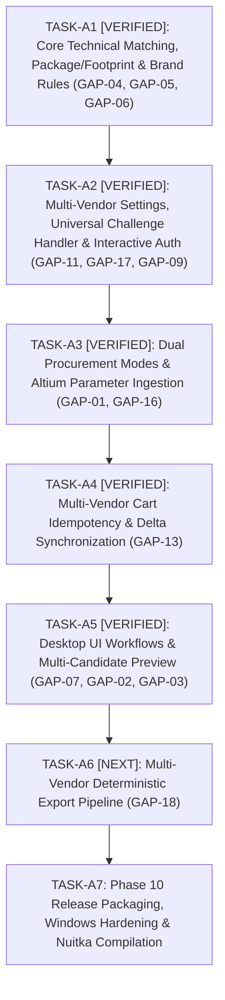

# CANONICAL GAP REGISTRY & VERIFICATION MATRIX
## Omnix — Deterministic Multi-Vendor Electronics Procurement Platform

**Document Reference:** `DOC-OMNIX-REGISTRY-001`  
**Version:** `1.0.0-CANONICAL`  
**Status:** Authoritative Single Source of Truth for Project GAPs  
**Repository:** `D:\management-elec\autom\atom`  
**Branch:** `Auto`  
**Automated Tests:** 258 / 258 PASSED  
**Discovery Graph Audits:** Lion (`10/10`), Javan (`10/10`), RoboEq (`10/10`) — ALL 30/30 PASS  
**Phase 9 Certification Baseline:** `PHASE_9_FINAL_REVIEW_PASS`  
**Task A1 Status:** `COMPLETED_AND_VERIFIED`  
**Task A2 Status:** `COMPLETED_AND_VERIFIED`  
**Task A3 Status:** `COMPLETED_AND_VERIFIED`  
**Audit Date:** September 20, 2026  

---

## 1. EXECUTIVE SUMMARY & GOVERNING PRINCIPLES

This document establishes the **single, definitive Canonical GAP Registry** for the Omnix project. It replaces all prior ad-hoc or drifting numbering schemes and establishes an authoritative, forensically verified baseline across documentation, source code, and automated tests.

### 1.1 Controlled Status Vocabulary
Every requirement and gap in Omnix is classified under one of the following strict lifecycle states:

| Status | Definition |
|---|---|
| **`VERIFIED`** | Code is implemented, tested with unit/contract tests, and validated in test suite. |
| **`IMPLEMENTED`** | Code is fully written and integrated, awaiting full formal certification. |
| **`PARTIAL`** | Subsystem is partially implemented (e.g. Core logic present, UI missing; or Mode A working, Mode B unwritten). |
| **`MISSING`** | Subsystem or feature is completely unwritten in the current codebase. |
| **`DEFERRED`** | Architectural evolution item explicitly deferred to post-release milestones (e.g., gated on Open Decisions). |
| **`OUT_OF_SCOPE`** | Feature or capability explicitly excluded from Omnix boundaries. |

### 1.2 Core Architectural Invariants (Unchanged)
1. **Production Datastore Baseline:** `Inventory.xlsx` is the active, verified production component and inventory datastore. Direct file access is managed via `ExcelDataLoader` and `BOMAuditor`.
2. **Zero Near-Term Database Migration:** `GAP-14` (SQLite ACID repository migration) is explicitly deferred to post-release evolution. No SQLite code or schema migrations are allowed during Tasks A1 through A7.
3. **Open Decision `OD-001` Preserved:** Package taxonomy remains **OPEN**. Conservative string normalization only (case-folding, whitespace, stripping `-` and `_`). Zero assumed broad package family equivalences (e.g., `DIP-8` != `PDIP-8`; `SOIC-8` != `SOP-8`).
4. **Strict Determinism:** 100% deterministic rule-based evaluation. Zero fuzzy guessing, zero LLM/AI runtime decision loops (`OOS-003`).
5. **Human-in-the-Loop Checkout:** Procurement automates up to the verified vendor cart staging. Final financial payment is strictly human-executed (`OOS-002`).

---

## 2. CANONICAL MASTER GAP REGISTRY (18 GAPs)

The table below catalogs the complete set of **exactly 18 canonical GAPs** governing Omnix completion:

| ID | Title | Domain / Layer | Current Code State | Blocking? | Task Target | Dependencies | Status |
|---|---|---|---|:---:|:---:|---|:---:|
| **`GAP-01`** | Dual Procurement Modes (Mode A vs Mode B) | `UI / WORKFLOW` | Mode A (database-aware shortage calculation) and Mode B (100% inventory-independent turnkey BOM sourcing) fully implemented and UI-switchable. | **YES** | `TASK-A3` | `GAP-04`, `GAP-06` | `VERIFIED` |
| **`GAP-02`** | Direct MPN Procurement Quick Order Dialog | `UI` | Standalone QuickOrderDialog tab implemented with brand rules, stepper, vendor filtering, candidate table, and cart delta staging. | No | `TASK-A5` | `GAP-04`, `GAP-07` | `VERIFIED` |
| **`GAP-03`** | Direct URL Procurement Quick Order Dialog | `UI` | Standalone QuickOrderDialog tab implemented with strict PDP regex validation, live inspection, constraint extraction, and cart delta staging. | No | `TASK-A5` | `GAP-13` | `VERIFIED` |
| **`GAP-04`** | Package & Footprint Hard Constraints (`OD-001` OPEN) | `CORE_ENGINE` | Fully implemented in Core models and orchestrator with conservative normalization. | **YES** | `TASK-A1` | None | `VERIFIED` |
| **`GAP-05`** | `UNKNOWN_REQUIRED_PARAMETER` & Spec Engine | `CORE_ENGINE` | Typed `EvaluationState` enum, 4-state spec engine, and dimension validator implemented. | **YES** | `TASK-A1` | None | `VERIFIED` |
| **`GAP-06`** | Manufacturer / Brand Constraint Engine | `CORE_ENGINE` | `ANY` vs explicit approved manufacturer list filtering implemented in Core. | **YES** | `TASK-A1` | `GAP-05` | `VERIFIED` |
| **`GAP-07`** | Multi-Candidate Alternative Selection UI | `UI` | Master-Detail OrderPreviewDialog implemented with factual candidate comparison, radio candidate override, dynamic total recalculation, and staging. | No | `TASK-A5` | `GAP-04`, `GAP-05`, `GAP-06` | `VERIFIED` |
| **`GAP-08`** | Split-Vendor Line Item Sourcing Allocation | `CORE_ENGINE` | Line items allocated to single vendor; split sourcing across multiple vendors deferred. | No | Post-Release | `OD-002` | `DEFERRED` |
| **`GAP-09`** | Interactive Authentication & Headful Fallback | `AUTHENTICATION` | Session promotion with explicit cookie transfer qualification and adapter challenge escalation implemented. | **YES** | `TASK-A2` | `GAP-11`, `GAP-17` | `VERIFIED` |
| **`GAP-10`** | Encrypted Keyring Credential Storage | `SECURITY` | Plaintext JSON in `settings.json`; OS keyring encryption deferred. | No | Post-Release | None | `DEFERRED` |
| **`GAP-13`** | Multi-Vendor Cart Idempotency & Delta Sync | `RUNTIME` | Cart pre-inspection, strict 4-priority identity cascade, A3 quantity reconciliation, and idempotent delta staging implemented. | **YES** | `TASK-A4` | None | `VERIFIED` |
| **`GAP-14`** | Embedded ACID Relational Persistence (SQLite) | `PERSISTENCE` | `Inventory.xlsx` production datastore active; SQLite migration deferred. | No | Post-Release | `OD-003` | `DEFERRED` |
| **`GAP-15`** | Append-Only Persistent Audit Trail Event Log | `AUDIT` | Ephemeral stdout logging; append-only event store deferred. | No | Post-Release | `GAP-14` | `DEFERRED` |
| **`GAP-16`** | Extended Altium Parameter Ingestion Parser | `CAD_INTEGRATION` | Full 20-parameter canonical contract ingestion, strict MPN validation, and technical spec extraction implemented. | No | `TASK-A3` | None | `VERIFIED` |
| **`GAP-17`** | Universal Security Challenge / CAPTCHA Handler | `SECURITY / AUTH` | Unified `IChallengeHandler` subsystem with 8 challenge types, callback handler, and Qt dialog implemented. | **YES** | `TASK-A2` | None | `VERIFIED` |
| **`GAP-18`** | Multi-Vendor Deterministic Export Pipeline | `REPORTING` | Basic Lion shortage export; multi-vendor PDF/CSV/XLSX export pipeline missing. | No | `TASK-A6` | `GAP-01`, `GAP-07` | `PARTIAL` |

---

## 3. RELEASE-BLOCKING GAP CLASSIFICATION

Forensic verification confirms that **EXACTLY 8 GAPS** are strictly classified as **Release-Blocking (`BLOCKS_PRODUCT_COMPLETION`)**:

```
┌──────────────────────────────────────────────────────────────────────────────────────────────────┐
│                                   8 RELEASE-BLOCKING GAPS                                        │
├──────────┬─────────────────────────────────────────────┬──────────────┬──────────────────────────┤
│ GAP ID   │ Title                                       │ Target Task  │ Current Status           │
├──────────┼─────────────────────────────────────────────┼──────────────┼──────────────────────────┤
│ GAP-01   │ Dual Procurement Modes (Mode A vs Mode B)   │ TASK-A3      │ VERIFIED (Mode Verified) │
│ GAP-04   │ Package & Footprint Hard Constraints        │ TASK-A1      │ VERIFIED (Core Verified) │
│ GAP-05   │ UNKNOWN_REQUIRED_PARAMETER & Spec Engine    │ TASK-A1      │ VERIFIED (Core Verified) │
│ GAP-06   │ Manufacturer / Brand Constraint Engine      │ TASK-A1      │ VERIFIED (Core Verified) │
│ GAP-09   │ Interactive Auth & Headful Fallback         │ TASK-A2      │ VERIFIED (Auth Verified) │
│ GAP-11   │ Multi-Vendor Settings & Enable/Disable      │ TASK-A2      │ VERIFIED (Settings Ver.) │
│ GAP-13   │ Multi-Vendor Cart Idempotency & Delta Sync  │ TASK-A4      │ VERIFIED (Sync Verified) │
│ GAP-17   │ Universal Security Challenge Handler        │ TASK-A2      │ VERIFIED (Handler Ver.)  │
└──────────┴─────────────────────────────────────────────┴──────────────┴──────────────────────────┘
```

---

## 4. TASK IMPLEMENTATION & FORENSIC VERIFICATION EVIDENCE

### 4.1 Task A1 Verification Evidence (GAP-04, GAP-05, GAP-06)
- **`GAP-04`**: `normalize_constraint_string()`, independent package/footprint matching ([`core/procurement/models.py`](file:///d:/management-elec/autom/atom/core/procurement/models.py), [`core/procurement/orchestrator.py`](file:///d:/management-elec/autom/atom/core/procurement/orchestrator.py)).
- **`GAP-05`**: `EvaluationState` enum, 4-state spec engine, dimension validator, `UNKNOWN_REQUIRED_PARAMETER` exclusion ([`core/procurement/models.py`](file:///d:/management-elec/autom/atom/core/procurement/models.py), [`core/procurement/orchestrator.py`](file:///d:/management-elec/autom/atom/core/procurement/orchestrator.py)).
- **`GAP-06`**: `ANY` vs approved manufacturer set filtering ([`core/procurement/models.py`](file:///d:/management-elec/autom/atom/core/procurement/models.py), [`core/procurement/orchestrator.py`](file:///d:/management-elec/autom/atom/core/procurement/orchestrator.py)).

### 4.2 Task A2 Verification Evidence (GAP-11, GAP-17, GAP-09)
| GAP ID | Implemented Features | Source Code Location | Forensic Verification |
|---|---|---|---|
| **`GAP-11`** | • `VendorSettings` dataclass with masked `__repr__`<br>• `SettingsManager` multi-vendor storage & legacy synchronization<br>• `VendorRegistry` dynamic filtering (`is_vendor_enabled`)<br>• `UniversalProcurementOrchestrator` bypassed disabled vendors<br>• `SettingsDialog` 4-tab UI with enable toggles & credentials | [`core/models.py:27-58`](file:///d:/management-elec/autom/atom/core/models.py#L27-L58)<br>[`settings_manager.py:30-140`](file:///d:/management-elec/autom/atom/settings_manager.py#L30-L140)<br>[`core/procurement/registry.py:80-120`](file:///d:/management-elec/autom/atom/core/procurement/registry.py#L80-L120)<br>[`core/procurement/orchestrator.py:90-110`](file:///d:/management-elec/autom/atom/core/procurement/orchestrator.py#L90-L110)<br>[`ui/dialogs/settings_dialog.py`](file:///d:/management-elec/autom/atom/ui/dialogs/settings_dialog.py) | Passed 11 dedicated multi-vendor settings tests in [`tests/test_multi_vendor_settings.py`](file:///d:/management-elec/autom/atom/tests/test_multi_vendor_settings.py). |
| **`GAP-17`** | • `ChallengeType` enum (8 types: Turnstile, reCAPTCHA, hCaptcha, Image CAPTCHA, OTP, SMS, Password, Custom)<br>• `ChallengeState` enum (Solved, Cancelled, TimedOut, Unsupported, Failed)<br>• `ChallengeContext` & `ChallengeResult` dataclasses<br>• `IChallengeHandler` interface & `CallbackChallengeHandler`<br>• `UniversalChallengeDialog` & `QtChallengeHandler` | [`core/procurement/challenge_handler.py`](file:///d:/management-elec/autom/atom/core/procurement/challenge_handler.py)<br>[`ui/dialogs/challenge_dialog.py`](file:///d:/management-elec/autom/atom/ui/dialogs/challenge_dialog.py) | Passed 12 dedicated challenge handler tests in [`tests/test_challenge_handler.py`](file:///d:/management-elec/autom/atom/tests/test_challenge_handler.py). |
| **`GAP-09`** | • Headless-to-headful promotion (`promote_to_headful`)<br>• Qualified session continuity (`SessionContinuityMode`)<br>• Cookie capture, headless teardown, headful recreation, cookie re-application<br>• `IVendorAdapter.authenticate(credentials, challenge_handler)` integration across Lion, Javan, and RoboEq | [`vendors/lion/session.py:100-145`](file:///d:/management-elec/autom/atom/vendors/lion/session.py#L100-L145)<br>[`vendors/javan/session.py:100-145`](file:///d:/management-elec/autom/atom/vendors/javan/session.py#L100-L145)<br>[`vendors/roboeq/session.py:100-145`](file:///d:/management-elec/autom/atom/vendors/roboeq/session.py#L100-L145)<br>[`vendors/lion/adapter.py:540-630`](file:///d:/management-elec/autom/atom/vendors/lion/adapter.py#L540-L630)<br>[`vendors/javan/adapter.py:570-710`](file:///d:/management-elec/autom/atom/vendors/javan/adapter.py#L570-L710)<br>[`vendors/roboeq/adapter.py:440-520`](file:///d:/management-elec/autom/atom/vendors/roboeq/adapter.py#L440-L520) | Passed 10 dedicated interactive auth and session promotion tests in [`tests/test_interactive_authentication.py`](file:///d:/management-elec/autom/atom/tests/test_interactive_authentication.py). |

### 4.3 Task A3 Verification Evidence (GAP-01, GAP-16)
| GAP ID | Implemented Features | Source Code Location | Forensic Verification |
|---|---|---|---|
| **`GAP-01`** | • `ProcurementMode` enum (`DATABASE_AWARE` vs `DIRECT_BOM`)<br>• Mode A: stock subtraction $\Delta Q = \max(0, (\text{unit\_qty} \times M) - \text{db\_stock\_qty})$ using authoritative store link<br>• Mode B: 100% inventory-independent turnkey sourcing ($Q = \text{unit\_qty} \times M$, DB ignored)<br>• Mode-explicit branching in `ProcurementBridge.item_to_request`<br>• Interactive Mode A/B switcher ribbon in `BOMAuditWidget` | [`core/procurement/models.py:32-39`](file:///d:/management-elec/autom/atom/core/procurement/models.py#L32-L39)<br>[`bom_auditor.py:10-380`](file:///d:/management-elec/autom/atom/bom_auditor.py#L10-L380)<br>[`core/procurement/bridge.py:100-190`](file:///d:/management-elec/autom/atom/core/procurement/bridge.py#L100-L190)<br>[`ui/widgets/bom_audit_widget.py`](file:///d:/management-elec/autom/atom/ui/widgets/bom_audit_widget.py) | Passed 4 dedicated dual procurement mode tests in [`tests/test_dual_procurement_modes.py`](file:///d:/management-elec/autom/atom/tests/test_dual_procurement_modes.py). |
| **`GAP-16`** | • Full 20-parameter Altium contract parser conforming to `DOC-OMNIX-ALTIUM-CONTRACT-001`<br>• Strict MPN validation (missing/blank MPN $\to$ `INVALID_REQUIRED_PARAMETER` / non-orderable; never falls back to `Comment`)<br>• Strict quantity validation (rejection of zero, negative, non-integer, and malformed strings)<br>• Separate `ManufacturerRule` (`EXACT`, `APPROVED_LIST`, `ANY`) and `ManufacturerDataState`<br>• Technical specs bundling (`Value`, `Tolerance`, `Voltage_Rating`, `Current_Rating`, `Power_Rating`) | [`bom_auditor.py:10-380`](file:///d:/management-elec/autom/atom/bom_auditor.py#L10-L380)<br>[`core/procurement/models.py:41-60`](file:///d:/management-elec/autom/atom/core/procurement/models.py#L41-L60) | Passed 4 dedicated Altium contract tests in [`tests/test_altium_contract_ingestion.py`](file:///d:/management-elec/autom/atom/tests/test_altium_contract_ingestion.py) and 7 brand selection tests in [`tests/test_bom_brand_selection.py`](file:///d:/management-elec/autom/atom/tests/test_bom_brand_selection.py). |

### 4.4 Task A4 Verification Evidence (GAP-13)
| GAP ID | Implemented Features | Source Code Location | Forensic Verification |
|---|---|---|---|
| **`GAP-13`** | • Strict 4-priority Cart Item Identity cascade (`EXACT_VENDOR_SKU` $\to$ `CANONICAL_PDP_URL` $\to$ `MPN_AND_MANUFACTURER` $\to$ `MPN_ONLY_FALLBACK`)<br>• Differing valid manufacturers strictly rejected (`NO_MATCH`)<br>• Product Name never used as definitive identity key<br>• Multi-line same-candidate cart quantity aggregation ($Q_{\text{existing}} = \sum \text{qty}$)<br>• Authoritative A3 quantity reconciliation without secondary step rounding<br>• Mathematical delta synchronization: $\Delta Q = \max(0, Q_{\text{target\_orderable}} - Q_{\text{existing}})$<br>• Deterministic idempotent No-Op when $Q_{\text{existing}} \ge Q_{\text{target\_orderable}}$<br>• Multi-vendor session & failure isolation (Vendor A error does not abort Vendor B/C)<br>• Disabled vendor upfront bypass before network activity<br>• Deterministic `MAX_QUANTITY_EXCEEDED` constraint handling<br>• Complete DOM cart extraction in `RoboEqVendorAdapter` | [`core/models.py`](file:///d:/management-elec/autom/atom/core/models.py)<br>[`core/procurement/models.py`](file:///d:/management-elec/autom/atom/core/procurement/models.py)<br>[`core/procurement/orchestrator.py`](file:///d:/management-elec/autom/atom/core/procurement/orchestrator.py)<br>[`core/procurement/bridge.py`](file:///d:/management-elec/autom/atom/core/procurement/bridge.py)<br>[`vendors/roboeq/adapter.py`](file:///d:/management-elec/autom/atom/vendors/roboeq/adapter.py) | Passed 24 dedicated unit/integration tests in [`tests/test_cart_sync.py`](file:///d:/management-elec/autom/atom/tests/test_cart_sync.py). |

### 4.5 Task A5 Verification Evidence (GAP-07, GAP-02, GAP-03)
| GAP ID | Implemented Features | Source Code Location | Forensic Verification |
|---|---|---|---|
| **`GAP-07`** | • Master-Detail `OrderPreviewDialog` architecture with line-item master and candidate-detail tables<br>• Factual raw candidate offer rendering (Vendor, SKU, MPN, Brand, Package, Stock, MOQ, Step, Unit Price, Total Cost, Status)<br>• Explicit user candidate selection override via radio toggle without hidden/winner scoring<br>• Ineligible candidate non-selectability with explicit rejection reason tooltips<br>• Dynamic total estimated order cost and effective quantity recalculation upon candidate override<br>• Staging execution strictly targeting selected candidate evaluations via `stage_candidate(sync_cart=True)` | [`ui/dialogs/order_preview_dialog.py`](file:///d:/management-elec/autom/atom/ui/dialogs/order_preview_dialog.py) | Passed 11 dedicated candidate comparison & selection tests in [`tests/test_desktop_workflows.py`](file:///d:/management-elec/autom/atom/tests/test_desktop_workflows.py). |
| **`GAP-02`** | • Standalone Direct MPN Sourcing tab in `QuickOrderDialog`<br>• Dedicated input parameters: MPN (mandatory string), Quantity stepper (`NumberStepperWidget`), Brand Rule (`ANY`, `EXACT`, `APPROVED_LIST`), Package/Footprint, Target Vendor combo<br>• Strict MPN validation (empty MPN prohibited; zero Comment fallback)<br>• Background `MPNSearchWorker` calling `orchestrator.gather_candidates` & `evaluate_candidate`<br>• Factual candidate table with radio candidate selection & MOQ/Step effective quantity calculation<br>• Cart staging integration invoking `orchestrator.stage_candidate(sync_cart=True)` | [`ui/dialogs/quick_order_dialog.py:292-486`](file:///d:/management-elec/autom/atom/ui/dialogs/quick_order_dialog.py#L292-L486) | Passed 12 dedicated Direct MPN sourcing tests in [`tests/test_desktop_workflows.py`](file:///d:/management-elec/autom/atom/tests/test_desktop_workflows.py). |
| **`GAP-03`** | • Standalone Direct Product URL tab in `QuickOrderDialog`<br>• Strict `validate_vendor_pdp_url` validating vendor domain AND canonical PDP regex patterns across Lion, Javan, and RoboEq (non-PDP URLs rejected)<br>• Background `URLInspectWorker` executing adapter product inspection, stock querying, and constraint resolution<br>• Factually rendered inspection details table with raw technical specs, stock, MOQ, packaging step, and total cost<br>• Cart staging integration with GAP-13 delta synchronization via `orchestrator.stage_candidate(sync_cart=True)` | [`ui/dialogs/quick_order_dialog.py:50-86`](file:///d:/management-elec/autom/atom/ui/dialogs/quick_order_dialog.py#L50-L86)<br>[`ui/dialogs/quick_order_dialog.py:488-602`](file:///d:/management-elec/autom/atom/ui/dialogs/quick_order_dialog.py#L488-L602) | Passed 11 dedicated Direct URL sourcing tests in [`tests/test_desktop_workflows.py`](file:///d:/management-elec/autom/atom/tests/test_desktop_workflows.py). |

---

## 5. RECONCILED IMPLEMENTATION ROADMAP (TASKS A1 THROUGH A7)



### Task Definitions & Target Scopes:

#### TASK-A1: Core Technical Matching, Package/Footprint Constraints & Brand Rules
- **Target GAPs:** `GAP-04`, `GAP-05`, `GAP-06`
- **Status:** `COMPLETED_AND_VERIFIED` (208 tests passing baseline).

#### TASK-A2: Multi-Vendor Settings, Universal Challenge Handler & Interactive Auth
- **Target GAPs:** `GAP-11`, `GAP-17`, `GAP-09`
- **Status:** `COMPLETED_AND_VERIFIED` (241 tests passing total).

#### TASK-A3: Dual Procurement Modes & Altium Parameter Ingestion
- **Target GAPs:** `GAP-01`, `GAP-16`
- **Status:** `COMPLETED_AND_VERIFIED` (258 tests passing total).

#### TASK-A4: Multi-Vendor Cart Idempotency & Delta Synchronization
- **Target GAPs:** `GAP-13`
- **Status:** `COMPLETED_AND_VERIFIED` (282 tests passing total).

#### TASK-A5: Desktop UI Workflows & Multi-Candidate Preview
- **Target GAPs:** `GAP-07`, `GAP-02`, `GAP-03`
- **Status:** `COMPLETED_AND_VERIFIED` (316 tests passing total, +34 new tests).
- **Scope Accomplished:** Master-Detail `OrderPreviewDialog` with multi-candidate offers, factual parameter comparison, radio candidate override, dynamic total recalculation, and `QuickOrderDialog` with standalone Direct MPN (GAP-02) and Direct URL (GAP-03) sourcing workflows.

#### TASK-A6: Multi-Vendor Deterministic Export Pipeline
- **Target GAPs:** `GAP-18`
- **Status:** `NEXT_TASK_FOR_EXECUTION`
- **Scope:**
  1. Implement multi-vendor procurement report generation in PDF, CSV, and Excel formats.
  2. Include complete decision audit trail, pricing breakdown, and unverified parameter warnings.

#### TASK-A7: Phase 10 Release Packaging & Nuitka Hardening
- **Target Scope:** End-to-end live multi-vendor validation on Windows host, application-level packaging, and production Nuitka binary compilation.

---

## 6. OPEN ARCHITECTURAL DECISIONS & OUT-OF-SCOPE BOUNDARIES

### 6.1 Open Architectural Decisions
- **`OD-001` (Package Taxonomy Standardization):** Standardizing package strings (`SOIC-8` vs `SOP-8`) vs IPC-7351B standards. Preserved **OPEN**. Conservative string normalization only.
- **`OD-002` (Multi-Vendor Split-Sourcing Allocation Metric):** Optimization function for dividing line items across vendors (cost vs shipments vs delivery). Preserved **OPEN**; `GAP-08` deferred.
- **`OD-003` (Safety Stock & Datastore Migration Strategy):** Formulas for safety stock in Mode A and SQLite migration architecture. Preserved **OPEN**; `GAP-14` deferred.

### 6.2 Out-of-Scope Boundaries
- **`OOS-001` (External Altium CAD Library DB Creation):** External Altium library construction (symbols, footprints, 3D models) is **OUT OF SCOPE**. Ingestion of the parameter contract (`GAP-16`) is **IN SCOPE**.
- **`OOS-002` (Automated Payment & Final Financial Checkout):** Payment gateway completion (CVV2, OTP, Shetab) is strictly retained as a human manual step.
- **`OOS-003` (Autonomous AI/LLM Purchasing Agents):** Non-deterministic generative loops are prohibited in production runtime. Omnix is 100% deterministic rule-based.

---

## 7. CANONICAL AUDIT SUMMARY

```
================================================================================
CANONICAL GAP REGISTRY AUDIT SUMMARY
================================================================================
Document Reference:      DOC-OMNIX-REGISTRY-001
Version:                 1.0.0-CANONICAL
Repository:              D:\management-elec\autom\atom
Branch:                  Auto
Automated Test Suite:    316 / 316 PASSED
Site Map Graph Audits:   Lion (10/10), Javan (10/10), RoboEq (10/10) — 30/30 PASS
Total Registered GAPs:   18 GAPs (GAP-01 through GAP-18)
Release-Blocking GAPs:   8 GAPs (GAP-01, GAP-04, GAP-05, GAP-06, GAP-09, GAP-11, GAP-13, GAP-17 — ALL 8 VERIFIED)
Verified GAPs:           12 GAPs (GAP-01, GAP-02, GAP-03, GAP-04, GAP-05, GAP-06, GAP-07, GAP-09, GAP-11, GAP-13, GAP-16, GAP-17)
Next Task for Execution: TASK-A6 (GAP-18 — Multi-Vendor Deterministic Export Pipeline)
Datastore Baseline:      Inventory.xlsx (Production Datastore Preserved)
SQLite Status:           DEFERRED (GAP-14 gated on OD-003)
================================================================================
```


